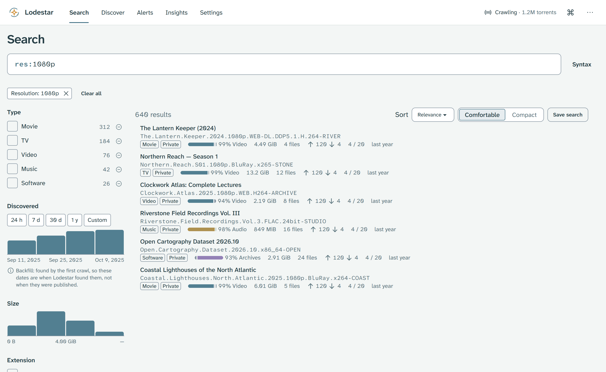
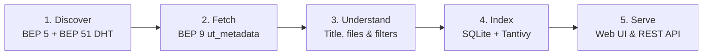
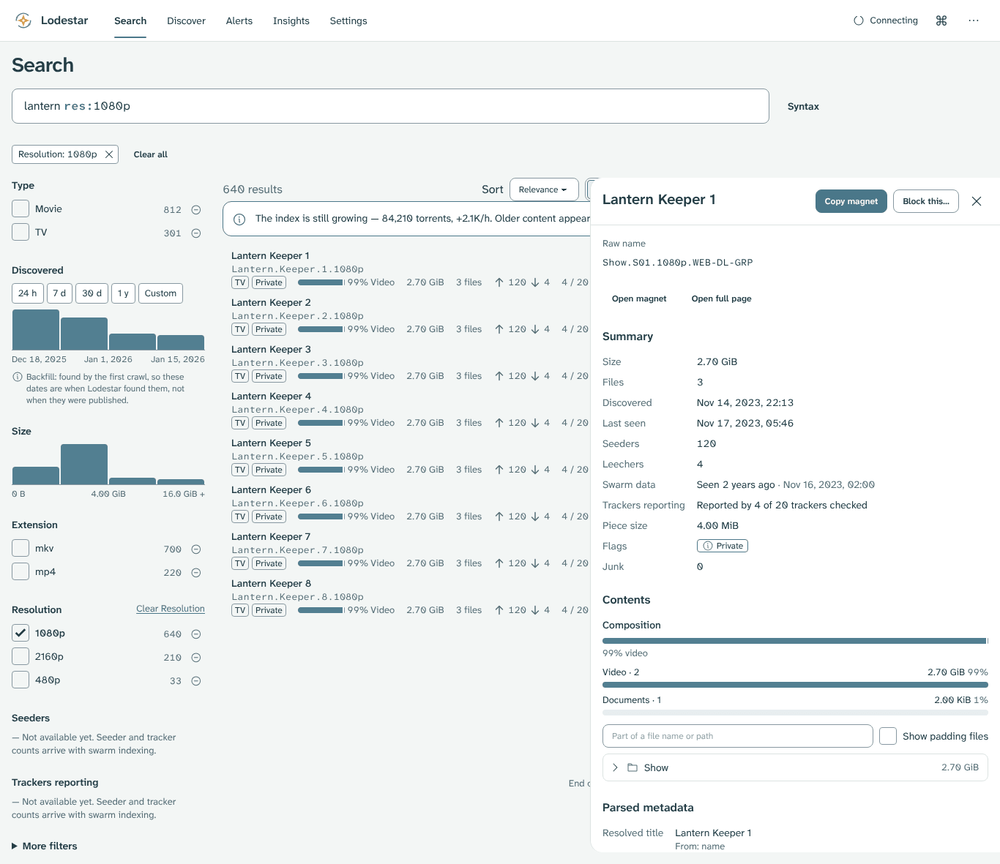
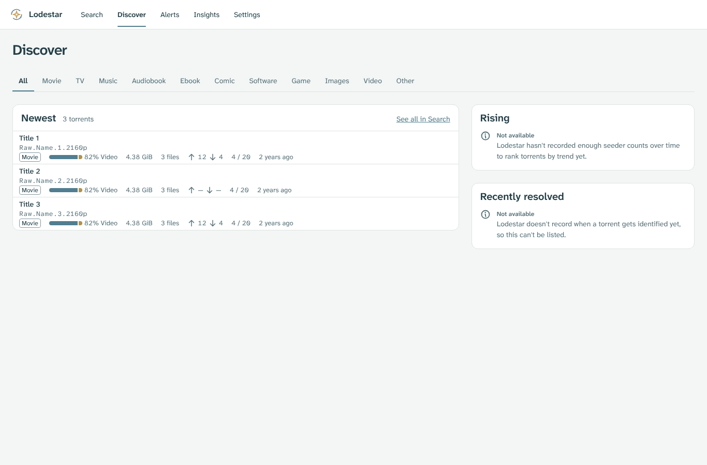
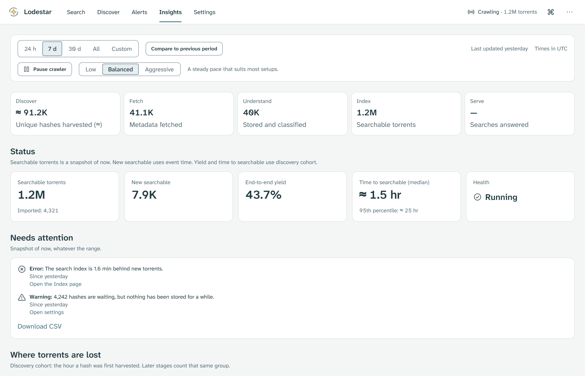

<p align="center">
  <picture>
    <source media="(prefers-color-scheme: dark)" srcset="brand/source/logos/horizontal_dark_transparent.png">
    <source media="(prefers-color-scheme: light)" srcset="brand/source/logos/horizontal_light_transparent.png">
    
  </picture>
</p>

# Lodestar

*Every node is a new discovery.*

Lodestar is a from-scratch BitTorrent DHT crawler and torrent-metadata search engine. It ships as one Rust binary with an embedded Svelte web UI and runs on Unraid, Docker, Windows and Linux.

<picture>
  <source media="(prefers-color-scheme: dark)" srcset="docs/user/images/search-dark.png">
  <source media="(prefers-color-scheme: light)" srcset="docs/user/images/search-light.png">
  </picture>
*Figure 1: Search filtered by resolution with facet histograms on the left and file composition bars on each row.*

## Where to find each task

| If you want to | Go to |
|---|---|
| Learn what Lodestar does and never does | [Chapter 1: Before you start](docs/user/01-before-you-start.md) |
| Install on Unraid from the container template | [Chapter 2: Install on Unraid and Docker](docs/user/02-install-lodestar-on-unraid-and-docker.md#21-install-with-the-unraid-template) |
| Install with Docker Compose | [Chapter 2: Install with Docker Compose](docs/user/02-install-lodestar-on-unraid-and-docker.md#24-install-with-docker-compose) |
| Claim a fresh instance with the setup token | [Chapter 2: Create the admin password](docs/user/02-install-lodestar-on-unraid-and-docker.md#25-create-the-admin-password) |
| Keep the web UI private and run behind a VPN | [Chapter 3: Keep Lodestar safe](docs/user/03-keep-lodestar-safe.md) |
| Back up and restore the `/data` folder | [Chapter 3: Back up and restore](docs/user/03-keep-lodestar-safe.md#37-back-up-and-restore) |
| Install on Windows or Linux | [Chapter 4: Install on Windows and Linux](docs/user/04-install-on-windows-and-linux.md) |
| Search, inspect torrents and check crawler health | [Chapter 5: Use Lodestar](docs/user/05-use-lodestar.md) |
| Fix a startup or permission problem | [Chapter 6: Troubleshooting](docs/user/06-troubleshooting.md) |
| Look up search operators and filters | [Query language reference](docs/query-language.md) |

**Reading paths.** First-time installers start at the [Lodestar setup guide](docs/user/README.md) and read Chapters 1 to 3 in order. Returning readers use the table above to jump to a task, backup step or reference page.

## What Lodestar does and never does

Lodestar listens to the public BitTorrent DHT and fetches each torrent's small description (info-dictionary metadata). It parses release titles and file trees, then indexes them locally in Tantivy and SQLite.

- **Metadata only.** Lodestar never downloads or shares torrent content. It disconnects from each peer as soon as the description arrives.
- **Local and private.** Your searches, saved alerts and settings stay in your `/data` folder. Lodestar sends no telemetry.
- **Safe defaults.** First run prints a one-time setup token to the container log so you can set an admin password. A built-in child-safety filter stays on at all times.

## How it works

Five stages move each torrent from peer discovery to your browser:



In order: **Discover** walks the DHT for infohashes and **Fetch** pulls the metadata dictionary over BEP 9. **Understand** classifies titles and file trees, **Index** commits rows to SQLite and Tantivy, and **Serve** answers searches over the web UI and REST API. Torznab is planned.

## Interface tour

### Inspect file trees and magnet links

Select any search result to open its detail drawer beside the list. The drawer shows swarm counts, piece size, flags and the folder tree inside the torrent.

<picture>
  <source media="(prefers-color-scheme: dark)" srcset="docs/user/images/detail-dark.png">
  <source media="(prefers-color-scheme: light)" srcset="docs/user/images/detail-light.png">
  </picture>
*Figure 2: The torrent detail drawer showing summary metadata, magnet actions and the file tree.*

### Browse new arrivals on Discover

**Discover** groups recently indexed torrents by category so you can scan new movies, TV, music, software, books or games without typing a query.

<picture>
  <source media="(prefers-color-scheme: dark)" srcset="docs/user/images/discover-dark.png">
  <source media="(prefers-color-scheme: light)" srcset="docs/user/images/discover-light.png">
  </picture>
*Figure 3: The Discover screen showing newest indexed torrents across category tabs.*

### Monitor the crawler on Insights

**Insights** reports the live state of all five pipeline stages, searchable torrent counts, disk usage and any stage that needs attention.

<picture>
  <source media="(prefers-color-scheme: dark)" srcset="docs/user/images/insights-dark.png">
  <source media="(prefers-color-scheme: light)" srcset="docs/user/images/insights-light.png">
  </picture>
*Figure 4: The Insights overview showing stage health cards, searchable totals and attention items.*

## Quick start

> [!IMPORTANT]
> Put `/data` on a local SSD or NVMe drive (on Unraid, use `/mnt/cache/appdata/lodestar`, not `/mnt/user/...`). Keep port `8090` on your home network and reach it from outside through a VPN such as WireGuard or Tailscale.

### Docker Compose

Run these commands in a terminal on your Docker host to start Lodestar with a named volume:

```bash
mkdir lodestar && cd lodestar
curl -fsSLO https://raw.githubusercontent.com/dvortsis/lodestar-v2/main/docker-compose.yml
docker compose up -d
```

Then run this command in the same terminal to read the one-time setup token, and open `http://<server-ip>:8090`:

```bash
docker compose logs lodestar
```

See [Chapter 2](docs/user/02-install-lodestar-on-unraid-and-docker.md) for the Unraid template, bind-mount permissions (`PUID` and `PGID`) and first-run setup.

## Reference and architecture

- **User setup and safety guide:** [`docs/user/README.md`](docs/user/README.md)
- **Search query syntax:** [`docs/query-language.md`](docs/query-language.md)
- **Operations and environment variables:** [`docs/operations.md`](docs/operations.md)
- **System architecture:** [`docs/architecture.md`](docs/architecture.md)
- **Release notes:** [`docs/releases/`](docs/releases/). The first release will be v0.5.1.
- **Brand assets and checksums:** [`brand/source/`](brand/source/) (`SHA256SUMS.txt`)

## Licence

Lodestar is free software. It is licensed under the [GNU Affero General Public License, version 3 or later](LICENSE) (`AGPL-3.0-or-later`).

If you run a modified version for others over a network, the AGPL asks you to offer them your version's source. The app's About screen links to the source of the version it runs.

The name, logo, mascot and other brand artwork are **not** covered by the AGPL. See [`brand/LICENSE.md`](brand/LICENSE.md).
