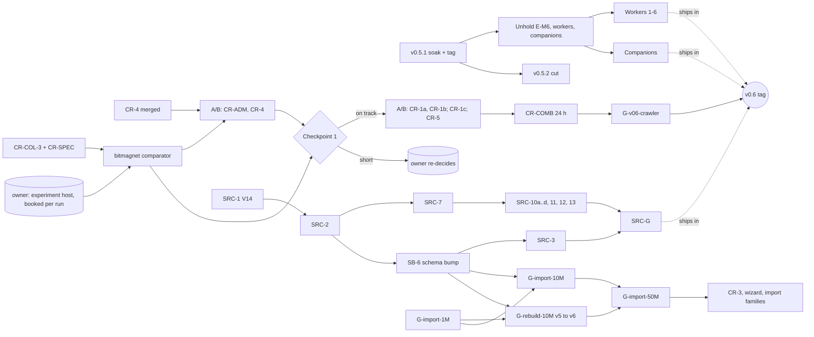

# Lodestar v2 build plan: v0.5.1 → 1.0, with helper-agent orchestration

> First written 2026-10-22, after M3. It plans the order of work and who does it: the main session or a helper agent, per the delegation policy in `CLAUDE.md`.
> **§0 (2026-11-02, r3) is the current plan.** It replaces the 2026-10-30 §0, whose lanes are done. It rests on the owner's answers in `docs/owner-decisions.md` §2.25–§2.33 and on the runner's choices in `docs/decisions/2026-10-30-master-plan.md`, `docs/decisions/2026-11-02-master-plan-r2.md` and `docs/decisions/2026-11-02-master-plan-r3.md` (an external review's findings).
> **Picking this up from another session or agent?** Start at [`docs/handoff.md`](handoff.md).

## 0. Status and plan from 2026-11-02

### 0.1 Where things stand
Status as of `main` at `0c1931ae` (2026-11-02 03:22Z; CR-4 merged at `bcb9d4fa`). Live per-slice state is on the `runner-state` branch (`state.json`); reconcile it against `main`'s merges before acting on it ([handoff §2](handoff.md#2-where-the-truth-lives)).

| Area | Done | In flight | Next |
|---|---|---|---|
| **M0–M5** | All merged. G-v05 passed 10-24. **G-m5 passed 11-01** (#352): analytics-validation matrix, reporting overhead 0.08–0.09 % of a 1 % gate, design review with all 7 blocking findings fixed (#340 and FX-1..4; important and polish in FX-5..6) | — | Backlog only (Track B) |
| **v0.5.1 release** | Release branch `release/v0.5.1` cut at `c3f6341a`. rc.1 rejected by the owner. **rc.2 = `6be95525`**, artifacts signed and verified. Delta mapped (CR-0f the only class-A change). Windows MSI service mode 7 h 10 m **PASS** (17.0 stored/min), portable **PASS**, MSI options **PASS** | **Soak r4 on rc.3 failed the memory gate**: 29.35 MiB/h, 95 % CI [28.75, 29.96], growth in C-allocator mappings outside mimalloc's arena (`docs/decisions/2026-11-05-soak-r4-verdict.md`). **rc.4** (§2.40) = the memory fixes (R-rc4-cut, with the runner-added redaction fix) + the release-branch Legal Notice (LEGAL-1r); X-mimalloc-override is #448. Soak r3 on rc.2 **failed the memory gate**: 1.88 MiB/h, 95 % CI [1.43, 2.33] (`docs/decisions/2026-11-03-soak-r3-verdict.md`). #357 is on `release/v0.5.1` as #377 (`0acc5a37`) | **Soak r5 on rc.4 passed**: 0.91 MiB/h, 95 % CI [0.47, 1.35] (`docs/decisions/2026-11-06-soak-r5-verdict.md`). Next: the gluetun leg (running from about 2026-11-06T15:00Z) and a short Windows smoke on rc.4; the owner tags `v0.5.1` (§0.4) |
| **Crawler** | CR-0 accepted (24 h final: **740.6 stored/h ≈ 12.3/min**). Merged, each behind its own switch, all **off by default**: CR-SIM, CR-gate-metrics, CR-ADM (`dht.coordinated_admission`), CR-1a-H (`dht.responder_hints`), CR-1a-S (`dht.streaming_peers`), CR-1b (`dht.target_prefixes`), CR-0d (`dht.safe_restart`), CR-0f, CR-COL, **CR-4** (#365: uTP in the fetch path and IPv6 route backoff, `dht.utp` and `dht.route_backoff`) | — | CR-COL-3 and CR-SPEC, then live A/B runs (none run yet), CR-1c, CR-5 (§0.5) |
| **Imports** | IMP-0..5 merged: PostgreSQL restore runbook, V13 job tables, Magnetico and Bitmagnet adapters, merge/dedupe CLI, imported cohorts kept out of crawl-yield Insights, refile, server-side import part 1 | — | Pilots on real data (§0.6); none run. Only a synthetic figure exists: 100k at ~13,900/s |
| **v0.6 Sources** | Plan sliced into 25 SRC-* slices (#356). SRC-0 (#360), SRC-6 (#363), SRC-8 (#366), SRC-16 (#361) merged | — | SRC-4, SRC-5, SRC-9 now; SRC-1 (V14) now that migrations may land on `main` (owner-decisions §2.28); SRC-7 after SRC-2, SRC-4 and SRC-5 |
| **Blocklist subscriptions** | B-subscriptions-api (#362) merged | S-blocklists (Sonnet) | — |
| **Filters** | F-auth, F-filters (+packs, neutral-perf, xcpu), F-metainfo, F-updater, F-status, F-filter-load-fail-closed (#357), F-filter-standin-undo (#367, 785b282c, not in rc.3) | Adult stand-in holds stay held (owner-decisions §2.28) | — |
| **Update engine** | B-update-1..6 (signed manifest, install, rollback, fail-closed checks). Ships **disabled** in v0.5.1 | — | Owner: nightly signing key |
| **Remote workers** | `crates/cluster` library: cluster CA, mTLS 1.3, join tokens, postcard-over-WebSocket protocol, leases and fencing (~104 tests) | — | Epic **held** until the soak verdict. **Nothing wires it**: there is no `lodestar worker` command, though `packaging/unraid/lodestar-worker.xml` calls one |
| **Companions** | — | — | Epic held until the soak verdict. No code |
| **M6 packaging** | CLI (`backup`, `rollback`, `vacuum`, `reindex`, `stats`, `import`, …), Windows service and port handling, WiX MSI and portable zip, Unraid templates (main, gluetun, worker), systemd unit, Linux tarball, Docker multi-arch, smoke jobs, user guide in `docs/user/` | — | Epic held until the soak verdict; expansion starts with a gap audit (§0.2 Track M6) |
| **M7** | Pulled forward and merged: download clients (qBittorrent, Transmission, Deluge, rTorrent, aria2), notifiers (webhook, ntfy, Discord, email, RSS), secret storage and SSRF guard, Send UI, uTP library | — | Epic ready to expand (deps met) |

**Code facts** (they replace the 2026-10-22 "what the code shows" list, which is gone): the store is at **V13**; search is at `SCHEMA_VERSION` **5** with a working blue/green rebuild (`crates/search/src/rebuild.rs`); `crates/utp` is a real BEP 29 library that CR-4 is wiring in; the only production source plugin is `DhtSource` (`crates/pipeline/src/dht.rs`); there is no Torznab server (only an outbound connection test in `crates/integrations/src/torznab.rs`); scheduled CI runs live in `ci.yml` and `e2e.yml`, so there is no `nightly.yml`. Rust has 4 TODOs and no `todo!()`.

**All findings the 2026-10-30 plan listed as open are fixed** (A1-1..4, A2-1, A3-1..3, DUR-26), except S04 (uTP), which CR-4 addresses, and S03 (admission), which CR-ADM addresses behind its switch.

### 0.2 Order of work and tracks
**Concurrency:** at most **four slices at a time in total** from 2026-11-06T00:00Z: Opus, helper and docs slices alike (owner, §2.42, replacing §2.36's twelve and §2.43's interim eight). Slices running at the cut finish normally, including those launched in the owner's no-limit window (§2.45), and nothing new launches until fewer than four are running. Filling every slot isn't required: a slot stays empty when no ready work fits, when a slice's `owns` would overlap a running one, or when starting it doesn't make sense for the roadmap. The `runner/slices.yaml` limits (16 Opus + 16 helpers, §2.15) are the ceiling once the owner lifts that. The cap is in `runner/slices.yaml` as `limits.phase_total` so the launch procedure enforces it (`runner/README.md` step 7). **The ladder decides between ready slices;** a slice being ready in the graph doesn't jump the ladder.

**The ladder** (fill free slots in this order; the owner can reorder it in one line):
1. **Close v0.5.1** (Track R): rc.4 (§2.40: the memory fixes and the release-branch Legal Notice), soak r5 (**passed**, 2026-11-06), the gluetun leg, the Windows smoke, rc.5 (text-only Legal Notice v3, #540), the legal-documents check (§2.48), the tag on rc.5.
2. **The crawler's live evidence** (Track C): CR-SPEC, then CR-COL-3 (no host needed, so they start now), then the comparator and the A/B runs on the owner's experiment host, up to Checkpoint 1.
3. **The Sources critical path** (Track S): SRC-1 → SRC-2 → SRC-7 (Q2/Q15 answered by §2.28).
4. **Unhold the epics** once the soak verdict is in: build E-M6, E-v06-workers and E-v06-companions from their plans (the planning wave below expands them now).
5. **Expand E-M7**, starting with the schema-bump convergence slice SB-6.
6. **Import pilots** (Track I), on the owner's import host, never alongside an A/B run.
7. **Backlog and polish** (Track B).

Each track below lists its steps in order. "Owner" marks a step only the owner can take; `ext:` names match the `external` section of `runner/slices.yaml`.

**Track R: release**

| Step | Who | Waits on | Exit |
|---|---|---|---|
| R1 Unraid soak r3 verdict: **FAIL (memory)**, 1.88 MiB/h, 95 % CI [1.43, 2.33] over hours 12–24, so the upper bound misses the ≤ 2 bar. Coverage, shutdown and evidence were clean (`docs/decisions/2026-11-03-soak-r3-verdict.md`) | runner (analysis), owner (evidence hand-back) | the baseline end, 11-02 22:16Z | `analyze` report: no stall, no interruption, ≥ 24 h covered, memory slope upper 95 % CI ≤ 2 MiB/h on `anon` private memory over hours 12–24, peak reported |
| R1-fix Memory fix **X-mmap-cache-prune**: M1-exp (prune versus default) first, then prune tantivy's mmap cache after each commit. M2 (commit cadence) only if M1-exp leaves growth | R-mem-triage session (existing) | R1 | M1-exp passes, then a fresh Opus review, green CI and merged to `main` |
| R2 gluetun leg (≥ 2 h measured, part of the v0.5.1 gate) | owner runs it on rc.4 after R1″; runner analyses | R1″ | collector run with `--leg gluetun --require-gluetun` |
| R3 **rc.3 = rc.2 + #357 + #402 + the memory fix**, owner's decision 2026-11-03 (§2.31, replacing §2.29's rc.3 = rc.2 + #357). #357 (F-filter-load-fail-closed) is on `release/v0.5.1` as #377 (merged `0acc5a37`). Cherry-pick checks and delta mapping as in §2.29: filter load, stand-ins, the §20.8 budget. #402 requires a re-soak, so r3's evidence no longer covers rc.3 and R1′ runs a fresh one. None of #357, #402 or the fix touches `crates/store`, so r1's upgrade evidence still counts under §2.28 (the fix must keep it so) | runner; owner tags rc.3 | R1-fix | rc.3 artifacts signed and hashed; delta report |
| R3′ **R-rc3-cut**: #402 and the memory fix onto `release/v0.5.1` after #377 (merged `0acc5a37`) | R-rc3-backport session (existing) | R1-fix | release PR green, fresh Opus review, merged; the owner tags `v0.5.1-rc.3` |
| R1′ Soak r4 on rc.3 | owner | R3′ | **FAIL** (memory): 29.35 MiB/h, CI [28.75, 29.96] (`docs/decisions/2026-11-05-soak-r4-verdict.md`) |
| R3″ **R-rc4-cut**: X-thp-off (#434), X-mem-gauges (#433, #442) and X-mimalloc-override (#448), plus the runner's addition X-log-url-redact (#432), onto `release/v0.5.1`; and **LEGAL-1r**, the Legal Notice at setup and login on the release branch (owner §2.40) | R-rc4-cut and LEGAL-1r sessions | #448 merged | both release PRs green, fresh Opus reviews, merged; the owner tags `v0.5.1-rc.4` |
| R1″ Soak r5 on rc.4: Linux main leg, frozen image, 6 h suppression + 30 min warm-up + 24 h baseline; Appdata Backup disabled (owner §2.40) | owner | R3″ | `analyze` report with gate evidence yes and memory slope upper 95 % CI ≤ 2 MiB/h over hours 12–24. **PASS** 2026-11-06: 0.91 MiB/h, CI [0.47, 1.35] |
| R-win Short Windows MSI service smoke on rc.4 (≥ 1 h: start, stop, clean restart, non-zero stored rate, and the Legal Notice at setup). The memory fixes are Linux-only or platform-independent, so a full re-soak isn't needed | owner | R3″ | pass |
| R3‴ **rc.5 = rc.4 + Legal Notice v3, text only** (#540, slice R-rc5-notice; the owner chose it directly, §2.48). `release/v0.5.1` is at `a0eb0a9087c2474ef4285416403eacbf8a475111` | R-rc5-notice session | R3″ | release PR green, fresh Opus review, merged; the owner tags `v0.5.1-rc.5` |
| R-legal **Legal documents (§2.48):** before any version is tagged, check `docs/legal/legal-notice.md` and `docs/legal/operator-guidance.md` against that build, keep both on one release baseline with the notice's "applies to" line, decide `NOTICE_VERSION` by X-legal-docs' substance test, and record the check in the release decisions file | runner | the release candidate to be tagged | check recorded in the release decisions file |
| R3b Tag `v0.5.1` from rc.5 (`a0eb0a9087c2474ef4285416403eacbf8a475111`, #540), approve the release environment, publish | **owner** | R1″, R2, R-win, R3‴, R-legal | GitHub release published; `:latest` moves |
| R4 Bring `docs/releases/v0.5.1.md` to `main`, mark `docs/releases/v0.5.0.md` as never released, update the README's release status | docs slice | R3b | — |
| R5 **v0.5.2 cut from `main`** (recommended, §0.4) | runner | R3b | G-v052 |
| On failure at R1/R2 | fix PR on `main`, cherry-picked to `release/v0.5.1`, the next rc, a fresh frozen soak. Runs are never stitched | — | — |

**The stand-in gap in rc.3 and rc.4.** rc.3 is rc.2 + #357 + #402 + the memory fix (§2.31), with nothing else from `main`; rc.4 adds only the §2.40 changes, not #367. #357 alone holds what an unreadable rule's stand-in matches, and nothing in rc.3 undoes those holds: F-filter-standin-undo (#367) re-judges them, and rc.3 doesn't write the `filter.stand_ins` record a later upgrade needs to find them. The delta report states this gap. rc.3 and rc.4 are built without #367, so it ships in v0.5.2 from `main`, unless the owner says otherwise.

**Track C: crawler to the v0.6 gate.** Details, evidence and the checkpoint are in §0.5.

| Step | Who | Waits on |
|---|---|---|
| C0a **CR-COL-3**: the Linux collector and analyzer keep and judge the gate's evidence. Today `collect.py` keeps only the CR-0 series, so `searchable_new_total`, the latency histogram and its dropped counter, and CR-4's family-labelled, connect-timeout, no-route and uTP series are discarded; only `fetch_attempts_total` and `fetch_success_total` survive with their `transport` label (reproduced by the 2026-11-02 review). Retain bounded, validated labels and histogram buckets including `+Inf`; compute searchable rate, hourly minima, latency coverage and per-transport/per-family breakdowns; reject missing evidence and counter resets; fixtures that pass and fail; a short end-to-end rehearsal | Opus | — |
| C0b **CR-SPEC**: a frozen measurement specification, written before any data is collected (§0.5 "Measurement specification") | Opus (docs) | — |
| C1 CR-4 merged (#365, 2026-11-02) ✔ | Opus | — |
| C2 Experiment host ready (one node, one public IP, no imports, not the soak PC), and **booked exclusively per run** (§0.7 calendar) | **owner** | `ext:experiment-host` |
| C3 Pinned bitmagnet comparator, 24 h, fresh data, its own day | owner runs, runner analyses | C0a, C0b, C2 |
| C4 Live ABBA A/B, 6 h measured × ≥ 2 reps per arm: CR-ADM, then CR-4 uTP; route backoff only if a baseline shows `fetch_no_route_total{family="ipv6"} > 0` (CR-4's own gate), otherwise recorded as skipped | owner runs, runner analyses | C0a, C0b, C1, C3 |
| C5 **Checkpoint 1**: projection to the gate, reported to the owner | runner → **owner** | C3, C4 |
| C6 A/B runs for CR-1a-S, CR-1a-H, CR-1b; build CR-1c (cap sized to the intensity preset) | Opus + owner host | C5 |
| C7 CR-5: profile, then either tune or record a reasoned skip in its decisions file. Either outcome completes it, so CR-COMB can depend on it | Opus | C6 |
| C8 CR-COMB: winning switches default on, 24 h acceptance on the gate metric (G-v06-crawler) | Opus + owner host | C6, C7 |

**Track I: imports to scale.** Gates in §0.6.

| Step | Who | Waits on |
|---|---|---|
| I1 10k and 100k smoke stages (runner) | Opus | — |
| I1b **SB-6's population contract** (Track M7): each later producer of an SB-6 field ships a resumable backfill, so fields exist and are filled | Opus | SB-6 |
| I2 X-search-files-3: use the file index's `size` field (added by SB-6; it's an index format change) so cold file-search p95 stays ≤ 150 ms at 10M (`docs/decisions/2026-10-31-X-search-files-2.md`) | Opus | SB-6 |
| I3 G-import-1M on the owner's data (Bitmagnet dump restored per IMP-0 first) | owner host, runner analyses | `ext:import-host` |
| I4 G-import-10M: steady-state v6 import at 10M | owner host | I2, I3, SB-6 (which waits on SRC-1 → SRC-2) |
| I4b **G-rebuild-10M**: the v5 → v6 blue/green rebuild at 10M. Build and checkpoint a 10M v5 corpus and index with a pinned pre-SB-6 binary, upgrade a copy to SB-6, and measure the rebuild, serving during it, catch-up, the disk high-water mark and an interrupted resume. An initial v6 indexing pass doesn't count as blue/green evidence | owner host, runner analyses | I3, SB-6 |
| I5 G-import-50M: measured numbers go to the owner, naming which SB-6 fields were populated | owner host | I4, I4b |
| I6 Full corpus (~40–50M) once the owner approves the 50M numbers (`ext:owner-50m-approval`); then CR-3 (durable partial upgrades, the next free migration), the wizard subset (WIZ-*), IMP-05..08 | Opus | I5 |
| Parked | B-import-server-2 (import through the running server's writer) adds an API that takes a source path or credentials, which is new attack surface. **Online** import targets (1,000/s, writer-share fairness, search latency under import) belong to it, not to the pilots | **owner** |

**Track S: v0.6 Sources.** The plan is `docs/plan/2026-11-01-v06-sources.md` §6. Its critical path is SRC-0 ✔ → **SRC-1** → SRC-2 → **SRC-7** → SRC-10* → SRC-G.
- **Now:** SRC-4 (consent framework), SRC-5 (egress and kill-switch), SRC-9 (Internet Archive JSON parser). All are Opus with `/security-review`.
- **SRC-1:** V14 (`docs/decisions/2026-11-02-master-plan-r2.md`; `migration_order` records it). The owner allowed migrations on `main` before the v0.5.1 tag (§2.28), so `ext:owner-migrations-on-main` holds and SRC-1 may land. CR-3, which once reserved V14, takes V15 after the 50M gate.
- **SRC-7:** Q2 and Q15 are answered (§2.28), so it waits only on SRC-2, SRC-4, SRC-5 and SRC-6.
- **SRC-3 depends on SB-6** (Track M7) instead of the old `ext:m7-schema-bump`.
- **P-v06-rulepacks:** plan the other half of E-v06-sources (curated rule packs, ThePornDB/StashDB enrichment) the same way P-v06-sources-plan did.
- Verification fetches of unverified keys stay behind `sources.verify_unverified` (off) until the crawler acceptance soak (C8) ends.

**Track W: remote workers (E-v06-workers, held for the soak verdict).** The expansion starts from what's built: the library covers P4 steps 1–2. Still to build, in order:
1. the `lodestar worker` subcommand and the coordinator side in `crates/lodestar`, wired to `ClusterServer`/`WorkerSession`;
2. have-filter replication (today the worker ignores the message);
3. the `sharded(keyspace)` DHT;
4. fetch and prepare on workers, plus the spool;
5. the chaos harness and the §19.8 gates;
6. Settings → Workers and per-worker Insights (Sonnet).

Any worker table goes through the migration queue (§0.7). Interface changes from the crawler program keep `crates/cluster`'s chaos and transport tests green.

**Track K: companions (E-v06-companions, held).** No code. Expand per P4: signed catalogue, checksum and signature checks, supervised child processes, encrypted credentials (Opus), then compose and CA-template generation, detection adapters and the Companions UI (Sonnet).

**Track M6 (E-M6, held).** Most of P3 is built (§0.1). The expansion is a **gap audit** against P3 and §14, then slices for what's missing. Known items:
- FUSE and network-filesystem detection: verify whether it exists;
- the worker template: label it "requires v0.6" more prominently, or keep it out of the CA submission until Track W step 1 lands;
- the user guide refreshed for v0.5.1 (the first hours are slow because of the 6 h sampling suppression; `docs/decisions/2026-10-31-owner-delegation.md`);
- the Unraid Community Apps submission (**owner**), after 1.0 (§2.37); not part of M6's exit.

**Track M7 (E-M7, ready to expand).** Already merged: the integrations crate and adapters, notifiers, Send UI. To expand:
- **SB-6, the schema-bump convergence slice (Opus, first).** Search rebuilds once per release (§1.3). SB-6 is the bump 5 → 6; X-search-files-5 adds 6 → 7 (the torrent-level file size terms and B13's title-identity key) before the v0.5.2 cut, so a v0.5.1 user rebuilds once, v5 → v7 (runner, 2026-11-05). It fixes, in one change: SRC-3's `verified:`/`source:`/`network:` fields; `payload_sig` and the grouping fields; the regex trigram field; file category and `pieces_root`; and `size` in the file index, which X-search-files-3 needs. It waits only on SRC-2 (so the unverified data model is settled), not on E-M7's expansion. Later M7 slices fill these fields; apart from v7, they don't bump again. It lands before the 10M import pilot.
  - **Population contract (r3).** A new field is empty on every record indexed before its producer ships: `crates/search/src/rebuild.rs` opens an existing current-version index without rebuilding, and the live indexer visits only new ids and `reindex_log` entries. So SB-6 also defines, and every producer slice (SRC-3, grouping, `payload_sig`, trigram, file category) ships: a per-field **population generation** recorded durably; a **resumable backfill** that walks existing records through `reindex_log` in bounded batches and survives restarts, deletions and filter changes made while it runs; completion criteria; and **truthful availability** while it runs (a query on a partly populated field says so, and a prefilter never treats an unpopulated field as "no match"), built on the existing `missing_fields()` / `unavailable` reporting in `rebuild.rs`. Fields SB-6 can compute from the store (file `size`, `pieces_root`, file category) are filled by SB-6's own blue/green rebuild, which X-search-files-3 relies on. Each producer's acceptance tests SB-6 → import → producer on an existing database, including a restart mid-backfill.
  - **Cost.** Producers that land after the 50M import rewrite the corpus once each. Either they land before the 50M import, or their backfill time, disk and RSS are measured at 10M and budgeted for 50M. The 50M approval names which fields were populated; a later producer re-checks the affected budgets when its backfill runs.
- The Torznab server; `.torrent` upload and folder watch (upload needs an **owner** exception to the JSON-only middleware); grouping (MinHash, collapse-by-group, "same file"); the regex prefilter and time-budgeted verify; the enrichment harness and plugins; the usenet tier and IRC announces; the Stremio addon and bitmagnet export.

**Track B: backlog** (fills spare slots; each is small):
- S-blocklists (running);
- F-filter-standin-undo (#367);
- openapi-example-size (#368, in review);
- X-strip-format-chars (strip every Unicode Cf character in feed titles and digests, from #366's review), running; #367 merges first and this slice brings `main` in (both touch `crates/api/src/digest.rs`);
- i9-stage2 (print the `a..<b` range form), which waits until the release after the one that ships its parser;
- X-settings-overview: replace the placeholder Settings Overview with needs-attention and changed-from-default (§10.10.8);
- X-overflow-links: the overflow menu sends Import and Backup to unregistered screens ("unavailable") and lacks Logs and the Syntax guide;
- Logs event labels (~200 events × 2 messages × 2 locales);
- FX-4's off-ramp `.css` spacing onto the scale;
- a polish slice for `carry_forward` (118 items, over the 15 threshold in `runner/README.md` step 9);
- **X-required-web-checks**: before the owner makes web and E2E checks required (§2.28), add an always-reporting aggregate check per workflow, with explicit applicability (which paths, including backend changes that need E2E) and failure propagation. Today the jobs are named `check + test + build + size` (`web.yml`) and `playwright (core, matrix, sample, motion, keyboard)` (`e2e.yml`), and both workflows are path-filtered, which `runner/README.md` says would stall unrelated PRs if required. Take the exact check names from a real run, show a web-changing PR and a docs-only PR both reporting, and keep snapshot regeneration separate from comparison;
- **D-egress-note**: the user guide says plainly that blocklist list fetches ignore `HTTPS_PROXY` and use the container's own route (a whole-container VPN still applies), per §2.28's acceptance of #362. The in-app copy under Settings → Blocklists is **X-egress-copy**, a follow-up web slice after S-blocklists (#370), which isn't widened.

### 0.3 Owner queue
On 2026-11-02 the owner told the runner to take its recommendation on every question that was waiting (`docs/owner-decisions.md` §2.28). The answers are recorded there; the owner can veto any of them. What's left needs the owner's hands, ordered by what each unblocks. The runner keeps working on everything else meanwhile.

| # | Action | Unblocks |
|---|---|---|
| 1 | Soak r4 on rc.3 failed (memory); soak r5 on rc.4 (§2.40: R-rc4-cut + LEGAL-1r) **passed** (2026-11-06). Then the gluetun leg (running) and a short Windows MSI smoke on rc.4; tag `v0.5.1` on rc.5 (`a0eb0a9087c2474ef4285416403eacbf8a475111`, #540: rc.4 plus the text-only Legal Notice v3) and approve the release environment. (r1's upgrade still counts per §2.28 if rc.4 changes no migration code; LEGAL-1r stores the notice version in `auth.json`, not the database, a runner refinement recorded in §2.40.) | v0.5.1; the three held epics |
| 2 | Name the **experiment host** for crawler A/B runs and book its calendar (about three weeks of exclusive use, §0.7) | Track C's live work (C2–C8) and the v0.6 tag |
| 3 | Create the **nightly signing key** and its environment (optional; skipped for v0.5.1, §2.37) | update checks on the Nightly channel |
| 4 | Add `web-ok` and `e2e-ok` (X-required-web-checks' aggregates) to the main ruleset's required checks; the owner said yes (§2.37) | safer merges |
| 5 | The Unraid Community Apps submission, after the 1.0 release is complete (§2.37) | the Unraid app-store listing |
| 6 | ✔ Approve the Q1 consent texts SRC-4 drafted (`docs/decisions/2026-11-02-SRC-4.md`, "Draft consent texts"): **approved** 2026-11-06, with the Account sentence bounded (`docs/owner-decisions.md` §2.49) | SRC-15b |
| Later | **Checkpoint 1** decision (§0.5); the 50M numbers (§0.6); B-import-server-2's API surface and the `.torrent` upload middleware exception go with the runner's recommendation, recorded when they're planned, and back to the owner only if what's built deviates (§2.37) | the v0.6 tag; the full-corpus import; server-side imports and M7 upload |

Answered by §2.28 (and #357's release by §2.29): Q2, Q3, Q7 and Q15 (Q1 keeps the owner's approval of the drafted texts) (plan `2026-11-01-v06-sources.md` §5), migrations on `main` before the tag (allowed, so SRC-1 may land), #362's egress trade-off (accepted for v0.6), and adult stand-in holds (not released automatically).

Answered by §2.37: rule-pack Q1-Q5 (plan `2026-11-04-v06-rulepacks.md` §5), SRC-12's grey case (skip), required web checks (yes), the server-import surface and upload exception (the runner's recorded recommendation), and no veto of SB-6's `size_bucket`, SRC-11's automatic export or dropping SRC-10b.

`docs/owner-decisions.md` §3 ("Points still open") predates these; the owner may move answered items into §2.

### 0.4 v0.5.1 gate (and v0.5.2)
**v0.5.1** (G-v051), from the 2026-10-30 plan:
- ✔ Release branch at a fixed SHA (`c3f6341a`); `v0.5.1-rc.N` candidates with hashes (rc.2 `6be95525`).
- ✔ Delta from the soaked `744b84d6` mapped to targeted tests.
- ✔ L1–L7 and F-* merged; the CR-0 soak accepted (`docs/decisions/2026-10-30-CR-0-acceptance.md`).
- ✔ Every workflow green on rc.2, no regenerated baselines.
- ✔ Windows ≥ 6 h service-mode run of the rc MSI, plus a portable smoke test.
- ☐ **24 h Linux Docker soak on the owner's Unraid box** with CR-COL: the binding memory gate (upper 95 % CI of the `anon` private-memory slope over hours 12–24 ≤ 2 MiB/h; report the slope with its CI and the peak). Attempt r3 on rc.2 failed the memory gate (1.88 MiB/h, CI [1.43, 2.33]); attempt r4 on rc.3 failed too (29.35 MiB/h, CI [28.75, 29.96]); **attempt r5 on rc.4 passed** (0.91 MiB/h, CI [0.47, 1.35], `docs/decisions/2026-11-06-soak-r5-verdict.md`). **The upgrade test** (the Oct 22 volume, V3 → V12) passed only at r1's start, and r1 itself isn't gate evidence (it stopped at 19.6 h on the old working-set rule; partial slope 1.85 MiB/h, CI [0.92, 2.77]). Per owner-decisions §2.28, r1's clean upgrade counts if rc.2's migration code matches r1's build (the runner checks); otherwise rc.2 gets a short upgrade smoke. Its stop rule is the old working-set rule, which `docs/decisions/2026-10-31-X-soak-docker-memrule.md` showed could stop a healthy run; a stop on that rule alone is reviewed against `anon` before it counts as a failure.
- ☐ ≥ 2 h gluetun leg.
- ☐ rc.4 = rc.3 + the memory fixes + LEGAL-1r (§2.40), plus the runner-added redaction fix, with its delta mapped (Track R step R3″), then soak r5 on rc.4 (R1″, **passed** 2026-11-06) and a short Windows MSI smoke (R-win).
- ✔ Updates ship off (no nightly key yet; the release key exists).
- ☐ The owner tags, approves the release environment and publishes.

**v0.5.2 (recommended, runner, flagged in the r2 decisions file).** `main` already carries fixes v0.5.1 lacks (B-update-5..6, the M5 exit fixes and later work) and diverges fast. Cut `release/v0.5.2` from `main` soon after v0.5.1 ships rather than cherry-picking long chains. **Freeze the cut first:** a feature manifest that lists every behaviour enabled in the build with its own acceptance, and every partly landed feature (Sources, M7) as inactive or excluded. The gate is v0.5.1's: the 24 h Linux Docker soak stays the binding memory gate, plus a ≥ 6 h Windows service run, and the delta rule adds re-soaks for crawler lifecycle, sampler or endpoint-policy changes. **A cut from `main` ships one-way migrations** (V13, and V14 if SRC-1 has merged), so the gate adds a V12 → V13+ upgrade smoke on a copy of a v0.5.1 data folder, pinned by its schema version and the snapshot file the upgrade writes (`<db>.pre-v13.db`), and a rollback-to-snapshot check: `lodestar rollback` to that file, then the v0.5.1 binary starts on it and serves. Crawler switches stay off in v0.5.2 unless they've passed C8.

### 0.5 Crawler program
**Evidence so far.**
- CR-0 24 h final (`docs/soak/evidence/2026-10-30-cr0-final/cr0-final.md`): 12.3 stored/min. Fetch success is about 4.4 %. Of 389,644 fetch failures, **74 % timed out**, 15 % were unreachable and 11 % refused. The DHT actor rejected 95.6M peer requests for capacity.
- rc.2 runs: Windows service mode 17.0/min; Unraid r1's 14 h preliminary ~11/min.
- CR-SIM screens (IPv4 only, approximate routing, no churn, so a screen never replaces a live run):
  - CR-ADM: Better on 8/8 seeds in all four scenarios, +26 % to +50 %, capacity refusals to 0.
  - CR-1a-H: inconclusive; ~94 % of hints expire unused.
  - CR-1a-S: +7.5 % in `healthy` only; fetches start 4.6–16× sooner.
  - CR-1b: inconclusive; worse 8/8 on one secondary under admission pressure. Expected to stay off.
  - CR-4: can't be screened (the simulator has no transport layer).

**Reading.** The gate needs about **8×**. The failure mix points at H3 (reachability and transport: TCP timeouts are what uTP-only and NATed peers look like) and H2 (admission churn), more than H1 (lookup latency). So the order is: CR-ADM and CR-4 first, then the H1 candidates.

**Before any live run** (r3):
- **CR-COL-3 (tooling).** The Linux collector and analyzer must keep and judge the gate's own evidence (Track C step C0a). Without it a completed run permanently lacks its primary outcome and the checks that prove a treatment was active.
- **CR-SPEC (measurement specification).** A decisions file, frozen before collection and not changed after any data is seen. §2.25 makes the exact measurement rules refinements **the owner confirms before the first acceptance analysis**, so CR-SPEC is flagged to the owner and confirmed **before any data exists**: the first booked run (the comparator, CR-AB-COMP) and CR-COMB both depend on `ext:owner-cr-spec`. CR-COL-3 implements its rules, so it follows CR-SPEC. It fixes:
  - **the measured window:** it starts at a stated boundary after suppression ends plus a stated warmup, for every run including the 24 h acceptance soak on a fresh directory (whose 6 h first-start suppression is otherwise inside or outside the mean by accident); hours are consecutive 60-minute intervals counted from that start (not wall-clock aligned, not rolling);
  - **carry-over between arms:** a fresh data directory per arm, or a stated wash-out, and how CR-0d's `dht.safe_restart` is set across arm switches;
  - **the cohort:** which events count towards an arm (by first sighting inside the window), and how latency samples that straddle a window edge are treated;
  - **latency coverage:** the maximum share of dropped latency samples (`discovery_to_searchable_dropped_total`) for which a p95 is reported at all; below that coverage the p95 is "not measured", never a pass. Dropped samples are counted as above the threshold when bounding the p95. Unfinished work at the window's end is reported, not dropped;
  - **mechanism checks** per treatment (for example uTP connects and `dht_utp_in_total` for CR-4), so an arm whose switch didn't take effect is void, not negative;
  - **the analysis:** effect size with a confidence interval per treatment, and what counts as a win.

**Order** (Track C table, §0.2):
1. CR-4 is merged (#365).
2. Run the pinned **bitmagnet comparator early**, before tuning, on the same host and IP, on its own day, from fresh data. It shows what 100/min means there.
3. Live ABBA runs per CR-SPEC (6 h measured, ≥ 2 repetitions per arm, treatment boundaries and host activity logged, per-family counters): **CR-ADM**, then **CR-4 uTP** (`dht.utp`), then route backoff (`dht.route_backoff`) **only if a baseline shows `fetch_no_route_total{family="ipv6"} > 0`**, as CR-4's decision requires; it expects no measurable effect, and a skipped arm is recorded, not run. Measure each alone.
4. **Checkpoint 1** (owner's choice, 2026-11-02). After the CR-ADM and CR-4 results, the runner projects the reachable single-node rate from the measured gains and the comparator, against all three thresholds (the 24 h mean, the worst hour and the p95 discovery-to-searchable). **It's a projection with stated uncertainty, not a measured ceiling:** isolated gains aren't necessarily additive or multiplicative, and 6 h arms don't bound a 24 h worst hour. The failure breakdown justifies testing transport first; it doesn't say how many timeouts uTP recovers. Only CR-COMB's 24 h soak measures the gate.
   - If the projection reaches ≥ 100/min: continue with step 5.
   - If it doesn't: the runner reports the projection and its uncertainty, the dominant limiter (from the failure and rejection breakdowns), the comparator's rate and the options to the owner **before** CR-5. The owner re-decides. **The runner never loosens the gate.** Sources, workers and M7 continue meanwhile; only the v0.6 tag waits.
5. A/B for CR-1a-S, CR-1a-H, CR-1b; build CR-1c (a lookup cap sized to the intensity preset) after the CR-ADM result.
6. CR-5 (profile-driven tuning, including the verified-known cache): profile first, then tune only on profiler evidence, or record a reasoned skip. Either way it completes, and CR-COMB waits for it.
7. **CR-COMB:** combine the winners, make them default on, and run the 24 h acceptance soak on the gate metric. If the host, its public IP or its network changed since the comparator ran, re-run the comparator first.

**Still unscheduled:** CR-2 (fairness tiers) and CR-3 (durable partial upgrades; Track I step 6). A dual-stack default DHT bind (`[::]`, from CR-0f's follow-ups) and BEP 33 piggyback are CR-4 follow-ups, taken only if CR-4's per-family counters show IPv6 coverage matters.

**Rules for every run:**
- on the dedicated experiment host, never the soak PC;
- no imports on that host during a run;
- the comparator on separate days, never back to back with a Lodestar run, version pinned;
- Defender exclusion recorded on Windows;
- packets/s, bytes, connects/s, open sockets and router/NAT health recorded;
- BEP 51 intervals, per-IP limits and the §18 politeness caps are never tuned away.

### 0.6 Gates added by this plan
**Crawler (gates the v0.6 tag):**
- **What counts:** unique infohashes fetched and verified from the network in this run, committed and searchable. Imports, recovery, rediscoveries, filtered or quarantined items and failures are reported separately. Rows a rule hides still count as searchable (`docs/decisions/2026-10-30-CR-gate-metrics.md`).
- **Where:** one node, one public IP, a fresh data directory with no imports, the Balanced preset.
- **Target:** ≥ 100 per minute sustained, comparable to a pinned bitmagnet run. The stretch target is 1,000/min, which remote workers serve.
- **Thresholds** (decided 2026-10-31 under `docs/owner-decisions.md` §2.26): 24 h mean ≥ 100/min, no hour below 70/min, p95 discovery-to-searchable ≤ 10 min. That figure runs from the first sighting of the infohash and includes the metadata fetch; it doesn't replace §1.6's "new torrent → searchable < 5 s", which starts once the metadata is stored.
- **How it's measured:** per CR-SPEC (§0.5), frozen before collection and confirmed by the owner: the window's start boundary, 60-minute intervals from that start for the worst hour, the cohort, and the latency-coverage rule under which a p95 counts.
- Politeness and network guardrails are never relaxed to reach it. Checkpoint 1 (§0.5) is where a shortfall goes to the owner.

**Import scale:**
- **The ladder is offline-only:** `lodestar import` runs with the server stopped (the CLI refuses to write while it runs). Online import (through the running server's writer, with writer-share fairness and search latency under import) belongs to B-import-server-2, which is parked, so the pilots don't claim it.
- Runner smoke stages at 10k and 100k, then the owner's ladder: **1M → 10M**, each measured against the budgets in `docs/owner-decisions.md` §1.6, including about 2.3 KB per torrent all-in. Any excess, with what drives it, goes to the owner before the next stage.
- Then a measured **50M gate**, whose numbers go to the owner before the full corpus (~40–50M) is imported.
- Measured at every stage, never estimated (`docs/decisions/2026-10-30-master-plan.md` "Imports"): bytes per record, source copies and PostgreSQL restore space, backups, the old and new index during a rebuild, the have-filter, `filter_hits` and the review queue, relevance (the existing `relevance` judged fixture as a regression check only: it builds its own synthetic corpus, so it says nothing about ranking on pilot data; NDCG on real data waits for P7's judgment set), backup and restore time, cold start, RSS, search p95 (including cold file search), Insights overhead. A backup precedes each stage; removal by job provenance is tested.
- **Import speed** (runner, `docs/decisions/2026-10-31-IMP-4b.md`): 2,000/s offline is the pilots' pass line. It's measured end to end, to the job's completion with every record durably written **and** indexed, and reported in two parts, write time and index drain, so the synthetic insert figure (13,900/s) can't stand in for it. The 1,000/s online line is B-import-server-2's acceptance, not the pilots'.
- **The 10M stage has two parts:** steady-state import into a v6 index (G-import-10M), and the v5 → v6 blue/green rebuild from a pinned pre-SB-6 corpus (G-rebuild-10M). Only the second is rebuild evidence.
- **The 50M approval names the populated feature set.** Passing while trigram, grouping or signature fields are empty doesn't approve their future disk, rebuild and RSS cost; each producer re-checks the affected budgets when its backfill runs (Track M7, SB-6).
- After the gate: CR-3, then a subset of the wizard, then the other import families (Rats, dhtc, MongoDB, …; `docs/plan/2026-10-29-dht-import-wizards.md`).

**Other gates, for reference:**

| Gate | Where it's defined | Status |
|---|---|---|
| G-v051 | §0.4 | soak and tag pending |
| G-v052 (proposed) | §0.4 | after v0.5.1 |
| SRC-G (v0.6 sources) | plan `2026-11-01-v06-sources.md` §4.2 | not started |
| §19.8 chaos gates (workers) | architecture §19.8 | not started |
| §20.8 filter budget (50 µs) | architecture §20.8, owner §2.20 | held; the Neutralize case is reported, not held, at ~55 µs on Intel 8573C runners |
| §17 1.0 gates (NDCG@10, 10M perf and size, Windows soak, full security review, chaos, politeness and purge audits) | architecture §17, P7 below | after M7/v0.8 |

### 0.7 Dependencies and serial points


**Things that run one at a time:**
- **Migrations:** one migration PR open at a time (`ext:migration-slot`), written only by an Opus slice that owns the store schema. Queue: V12 → V13 (merged) → **V14 SRC-1** (§2.28 lifted the migration hold) → **V15 CR-3** (after the 50M gate), with any worker or companion table taking the next number when it reaches the slot. The runner records the queue in `runner-state` `migration_order`.
- **Search schema:** a released user rebuilds the search index once per release. Normally that's one `SCHEMA_VERSION` bump per milestone. M7 has two, SB-6 (v6) and X-search-files-5 (v7), both before the v0.5.2 cut, so users rebuild once, v5 → v7 (runner, 2026-11-05; the rebuild always goes straight to the current version). A slice that needs a new indexed field asks the milestone's open bump to carry it instead of bumping again.
- **The owner's machines:** the Unraid box finishes the v0.5.1 soak first. After that, the experiment host runs A/B arms, comparator days and acceptance soaks, and the import host runs pilots. If they're the same machine, the runs never overlap; the order is soak → comparator → A/B → pilots between A/B blocks. **Bookings are exclusive and per run:** `ext:experiment-host` and `ext:import-host` hold for one booked run, not once for all, so two gates can't share the host because their `owns` happen to be disjoint.
- **The experiment calendar** (the slice cap can't shorten this serial path):

  | Run | Measured time |
  |---|---|
  | bitmagnet comparator | 1 day |
  | CR-ADM, CR-4 uTP (ABBA, 2 reps × 2 arms × 6 h each) | 2 days |
  | route backoff, only if the baseline shows IPv6 no-route events | 0–1 day |
  | CR-1a-S, CR-1a-H, CR-1b, CR-1c | 4 days |
  | CR-COMB 24 h acceptance | 1 day |
  | **Total measured** | **8–9 days** |

  Add each arm's start-up: a fresh data directory means the 6 h sampling suppression plus warmup before measurement starts, unless CR-SPEC adopts a crash-safe restart between arms. Add a retry budget of about 30 % for interruptions and repeats. **Plan for roughly three weeks of exclusive host time**, and keep the v0.5.x soaks and the import pilots off those days. The runner keeps the booking calendar in `runner-state` and states the next booking in every daily summary.
- **CI capacity:** each push starts about 37 jobs that every PR queues behind. One push per round of fixes.
- **Release branches:** fixes for a release land on `main` first and are cherry-picked; nothing is developed on a release branch.
- **Hub files** (§1.3 table): unchanged.

### 0.8 Anticipated complications

| Complication | Why it matters | Mitigation |
|---|---|---|
| The crawler gap may be structural | One IP and BEP 51's per-node intervals may cap discovery well below 100/min, whatever we tune | The early comparator shows what's possible on the same IP; Checkpoint 1 brings it to the owner before CR-5; workers (more IPs) serve the stretch |
| uTP can't be simulated | CR-SIM has no transport layer | Live A/B only; `dht.utp` stays off until it wins; the Settings field stays labelled "not active yet" so a saved value can't decide an A/B arm |
| The owner's machines are a bottleneck | Soak, A/B arms, comparator days and pilots all need them, and each needs exclusive use | §0.7 calendar; the runner states the next machine booking in every daily summary |
| A host plugin interrupts a run | r2 was stopped by CA Docker Auto Update; Appdata Backup can stop containers | Host checklist before every run: exclude the containers from auto-update and backup plugins and record the next scheduled plugin runs |
| Search rebuild at scale | A blue/green rebuild needs about 2× index disk and hours at 50M | SB-6 lands before the 10M pilot; G-rebuild-10M measures a real v5 → v6 rebuild at 10M |
| New fields stay empty on old records | A field added by SB-6 isn't filled on records indexed before its producer ships, so queries and prefilters would be wrong | SB-6's population contract: per-field generation, resumable backfill, truthful availability; backfill cost measured at 10M and named in the 50M approval |
| Experiment evidence is lost | The Linux collector drops the gate's own series | CR-COL-3 and a rehearsal before any booked run |
| A measurement decided after the data | Window boundaries, coverage and cohort rules chosen late can bias the gate | CR-SPEC, frozen before collection |
| Two agents build at once | A stale runner timestamp doesn't prove the runner stopped; the watchdog restarts it after 4 h | The explicit handover in [handoff §5](handoff.md#5-path-b-a-single-agent-without-the-runner): `HANDOVER.md` on `runner-state`, honoured by both paths |
| Migration contention | Sources, CR-3 and workers each want a migration | §0.7 queue, one at a time |
| Unverified items in the id sequence | They grow the hot-column arrays | SRC-2 measures RSS at 1M unverified ids; the Q11 cap (1M dead hashes) |
| Triggers on the crawler's hot path | V13's triggers add up to 4 index probes per insert | No new trigger on `torrents` inserts for Sources; unverified rows reuse V13's trigger pattern (P-v06-sources-plan, Q16); measure insert cost at each import stage |
| The filter budget on common runners | The Neutralize case projects ~55 µs on Intel 8573C against 50 µs | Reported, not held (`docs/decisions/2026-10-30-F-filters-neutral-perf.md`); revisit if rule packs add Neutralize terms |
| File search at 10M | Cold p95 projected over 150 ms | SB-6 adds the field, X-search-files-3 uses it, both before the 10M pilot |
| `main` outruns the release branch | Cherry-pick chains get long and risky | v0.5.2 soon after v0.5.1 |
| Promises the binary can't keep | The Unraid worker template calls a missing `worker` command; Settings Overview is a placeholder; menu links lead to "unavailable" | Track M6 gap audit, Track B items |
| Stale runner state | `state.json` shows merged slices as building, and its `migration_order` stops at V11 | A successor reconciles against `main` first ([handoff](handoff.md)); the runner trims `state.json` and moves history to `log/<id>.md` (`runner/README.md` step 10) |
| Usage runs out mid-slice | A session stops with a half-done branch | Small PRs, one decisions file per slice, the handoff; a branch with no PR is restarted from its brief, not resumed blind |
| Toolchain debt | MSRV 1.89 and one temporarily allowed clippy lint, `chunks_exact_to_as_chunks` (`Cargo.toml`) | Remove the allow when CI's clippy reaches 1.99 (runner follow-up) |
| Owner answers arrive late | Owner actions (host, keys, tags) gate whole tracks | §2.28 delegates decisions to the runner's recommendation; ask once for actions, and fill the slots with Sources, Track B and the epics meanwhile |

### 0.9 Next actions
In order, as slots allow (four slices in total from 2026-11-06T00:00Z, §2.42; no two with overlapping `owns`). **2026-11-05 planning wave** (§2.44, §2.45): the epics are expanded into slices now, so building can start the moment the soak verdict allows: P-v07 (E-M7), P-m8 (E-M8), P-v08 (E-v08), P-v06-workers (E-v06-workers), P-v06-companions (E-v06-companions), P-m6-audit (E-M6) and P-v052-manifest (the v0.5.2 freeze list for P-v052-cut). The runner adds their slices to `runner/slices.yaml` after review. Building the held epics (E-M6, E-v06-workers, E-v06-companions) still waits for the soak verdict. Track C's next steps after CR-4 need the owner's experiment host, which is why Sources slices fill slots first:
1. Finish the in-flight work: F-filter-standin-undo (#367), openapi-example-size (#368), S-blocklists (#370), X-strip-format-chars (4 of 4 slots on 2026-11-02 03:22Z; all merged since).
2. Launch **CR-SPEC**, then **CR-COL-3** (ladder rung 2): they gate every booked crawler run, and the host calendar is the longest path to v0.6. X-strip-format-chars has merged as #373 (it was a recorded exception: it shared `crates/api/src/digest.rs` with #367, which merged first).
3. Launch SRC-1 (V14; §2.28 lifted the migration hold), SRC-4, SRC-5 and SRC-9 as slots free (rung 3), critical path first. 2026-11-04: SB-6 merged; P-v06-rulepacks merged (19 slices added); next on Track S: SRC-3 after SB-6b, SRC-12b, and SRC-10d after SRC-8b. SRC-10b (AnimeTosho) is dropped: the site stopped ingesting in May 2026.
4. r3 and r4 failed (memory). R3″ (rc.4 = R-rc4-cut + LEGAL-1r, §2.40) is tagged and R1″ (soak r5 on rc.4) **passed** (2026-11-06); the gluetun leg is running, then the Windows smoke and the tag (owner queue #1). Ask for the experiment host and its calendar (#2) in the same message.
5. On the soak verdict: build E-M6, E-v06-workers and E-v06-companions from the planning wave's slices (P-m6-audit, P-v06-workers, P-v06-companions).
6. Launch SB-6 when SRC-2 merges; expand the rest of E-M7; launch P-v06-rulepacks.
7. Launch the 10k/100k import smoke stages; X-search-files-3 after SB-6; G-rebuild-10M's v5 corpus is built with a pinned pre-SB-6 binary, so it can be prepared whenever the import host is free.
8. Drain Track B with whatever slots remain, X-required-web-checks first (the owner's ruleset change waits for it).

### 0.10 History of this section
- **2026-10-30:** the post-CR-0 plan: lanes L (land the owner's work), F (release blockers), C (crawler candidates behind switches), I (imports), S (Settings reconcile), D (docs), and the v0.5.1 gate. All lanes finished by 11-01. Its text is in git history (`git log -p docs/build-plan.md`) and its reasoning in `docs/decisions/2026-10-30-master-plan.md`.
- **2026-11-02:** this rewrite (`docs/decisions/2026-11-02-master-plan-r2.md`), then §2.28's answers (#371), then r3 after an external review (`docs/decisions/2026-11-02-master-plan-r3.md`).

---

## 1. Orchestration model

### 1.1 Who does what (CLAUDE.md policy, made operational)

**Main session (Opus 5.5, high effort): the integrator.** It owns:
- **Rust: search.** Leases, rebuild, facets, suggest, percolator, regex prefilter.
- **Rust: store.** Migrations and on-disk formats.
- **Rust: API.** Contracts, auth and keys, SSE, insights queries.
- **Rust: protocols and untrusted input.** The cluster and mTLS, uTP, Torznab query mapping, `.torrent` import, and hand-written feed, XML and IRC parsers.
- **Rust: other security-critical code.** Companion signature checks, credential storage and the SSRF guard.
- **Security-sensitive UI state machines.** Setup token, 18+ confirmation, §20.11 password and effect warnings, CSX-5.
- **Every review and merge.**

**Sonnet helpers** take everything well specified:
- web foundations and screens per §10, and the theme compiler;
- formatters, written to a main-session spec and reviewed by the main session line by line;
- the typed client and URL state, reviewed by the main session;
- test harnesses, CI workflows, packaging and docs;
- download-client and notification adapters behind a trait the main session defines;
- plugin glue, manifests and recorded-fixture tests, after the main session lands plugin #1 of each family;
- serde-derived JSON clients;
- simple CRUD endpoints that follow an established pattern.

**Haiku helpers** do mechanical work only: generated theme files, message-key extraction and renames, formatting sweeps.

**What's never delegated:** parsers of untrusted input, on-disk formats, concurrency-heavy code, security and content-safety logic.

To protect the critical path, **the main session writes almost no Svelte.** Its time goes to Rust and to reviews.

A non-Claude agent picking up the work maps this to "use your strongest model for core, parser, store, concurrency and security work, and never hand those to a weaker one" ([handoff §5](handoff.md#5-path-b-a-single-agent-without-the-runner)).

### 1.2 How a helper runs
- **Launch:** the runner starts each slice in its own cloud session (`runner/README.md`). Inside a session, a helper is an Agent with `isolation: "worktree"`, `run_in_background: true` and the model above, branched from `main`.
- **Brief:** every slice gets one, using the template in §7. The runner keeps them on the `runner-state` branch under `briefs/`.
- **Cap:** at most four slices in total at a time in the current phase, from 2026-11-06T00:00Z (owner §2.42), and filling them all isn't required. `runner/slices.yaml` `limits` (16 core + 16 helpers, §2.15) are the ceiling once the owner lifts it. Review bandwidth is the bottleneck, not how many agents can be spawned.
- **Review gate** (for every result):
  - read the whole diff;
  - run `npm run check`, `npx vitest run`, `npx size-limit` and the affected Playwright specs;
  - run `cargo fmt --check`, `clippy -D warnings` and `test` wherever Rust is touched;
  - run `/code-review high` on diffs over 400 lines;
  - run `/security-review` on anything touching auth, credentials, filters, the cluster, companions or source plugins;
  - redo weak output on Opus rather than patching it piecemeal.
- **Unanchored second read** for the riskiest PRs (leases and cursors, rebuild and swap, percolator, mTLS join and fencing, uTP, companion verification, the filters API, plugin consent). A fresh Opus review agent gets only the diff and the spec sections, not the author's conclusions.
- **Workflow scripts are optional.** Any wave can run as a `Workflow` script instead of hand-launched agents, but only if the owner explicitly says "use a workflow".

### 1.3 Seams that make parallel work safe
1. **Contract-first API.** Typed DTOs with utoipa produce `/openapi.json`; a bin writes `web/src/lib/api/openapi.json` and `openapi-typescript` turns it into `schema.d.ts`. CI fails if either is stale. New endpoints can land first as typed structs plus a `501` stub with an example. Helpers use only the generated types; a missing field is a request to the main session, never a local type.
2. **Fixture backend.** `lodestar serve --fixture` builds a deterministic data directory; screens and E2E run against it.
3. **Token contract.** `docs/design-tokens.md` fixes every CSS custom-property name.
4. **Nullable fields.** "Never measured" is `null`, so the UI's "—" state is built and tested before a source exists.
5. **Points that must run one at a time:**

| Shared thing | Rule |
|---|---|
| `crates/store/src/schema.rs` migrations | One migration PR at a time (`ext:migration-slot`), Opus only, in the queue in §0.7 (V14 → SRC-1 next) |
| `crates/search` `SCHEMA_VERSION` | One rebuild per release, through the blue/green rebuild. M5's was v5 (facets). M7: **SB-6** (v6), which carries SRC-3's `verified:`/`source:`/`network:` fields, `payload_sig`, the trigram field and file category/`pieces_root`, and **X-search-files-5** (v7), the torrent-level file size bucket terms and B13's title-identity key, both before the v0.5.2 cut; users rebuild once |
| `crates/api/src/lib.rs`, `crates/lodestar/src/services.rs` | Each slice adds one line; merged in sequence |
| `openapi.json` / `schema.d.ts` | Regenerated after bringing in `main`, never merged by hand |
| `web/package.json` and the lockfile | A new dependency needs main-session approval |
| `.github/workflows/*` | `ci.yml` (Rust, with `ci-ok`), `web.yml`, `e2e.yml`, `release.yml`, `freshness.yml`; scheduled jobs live inside `ci.yml` and `e2e.yml` (there is no `nightly.yml`). One owner at a time |
| Messages | One message file per feature (`features/*/messages/{en,zh}.json`), merged by a script |

---

## 2. Sequencing and critical path
```
P0 seams ─► P1 v0.5 MVP ─► P2 M5 ──────────────► v0.5.1 ─► v0.5.2
   (done)       (done)       (done 11-01)            │
                                                     ├─► P3 M6 (mostly built; gap audit)
                                                     ├─► P4 v0.6: Sources ∥ workers ∥ companions ∥ crawler gate
                                                     └─► P5 M7/v0.7 (SB-6 first) ─► P6 v0.8 ─► P7 M8 → 1.0
```
- **Critical path to v0.6:** the crawler gate (§0.5), which needs the owner's experiment host and may need the owner's re-decision at Checkpoint 1; in parallel, the Sources path SRC-1 → SRC-2 → SRC-7 → SRC-10* → SRC-G.
- **Critical path to 1.0:** M7's SB-6 and the import scale gates feed P7's 10M/50M performance gates.

---

## 3. Phases and slices
Each item is one PR of about 1,500 changed lines or fewer. **[M]** = main session or an Opus slice, **[S]** = Sonnet, **[H]** = Haiku.

### Done: P0–P2 (M0–M5)
- **P0 seams:** router split and error envelope (B0), typed DTOs and OpenAPI (B1), embedded SPA (B3), settings registry (B2), web foundations (W0–W9), the contract docs.
- **P1 v0.5 MVP:** blue/green rebuild (B5b), searcher leases (B5a), the M5 migration (B8, V10), SSE (B4), facets (B6, search schema v5), the fixture server (B16), primitives, charts, formatters, app shell, search UI, detail drawer, Docker. G-v05 passed 2026-10-24.
- **P2 M5:** Insights (B11a–c), suggest (B7), API keys and feed tokens (B12), percolator and alerts (B9), result cache (B5c), siblings/compare/discover (B13), stats and crawler control (B14), export and jobs (B10b), filters API (B15), settings API and form engine, every Settings screen, the wizard, update engine and screens, logging core and screens, Filters & Safety, keyboard map, Playwright matrix and Lighthouse, zh catalogue. **G-m5 passed 2026-11-01** (`docs/decisions/2026-11-01-G-m5.md`).
- The standing rule from P1, "the client never computes counts, cohorts or percentages", is in `runner/standards.md` §4.
- Every slice's decisions are in `docs/decisions/`; the slice graph and its history are in `runner/slices.yaml` and on `runner-state`.

### P3: M6 packaging (mostly built; Track M6)
Built: the clap CLI with `backup`, `rollback`, `vacuum`, `reindex`, `stats` and more; the Windows service entrypoint, port warnings and runtime work; the WiX MSI (service, firewall rules, opt-in Defender exclusion) and portable zip; Unraid templates (main, gluetun, worker); the systemd unit, Linux tarballs and the `release.yml` matrix; smoke jobs; the user guide in `docs/user/`.
To audit and finish (E-M6 expansion): FUSE and network-filesystem detection; the worker template's v0.6 labelling; the user guide's v0.5.1 refresh; anything else the gap audit finds.
**Owner actions:** the Unraid CA submission, after 1.0 (§2.37). The code-signing certificate is deferred (§2.23): Windows builds ship unsigned, and the guide covers the SmartScreen warning.

### P4: v0.6
**Remote workers v1 (§19), Opus, about 6 PRs.** Built: cluster CA, mTLS and one-time join tokens; the postcard-over-WebSocket protocol, heartbeats and fencing (library only). To build: wiring and the `worker` command, have-filter replication, `sharded(keyspace)` DHT, fetch and prepare on workers plus the spool, the chaos harness and §19.8 gates (Track W). **[S]** Settings → Workers and per-worker Insights.

**Companion manager (Track K):**
- **[M]** the signed catalogue, checksum and signature checks, supervised child processes and encrypted credentials.
- **[S]** compose and CA-template generation, detection adapters and the Companions UI.

**Sources (Track S):** sliced into SRC-0..17 and SRC-G by `docs/plan/2026-11-01-v06-sources.md`: the unverified tier and claims (§18.5), the consent framework, egress and kill-switch, Prowlarr/Jackett as plugin #1, Nyaa, AnimeTosho, Internet Archive, Academic and official lists, download clients as a source, BEP 48 full scrape, torrent-cache enrichment, the Sources API and UI, the Jobs view. Parsers are Opus; plugin glue is Sonnet after SRC-7 sets the pattern.

**Filters:** **[M]** curated rule packs; **[S]** ThePornDB/StashDB enrichment following the plugin pattern. To be planned by P-v06-rulepacks.

**v0.6 tag gate (§0.6, owner §2.25):**
- the single-node crawler gate passes, or the owner re-decides at Checkpoint 1;
- the interface changes from the crawler program keep `crates/cluster`'s chaos and transport tests green.

Feature work on workers, companions and sources continues in parallel; only the tag waits. What ships in v0.6 is §14's scope; each feature's own gate (SRC-G for Sources, §19.8 for workers) decides whether it's ready to ship in it.

### P5: M7 / v0.7
- **[M] SB-6 first** (§0.2 Track M7): the search schema bump to v6, rebuilt blue/green; X-search-files-5's v7 follows before the v0.5.2 cut, and users rebuild once.
- **[M]** The Torznab server; `.torrent` upload (owner exception needed) and folder watch; grouping (MinHash, collapse-by-group), `payload_sig`/`sig:` and "same file"; the regex trigram prefilter and time-budgeted verify.
- **Already built:** the integrations trait and adapters (qBittorrent, Transmission, Deluge, rTorrent, aria2), the notifiers (webhook, ntfy, Discord, email, RSS), secret storage and the SSRF guard, the Send UI. uTP moved into the crawler program (CR-4).
- **Enrichment plugins** (srrDB, PreDB, Wikidata, TMDB/TVDB, AniDB/AniList, MusicBrainz, OpenLibrary, IGDB, Discogs, Steam, debrid): **[M]** the HTTP, egress, rate-limit and cache harness plus the first plugin (reusing SRC-5's egress); **[S]** the rest, one module each; every response parser reviewed by Opus.
- **[M]** The usenet tier, IRC announces and PreDB's IRC feed.
- **[S]** Stremio addon and bitmagnet export.

### P6: v0.8
- **[M]** Placement for singleton, account and overlay plugins on workers; companions on workers. (No Anna's Archive or LibGen importer: owner-decisions §2.38.)
- **[S]** Nostr NIP-35 and Lemmy plugin glue (parsers are Opus work).

### P7: M8 hardening → 1.0
- **[M]**
  - The relevance judgment set and `relevance` bin, with an NDCG@10 gate.
  - 10M performance and size gates on a dedicated runner, plus the owner-approved 50M import-scale numbers (§0.6).
  - The crawler gate re-measured on the release candidate.
  - The Windows soak test.
  - A full-system security review.
  - Plugin politeness and purge audits.
  - The chaos gates green.
- **[S]**
  - CI wiring for those gates.
  - Docs: `query-language.md`, `relevance.md`, `themes.md`, the user guide, a README with the brand lockups.
  - Playwright and axe across all 48 themes on a schedule.
- Release 1.0 when every §17 gate is green.

### After 1.0 (outline)
- v1.1: network tiers and I2P (i2pd)
- v1.2: eD2k/Kad and aMule
- v1.3: IPFS and IPNI
- v1.x: the micro-piece prober (consent-gated), embedded WireGuard, saved-search auto-send

Each gets its own detailed plan when it's reached. All of the protocol work is Opus work.

---

## 4. Where helpers add value, and where they don't
- **High value.** Many disjoint files with tight specs: Svelte screens, theme files, packaging and CI, adapters and plugin glue after an Opus pattern, Playwright matrices and docs.
- **Little or negative value.** Splitting search, the percolator, leases and rebuild, the cluster, uTP or schema work across agents. These have tight invariants and shared files, and reviewing split work would cost more than writing it. The same goes for two helpers on one screen, or a helper inventing API shapes.

## 5. Standing risks
The current risks are in §0.8. These standing mitigations still apply:

| Risk | Mitigation |
|---|---|
| Helpers drift from §10 | Briefs cite exact § and skill paths; the hex and arbitrary-value ban; snapshots and axe in Riverstone light/dark on every PR (all 48 themes on a schedule); `design-review` per screen |
| API contract drift | Generated OpenAPI → TS types, a CI drift check, `501` stubs with examples |
| Conflicts in shared files | Per-feature messages and screens, one line per slice in hub files, no barrel files |
| Bundle creep | size-limit per route chunk in every slice's checks; fixed by code splitting, never by raising limits without a recorded §2.26 decision |
| Review backlog lowers quality | The helper cap; the main track pauses for reviews; weak output redone on Opus |

## 6. Verification
- **Every PR:**
  - Rust: `cargo fmt --check`, `cargo clippy --workspace --all-targets -- -D warnings`, `cargo test --workspace`;
  - web: `npm run check`, `npx vitest run`, `npm run build`, `npx size-limit`, and `npx playwright test` for anything with an e2e spec;
  - `git fetch origin main` before pushing (clones are shallow).
- **Milestone exits:** as listed in each phase and in §0.6, mirroring architecture §14 and §17.

## 7. Helper brief template
```
Goal: <one sentence>.   Model: opus|sonnet|haiku.   Branch: slice/<id> from main.
Read first: CLAUDE.md; runner/standards.md; docs/architecture.md §<n>; the plan or decisions files for this area;
  ui-design-skills/skills/<x>/SKILL.md and docs/design-tokens.md (UI only); web/src/lib/api/schema.d.ts (web only)
Own (create/edit): <paths>.   Do not edit: hub files (§1.3), package.json, anything not listed.
Inputs: <endpoints / fixtures>.   Out of scope: <list>.
Done when: <the slice's checks>, plus CLAUDE.md's "Before pushing" checks; no hex/arbitrary values;
  strings only in features/<x>/messages; ≲ 1,500 changed lines; decisions in docs/decisions/<date>-<id>.md.
Report: files changed, hub edits needed, missing contract fields, deviations from spec and why.
```

## 8. Automation: the runner
`runner/README.md` describes a long-lived Opus **runner session**:
- It starts each slice in a new cloud session as soon as the slice's dependencies are merged.
- It has a fresh Opus reviewer check every PR.
- It merges PRs that are green and have no blocking findings (owner, 2026-10-22; only the runner merges, §2.22).
- It keeps going around the clock, with a watchdog that restarts it.

The slice graph is in `runner/slices.yaml`; live state is on the `runner-state` branch. If no runner can run, [`docs/handoff.md`](handoff.md) describes how a single agent continues safely.
