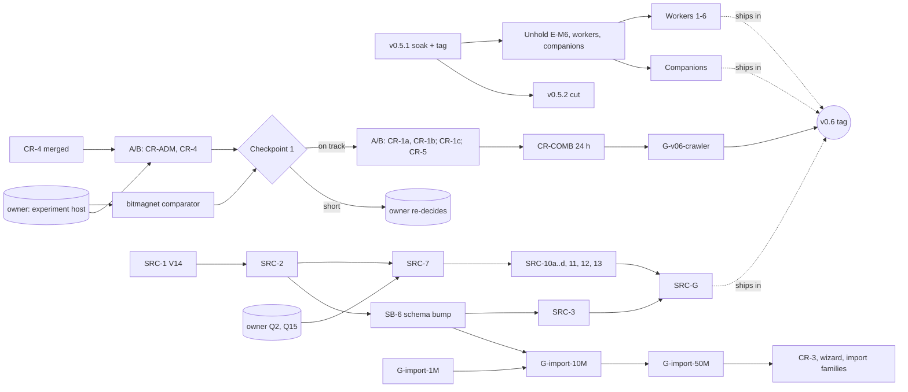

# Lodestar v2 build plan: v0.5.1 → 1.0, with helper-agent orchestration

> First written 2026-10-22, after M3. It plans the order of work and who does it: the main session or a helper agent, per the delegation policy in `CLAUDE.md`.
> **§0 (2026-11-02) is the current plan.** It replaces the 2026-10-30 §0, whose lanes are done. It rests on the owner's answers in `docs/owner-decisions.md` §2.25–§2.27 and on the runner's choices in `docs/decisions/2026-10-30-master-plan.md` and `docs/decisions/2026-11-02-master-plan-r2.md`.
> **Picking this up from another session or agent?** Start at [`docs/handoff.md`](handoff.md).

## 0. Status and plan from 2026-11-02

### 0.1 Where things stand
Status as of `main` at `7f167278` (2026-11-02 02:23Z). Live per-slice state is on the `runner-state` branch (`state.json`); reconcile it against `main`'s merges before acting on it ([handoff §2](handoff.md#2-where-the-truth-lives)).

| Area | Done | In flight | Next |
|---|---|---|---|
| **M0–M5** | All merged. G-v05 passed 10-24. **G-m5 passed 11-01** (#352): analytics-validation matrix, reporting overhead 0.08–0.09 % of a 1 % gate, design review with all 7 blocking findings fixed (#340 and FX-1..4; important and polish in FX-5..6) | — | Backlog only (Track B) |
| **v0.5.1 release** | Release branch `release/v0.5.1` cut at `c3f6341a`. rc.1 rejected by the owner. **rc.2 = `6be95525`**, artifacts signed and verified. Delta mapped (CR-0f the only class-A change). Windows MSI service mode 7 h 10 m **PASS** (17.0 stored/min), portable **PASS**, MSI options **PASS** | **Unraid 24 h soak, attempt r3** on rc.2, fresh data directory: baseline 2026-11-01 22:16Z → 2026-11-02 22:16Z. r1 (upgraded the Oct 22 volume V3 → V12 cleanly) tripped the old working-set stop rule at 19.6 h, so it isn't gate evidence; r2 was stopped by the CA Docker Auto Update plugin at 11-01 11:00Z | Verdict; the owner runs the gluetun leg after the baseline; the owner tags `v0.5.1` (§0.4) |
| **Crawler** | CR-0 accepted (24 h final: **740.6 stored/h ≈ 12.3/min**). Merged, each behind its own switch, all **off by default**: CR-SIM, CR-gate-metrics, CR-ADM (`dht.coordinated_admission`), CR-1a-H (`dht.responder_hints`), CR-1a-S (`dht.streaming_peers`), CR-1b (`dht.target_prefixes`), CR-0d (`dht.safe_restart`), CR-0f, CR-COL | **CR-4** (#365): uTP in the fetch path and IPv6 route backoff, switches `dht.utp` and `dht.route_backoff`; review fixes verified, merging on green | Live A/B runs (none run yet), CR-1c, CR-5 (§0.5) |
| **Imports** | IMP-0..5 merged: PostgreSQL restore runbook, V13 job tables, Magnetico and Bitmagnet adapters, merge/dedupe CLI, imported cohorts kept out of crawl-yield Insights, refile, server-side import part 1 | — | Pilots on real data (§0.6); none run. Only a synthetic figure exists: 100k at ~13,900/s |
| **v0.6 Sources** | Plan sliced into 25 SRC-* slices (#356). SRC-0 (#360), SRC-6 (#363), SRC-8 (#366), SRC-16 (#361) merged | — | SRC-4, SRC-5, SRC-9 now; SRC-1 (V14) once migrations may land on `main` (owner hold); SRC-7 blocked on owner Q2/Q15 |
| **Blocklist subscriptions** | B-subscriptions-api (#362) merged | S-blocklists (Sonnet) | — |
| **Filters** | F-auth, F-filters (+packs, neutral-perf, xcpu), F-metainfo, F-updater, F-status, F-filter-load-fail-closed (#357) | F-filter-standin-undo (#367), with an owner question on releasing adult stand-in holds | — |
| **Update engine** | B-update-1..6 (signed manifest, install, rollback, fail-closed checks). Ships **disabled** in v0.5.1 | — | Owner: nightly signing key |
| **Remote workers** | `crates/cluster` library: cluster CA, mTLS 1.3, join tokens, postcard-over-WebSocket protocol, leases and fencing (~104 tests) | — | Epic **held** until the soak verdict. **Nothing wires it**: there is no `lodestar worker` command, though `packaging/unraid/lodestar-worker.xml` calls one |
| **Companions** | — | — | Epic held until the soak verdict. No code |
| **M6 packaging** | CLI (`backup`, `rollback`, `vacuum`, `reindex`, `stats`, `import`, …), Windows service and port handling, WiX MSI and portable zip, Unraid templates (main, gluetun, worker), systemd unit, Linux tarball, Docker multi-arch, smoke jobs, user guide in `docs/user/` | — | Epic held until the soak verdict; expansion starts with a gap audit (§0.2 Track M6) |
| **M7** | Pulled forward and merged: download clients (qBittorrent, Transmission, Deluge, rTorrent, aria2), notifiers (webhook, ntfy, Discord, email, RSS), secret storage and SSRF guard, Send UI, uTP library | — | Epic ready to expand (deps met) |

**Code facts** (they replace the 2026-10-22 "what the code shows" list, which is gone): the store is at **V13**; search is at `SCHEMA_VERSION` **5** with a working blue/green rebuild (`crates/search/src/rebuild.rs`); `crates/utp` is a real BEP 29 library that CR-4 is wiring in; the only production source plugin is `DhtSource` (`crates/pipeline/src/dht.rs`); there is no Torznab server (only an outbound connection test in `crates/integrations/src/torznab.rs`); scheduled CI runs live in `ci.yml` and `e2e.yml`, so there is no `nightly.yml`. Rust has 4 TODOs and no `todo!()`.

**All findings the 2026-10-30 plan listed as open are fixed** (A1-1..4, A2-1, A3-1..3, DUR-26), except S04 (uTP), which CR-4 addresses, and S03 (admission), which CR-ADM addresses behind its switch.

### 0.2 Order of work and tracks
**Concurrency:** at most **four slices at a time in total** in this phase: Opus, helper and docs slices alike, as the runner has applied §2.25 since 10-30 (the owner: "keep 4 slots full"). The `runner/slices.yaml` limits (16 Opus + 16 helpers, §2.15) are the ceiling once the owner lifts that. A seven-day usage warning is active: prefer Sonnet where the delegation policy allows it. **The ladder decides between ready slices;** a slice being ready in the graph doesn't jump the ladder.

**The ladder** (fill free slots in this order; the owner can reorder it in one line):
1. **Close v0.5.1** (Track R): the soak verdict, the gluetun leg, the tag.
2. **The crawler's live evidence** (Track C): land CR-4, then the comparator and the A/B runs on the owner's experiment host, up to Checkpoint 1.
3. **The Sources critical path** (Track S): SRC-1 → SRC-2 → SRC-7, with the owner's Q2/Q15.
4. **Unhold the epics** once the soak verdict is in: expand E-M6 (gap audit), E-v06-workers, E-v06-companions.
5. **Expand E-M7**, starting with the schema-bump convergence slice SB-6.
6. **Import pilots** (Track I), on the owner's import host, never alongside an A/B run.
7. **Backlog and polish** (Track B).

Each track below lists its steps in order. "Owner" marks a step only the owner can take; `ext:` names match the `external` section of `runner/slices.yaml`.

**Track R: release**

| Step | Who | Waits on | Exit |
|---|---|---|---|
| R1 Unraid soak r3 verdict | runner (analysis), owner (evidence hand-back) | the baseline end, 11-02 22:16Z | `analyze` report: no stall, no interruption, ≥ 24 h covered, memory slope upper 95 % CI ≤ 2 MiB/h on `anon` private memory over hours 12–24, peak reported |
| R2 gluetun leg (≥ 2 h measured, part of the v0.5.1 gate) | owner runs it after the baseline; runner analyses | R1 | collector run with `--leg gluetun --require-gluetun` |
| R3 Tag `v0.5.1` from rc.2, approve the release environment, publish | **owner** | R1, R2 | GitHub release published; `:latest` moves |
| R4 Bring `docs/releases/v0.5.1.md` to `main`, mark `docs/releases/v0.5.0.md` as never released, update the README's release status | docs slice | R3 | — |
| R5 **v0.5.2 cut from `main`** (recommended, §0.4) | runner | R3 | G-v052 |
| On failure at R1/R2 | fix PR on `main`, cherry-picked to `release/v0.5.1`, rc.3, a fresh frozen soak. Runs are never stitched | — | — |

**Track C: crawler to the v0.6 gate.** Details, evidence and the checkpoint are in §0.5.

| Step | Who | Waits on |
|---|---|---|
| C1 CR-4 (#365) merged | Opus | review fixes |
| C2 Experiment host ready (one node, one public IP, no imports, not the soak PC) | **owner** | `ext:experiment-host` |
| C3 Pinned bitmagnet comparator, 24 h, fresh data, its own day | owner runs, runner analyses | C2 |
| C4 Live ABBA A/B, 6 h measured × ≥ 2 reps per arm: CR-ADM, then CR-4 (uTP, then route backoff) | owner runs, runner analyses | C1, C2 |
| C5 **Checkpoint 1**: projection to the gate, reported to the owner | runner → **owner** | C3, C4 |
| C6 A/B runs for CR-1a-S, CR-1a-H, CR-1b; build CR-1c (cap sized to the intensity preset) | Opus + owner host | C5 |
| C7 CR-5 (profile-driven tuning) only on profiler evidence | Opus | C6 |
| C8 CR-COMB: winning switches default on, 24 h acceptance on the gate metric (G-v06-crawler) | Opus + owner host | C6/C7 |

**Track I: imports to scale.** Gates in §0.6.

| Step | Who | Waits on |
|---|---|---|
| I1 10k and 100k smoke stages (runner) | Opus | — |
| I2 X-search-files-3: use the file index's `size` field (added by SB-6; it's an index format change) so cold file-search p95 stays ≤ 150 ms at 10M (`docs/decisions/2026-10-31-X-search-files-2.md`) | Opus | SB-6 |
| I3 G-import-1M on the owner's data (Bitmagnet dump restored per IMP-0 first) | owner host, runner analyses | `ext:import-host` |
| I4 G-import-10M, including the SB-6 rebuild measured at 10M | owner host | I2, I3, SB-6 (which waits on SRC-1 → SRC-2) |
| I5 G-import-50M: measured numbers go to the owner | owner host | I4 |
| I6 Full corpus (~40–50M) once the owner approves the 50M numbers (`ext:owner-50m-approval`); then CR-3 (durable partial upgrades, the next free migration), the wizard subset (WIZ-*), IMP-05..08 | Opus | I5 |
| Parked | B-import-server-2 (import through the running server's writer) adds an API that takes a source path or credentials, which is new attack surface | **owner** |

**Track S: v0.6 Sources.** The plan is `docs/plan/2026-11-01-v06-sources.md` §6. Its critical path is SRC-0 ✔ → **SRC-1** → SRC-2 → **SRC-7** → SRC-10* → SRC-G.
- **Now:** SRC-4 (consent framework), SRC-5 (egress and kill-switch), SRC-9 (Internet Archive JSON parser). All are Opus with `/security-review`.
- **SRC-1:** **this update assigns it V14** (`docs/decisions/2026-11-02-master-plan-r2.md`); the runner records it in `migration_order`. It still waits on the owner's hold, restated on 11-01: **no migrations on `main` before the release cut** (`ext:owner-migrations-on-main`: v0.5.1 tagged, or the owner lifts the hold sooner; owner queue #1). Until then SRC-1 can be built and reviewed but not merged; SRC-4, SRC-5 and SRC-9 fill the slots. CR-3, which once reserved V14, takes the next free number after the 50M gate.
- **SRC-7 needs owner Q2 and Q15.** It's on the critical path, so they head the owner queue (§0.3). Until they're answered, everything from SRC-10 onward waits.
- **SRC-3 depends on SB-6** (Track M7) instead of the old `ext:m7-schema-bump`.
- **P-v06-rulepacks:** plan the other half of E-v06-sources (curated rule packs, ThePornDB/StashDB enrichment) the same way P-v06-sources-plan did.
- Verification fetches of unverified keys stay behind `sources.verify_unverified` (off) until the crawler acceptance soak (C8) ends.

**Track W: remote workers (E-v06-workers, held for the soak verdict).** The expansion starts from what's built: the library covers P4 steps 1–2. Still to build, in order:
1. the `lodestar worker` subcommand and the coordinator side in `crates/lodestar`, wired to `ClusterServer`/`WorkerSession`;
2. have-filter replication (today the worker ignores the message);
3. the `sharded(keyspace)` DHT;
4. fetch and prepare on workers, plus the spool;
5. the chaos harness and the §19.8 gates;
6. Settings → Workers and per-worker Insights (Sonnet).

Any worker table goes through the migration queue (§0.7). Interface changes from the crawler program keep `crates/cluster`'s chaos and transport tests green.

**Track K: companions (E-v06-companions, held).** No code. Expand per P4: signed catalogue, checksum and signature checks, supervised child processes, encrypted credentials (Opus), then compose and CA-template generation, detection adapters and the Companions UI (Sonnet).

**Track M6 (E-M6, held).** Most of P3 is built (§0.1). The expansion is a **gap audit** against P3 and §14, then slices for what's missing. Known items:
- FUSE and network-filesystem detection: verify whether it exists;
- the worker template: label it "requires v0.6" more prominently, or keep it out of the CA submission until Track W step 1 lands;
- the user guide refreshed for v0.5.1 (the first hours are slow because of the 6 h sampling suppression; `docs/decisions/2026-10-31-owner-delegation.md`);
- the Unraid Community Apps submission (**owner**).

**Track M7 (E-M7, ready to expand).** Already merged: the integrations crate and adapters, notifiers, Send UI. To expand:
- **SB-6, the schema-bump convergence slice (Opus, first).** Search allows one `SCHEMA_VERSION` bump per milestone (§1.3). SB-6 is the bump 5 → 6. It fixes, in one change: SRC-3's `verified:`/`source:`/`network:` fields; `payload_sig` and the grouping fields; the regex trigram field; file category and `pieces_root`; and `size` in the file index, which X-search-files-3 needs. It waits only on SRC-2 (so the unverified data model is settled), not on E-M7's expansion. Later M7 slices fill these fields; they don't bump again. **It lands before the 10M import pilot**, so the blue/green rebuild is measured at 10M and the 50M corpus is indexed once.
- The Torznab server; `.torrent` upload and folder watch (upload needs an **owner** exception to the JSON-only middleware); grouping (MinHash, collapse-by-group, "same file"); the regex prefilter and time-budgeted verify; the enrichment harness and plugins; the usenet tier and IRC announces; the Stremio addon and bitmagnet export.

**Track B: backlog** (fills spare slots; each is small):
- S-blocklists (running);
- F-filter-standin-undo (#367);
- openapi-example-size (#368, in review);
- X-strip-format-chars (strip every Unicode Cf character in feed titles and digests, from #366's review), after #367 (both touch `crates/api/src/digest.rs`);
- i9-stage2 (print the `a..<b` range form), which waits until the release after the one that ships its parser;
- X-settings-overview: replace the placeholder Settings Overview with needs-attention and changed-from-default (§10.10.8);
- X-overflow-links: the overflow menu sends Import and Backup to unregistered screens ("unavailable") and lacks Logs and the Syntax guide;
- Logs event labels (~200 events × 2 messages × 2 locales);
- FX-4's off-ramp `.css` spacing onto the scale;
- a polish slice for `carry_forward` (118 items, over the 15 threshold in `runner/README.md` step 9).

### 0.3 Owner queue
On 2026-11-02 the owner told the runner to take its recommendation on every question that was waiting (`docs/owner-decisions.md` §2.28). The answers are recorded there; the owner can veto any of them. What's left needs the owner's hands, ordered by what each unblocks. The runner keeps working on everything else meanwhile.

| # | Action | Unblocks |
|---|---|---|
| 1 | Hand back the r3 soak evidence; run the gluetun leg after the baseline; tag `v0.5.1` and approve the release environment. (#357 goes into an rc.3 only if the soak must be re-run anyway, otherwise into v0.5.2; r1's upgrade counts if rc.2's migration code matches, per §2.28.) | v0.5.1; the three held epics |
| 2 | Name the **experiment host** for crawler A/B runs, and when it's free | Track C's live work (C2–C8) and the v0.6 tag |
| 3 | Create the **nightly signing key** and its environment | update checks on the Nightly channel |
| 4 | Make `Web / web` and `E2E / run` required checks in the ruleset (§2.28) | safer merges |
| 5 | The Unraid Community Apps submission | M6 |
| Later | **Checkpoint 1** decision (§0.5); the 50M numbers (§0.6); B-import-server-2's API surface and the `.torrent` upload middleware exception (the runner brings a recommendation when they're planned) | the v0.6 tag; the full-corpus import; server-side imports and M7 upload |

Answered by §2.28: Q1, Q2, Q3, Q7 and Q15 (plan `2026-11-01-v06-sources.md` §5), migrations on `main` before the tag (allowed, so SRC-1 may land), #362's egress trade-off (accepted for v0.6), and adult stand-in holds (not released automatically).

`docs/owner-decisions.md` §3 ("Points still open") predates these; the owner may move answered items into §2.

### 0.4 v0.5.1 gate (and v0.5.2)
**v0.5.1** (G-v051), from the 2026-10-30 plan:
- ✔ Release branch at a fixed SHA (`c3f6341a`); `v0.5.1-rc.N` candidates with hashes (rc.2 `6be95525`).
- ✔ Delta from the soaked `744b84d6` mapped to targeted tests.
- ✔ L1–L7 and F-* merged; the CR-0 soak accepted (`docs/decisions/2026-10-30-CR-0-acceptance.md`).
- ✔ Every workflow green on rc.2, no regenerated baselines.
- ✔ Windows ≥ 6 h service-mode run of the rc MSI, plus a portable smoke test.
- ☐ **24 h Linux Docker soak on the owner's Unraid box** with CR-COL: the binding memory gate (upper 95 % CI of the `anon` private-memory slope over hours 12–24 ≤ 2 MiB/h; report the slope with its CI and the peak). Attempt r3 is running on a fresh data directory. **The upgrade test** (the Oct 22 volume, V3 → V12) passed only at r1's start, and r1 itself isn't gate evidence (it stopped at 19.6 h on the old working-set rule; partial slope 1.85 MiB/h, CI [0.92, 2.77]). The owner decides whether r1's clean upgrade counts or rc.2 gets a separate upgrade smoke (owner queue #1). Its stop rule is the old working-set rule, which `docs/decisions/2026-10-31-X-soak-docker-memrule.md` showed could stop a healthy run; a stop on that rule alone is reviewed against `anon` before it counts as a failure.
- ☐ ≥ 2 h gluetun leg.
- ✔ Updates ship off (no nightly key yet; the release key exists).
- ☐ The owner tags, approves the release environment and publishes.

**v0.5.2 (recommended, runner, flagged in the r2 decisions file).** `main` already carries fixes v0.5.1 lacks (B-update-5..6, filter fail-closed, the M5 exit fixes) and diverges fast. Cut `release/v0.5.2` from `main` soon after v0.5.1 ships rather than cherry-picking long chains. The gate is v0.5.1's: the 24 h Linux Docker soak stays the binding memory gate, plus a ≥ 6 h Windows service run, and the delta rule adds re-soaks for crawler lifecycle, sampler or endpoint-policy changes. **A cut from `main` ships one-way migrations** (V13, and V14 if SRC-1 has merged), so the gate adds a V12 → V13+ upgrade smoke on a copy of a v0.5.1 data folder and a rollback-to-snapshot check (`lodestar rollback` to the `pre-vN` snapshot, then v0.5.1 starts on it). Crawler switches stay off in v0.5.2 unless they've passed C8.

### 0.5 Crawler program
**Evidence so far.**
- CR-0 24 h final (`docs/soak/evidence/2026-10-30-cr0-final/cr0-final.md`): 12.3 stored/min. Fetch success is about 4.4 %. Of 389,644 fetch failures, **74 % timed out**, 15 % were unreachable and 11 % refused. The DHT actor rejected 95.6M peer requests for capacity.
- rc.2 runs: Windows service mode 17.0/min; Unraid r1's 14 h preliminary ~11/min.
- CR-SIM screens (IPv4 only, approximate routing, no churn, so a screen never replaces a live run):
  - CR-ADM: Better on 8/8 seeds in all four scenarios, +26 % to +50 %, capacity refusals to 0.
  - CR-1a-H: inconclusive; ~94 % of hints expire unused.
  - CR-1a-S: +7.5 % in `healthy` only; fetches start 4.6–16× sooner.
  - CR-1b: inconclusive; worse 8/8 on one secondary under admission pressure. Expected to stay off.
  - CR-4: can't be screened (the simulator has no transport layer).

**Reading.** The gate needs about **8×**. The failure mix points at H3 (reachability and transport: TCP timeouts are what uTP-only and NATed peers look like) and H2 (admission churn), more than H1 (lookup latency). So the order is: CR-ADM and CR-4 first, then the H1 candidates.

**Order** (Track C table, §0.2):
1. Land CR-4 (#365).
2. Run the pinned **bitmagnet comparator early**, before tuning, on the same host and IP, on its own day, from fresh data. It shows what 100/min means there.
3. Live ABBA runs (6 h measured after suppression and warmup, ≥ 2 repetitions per arm, controlled starting state, treatment boundaries and host activity logged, per-family counters): **CR-ADM**, then **CR-4 uTP** (`dht.utp`), then route backoff (`dht.route_backoff`). Measure each alone.
4. **Checkpoint 1** (owner's choice, 2026-11-02). After the CR-ADM and CR-4 results, the runner projects the reachable single-node rate from the measured gains and the comparator, against all three thresholds (the 24 h mean, the worst hour and the p95 discovery-to-searchable).
   - If the projection reaches ≥ 100/min: continue with step 5.
   - If it doesn't: the runner reports the measured ceiling, the dominant limiter (from the failure and rejection breakdowns), the comparator's rate and the options to the owner **before** CR-5. The owner re-decides. **The runner never loosens the gate.** Sources, workers and M7 continue meanwhile; only the v0.6 tag waits.
5. A/B for CR-1a-S, CR-1a-H, CR-1b; build CR-1c (a lookup cap sized to the intensity preset) after the CR-ADM result.
6. CR-5 (profile-driven tuning, including the verified-known cache) only on profiler evidence.
7. **CR-COMB:** combine the winners, make them default on, and run the 24 h acceptance soak on the gate metric. If the host, its public IP or its network changed since the comparator ran, re-run the comparator first.

**Still unscheduled:** CR-2 (fairness tiers) and CR-3 (durable partial upgrades; Track I step 6). A dual-stack default DHT bind (`[::]`, from CR-0f's follow-ups) and BEP 33 piggyback are CR-4 follow-ups, taken only if CR-4's per-family counters show IPv6 coverage matters.

**Rules for every run:**
- on the dedicated experiment host, never the soak PC;
- no imports on that host during a run;
- the comparator on separate days, never back to back with a Lodestar run, version pinned;
- Defender exclusion recorded on Windows;
- packets/s, bytes, connects/s, open sockets and router/NAT health recorded;
- BEP 51 intervals, per-IP limits and the §18 politeness caps are never tuned away.

### 0.6 Gates added by this plan
**Crawler (gates the v0.6 tag):**
- **What counts:** unique infohashes fetched and verified from the network in this run, committed and searchable. Imports, recovery, rediscoveries, filtered or quarantined items and failures are reported separately. Rows a rule hides still count as searchable (`docs/decisions/2026-10-30-CR-gate-metrics.md`).
- **Where:** one node, one public IP, a fresh data directory with no imports, the Balanced preset.
- **Target:** ≥ 100 per minute sustained, comparable to a pinned bitmagnet run. The stretch target is 1,000/min, which remote workers serve.
- **Thresholds** (decided 2026-10-31 under `docs/owner-decisions.md` §2.26): 24 h mean ≥ 100/min, no hour below 70/min, p95 discovery-to-searchable ≤ 10 min. That figure runs from the first sighting of the infohash and includes the metadata fetch; it doesn't replace §1.6's "new torrent → searchable < 5 s", which starts once the metadata is stored.
- Politeness and network guardrails are never relaxed to reach it. Checkpoint 1 (§0.5) is where a shortfall goes to the owner.

**Import scale:**
- Runner smoke stages at 10k and 100k, then the owner's ladder: **1M → 10M**, each measured against §1.6's budgets, including about 2.3 KB per torrent all-in. Any excess, with what drives it, goes to the owner before the next stage.
- Then a measured **50M gate**, whose numbers go to the owner before the full corpus (~40–50M) is imported.
- Measured at every stage, never estimated (`docs/decisions/2026-10-30-master-plan.md` "Imports"): bytes per record, source copies and PostgreSQL restore space, backups, the old and new index during a rebuild, the have-filter, `filter_hits` and the review queue, NDCG@10, backup and restore time, cold start, RSS, search p95 (including cold file search), Insights overhead. A backup precedes each stage; removal by job provenance is tested.
- Pass lines for import speed (runner, `docs/decisions/2026-10-31-IMP-4b.md`): 2,000/s offline, 1,000/s online.
- After the gate: CR-3, then a subset of the wizard, then the other import families (Rats, dhtc, MongoDB, …; `docs/plan/2026-10-29-dht-import-wizards.md`).

**Other gates, for reference:**

| Gate | Where it's defined | Status |
|---|---|---|
| G-v051 | §0.4 | soak and tag pending |
| G-v052 (proposed) | §0.4 | after v0.5.1 |
| SRC-G (v0.6 sources) | plan `2026-11-01-v06-sources.md` §4.2 | not started |
| §19.8 chaos gates (workers) | architecture §19.8 | not started |
| §20.8 filter budget (50 µs) | architecture §20.8, owner §2.20 | held; the Neutralize case is reported, not held, at ~55 µs on Intel 8573C runners |
| §17 1.0 gates (NDCG@10, 10M perf and size, Windows soak, full security review, chaos, politeness and purge audits) | architecture §17, P7 below | after M7/v0.8 |

### 0.7 Dependencies and serial points


**Things that run one at a time:**
- **Migrations:** one migration PR open at a time (`ext:migration-slot`), written only by an Opus slice that owns the store schema. Queue: **V14 → SRC-1** (assigned by this update; merges once `ext:owner-migrations-on-main` holds), then whichever of CR-3 (after the 50M gate) and any worker or companion table reaches the slot first. The runner records the queue in `runner-state` `migration_order` (today stale at V11).
- **Search schema:** exactly one `SCHEMA_VERSION` bump per milestone. M7's is SB-6. A slice that needs a new indexed field asks SB-6 to carry it instead of bumping.
- **The owner's machines:** the Unraid box finishes the v0.5.1 soak first. After that, the experiment host runs A/B arms, comparator days and acceptance soaks, and the import host runs pilots. If they're the same machine, the runs never overlap; the order is soak → comparator → A/B → pilots between A/B blocks.
- **CI capacity:** each push starts about 37 jobs that every PR queues behind. One push per round of fixes.
- **Release branches:** fixes for a release land on `main` first and are cherry-picked; nothing is developed on a release branch.
- **Hub files** (§1.3 table): unchanged.

### 0.8 Anticipated complications

| Complication | Why it matters | Mitigation |
|---|---|---|
| The crawler gap may be structural | One IP and BEP 51's per-node intervals may cap discovery well below 100/min, whatever we tune | The early comparator shows what's possible on the same IP; Checkpoint 1 brings it to the owner before CR-5; workers (more IPs) serve the stretch |
| uTP can't be simulated | CR-SIM has no transport layer | Live A/B only; `dht.utp` stays off until it wins; the Settings field stays labelled "not active yet" so a saved value can't decide an A/B arm |
| The owner's machines are a bottleneck | Soak, A/B arms, comparator days and pilots all need them, and each needs exclusive use | §0.7 calendar; the runner states the next machine booking in every daily summary |
| A host plugin interrupts a run | r2 was stopped by CA Docker Auto Update; Appdata Backup can stop containers | Host checklist before every run: exclude the containers from auto-update and backup plugins and record the next scheduled plugin runs |
| Search rebuild at scale | A blue/green rebuild needs about 2× index disk and hours at 50M | SB-6 lands before the 10M pilot; its rebuild is measured at 10M; the 50M import indexes once |
| Migration contention | Sources, CR-3 and workers each want a migration | §0.7 queue, one at a time |
| Unverified items in the id sequence | They grow the hot-column arrays | SRC-2 measures RSS at 1M unverified ids; the Q11 cap (1M dead hashes) |
| Triggers on the crawler's hot path | V13's triggers add up to 4 index probes per insert | No new trigger on `torrents` inserts for Sources; unverified rows reuse V13's trigger pattern (P-v06-sources-plan, Q16); measure insert cost at each import stage |
| The filter budget on common runners | The Neutralize case projects ~55 µs on Intel 8573C against 50 µs | Reported, not held (`docs/decisions/2026-10-30-F-filters-neutral-perf.md`); revisit if rule packs add Neutralize terms |
| File search at 10M | Cold p95 projected over 150 ms | SB-6 adds the field, X-search-files-3 uses it, both before the 10M pilot |
| `main` outruns the release branch | Cherry-pick chains get long and risky | v0.5.2 soon after v0.5.1 |
| Promises the binary can't keep | The Unraid worker template calls a missing `worker` command; Settings Overview is a placeholder; menu links lead to "unavailable" | Track M6 gap audit, Track B items |
| Stale runner state | `state.json` shows merged slices as building, and its `migration_order` stops at V11 | A successor reconciles against `main` first ([handoff](handoff.md)); the runner trims `state.json` and moves history to `log/<id>.md` (`runner/README.md` step 10) |
| Usage runs out mid-slice | A session stops with a half-done branch | Small PRs, one decisions file per slice, the handoff; a branch with no PR is restarted from its brief, not resumed blind |
| Toolchain debt | MSRV 1.89 and one temporarily allowed clippy lint, `chunks_exact_to_as_chunks` (`Cargo.toml`) | Remove the allow when CI's clippy reaches 1.99 (runner follow-up) |
| Owner answers arrive late | Q2/Q15 block the Sources critical path | Ask once with a recommendation; fill the slots with SRC-4/5/9, Track B and the epics meanwhile |

### 0.9 Next actions
In order, as slots allow (four slices in total; no two with overlapping `owns`). Track C's next steps after CR-4 need the owner's experiment host, which is why Sources slices fill slots first:
1. Finish the in-flight work: CR-4 (#365), F-filter-standin-undo (#367), S-blocklists, openapi-example-size (#368) (4 of 4 slots on 2026-11-02 02:50Z).
2. Launch SRC-4, SRC-5 and SRC-9; then X-strip-format-chars after #367.
3. Launch SRC-1 with V14 when the owner's migration hold lifts (v0.5.1 tagged, or the owner says so sooner; owner queue #1). The runner records V14 in `migration_order` now.
4. After 11-02 22:16Z: analyse the r3 soak; ask the owner for the gluetun leg and the tag (owner queue #1), and in the same message for Q2/Q15 and the experiment host (#2, #3).
5. On the soak verdict: expand E-M6 (gap audit first), E-v06-workers, E-v06-companions.
6. Launch SB-6 when SRC-2 merges; expand the rest of E-M7; launch P-v06-rulepacks.
7. Launch the 10k/100k import smoke stages; X-search-files-3 after SB-6.
8. Drain Track B with whatever slots remain.

### 0.10 History of this section
- **2026-10-30:** the post-CR-0 plan: lanes L (land the owner's work), F (release blockers), C (crawler candidates behind switches), I (imports), S (Settings reconcile), D (docs), and the v0.5.1 gate. All lanes finished by 11-01. Its text is in git history (`git log -p docs/build-plan.md`) and its reasoning in `docs/decisions/2026-10-30-master-plan.md`.
- **2026-11-02:** this rewrite (`docs/decisions/2026-11-02-master-plan-r2.md`).

---

## 1. Orchestration model

### 1.1 Who does what (CLAUDE.md policy, made operational)

**Main session (Opus 5.5, high effort): the integrator.** It owns:
- **Rust: search.** Leases, rebuild, facets, suggest, percolator, regex prefilter.
- **Rust: store.** Migrations and on-disk formats.
- **Rust: API.** Contracts, auth and keys, SSE, insights queries.
- **Rust: protocols and untrusted input.** The cluster and mTLS, uTP, Torznab query mapping, `.torrent` import, and hand-written feed, XML and IRC parsers.
- **Rust: other security-critical code.** Companion signature checks, credential storage and the SSRF guard.
- **Security-sensitive UI state machines.** Setup token, 18+ confirmation, §20.11 password and effect warnings, CSX-5.
- **Every review and merge.**

**Sonnet helpers** take everything well specified:
- web foundations and screens per §10, and the theme compiler;
- formatters, written to a main-session spec and reviewed by the main session line by line;
- the typed client and URL state, reviewed by the main session;
- test harnesses, CI workflows, packaging and docs;
- download-client and notification adapters behind a trait the main session defines;
- plugin glue, manifests and recorded-fixture tests, after the main session lands plugin #1 of each family;
- serde-derived JSON clients;
- simple CRUD endpoints that follow an established pattern.

**Haiku helpers** do mechanical work only: generated theme files, message-key extraction and renames, formatting sweeps.

**What's never delegated:** parsers of untrusted input, on-disk formats, concurrency-heavy code, security and content-safety logic.

To protect the critical path, **the main session writes almost no Svelte.** Its time goes to Rust and to reviews.

A non-Claude agent picking up the work maps this to "use your strongest model for core, parser, store, concurrency and security work, and never hand those to a weaker one" ([handoff §5](handoff.md#5-path-b-a-single-agent-without-the-runner)).

### 1.2 How a helper runs
- **Launch:** the runner starts each slice in its own cloud session (`runner/README.md`). Inside a session, a helper is an Agent with `isolation: "worktree"`, `run_in_background: true` and the model above, branched from `main`.
- **Brief:** every slice gets one, using the template in §7. The runner keeps them on the `runner-state` branch under `briefs/`.
- **Cap:** at most four helper slices at a time in the current phase (owner §2.25). `runner/slices.yaml` `limits` (16 core + 16 helpers, §2.15) are the ceiling once the owner lifts it. Review bandwidth is the bottleneck, not how many agents can be spawned.
- **Review gate** (for every result):
  - read the whole diff;
  - run `npm run check`, `npx vitest run`, `npx size-limit` and the affected Playwright specs;
  - run `cargo fmt --check`, `clippy -D warnings` and `test` wherever Rust is touched;
  - run `/code-review high` on diffs over 400 lines;
  - run `/security-review` on anything touching auth, credentials, filters, the cluster, companions or source plugins;
  - redo weak output on Opus rather than patching it piecemeal.
- **Unanchored second read** for the riskiest PRs (leases and cursors, rebuild and swap, percolator, mTLS join and fencing, uTP, companion verification, the filters API, plugin consent). A fresh Opus review agent gets only the diff and the spec sections, not the author's conclusions.
- **Workflow scripts are optional.** Any wave can run as a `Workflow` script instead of hand-launched agents, but only if the owner explicitly says "use a workflow".

### 1.3 Seams that make parallel work safe
1. **Contract-first API.** Typed DTOs with utoipa produce `/openapi.json`; a bin writes `web/src/lib/api/openapi.json` and `openapi-typescript` turns it into `schema.d.ts`. CI fails if either is stale. New endpoints can land first as typed structs plus a `501` stub with an example. Helpers use only the generated types; a missing field is a request to the main session, never a local type.
2. **Fixture backend.** `lodestar serve --fixture` builds a deterministic data directory; screens and E2E run against it.
3. **Token contract.** `docs/design-tokens.md` fixes every CSS custom-property name.
4. **Nullable fields.** "Never measured" is `null`, so the UI's "—" state is built and tested before a source exists.
5. **Points that must run one at a time:**

| Shared thing | Rule |
|---|---|
| `crates/store/src/schema.rs` migrations | One migration PR at a time (`ext:migration-slot`), Opus only, in the queue in §0.7 (V14 → SRC-1 next) |
| `crates/search` `SCHEMA_VERSION` | Exactly one bump per milestone, through the blue/green rebuild. M5's was v5 (facets). M7's is **SB-6** (v6), which carries SRC-3's `verified:`/`source:`/`network:` fields, `payload_sig`, the trigram field and file category/`pieces_root` |
| `crates/api/src/lib.rs`, `crates/lodestar/src/services.rs` | Each slice adds one line; merged in sequence |
| `openapi.json` / `schema.d.ts` | Regenerated after bringing in `main`, never merged by hand |
| `web/package.json` and the lockfile | A new dependency needs main-session approval |
| `.github/workflows/*` | `ci.yml` (Rust, with `ci-ok`), `web.yml`, `e2e.yml`, `release.yml`, `freshness.yml`; scheduled jobs live inside `ci.yml` and `e2e.yml` (there is no `nightly.yml`). One owner at a time |
| Messages | One message file per feature (`features/*/messages/{en,zh}.json`), merged by a script |

---

## 2. Sequencing and critical path
```
P0 seams ─► P1 v0.5 MVP ─► P2 M5 ──────────────► v0.5.1 ─► v0.5.2
   (done)       (done)       (done 11-01)            │
                                                     ├─► P3 M6 (mostly built; gap audit)
                                                     ├─► P4 v0.6: Sources ∥ workers ∥ companions ∥ crawler gate
                                                     └─► P5 M7/v0.7 (SB-6 first) ─► P6 v0.8 ─► P7 M8 → 1.0
```
- **Critical path to v0.6:** the crawler gate (§0.5), which needs the owner's experiment host and may need the owner's re-decision at Checkpoint 1; in parallel, the Sources path SRC-1 → SRC-2 → SRC-7 (needs Q2/Q15) → SRC-10* → SRC-G.
- **Critical path to 1.0:** M7's SB-6 and the import scale gates feed P7's 10M/50M performance gates.

---

## 3. Phases and slices
Each item is one PR of about 1,500 changed lines or fewer. **[M]** = main session or an Opus slice, **[S]** = Sonnet, **[H]** = Haiku.

### Done: P0–P2 (M0–M5)
- **P0 seams:** router split and error envelope (B0), typed DTOs and OpenAPI (B1), embedded SPA (B3), settings registry (B2), web foundations (W0–W9), the contract docs.
- **P1 v0.5 MVP:** blue/green rebuild (B5b), searcher leases (B5a), the M5 migration (B8, V10), SSE (B4), facets (B6, search schema v5), the fixture server (B16), primitives, charts, formatters, app shell, search UI, detail drawer, Docker. G-v05 passed 2026-10-24.
- **P2 M5:** Insights (B11a–c), suggest (B7), API keys and feed tokens (B12), percolator and alerts (B9), result cache (B5c), siblings/compare/discover (B13), stats and crawler control (B14), export and jobs (B10b), filters API (B15), settings API and form engine, every Settings screen, the wizard, update engine and screens, logging core and screens, Filters & Safety, keyboard map, Playwright matrix and Lighthouse, zh catalogue. **G-m5 passed 2026-11-01** (`docs/decisions/2026-11-01-G-m5.md`).
- The standing rule from P1, "the client never computes counts, cohorts or percentages", is in `runner/standards.md` §4.
- Every slice's decisions are in `docs/decisions/`; the slice graph and its history are in `runner/slices.yaml` and on `runner-state`.

### P3: M6 packaging (mostly built; Track M6)
Built: the clap CLI with `backup`, `rollback`, `vacuum`, `reindex`, `stats` and more; the Windows service entrypoint, port warnings and runtime work; the WiX MSI (service, firewall rules, opt-in Defender exclusion) and portable zip; Unraid templates (main, gluetun, worker); the systemd unit, Linux tarballs and the `release.yml` matrix; smoke jobs; the user guide in `docs/user/`.
To audit and finish (E-M6 expansion): FUSE and network-filesystem detection; the worker template's v0.6 labelling; the user guide's v0.5.1 refresh; anything else the gap audit finds.
**Owner actions:** the Unraid CA submission. The code-signing certificate is deferred (§2.23): Windows builds ship unsigned, and the guide covers the SmartScreen warning.

### P4: v0.6
**Remote workers v1 (§19), Opus, about 6 PRs.** Built: cluster CA, mTLS and one-time join tokens; the postcard-over-WebSocket protocol, heartbeats and fencing (library only). To build: wiring and the `worker` command, have-filter replication, `sharded(keyspace)` DHT, fetch and prepare on workers plus the spool, the chaos harness and §19.8 gates (Track W). **[S]** Settings → Workers and per-worker Insights.

**Companion manager (Track K):**
- **[M]** the signed catalogue, checksum and signature checks, supervised child processes and encrypted credentials.
- **[S]** compose and CA-template generation, detection adapters and the Companions UI.

**Sources (Track S):** sliced into SRC-0..17 and SRC-G by `docs/plan/2026-11-01-v06-sources.md`: the unverified tier and claims (§18.5), the consent framework, egress and kill-switch, Prowlarr/Jackett as plugin #1, Nyaa, AnimeTosho, Internet Archive, Academic and official lists, download clients as a source, BEP 48 full scrape, torrent-cache enrichment, the Sources API and UI, the Jobs view. Parsers are Opus; plugin glue is Sonnet after SRC-7 sets the pattern.

**Filters:** **[M]** curated rule packs; **[S]** ThePornDB/StashDB enrichment following the plugin pattern. To be planned by P-v06-rulepacks.

**v0.6 tag gate (§0.6, owner §2.25):**
- the single-node crawler gate passes, or the owner re-decides at Checkpoint 1;
- the interface changes from the crawler program keep `crates/cluster`'s chaos and transport tests green.

Feature work on workers, companions and sources continues in parallel; only the tag waits. What ships in v0.6 is §14's scope; each feature's own gate (SRC-G for Sources, §19.8 for workers) decides whether it's ready to ship in it.

### P5: M7 / v0.7
- **[M] SB-6 first** (§0.2 Track M7): the one search schema bump, rebuilt blue/green.
- **[M]** The Torznab server; `.torrent` upload (owner exception needed) and folder watch; grouping (MinHash, collapse-by-group), `payload_sig`/`sig:` and "same file"; the regex trigram prefilter and time-budgeted verify.
- **Already built:** the integrations trait and adapters (qBittorrent, Transmission, Deluge, rTorrent, aria2), the notifiers (webhook, ntfy, Discord, email, RSS), secret storage and the SSRF guard, the Send UI. uTP moved into the crawler program (CR-4).
- **Enrichment plugins** (srrDB, PreDB, Wikidata, TMDB/TVDB, AniDB/AniList, MusicBrainz, OpenLibrary, IGDB, Discogs, Steam, debrid): **[M]** the HTTP, egress, rate-limit and cache harness plus the first plugin (reusing SRC-5's egress); **[S]** the rest, one module each; every response parser reviewed by Opus.
- **[M]** The usenet tier, IRC announces and PreDB's IRC feed.
- **[S]** Stremio addon and bitmagnet export.

### P6: v0.8
- **[M]** Placement for singleton, account and overlay plugins on workers; companions on workers; the Anna's Archive / LibGen importer (restricted consent).
- **[S]** Nostr NIP-35 and Lemmy plugin glue (parsers are Opus work).

### P7: M8 hardening → 1.0
- **[M]**
  - The relevance judgment set and `relevance` bin, with an NDCG@10 gate.
  - 10M performance and size gates on a dedicated runner, plus the owner-approved 50M import-scale numbers (§0.6).
  - The crawler gate re-measured on the release candidate.
  - The Windows soak test.
  - A full-system security review.
  - Plugin politeness and purge audits.
  - The chaos gates green.
- **[S]**
  - CI wiring for those gates.
  - Docs: `query-language.md`, `relevance.md`, `themes.md`, the user guide, a README with the brand lockups.
  - Playwright and axe across all 48 themes on a schedule.
- Release 1.0 when every §17 gate is green.

### After 1.0 (outline)
- v1.1: network tiers and I2P (i2pd)
- v1.2: eD2k/Kad and aMule
- v1.3: IPFS and IPNI
- v1.x: the micro-piece prober (consent-gated), embedded WireGuard, saved-search auto-send

Each gets its own detailed plan when it's reached. All of the protocol work is Opus work.

---

## 4. Where helpers add value, and where they don't
- **High value.** Many disjoint files with tight specs: Svelte screens, theme files, packaging and CI, adapters and plugin glue after an Opus pattern, Playwright matrices and docs.
- **Little or negative value.** Splitting search, the percolator, leases and rebuild, the cluster, uTP or schema work across agents. These have tight invariants and shared files, and reviewing split work would cost more than writing it. The same goes for two helpers on one screen, or a helper inventing API shapes.

## 5. Standing risks
The current risks are in §0.8. These standing mitigations still apply:

| Risk | Mitigation |
|---|---|
| Helpers drift from §10 | Briefs cite exact § and skill paths; the hex and arbitrary-value ban; snapshots and axe in Riverstone light/dark on every PR (all 48 themes on a schedule); `design-review` per screen |
| API contract drift | Generated OpenAPI → TS types, a CI drift check, `501` stubs with examples |
| Conflicts in shared files | Per-feature messages and screens, one line per slice in hub files, no barrel files |
| Bundle creep | size-limit per route chunk in every slice's checks; fixed by code splitting, never by raising limits without a recorded §2.26 decision |
| Review backlog lowers quality | The helper cap; the main track pauses for reviews; weak output redone on Opus |

## 6. Verification
- **Every PR:**
  - Rust: `cargo fmt --check`, `cargo clippy --workspace --all-targets -- -D warnings`, `cargo test --workspace`;
  - web: `npm run check`, `npx vitest run`, `npm run build`, `npx size-limit`, and `npx playwright test` for anything with an e2e spec;
  - `git fetch origin main` before pushing (clones are shallow).
- **Milestone exits:** as listed in each phase and in §0.6, mirroring architecture §14 and §17.

## 7. Helper brief template
```
Goal: <one sentence>.   Model: opus|sonnet|haiku.   Branch: slice/<id> from main.
Read first: CLAUDE.md; runner/standards.md; docs/architecture.md §<n>; the plan or decisions files for this area;
  ui-design-skills/skills/<x>/SKILL.md and docs/design-tokens.md (UI only); web/src/lib/api/schema.d.ts (web only)
Own (create/edit): <paths>.   Do not edit: hub files (§1.3), package.json, anything not listed.
Inputs: <endpoints / fixtures>.   Out of scope: <list>.
Done when: <the slice's checks>, plus CLAUDE.md's "Before pushing" checks; no hex/arbitrary values;
  strings only in features/<x>/messages; ≲ 1,500 changed lines; decisions in docs/decisions/<date>-<id>.md.
Report: files changed, hub edits needed, missing contract fields, deviations from spec and why.
```

## 8. Automation: the runner
`runner/README.md` describes a long-lived Opus **runner session**:
- It starts each slice in a new cloud session as soon as the slice's dependencies are merged.
- It has a fresh Opus reviewer check every PR.
- It merges PRs that are green and have no blocking findings (owner, 2026-10-22; only the runner merges, §2.22).
- It keeps going around the clock, with a watchdog that restarts it.

The slice graph is in `runner/slices.yaml`; live state is on the `runner-state` branch. If no runner can run, [`docs/handoff.md`](handoff.md) describes how a single agent continues safely.
