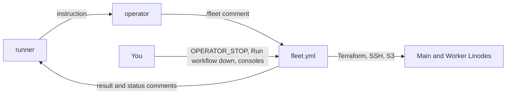
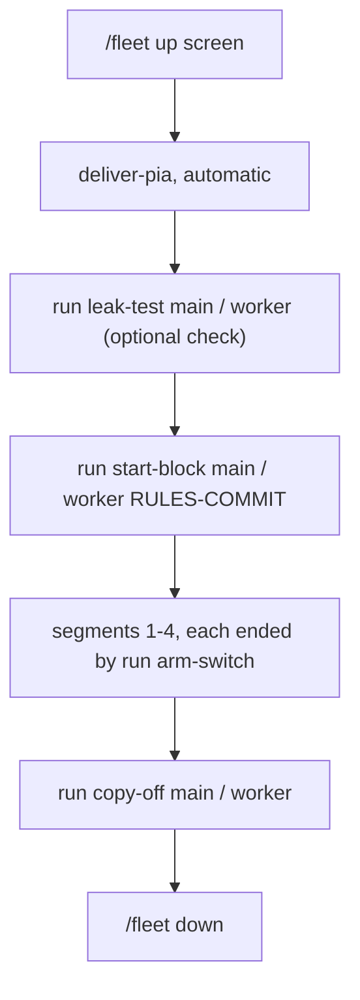

# Cloud fleet runbook

For the owner, who runs the cloud test fleet: two Linodes (Main and Worker) that screen a crawler change before it goes to the experiment host. This page says what each step does, what you see when it works, and what to do when it doesn't.

- **The plan:** `docs/plan/2026-11-08-cloud-operator.md` (the control plane and the operator) and `docs/plan/2026-11-08-cloud-test-plan.md` (the screen).
- **The decisions behind the code:** `docs/decisions/` for OP-1, OP-2a, OP-2, OP-2b, OP-3a and OP-3b.
- **Times are UTC.** Every value below in angle brackets (`<state bucket>`, `<vm address>`) is a placeholder; the only account ID shown is the fake `111122223333`.

> **If something is going wrong, go straight to [Stop everything](#stop-everything).**

## 1. What the fleet is, and who runs it
- **The control plane** is the workflow `.github/workflows/fleet.yml`, running the committed code in `infra/fleet/` and `infra/pia-bridge/`.
  - It reads `/fleet` commands from the operator's comments on one draft PR (the channel PR, repository variable `CHANNEL_PR`), checks them against hard limits in code, and runs them.
  - Its state lives in S3: `fleet/fleet.json` in the state bucket holds the fleet's pinned commit, expiry, addresses and host keys. It never reads state back from a comment.
  - It answers each command with a result comment, and keeps one status comment up to date: roles, ages, expiry and compute cost. No addresses, labels or fingerprints ever appear in a comment or log.
- **The operator** is an AI agent with no cloud or VPN credential. It holds only a short-lived GitHub App token (the `lodestar-operator` App), and acts only by posting `/fleet` commands. The runner instructs it. Its workflows (`operator-wake.yml`, `operator-apply.yml`, `operator-tripwire.yml`) arrive with OP-4. **Until OP-4 merges, nobody can issue a `/fleet` command**: `fleet.yml` accepts them only from the App's bot account (`OPERATOR_BOT_USER_ID`).
- **You:**
  - set the switches (the repository variables `FLEET_LIVE` and `OPERATOR_STOP`);
  - keep the secrets (`PIA_SERVERS` and the environment secrets);
  - book sessions with the runner;
  - pull the kill switch;
  - can always take the fleet down yourself (`fleet.yml`'s **Run workflow**, below), without the operator.
- **Live or dry-run:** with `FLEET_LIVE` anything but `true`, every command runs dry: it answers "would create", "would destroy", "would run the step", and touches no cloud. Set it to `true` only after the OP-G gate's dry cycle.


The runner instructs the operator; the operator posts `/fleet` commands; `fleet.yml` acts on the Linodes and reports back. You hold the switches and the consoles.

### The hard limits (in code; `infra/fleet/limits.yaml`)
| Limit | Value |
|---|---|
| Fleets at a time | one: `up` refuses while any Lodestar Linode or firewall exists, or a fleet is recorded |
| Preset | `screen` only: Main (`g6-standard-4`) and Worker (`g6-nanode-1`) |
| Lifetime | 44 h from `up`; then the hourly reaper runs `down` |
| Compute cap | $40 a month; one screen fleet costs at most about $3.50 |
| Fleet lock | 90 min, so one command runs at a time ("busy, retry" otherwise) |
| Code | every command runs only `main`'s current head, and a fleet stays pinned to the commit it was created from |

## 2. Booking a fleet session
Before each session:
1. **The switches.**
   - `OPERATOR_STOP` is `false`. Settings → Secrets and variables → Actions → Variables.
   - `FLEET_LIVE` is `true`, and only once OP-G has passed.
2. **Re-confirm `PIA_SERVERS` against the Unraid host's current exit.** Its exit can change between sessions. `PIA_SERVERS` is an environment secret in `pia-delivery`, a JSON object with one PIA region ID per role: `{"main": "<region id>", "worker": "<region id>"}`.
   - The two must differ from each other: `deliver-pia` refuses "PIA_SERVERS gives two roles the same region".
   - **Neither may be the region your Unraid host uses.** The code can't check this one. Look at the Unraid gluetun container's server setting, and if it now matches either value, change `PIA_SERVERS` before the session.
   - Tell the runner only if the Unraid exit changed.
3. **The rules commit.** The runner commits `infra/fleet/steps/screen-rules.json` for the screen (the candidate image by digest, the treatment, the segment length, and the Legal Notice version to accept), and gives you the commit. `start-block` refuses without it.
4. **The watchdog.** The Akamai watchdog (`lodestar-akamai-watchdog`) deletes any fleet Linode at 48 h. It is the backstop if everything else fails. Re-prove it with the canary (test plan 0a) if its code or deployment changed since its last proven deletion.
5. **Book the times with the runner.** A 2 h segment block runs about 18 h, and a 3 h one about 22 h. Book `up` early enough that the whole block, copy-off and `down` fit in 44 h.

## 3. A screen, step by step
You don't type these commands. The runner tells the operator, which posts them on the channel PR (after OP-4 merges), and the result comes back as a comment. Each line here is the exact command, with what you should see.


`up` creates the fleet, the PIA login follows automatically, then each VM runs its block, its evidence is copied off, and the fleet goes down.

### 3.1 `/fleet up screen`
- **What it does:** creates Main and Worker with Terraform, pinned to `main`'s commit, with an expiry 44 h out. Then the `deliver-pia` job (`pia-fence`, `deliver-pia`, `pia-release`) delivers the PIA login to each VM over pinned SSH, and each VM writes its own WireGuard configuration.
- **Works:** two comments. First `up screen: create main, worker, pinned to main; expires <UTC time>; at most $3.50`. Then one line per VM, `deliver-pia: main: delivered; /run clean`, and the same for `worker`.
- **Fails:**
  - `refused: up screen: a Lodestar Linode exists` (or firewall, or `a fleet is recorded`): a previous fleet wasn't fully removed. Check Cloud Manager, then `down`.
  - `refused: up screen: the monthly fleet-compute cap would be exceeded`: wait for next month, or ask the owner (you) to decide on the cap.
  - `failed: terraform didn't finish; the fleet is recorded, so run down`: run `down`. Terraform's output is in the evidence bucket under `fleet/<run id>/`.
  - A `deliver-pia` line that isn't `delivered; /run clean`: ask for `run renew-vpn <vm>` (§7). A line ending `NOT clean; escalate` means `/run/lodestar-pia` may still hold the login; tell the runner.

### 3.2 `/fleet run leak-test <vm>` (optional; `start-block` runs it too)
- **What it does:** proves nothing leaves the VM outside PIA.
  - With the tunnel up: IPv4 goes out through PIA, not the host's own address; IPv6 is blocked; DNS goes through gluetun.
  - With the tunnel down, twice (the endpoint blocked, then gluetun's VPN interface also taken down): IPv4, IPv6, DNS and UDP all fail, and a capture on gluetun's side sees zero packets.
  - Then the tunnel recovers through the same exit.
  - It also checks the host's own IPv6: no IPv6 forwarding, no IPv6 on the stack's Docker network, no global IPv6 address in gluetun's namespace.
  - It refuses while a block is recorded or running.
- **Works:** `run leak-test main: done; <n> ok`, with captured-packet counts of 0.
- **Fails:** `failed (exit 1); <n> ok; failed: <names>, leak_test`. **This is a stop condition: no crawl starts on that VM.** Tell the runner, with the failed names.

### 3.3 `/fleet run start-block <vm> <rules commit>`
- **What it does:** one ABBA block on that VM, at the rules commit (an ancestor of `main`):
  1. refuses if a block is recorded or running, or a past block's evidence hasn't been copied off;
  2. **runs the leak test in the same run**, and goes on only if it passes;
  3. writes the durable block marker (`/var/lib/lodestar-block/marker`);
  4. starts Lodestar on a fresh data directory, in gluetun's network namespace, with the candidate image from the rules;
  5. accepts the Legal Notice version the rules name, and sets a random admin password that stays root-only on the VM;
  6. starts segment 1's collector (the control arm) and the outage watcher. Then it returns; the block runs on its own.
- **Works:** `run start-block main: done; <n> ok; block_segment 1`.
- **Fails:**
  - `failed: leak_test_passed, start_block`: the leak test failed, so it's a stop (as in 3.2).
  - `failed: notice_version, start_block`, with `notice_version_served <n>` and `notice_version_pinned <m>`: Lodestar's Legal Notice changed since the rules were written. It's a stop; the runner commits new rules.
  - `failed: block_running`: a block is already recorded on that VM; `copy-off` ends it.
  - `failed: evidence_copied`: the last block's evidence hasn't been copied off; run `copy-off` first.
  - Any other failure after the marker: start-block stops Lodestar and the Docker proxy again, and the block stays recorded. Run `copy-off` to end it, then tell the runner.

### 3.4 `/fleet run arm-switch <vm>`, after each segment
- **What it does:** the operator runs it shortly before a segment ends (at the booked times).
  1. It waits up to 15 minutes for the segment's collector to finish its window. The collector stops Lodestar itself.
  2. Then it starts Lodestar alone on the next arm (control, treatment, treatment, control), without recreating gluetun, and starts the next segment's collector.
  3. After segment 4, it ends the block.
- **Works:** `done; <n> ok; block_segment 2, switch_seconds <s>`. A switch must take under 10 minutes (CR-SPEC 2.3). After segment 4: `done; <n> ok; block_segment 4`, with `block_ended`.
- **Fails:**
  - `failed: segment_ended, arm_switch`: the segment hadn't ended in 15 minutes; run it again later.
  - `failed: segment_complete, arm_switch`: the segment ended without completing its window (a crash, an exit, a stop). For a screen that's a stop or a void, which the runner decides. The block stays recorded; `copy-off` ends it.
  - Any failure after Lodestar started: it stops Lodestar and the proxy again; then the same as above.

### 3.5 `/fleet run vm-status <vm>`, any time
- **Works:** fixed names and counters only, for example `done; <n> ok; block_segment <n>, collectors_running 1, disk_free_gib <n>, mem_available_mib <n>, uptime_hours <n>`. A `failed:` list names what isn't so (`lodestar_running` between segments is normal). No `block_segment` means no block is recorded.

### 3.6 `/fleet run outage-watcher <vm>`, if needed
- **What it does:** the watcher follows gluetun's container events and log. On a VPN restart or tunnel-down line it writes a `link_outage` note into the running segment's evidence at once, and counts it. It never stops the crawl; the analyzer judges the segment. This step restarts the watcher if it has stopped.
- **Works:** `ok outage_watcher_started`, or `skip outage_watcher_started` if it was running, with `outages_seen <n>`.

### 3.7 `/fleet run copy-off <vm>`
- **What it does:**
  1. refuses while a collector runs, and stops a Lodestar left running alone;
  2. runs the analyzer and the allow-list scrubber over the block's evidence, in a container with no network;
  3. the control plane scrubs the result again and stores it in the private evidence bucket only, as `fleet/<run id>/copy-off-<vm>.json`;
  4. ends the block: the marker, the watcher and the Docker proxy go.
- **Works:** `done; <n> ok; segments_copied 4; evidence stored in the private bucket`.
- **Fails:**
  - `failed: block_running`: a collector is still running, so the segment isn't over.
  - `the evidence couldn't be stored; it's still on the VM, so copy-off can run again`: run it again.
- **Raw logs, databases, executables and the password never leave the VM.** They're destroyed with it.

### 3.8 `/fleet down`
- **What it does:** destroys everything in the Terraform state, deletes any tagged Lodestar resource left over, and records the fleet as gone. It runs even with `OPERATOR_STOP` set.
- **Works:** `down: destroy the fleet`.
- **Fails:** `down: tagged resources remain after destroy; escalate`. Check Cloud Manager (Linodes and Firewalls), and delete what's left by hand.

### 3.9 Messages you may see from the control plane
- **`busy, retry`:** another command holds the fleet lock.
- **`refused: OPERATOR_STOP is set: only down runs`:** the soft stop is on.
- **`refused: fleet overdue or mismatched: only down runs`:** the fleet is past its expiry, or the hourly firewall audit found a mismatch. The reaper takes it down within the hour; nothing else runs.
- **`reaper: …; escalate`:** the hourly reaper (minute 17) couldn't do part of its job. Tell the runner.

## Stop everything
Fastest first. Each step is independent: do as many as the situation needs.

1. **Set `OPERATOR_STOP` to `true`.**
   - **Where:** GitHub → the repository → Settings → Secrets and variables → Actions → Variables → `OPERATOR_STOP` → `true`.
   - **Effect:** every fleet command is refused except `down`; the reaper still runs. The operator workflows check it too (after OP-4 merges). The App can't change variables.
   - **Residual:** a Claude session posting as you could set it back. For a firm stop, do step 2 as well.
2. **Disable the operator's workflows, and take the fleet down.**
   - **Where:** GitHub → Actions → each workflow → **Disable workflow**, for `operator-wake.yml`, `operator-apply.yml` and `operator-tripwire.yml` (after OP-4 merges). They hold the Anthropic key.
   - **Take the fleet down without the operator:** GitHub → Actions → `fleet` → **Run workflow** on `main`. It runs only `down`, only for your user ID (`OWNER_USER_ID`), and has no inputs. It answers `owner's down: destroy the fleet`.
   - **Disable `fleet.yml` only after the fleet is down.** It runs the hourly reaper; once it's disabled, the Akamai watchdog is the only lifetime backstop.
   - **Residual:** any session posting as you can dispatch `down` and end a screen mid-block. That costs a screen, nothing else.
3. **Suspend the GitHub App, and stop Anthropic spend.**
   - **GitHub:** the `lodestar-operator` App's installation on `dvortsis/lodestar-v2` → Suspend.
   - **Anthropic Console:** in the `lodestar-operator` workspace, revoke the API key (or set the workspace spend limit to $0), then interrupt or archive any running session.
   - **Residual:** a revoked key may not stop a session already running; archive it.
4. **Cut cloud access.**
   - **AWS:** IAM → Roles. Attach the prepared deny-all policy:
     - `LodestarFleetDenyAll` to `LodestarFleetOperator` and `LodestarOperatorBridge`;
     - `LodestarPiaDenyAll` to `LodestarPiaDelivery`.
   - **Linode Cloud Manager:** Profile → API Tokens: revoke the fleet token (stored in `lodestar/akamai-fleet-token`) and the firewall token (`lodestar/akamai-firewall-token`). The watchdog's own token (`lodestar/akamai-token`) keeps working.
   - **GitHub:** delete both copies of `FLEET_SSH_KEY`, in the `cloud-fleet` and `pia-delivery` environments.
   - **If anything suggests the PIA password leaked,** change it, and update `lodestar/pia-vpn` in Secrets Manager.
   - **Residual:** with the roles denied, `fleet.yml` can't run `down` or the reaper either; step 5 is then by hand.
5. **Tear down by hand.**
   - **Where:** Linode Cloud Manager → Linodes → `lodestar-main-<id>` and `lodestar-worker-01-<id>` → Delete; then Firewalls → `lodestar-main-fw-<id>` and `lodestar-worker-fw-<id>` → Delete.
   - Or let the watchdog delete the Linodes at 48 h; it leaves their firewalls, so delete those by hand.
   - **Then** reconcile the Terraform state before the next `up` (see [the warning](#never-run-the-manual-scripts-while-a-fleet-exists)): `up` refuses while a fleet is recorded, so the next `down` clears the record.

**What doesn't depend on the repository:** the Akamai watchdog, the IAM roles' scopes, and the Anthropic workspace's spend limit. A bad merge to the control plane can't remove them.

## Never run the manual scripts while a fleet exists
`infra/akamai/terraform/scripts/Deploy.ps1` and `Destroy.ps1` (and their AWS Windows twins) use **the same Terraform state** as the fleet, **but not its lock**. Run while a fleet exists, they can destroy it under a running block, or leave `fleet.json` describing Linodes that are gone.
- Before using them, check the status comment says **No fleet**, or that Cloud Manager shows no `lodestar-` Linode.
- If you had to delete Linodes by hand, let `fleet.yml`'s `down` (or the owner's **Run workflow**) clear the record before any script or `up` runs.

## The gluetun-stop drill
**Why:** to see that when gluetun (the kill switch) stops mid-block, nothing leaves outside the VPN, the outage watcher records it, and the block can still be ended and copied off. **Do it only on a test VM, never on a block whose result matters.** It ends the segment.

**Getting in.** You SSH in yourself, from your admin address (`OWNER_ADMIN_CIDR`), with your own key, as user `lodestar`. Pin the host key from the state bucket, never from an operator report:
```bash
# With your MFA admin session; <state bucket> is the STATE_BUCKET secret's value.
aws s3 cp s3://<state bucket>/fleet/fleet.json - --expected-bucket-owner 111122223333 > fleet.json
python3 -c 'import json; r = json.load(open("fleet.json"))["roles"]["main"]; print(r["address"], r["host_key"])' > known_hosts
ssh-keygen -lf known_hosts        # must show the "fingerprint" value in fleet.json for that role
ssh -o UserKnownHostsFile=known_hosts -o StrictHostKeyChecking=yes lodestar@<vm address>
```
Use your real account ID in `--expected-bucket-owner`, not the fake one shown. Compare the address with Cloud Manager too. Delete `fleet.json` and `known_hosts` from your machine afterwards.

**The drill,** on the VM, during a segment (`run vm-status` shows `collectors_running 1`):
1. Note the segment: `sudo cat /var/lib/lodestar-block/marker` (the `segment=` line).
2. **Stop gluetun:** `sudo docker stop gluetun`.
3. **Confirm nothing leaves outside the VPN.** From a throwaway container in Lodestar's own network namespace, with the pinned probe image from `infra/fleet/steps/vm/block-lib.sh`:
   ```bash
   sudo docker run --rm --network container:lodestar --cap-drop ALL \
     nicolaka/netshoot@sha256:b09d9b21381f47a79b3cbcb30da25266dc17186ea00ae65e99fdc51396f48e70 \
     sh -c 'curl -4 -s -m 8 http://checkip.amazonaws.com; echo "rc=$?"; curl -6 -s -m 8 "http://[2606:4700:4700::1111]/"; echo "rc=$?"; ip -o addr'
   ```
   Both `curl` calls must fail (a non-zero `rc`), and `ip -o addr` must show only `lo`. Lodestar shares gluetun's namespace, so with gluetun gone it has no network at all: it's cut off, not leaking.
4. **Confirm the watcher recorded it:** `sudo cat /var/lib/lodestar-block/outages` gains a line, and `sudo cat /var/lib/lodestar-block/notes` gains a line with the segment number (the note went into that segment's evidence).
5. **End the segment and the block:** `sudo docker stop -t 120 lodestar-collector-<segment>`. The collector finishes with reason `operator_stop` and stops Lodestar first, which takes up to a minute; `-t 120` gives it that time (Docker's default of 10 s would kill it part-way). Then log out, and ask for `run copy-off <vm>`: it should report `ok block_ended` and `evidence stored in the private bucket`. The segment's verdict shows the stop.
6. **Afterwards:** gluetun stays stopped. A new block's `start-block` recreates it through its leak test. If you need the tunnel back before that, ask for `run leak-test <vm>` once the block is ended: it recreates gluetun from the current configuration and proves it.

Don't restart gluetun by hand in a block: a gluetun restart needs a Lodestar restart (`docs/operations.md` §4.3), which ends the segment anyway.

## 7. Renewing the VPN, host keys, and where the evidence lands
- **`/fleet run renew-vpn <vm>`** delivers the PIA login again (the same `deliver-pia` chain as after `up`).
  - **Outside a block,** it restarts gluetun (and Lodestar if running) so the new configuration takes effect: `deliver-pia: main: delivered; /run clean`.
  - **During a block,** including between segments, it never touches the tunnel. It delivers the new configuration and reports `renewed; takes effect after the block`. The next `start-block` (or `leak-test`) brings it into force.
  - If the VM can't say whether a block is running, it leaves the tunnel alone and reports `escalate`.
- **Host keys:** each VM's key is made by the control plane at `up` and pinned. Fingerprints are in `fleet/fleet.json` in the state bucket (`roles.<vm>.fingerprint`, in `SHA256:…` form). Addresses are in Cloud Manager. Never take either from a comment or an operator report.
- **Evidence:** in the private evidence bucket (14-day expiry):
  - `fleet/<run id>/copy-off-<vm>.json`: the scrubbed screen evidence;
  - `fleet/<run id>/<name>.log`: Terraform's output for that run.
  Nothing private goes to a comment, a log or an Actions artifact. The runner gets the results through a runner-reviewed PR.

## 8. What never to do
- **Never paste a credential into chat, an issue, a PR or a comment.** Values go only where they're named: GitHub environment secrets, Secrets Manager, the Console.
- **Never run a coding agent in the Windows session that holds your cached admin credentials** (#625's rule).
- **Never stitch soak or screen runs together, or pool a screen with experiment-host segments.** A screen is fail-only and never gate evidence.
- **Never widen an IAM role, a token's scope or a limit without deciding it yourself.** A change to `limits.yaml`, `fleet.yml` or the roles goes through a reviewed PR.
- **Never run `Deploy.ps1` or `Destroy.ps1` while a fleet exists** ([above](#never-run-the-manual-scripts-while-a-fleet-exists)).
