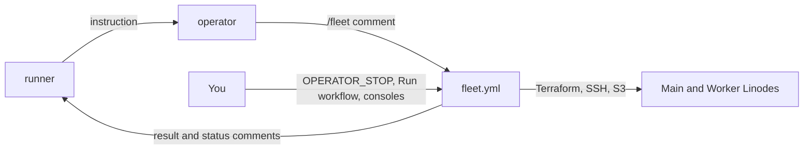
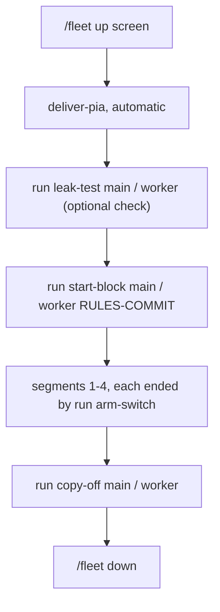

# Cloud fleet runbook

For the owner, who runs the cloud test fleet: two Linodes (Main and Worker) that screen a crawler change before it goes to the experiment host. This page says what each step does, what you see when it works, and what to do when it doesn't.

- **The plan:** `docs/plan/2026-11-08-cloud-operator.md` (the control plane and the operator) and `docs/plan/2026-11-08-cloud-test-plan.md` (the screen).
- **The decisions behind the code:** `docs/decisions/` for OP-1, OP-2a, OP-2, OP-2b, OP-3a, OP-3b and OP-3c.
- **Times are UTC.** Values in angle brackets (`<state bucket>`, `<vm address>`) are placeholders; the only account ID shown is the fake `111122223333`.

> **If something is going wrong, go straight to [Stop everything](#4-stop-everything).**

## 1. What the fleet is, and who runs it
- **The control plane** is the workflow `.github/workflows/fleet.yml`, running the committed code in `infra/fleet/` and `infra/pia-bridge/`.
  - It reads `/fleet` commands from the operator's comments on one draft PR (the channel PR, repository variable `CHANNEL_PR`), checks them against hard limits in code, and runs them.
  - Its state lives in S3: `fleet/fleet.json` in the state bucket holds the fleet's pinned commit, expiry, addresses and host keys. It never reads state back from a comment.
  - It answers each command with a result comment, and keeps one status comment up to date: roles, ages, expiry and compute cost. No address, label or fingerprint ever appears in a comment or log.
- **The operator** is an AI agent with no cloud or VPN credential. It holds only a short-lived token for the `lodestar-operator` GitHub App, and acts only by posting `/fleet` commands. The runner instructs it.
  - Its workflows arrive with OP-4 (`operator-wake.yml`, `operator-apply.yml`, `operator-tripwire.yml`) and OP-5 (`operator-injection.yml`).
  - **Until OP-4 merges, nobody can issue a `/fleet` command:** `fleet.yml` accepts them only from the App's bot account (`OPERATOR_BOT_USER_ID`).
- **You:**
  - set the switches (the repository variables `FLEET_LIVE` and `OPERATOR_STOP`);
  - keep the secrets (`PIA_SERVERS` and the environment secrets);
  - book sessions with the runner;
  - pull the kill switch;
  - can always take the fleet down yourself, without the operator ([Stop everything](#4-stop-everything), step 2).
- **Live or dry-run.** With `FLEET_LIVE` anything but `true`, every command runs dry: it answers "would create", "would destroy" or "would run the step", and touches no cloud.
  - Set it to `true` only after the OP-G gate's dry cycle.
  - **Never change it while a fleet exists.** A dry-run `down` or reaper touches nothing, so a live fleet would keep running and billing until the watchdog's 48 h.

The runner instructs the operator, the operator posts `/fleet` commands, and `fleet.yml` acts on the Linodes and reports back, while you hold the switches and the consoles:

In words: runner → operator → `/fleet` comment → `fleet.yml` → the Linodes; results go back to the runner as comments; you act on `fleet.yml` and the consoles directly.

### The hard limits (in code: `infra/fleet/limits.yaml`, bounded by `limits.py`)
| Limit | Value |
|---|---|
| Fleets at a time | one: `up` refuses while any Lodestar Linode or firewall exists, or a fleet is recorded |
| Preset | `screen` only: Main (`g6-standard-4`) and Worker (`g6-nanode-1`) |
| Lifetime | 44 h from `up`; then the hourly reaper runs `down` |
| Compute cap | $40 a month, your number; one screen fleet costs at most about $3.50 |
| Fleet lock | 90 min, so one command runs at a time |
| Code | `up` and `run` use only `main`'s current head (`down` is exempt), and a fleet stays pinned to the commit it was created from |

### Words used below
- **Screen:** a short, fail-only test of one crawler change on the two Linodes. It never ranks variants or shows a gain.
- **Block:** one screen's run on one VM: four **segments** of 2 or 3 hours each.
- **Arm:** the setting a segment runs with: the **control** (the change off) or the **treatment** (the change on). The order is ABBA: control, treatment, treatment, control.

## 2. Booking a fleet session
Before each session:
1. **The switches.** Settings → Secrets and variables → Actions → Variables:
   - `OPERATOR_STOP` is `false`;
   - `FLEET_LIVE` is `true` (only after OP-G's dry cycle).
2. **Re-confirm `PIA_SERVERS` against the Unraid host's current exit.** The Unraid exit can change between sessions. `PIA_SERVERS` is an environment secret in `pia-delivery`: a JSON object with one PIA region ID per role, `{"main": "<region id>", "worker": "<region id>"}`.
   - **The two must differ from each other.** Otherwise `deliver-pia` refuses: "PIA_SERVERS gives two roles the same region".
   - **Neither may be the region your Unraid host uses.** The code can't check this one. Look at the server or region your Unraid gluetun container is set to. If it now matches either value, change `PIA_SERVERS` before the session.
   - Tell the runner only if the Unraid exit changed.
3. **The rules commit.** The runner commits `infra/fleet/steps/screen-rules.json` for the screen and gives you the commit. It names:
   - the candidate image, by digest;
   - the treatment and the segment length;
   - the Legal Notice version start-block may accept for you (4 on `main` today).
   `start-block` refuses without it.
4. **The watchdog.** The Akamai watchdog (`lodestar-akamai-watchdog`) deletes any fleet Linode at 48 h. It's the backstop only once the canary (test plan 0a) has proven it in the fleet's Akamai account. Prove it again if its code or deployment has changed since.
5. **Book the times with the runner.** A block of 2 h segments runs about 18 h, and one of 3 h segments about 22 h. Book `up` early enough that both blocks, copy-off and `down` fit in 44 h.

## 3. A screen, step by step
You don't type these commands. The runner tells the operator, which posts them on the channel PR (after OP-4 merges), and each result comes back as a comment.

A result line has a fixed shape: `run <step> <vm>: done; <n> ok`, or `failed (exit <code>); <n> ok; failed: <names>`, followed by any counters. **Names that passed aren't listed;** only the count of `ok` lines is.

`up` creates the fleet and the PIA login follows automatically. Then each VM runs its block, its evidence is copied off, and the fleet goes down:

In words: up → deliver-pia → (leak test) → start-block → four segments with arm switches → copy-off → down.

### 3.1 `/fleet up screen`
- **What it does:**
  1. Creates Main and Worker with Terraform, pinned to `main`'s commit, with an expiry 44 h out.
  2. The `deliver-pia` chain (`pia-fence`, `deliver-pia`, `pia-release`) delivers the PIA login to each VM over pinned SSH.
  3. Each VM writes its own WireGuard configuration.
- **Works:**
  - `up screen: create main, worker, pinned to main; expires <UTC time>; at most $3.50`;
  - then one comment per VM: `deliver-pia: main: delivered; /run clean`, and the same for `worker`.
- **Fails:**
  - `refused: up screen: a Lodestar Linode exists` (or `a Lodestar firewall exists`, or `a fleet is recorded`): a previous fleet wasn't fully removed. Check Cloud Manager, then `down`.
  - `refused: up screen: the monthly fleet-compute cap would be exceeded`: wait for next month. The cap is yours, at most $40 by code.
  - `failed: terraform didn't finish; the fleet is recorded, so run down`: run `down`. Terraform's output is in the evidence bucket under `fleet/<run id>/`.
  - A `deliver-pia` line that isn't `delivered; /run clean`: ask for `run renew-vpn <vm>` ([§7](#7-renewing-the-vpn-host-keys-and-where-the-evidence-lands)).
  - A line ending `NOT clean; escalate`: `/run/lodestar-pia` may still hold the login. Tell the runner.

### 3.2 `/fleet run leak-test <vm>` (optional: `start-block` runs it too)
- **What it does:** proves nothing leaves the VM outside PIA.
  - **With the tunnel up:** IPv4 goes out through PIA, not the host's own address; IPv6 is blocked; DNS goes through gluetun.
  - **With the tunnel down, twice** (the endpoint blocked, then gluetun's VPN interface also taken down): IPv4, IPv6, DNS and UDP all fail, and a capture on gluetun's side sees zero packets.
  - **Then the tunnel recovers** through the same exit.
  - **The host's own IPv6 too:** no IPv6 forwarding, no IPv6 on the stack's Docker network, and no global IPv6 address in gluetun's namespace.
  - It refuses while a block is recorded or running.
- **Works:** `run leak-test main: done; <n> ok; captured_packets_down 0, captured_packets_ifdown 0`.
- **Fails:** `failed (exit 1); <n> ok; failed: <names>, leak_test`. **That's a stop condition: no crawl starts on that VM.** Tell the runner, with the failed names.

### 3.3 `/fleet run start-block <vm> <rules commit>`
- **What it does:** one block on that VM, at the rules commit (which must be an ancestor of `main`). In order:
  1. It refuses if a block is recorded or running, or a past block's evidence hasn't been copied off.
  2. **It runs the leak test in the same run,** and goes on only if it passes.
  3. It writes the durable block marker (`/var/lib/lodestar-block/marker`).
  4. It starts Lodestar on a fresh data directory, in gluetun's network namespace, with the candidate image.
  5. It accepts the Legal Notice version the rules name, and sets a random admin password that stays root-only on the VM.
  6. It starts segment 1's collector (the control arm) and the outage watcher, then returns. The block runs on its own.
- **Works:** `run start-block main: done; <n> ok; …, block_segment 1`, after the leak test's own counters.
- **Fails:**
  - **The failed names end `leak_test_passed, start_block`:** the leak test failed (its own failed names come first). It's a stop, as in 3.2.
  - **`failed: notice_version, start_block`,** with `notice_version_served <n>` and `notice_version_pinned <m>`: Lodestar's Legal Notice changed since the rules were written. It's a stop; the runner commits new rules.
  - **`failed: block_running, start_block`:** a block is already recorded there. `copy-off` ends it.
  - **`failed: evidence_copied, start_block`:** the last block's evidence hasn't been copied off. Run `copy-off` first.
  - **Any other failure after the marker:** start-block stops Lodestar and the Docker proxy again, and the block stays recorded. Run `copy-off` to end it, then tell the runner.
    - If `copy-off` then answers `failed: evidence_present, copy_off`, the block failed before anything was staged, and can't be ended that way. Run `down`.

### 3.4 `/fleet run arm-switch <vm>`, after each segment
- **What it does:** the operator runs it shortly before a segment ends, at the booked times.
  1. It waits up to 15 minutes for the segment's collector to finish its window. The collector stops Lodestar itself.
  2. It starts Lodestar alone on the next arm, without recreating gluetun.
  3. It starts the next segment's collector.
  4. After segment 4, it ends the block instead.
- **Works:** `done; <n> ok; block_segment 2, switch_seconds <s>`. A switch must take under 10 minutes (CR-SPEC 2.3). After segment 4: `done; <n> ok; block_segment 4`. A later `vm-status` then shows no `block_segment`.
- **Fails:**
  - **`failed: segment_ended, arm_switch`:** the segment hadn't ended within 15 minutes. Run it again later.
  - **`failed: segment_complete, arm_switch`:** the segment ended without completing its window (a crash, an exit, a stop). For a screen that's a stop or a void, which the runner decides. The block stays recorded; `copy-off` ends it.
  - **Any failure after Lodestar started:** it stops Lodestar and the proxy again. Then as above.

### 3.5 `/fleet run vm-status <vm>`, any time
- **Works:** counters only, for example `done; <n> ok; block_segment <n>, collectors_running 1, disk_free_gib <n>, mem_available_mib <n>, uptime_hours <n>`.
  - A `failed:` list names what isn't so; `lodestar_running` between segments is normal.
  - No `block_segment` means no block is recorded.

### 3.6 `/fleet run outage-watcher <vm>`, if needed
- **What the watcher does:** it follows gluetun's container events and log. On a VPN restart or tunnel-down line it counts an outage, and writes a `link_outage` note into the running segment's evidence at once.
  - It never stops the crawl; the analyzer judges the segment.
  - This step restarts it if it has stopped. It needs a recorded block.
- **Works:** `done; 2 ok; outages_seen <n>` when it started the watcher, or `done; 1 ok; outages_seen <n>` when it was already running.

### 3.7 `/fleet run copy-off <vm>`
- **What it does:**
  1. Refuses while a collector runs, and stops a Lodestar left running alone.
  2. Runs the analyzer and the allow-list scrubber over the block's evidence, in a container with no network.
  3. The control plane scrubs the result again, and stores it only in the private evidence bucket, as `fleet/<run id>/copy-off-<vm>.json`.
  4. Ends the block: the marker, the watcher and the Docker proxy go.
- **Works:** `done; <n> ok; segments_copied 4; evidence stored in the private bucket`.
- **Fails:**
  - **`failed: block_running, copy_off`:** a collector is still running, so the segment isn't over.
  - **`the evidence couldn't be stored; it's still on the VM, so copy-off can run again`:** run it again.
- **Raw logs, databases, executables and the password never leave the VM.** They're destroyed with it.

### 3.8 `/fleet down`
- **What it does:** destroys everything in the Terraform state, deletes any tagged Lodestar resource left over, and records the fleet as gone. It runs even with `OPERATOR_STOP` set, and on any `main` commit.
- **Works:** `down: destroy the fleet`.
- **Fails:** `down: tagged resources remain after destroy; escalate`. Check Cloud Manager (Linodes and Firewalls), and delete what's left by hand.

### 3.9 Other answers you may see
- **`refused: this run's code is not main's head`:** `main` moved between the comment and the job, which happens often. Post the command again.
- **`busy, retry`:** another command holds the fleet lock. **`busy: the fleet is being reaped; retry later`:** the reaper is taking the fleet down.
- **`refused: OPERATOR_STOP is set: only down runs`:** the soft stop is on.
- **`refused: fleet overdue or mismatched: only down runs`:** the fleet is past its expiry, or the hourly firewall audit found a mismatch. The reaper takes it down within the hour; nothing else runs.
- **`reaper: …; escalate`:** the hourly reaper (minute 17) couldn't do part of its job. Tell the runner.

## 4. Stop everything
Fastest first. Do as many steps as the situation needs; each says how to undo it.

> **Not a stop: never switch `FLEET_LIVE` off while a fleet exists.** Dry-run `down` and the reaper touch nothing, so the fleet would keep running until the watchdog's 48 h.

1. **Set `OPERATOR_STOP` to `true`.**
   - **Where:** GitHub → the repository → Settings → Secrets and variables → Actions → Variables → `OPERATOR_STOP`.
   - **Effect:** every fleet command except `down` is refused; the reaper still runs. The operator's workflows check it too (after OP-4 merges). The App can't change variables.
   - **Residual:** a Claude session posting as you could set it back. For a firm stop, do step 2 as well.
   - **Undo:** set it back to `false`.
2. **Disable the operator's workflows, and take the fleet down.**
   - **Where:** GitHub → Actions → each workflow → **Disable workflow**:
     - `operator-wake.yml`, `operator-apply.yml` and `operator-tripwire.yml`, after OP-4 merges;
     - `operator-injection.yml`, after OP-5 merges.
     The plan gives the wake, apply and injection workflows the Anthropic key; confirm which do once they're on `main`.
   - **Take the fleet down without the operator:** GitHub → Actions → `fleet` → **Run workflow**, on `main`.
     - It runs only `down`, only for your user ID (the `OWNER_USER_ID` variable), and takes no inputs. It answers `owner's down: destroy the fleet`.
     - If `OWNER_USER_ID` isn't set, or you aren't that user, the job is skipped without a word; use Cloud Manager (step 5).
   - **Disable `fleet.yml` only after the fleet is down.** It runs the hourly reaper; once it's disabled, the Akamai watchdog is the only lifetime backstop.
   - **Residual:** any session posting as you can dispatch `down` and end a screen mid-block. That costs a screen, nothing else.
   - **Undo:** Actions → each workflow → **Enable workflow**.
3. **Suspend the GitHub App, and stop Anthropic spend.**
   - **GitHub:** the `lodestar-operator` App's installation on `dvortsis/lodestar-v2`: suspend it.
   - **Anthropic Console:** in the `lodestar-operator` workspace, revoke the API key (or set the workspace's spend limit to $0). Then interrupt or archive any running session: a revoked key may not stop a session already running.
   - **Undo:** unsuspend the installation. A revoked key can't come back: make a new one and put it in the `cloud-operator` environment's `ANTHROPIC_API_KEY`. Restore the spend limit ($200).
4. **Cut cloud access.**
   > **The revocations and the key deletion in this step can't be undone, only replaced.** With the roles denied, `fleet.yml` can't run `down` or the reaper either, so step 5 is then by hand.
   - **AWS:** IAM → Roles → the role → Permissions → Add permissions → Attach policies:
     - `LodestarFleetDenyAll` on `LodestarFleetOperator` and `LodestarOperatorBridge`;
     - `LodestarPiaDenyAll` on `LodestarPiaDelivery`. If the fleet has its own AWS account, this role is in the account that holds the PIA secret.
   - **Linode Cloud Manager:** revoke the fleet token (the one stored in `lodestar/akamai-fleet-token`) and the firewall token (`lodestar/akamai-firewall-token`). The watchdog's own token (`lodestar/akamai-token`) keeps working.
   - **GitHub:** delete both copies of `FLEET_SSH_KEY`, in the `cloud-fleet` and `pia-delivery` environments.
   - **If anything suggests the PIA password leaked,** change it, and update `lodestar/pia-vpn` in Secrets Manager.
   - **Undo:**
     - detach the deny-all policies;
     - make new Linode tokens with the same scopes, and store them in the same two secrets;
     - for SSH, make a new key pair (`ssh-keygen -t ed25519`). Put the private key in both environments' `FLEET_SSH_KEY`, and the public key in the `FLEET_SSH_PUBLIC_KEY` variable; then delete the private key from your machine.
5. **Tear down by hand.**
   - **Where:** Linode Cloud Manager → Linodes → `lodestar-main-fleet` and `lodestar-worker-01-fleet` → Delete. Then Firewalls → `lodestar-main-fw-fleet` and `lodestar-worker-fw-fleet` → Delete.
   - Or let the watchdog delete the Linodes at 48 h. It leaves their firewalls, so delete those by hand.
   - **Then clear the record before any `up` or script runs.** `up` refuses while a fleet is recorded. Detach the deny-all policies first (step 4's undo), then dispatch `down` (step 2). It finds nothing left, and records the fleet as gone.

**What doesn't depend on the repository:** the Akamai watchdog, the IAM roles' scopes, and the Anthropic workspace's spend limit. A bad merge to the control plane can't remove them.

## 5. Never run the manual scripts while a fleet exists
`infra/akamai/terraform/scripts/Deploy.ps1` and `Destroy.ps1` use **the same Terraform state** as the fleet (`terraform/lodestar.tfstate`), **but not its lock**. So does a `terraform apply -refresh-only` run by hand. Run while a fleet exists, they can destroy it under a running block, or leave `fleet.json` describing Linodes that are gone.
- **Before using them, check both:** the status comment says **No fleet**, and Cloud Manager shows no `lodestar-` Linode or firewall.
- **If you deleted Linodes by hand,** clear the record first ([Stop everything](#4-stop-everything), step 5).

The AWS Windows scripts (`Deploy-AwsWindows.ps1`, `Destroy-AwsWindows.ps1`) keep their own state and don't touch the fleet's.

## 6. The gluetun-stop drill
**Why:** to see that when gluetun (the kill switch) stops mid-block:
- nothing leaves outside the VPN;
- the outage watcher records it;
- the block can still be ended and copied off.

**Do it only on a test VM, never on a block whose result matters.** It ends the segment.

**First, hold the operator off.** Your commands don't take the VM's lock, so ask the runner to hold all commands for that VM until step 5's copy-off.

**Getting in.** You SSH in yourself, from your admin address (`OWNER_ADMIN_CIDR`), with your own key, as user `lodestar`. Pin the host key from the state bucket, never from an operator report:
```bash
cd "$(mktemp -d)"
# With your MFA admin session. <state bucket> is the STATE_BUCKET secret's value;
# use your real account ID, not the fake one shown.
aws s3 cp s3://<state bucket>/fleet/fleet.json - --expected-bucket-owner 111122223333 > fleet.json
python3 -c 'import json; r = json.load(open("fleet.json"))["roles"]["main"]; print(r["address"], r["host_key"])' > known_hosts
ssh-keygen -lf known_hosts        # must show that role's "fingerprint" value in fleet.json
ssh -o UserKnownHostsFile=known_hosts -o StrictHostKeyChecking=yes lodestar@<vm address>
```
Check the address against Cloud Manager too. Delete the folder when you're done.

**The drill,** on the VM, during a segment (`run vm-status` shows `collectors_running 1`):
1. **Note the segment:** `sudo cat /var/lib/lodestar-block/marker` (the `segment=` line).
2. **Stop gluetun:** `sudo docker stop gluetun`.
3. **Confirm nothing leaves outside the VPN.**
   - The probe runs in a throwaway container in Lodestar's own network namespace, with the pinned probe image from `infra/fleet/steps/vm/block-lib.sh`:
     ```bash
     sudo docker run --rm --network container:lodestar --cap-drop ALL \
       nicolaka/netshoot@sha256:b09d9b21381f47a79b3cbcb30da25266dc17186ea00ae65e99fdc51396f48e70 \
       sh -c 'nc -z -w 5 1.1.1.1 443; echo "tcp rc=$?"; curl -6 -s -m 8 "http://[2606:4700:4700::1111]/"; echo "v6 rc=$?"; ip -o addr'
     ```
   - **What you should see:** both `rc` values non-zero, and no `eth0` in `ip -o addr`. Only `lo` is left; an old `wg0` can't send without `eth0`.
   - **Why this proves it:** Lodestar shares gluetun's namespace, so with gluetun gone it has no network at all. It's cut off, not leaking. The test uses an address, not a name, so a failure isn't just DNS.
   - **Why `container:lodestar`:** Docker refuses to join a stopped container's network (`container:gluetun`), but Lodestar's is still there.
4. **Confirm the watcher recorded it:**
   - `sudo cat /var/lib/lodestar-block/outages` gains one or more lines (the container's die and stop events each count);
   - `sudo cat /var/lib/lodestar-block/notes` gains a line with the segment number. That note went into the segment's evidence: one per 30-second burst.
5. **End the segment and the block:** `sudo docker stop -t 120 lodestar-collector-<segment>`.
   - The collector finishes with reason `operator_stop`, and stops Lodestar first. That takes up to a minute; `-t 120` gives it the time, where Docker's default of 10 s would kill it part-way.
   - Then log out, and ask for `run copy-off <vm>`. It should answer `done; <n> ok; segments_copied <k>; evidence stored in the private bucket`.
   - A `vm-status` afterwards shows no `block_segment`. The stopped segment's verdict is in the evidence bucket copy.
   - Tell the runner it can resume that VM's commands.
6. **Afterwards:** gluetun stays stopped.
   - A new block's `start-block` recreates it through its leak test.
   - To get the tunnel back sooner, ask for `run leak-test <vm>`: it recreates gluetun from the current configuration and proves it.
   - `renew-vpn` won't do it: it restarts gluetun only when it's running.

Don't restart gluetun by hand in a block: a gluetun restart needs a Lodestar restart (`docs/operations.md` §4.3), which ends the segment anyway.

## 7. Renewing the VPN, host keys, and where the evidence lands
- **`/fleet run renew-vpn <vm>`** delivers the PIA login again, through the same `deliver-pia` chain as after `up`. It first answers `run renew-vpn <vm>: deliver the PIA login again (deliver-pia, under this run's lock)`, then:
  - **outside a block,** with gluetun running: it restarts gluetun (and Lodestar, if running), so the new configuration takes effect: `deliver-pia: main: delivered; /run clean`;
  - **during a block,** between segments included: it never touches the tunnel. It reports `renewed; takes effect after the block`, and the next `start-block` or `leak-test` brings it into force;
  - **if the VM can't say whether a block is running:** it leaves the tunnel alone and reports `escalate`.
- **Host keys:** the control plane makes each VM's key at `up`, and pins it.
  - Fingerprints are in `fleet/fleet.json` in the state bucket (`roles.<vm>.fingerprint`, in `SHA256:…` form). Addresses are in Cloud Manager.
  - Never take either from a comment or an operator report.
- **Evidence:** in the private evidence bucket, which deletes objects after 14 days.
  - `fleet/<run id>/copy-off-<vm>.json`: the scrubbed screen evidence.
  - `fleet/<run id>/<name>.log`: Terraform's output for that run.
  - **Nothing private goes to a comment, a log or an Actions artifact.**
  - **How the results reach the runner isn't decided yet:** the runner has no AWS access. Fetch the copy-off file for it when it asks, within the 14 days.

## 8. What never to do
- **Never paste a credential into chat, an issue, a PR or a comment.** Values go only where they're named: GitHub environment secrets, Secrets Manager, the Console.
- **Never run a coding agent in the Windows session that holds your cached admin credentials** (#625's rule).
- **Never stitch soak or screen runs together, or pool a screen with experiment-host segments.** A screen is fail-only and never gate evidence.
- **Never widen an IAM role, a token's scope or a limit without deciding it yourself.** A change to `limits.yaml`, `fleet.yml` or the roles goes through a reviewed PR.
- **Never switch `FLEET_LIVE` off while a fleet exists** ([Stop everything](#4-stop-everything)).
- **Never run `Deploy.ps1` or `Destroy.ps1` while a fleet exists** ([§5](#5-never-run-the-manual-scripts-while-a-fleet-exists)).
