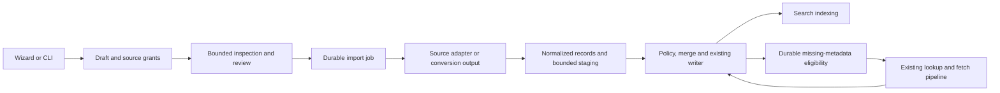

# DHT crawler import wizards

Date: October 29, 2026. Status: **specified; no implementation or compatibility acceptance yet**.

> **Scope now (owner-decisions §2.25; `docs/decisions/2026-10-30-master-plan.md`, "Imports", 2026-10-30):** a CLI import of the Magnetico SQLite database (read-only) and of Bitmagnet through a restored, isolated PostgreSQL 16, staged through 1M and 10M pilots to a measured 50M gate before the full corpus. **Deferred:** the SQL/ZIP dump parser, the other crawler families, uploads (the owner decides first), MongoDB/MySQL, the wizard, and recovery until CR-3. The rest of this document is the later design; where it differs, the master plan governs.

## 1. Product outcome and scope

Create source-specific import wizards over one durable migration engine. A user
selects their crawler, supplies a supported database or export, previews the data,
reviews storage and recovery choices, and starts a resumable import. Existing
catalog data becomes searchable as policy and indexing permit. Missing torrent
metadata is recovered independently through Lodestar's bounded background pipeline.

The requested coverage is all **seven identified crawler families**: Magnetico,
Bitmagnet, Rats Search, nbdy/dhtc, botsgalaxy/go-dhtcrawler, felix/dhtsearch and
nitmir/btdht-crawler. Include MagnetDB as a dataset profile and portable formats
for other crawlers. This is not a claim that every crawler, fork, database version
or physical database directory has an interchangeable schema.

The [Magnetico/Bitmagnet migration plan](2026-10-29-magnetico-bitmagnet-migration.md)
remains the detailed foundation for source preservation, field trust, transactional
merge, recovery and the supplied data. This document expands its coverage and
defines the wizard, adapter registry, APIs, implementation slices and release gates.
For wizard flow and expanded formats, this document takes precedence. Neither
document describes already-shipped functionality.

Do not implement seven separate copies of job control, deduplication or recovery.
Do not introduce arbitrary SQL execution or a general-purpose database browser.
Unknown sources can use a documented portable export; a new native profile must
pass the same compatibility process as the initial profiles.

While the CR-0 soak is active, perform only planning, source work and lightweight
checks in separate branches/worktrees. Builds, installs, browser suites, database
services, full source inspection, imports and network recovery trials wait until
the soak stops. The running package, live database, collector and settings stay frozen.

## 2. Support matrix and release meaning

Use these labels consistently in the UI, documentation and compatibility ledger:

- **Direct:** Lodestar reads the supported logical database/export without starting
  the source crawler or mutating the source.
- **Convert first:** a tested, bounded exporter or compatible source application
  produces a supported portable file. The wizard explains and verifies that step.
- **Needs a sample:** recognized family but untested schema/version. The wizard
  refuses native import and offers a portable-export route or a private schema report.
- **Unavailable in this build:** an optional connector/helper is not packaged;
  expose another supported method instead of a control that cannot work.

Only mark a source/method **supported** after a fixture has completed inspection,
import, restart/resume, deduplication, indexing and applicable recovery tests. A
README, model definition or export tutorial alone is not compatibility acceptance.

| Profile | Planned direct methods | Conversion / special cases | Initial contract |
| --- | --- | --- | --- |
| Magnetico | Consistent SQLite file/snapshot | TAR containing SQLite: explicitly staged extraction; PostgreSQL forks need a tested exporter/profile | Observed SQLite schema v3; add older schemas only with fixtures |
| Bitmagnet | Read-only PostgreSQL; supported PostgreSQL data-only SQL; ZIP containing one supported SQL member | Physical PostgreSQL directory or custom/directory pg_dump archive: compatible preparation/export first | Observed 0.10.0-shaped fields and dump dialect, capability-tested variants |
| Rats Search | `.ratsdb` portable export version 1 | Older Sphinx/Manticore installations: supported source export or separately tested read-only export helper; no raw-index-file parser | Current versioned dump framing plus domain JSON codec; old releases are separate profiles |
| nbdy/dhtc | SQLite, PostgreSQL and MySQL GORM schemas | CloverDB v2: bounded conversion helper operating on a consistent disposable copy if the library writes on open | Inspected `GormTorrent` and Clover document fields; each SQL backend tested separately |
| botsgalaxy/go-dhtcrawler | SQLite | Optional original `.torrent` directory through the generic profile | `hashes`, `torrents`, `files`; unresolved hashes are candidates, not complete torrents |
| felix/dhtsearch | SQLite and PostgreSQL | Unknown fork exports use the portable profile | Explicit `torrents`, `files`, `tags` and relationship schema; pending hashes have missing names |
| nitmir/btdht-crawler | Read-only MongoDB; collection BSON export; canonical Extended JSON export | Legacy MySQL variants require their own sample/profile or portable export | Inspected MongoDB writer uses binary `_id` and retains at most the first 1,000 files |
| MagnetDB dataset | Release-specific SQLite; documented portable tables if available | Distribution/package differences require a release fixture | Documentation identifies torrents/files/IMDb matches; actual release column/types remain a compatibility gate |
| Other crawler / portable | Lodestar import JSONL v1, constrained mapped CSV/JSONL, magnet/hash lists, `.torrent` files/directories | Unsupported proprietary databases need an exporter | Published versioned contract; no scripts or expressions in mappings |

Support is the cross-product of **source profile + schema version + transport**.
Supporting Bitmagnet PostgreSQL does not imply arbitrary PostgreSQL dumps or another
crawler's PostgreSQL tables. Supporting dhtc SQLite does not validate its MySQL
collation/unsigned-number behavior or Clover storage.

Deliver direct paths first, but keep Clover conversion, legacy Rats export and
MagnetDB release fixtures visible as remaining work. Do not declare complete
coverage of this matrix until every promised path has an accepted fixture. Unknown
historical forks remain explicitly outside the tested compatibility set.

## 3. Shared wizard: six stages

Use a full-page flow, not a modal. Entry points: Sources → **Import library**,
Settings → Data import, and the command palette. Direct `/imports` access must work
even if unrelated Sources/Settings features are not yet complete. Register links
only when the capability is present.

Routes:

- `/imports`: active jobs, saved drafts and paginated history.
- `/imports/new`: crawler selection and optional automatic detection.
- `/imports/drafts/{id}/{step}`: resumable setup steps, with validated prerequisites.
- `/imports/{jobId}`: durable running/result page, independent of browser lifetime.

### Stage 1 — Choose crawler and input

Present named crawler choices and **Other / portable export**. Show supported input
methods for the selected profile: local/server file, database connection, or export
preparation. Automatic detection ranks candidates using content/schema signatures;
it never selects a writer or starts a source application.

For local/server files, distinguish where the browser runs from where Lodestar
runs. Offer an operator-configured import folder, a CLI-registered source, or a
bounded small-file upload. Explain that a browser path on another computer is not
a server path. Large databases use mounted/server-side files, not browser upload.

Connection fields are structured: connector, host, port, database, allowed schema
or collection, username, password reference and TLS settings. Progressive advanced
fields contain certificate and timeout options. No arbitrary DSN options, commands,
SQL or server-side filename expressions. Passwords never enter URLs or browser drafts.

Primary action: **Inspect source**. Unsupported physical storage shows **Prepare
an export**, with the relevant source-specific instructions and prerequisites.

### Stage 2 — Inspect and preview

Show detected format/version, inspection confidence, source snapshot consistency,
available fields, source size, encoding, file-list limitations and compatibility.
Offer a small, access-controlled sample with imported/missing/conflicting fields
visibly distinguished. Apply current visibility/filter policy to preview content.
Do not display blocked names simply because preview precedes import.

Initial preview budget: at most 25 parent records, 1,000 sampled child file records,
8 MiB decoded data and a five-second query/decode deadline per operation. Enforce
row/field allocation limits before copying values. Metadata inspection must not
run unbounded counts, recursively enumerate a huge directory or load the largest
file list. Directory detection uses at most 1,000 entries before reporting an
unknown remainder. All previews are cancellable and leave the source untouched.

For a dump whose torrent table is far into the stream, report **format recognized;
torrent preview unavailable in this bounded inspection**. Do not scan 100 GiB merely
to populate a preview. Users can run a separate bounded pilot later. Estimated
counts, sampled completeness and sampled overlap remain estimates with coverage.

Require resolution of unsupported schema, unreadable input, missing permission or
inconsistent SQLite snapshot before continuing. A changed source or profile selection
invalidates this preview and all dependent estimates.

### Stage 3 — Choose data and duplicate behavior

Defaults: preserve core torrent metadata, available files, historical timestamps
and source attribution. Include supported categories/external IDs/annotations as
attributed imported data, with an explicit size estimate. Large readme/description
fields are optional and bounded. Unresolved hashes can be included as recovery
candidates; explain that they are not yet ordinary searchable torrent records.

Show a source-specific mapping preview. Native profiles use reviewed mappings;
users do not manually map every field. Generic CSV/JSONL exposes only typed field
selectors, encoding/delimiter selection and known transforms such as hex decoding.
No JavaScript, templates, SQL, arbitrary JSONPath evaluation or user-defined functions.

Offer **Merge and fill missing data** (recommended) and **Only add new torrents**.
Both dedupe by typed hash, preserve verified data/user corrections and obey deletion,
quarantine and private-source restrictions. Explain that skipping duplicates can
leave useful richer source metadata unimported. Do not offer a blanket overwrite
mode. Even add-only ingestion may attach safe source/job attribution without
changing existing metadata; document this distinction.

For cross-source conflicts, show a few authorized examples and aggregate counts;
keep existing equal-quality data and record the conflict. Never merge incompatible
file lists into a fabricated complete torrent. Preserve provenance without allocating
a new global source-bit slot for every job, dataset or imported label.

### Stage 4 — Storage, pacing and missing metadata

Show destination/staging volumes, estimated DB/index/WAL/spool growth, free-space
reserve and estimate uncertainty. Offer **Run a small pilot** when the estimate is
weak. No estimate based solely on compressed size is sufficient for a huge import.
Selection of a staging volume requires a configured writable location, not an
arbitrary browser-provided filesystem path.

Controls: ingestion pace, optional supported schedule window, staging quota, and
**Recover missing metadata after import**. Keep crawler intensity unchanged. If
schedule execution is not implemented, omit that control rather than accepting an
ineffective schedule. Start with one active import worker; additional approved jobs
wait in a durable queue. Paused jobs consume no worker slot.

Recovery is enabled for eligible public records when the user starts the job with
that option. Unknown-privacy datasets require an explicit public-dataset choice;
declared private/restricted records never become public through that choice. Show
eligible/private/unknown counts where measured; otherwise say unknown. No external
metadata provider, tracker contact from imported URLs or payload download is implied.

Default recovery begins after local import/merge completes, avoiding network work
for fields that later source tables supply. Multiple sources can be added to a
migration group whose recovery is held until all selected imports finish or the
owner explicitly releases the hold. Failure of one import does not silently release it.

### Stage 5 — Review and start

One summary identifies the source/snapshot, profile, mappings, duplicate policy,
storage budget, unsupported/skipped fields, privacy choice and recovery behavior.
Primary action: **Start import**. Do not ask for repeated confirmations for ordinary
reversible navigation, preview or pause. The start action is the explicit approval
for destination writes and the selected recovery policy.

Issue a short-lived server review token bound to source generation, preview ID,
options digest, authorization and draft revision. Initial lifetime: 15 minutes;
expiry refreshes the summary without discarding the draft. At start, recheck source
identity, permissions, capability and disk reserve. Changed input/options/policy
requires a fresh review. Double-clicks/retries use an idempotency key and return
the same job; they cannot start duplicate imports.

### Stage 6 — Progress and result

Display three independent tracks: **Import**, **Search indexing**, **Metadata recovery**.
Each has its own status and meaningful unit. Bytes read/replayed are separate from
records committed; imported rows are separate from unique new torrents. Recovery
counts committed upgrades rather than merely successful network fetches.

Show phase, elapsed active time, current rate, estimated/unknown total, recent
errors, disk reserve and controls. ETA is unavailable until there is a meaningful
denominator/rate; an ongoing recovery process has no fabricated completion ETA.
Index progress uses durable acknowledgments/watermarks, not a timer or queue-empty
guess. A job can say **Import complete; indexing in progress; recovery pending**.

Pause import and recovery independently. Cancel stops future work and preserves
committed records; explain that fact in the cancel dialog. This is not rollback.
An unavailable source can be reconnected and resumed after identity checks. After
failure, offer a specific repair action and **Resume**, not a silent restart from zero.

Results show new/improved/unchanged/conflicted/rejected/filtered counts, remaining
metadata gaps, index status and an aggregate report. Private issues use paginated
authorized views. A stopped or truncated import is **partial**, never complete.
Unavailable swarms do not keep ingestion permanently running.

## 4. Source-specific wizard branches

### 4.1 Magnetico

Detect SQLite magic plus required base-table columns and supported schema versions.
Show whether `files` and historical swarm observations exist. Ignore FTS objects.
Preserve unknown file ordering/single-file mode and unknown privacy explicitly.
Empty/malformed file rows do not discard a valid parent hash.

If WAL/SHM exist or the owner reports a live source, require a consistent snapshot
procedure. `immutable=1` is only for a proven static snapshot; it must not hide
uncheckpointed WAL data. Do not repair, checkpoint or add indexes to the original.

For TAR-only input, identify a single plausible SQLite member using bounded headers.
Require enough staging space and explicit preparation before streaming that member
to a job-owned file. SQLite needs random access; promise no direct random querying
inside compressed TAR. Reject links/traversal/multiple ambiguous candidates. The
owner already has an extracted file, so its wizard recommends that file instead.

### 4.2 Bitmagnet

Offer PostgreSQL, SQL and ZIP. Detect schemas by required columns/capabilities;
distinguish optional `files_count`, separate `torrent_pieces`, and legacy layouts.
Preview missing/over-threshold files and retain private status. Source tags/content
mappings are imported claims, not verified torrent metadata.

Use the foundation plan's non-executing INSERT/COPY parser. Handle the supplied
dump's `SQL_ASCII` byte uncertainty, column-named multi-row INSERT and table ordering.
Do not restore a community dump into PostgreSQL automatically. ZIP preview lists
member and expanded-size metadata; the importer streams the selected SQL member.

Detect `PG_VERSION` as **physical PostgreSQL storage** and route to a preparation
page: matching PostgreSQL major/platform/extensions, preserved consistent copy,
recovery only on the copy, then read-only connection or logical export. Never start
the crawler or source database as a side effect of Inspect. A tested conversion
guide/tool is required before that path is marked supported.

### 4.3 Rats Search

Prefer `.ratsdb` version 1. Validate its magic, big-endian framing, bounded JSON
header, qCompress frames, JSONL records, end marker and footer totals. Decompress
one bounded frame at a time; enforce both advertised and actual output limits.
Checkpoint at complete frame boundaries and verify source identity on resume.

Map core identity/files plus supported categories/historical statistics. Ignore
source peer IDs/IP addresses for recovery and do not import votes as Lodestar user
votes. Remote descriptions and image URLs remain inert attributed data. A missing
footer means partial source coverage, even if complete preceding frames are usable.

Older Rats installations may use Sphinx/Manticore data files and different schemas.
Offer **Export from Rats** when that version has a compatible exporter. Otherwise
provide a pinned read-only logical exporter for tested table layouts. Never assume
MySQL wire compatibility makes Manticore a normal MySQL database. Raw index files
need their matching engine/export procedure; they are not parsed by Lodestar.

### 4.4 nbdy/dhtc

Detect SQL GORM fields and serialized file JSON; support SQLite/PostgreSQL/MySQL
with backend-specific integer, time, encoding, collation and pagination tests.
Validate serialized hashes and file shapes before conversion. Import supported
categories as attributed labels; do not import watch rules, credentials or blacklists
as Lodestar settings.

CloverDB uses typed documents for name, hash, files, discovery time, total size and
categories. Its existing constructor opens writable storage and creates collections,
and several read helpers use `FindAll`. Do not call those helpers on the original.
Deliver a small pinned converter using a verified bounded iterator; if the library
cannot open read-only, work only on a consistent disposable copy. Export portable
JSONL with provenance and counts. Reader boundedness, platform packaging and restart
behavior are mandatory gates; merely having the source model is insufficient.

### 4.5 botsgalaxy/go-dhtcrawler

Read `torrents` and `files`; separately offer unresolved entries from `hashes`.
Keep request/announcement counts as historical source evidence, not current seeders.
Do not import operational retry state as Lodestar scheduling policy. A missing file
row for a reported single-file torrent is not automatically data loss: use the
profile's representation rules and preserve remaining uncertainty.

### 4.6 felix/dhtsearch

Read SQLite/PostgreSQL torrents, files and tags with schema-specific queries.
Rows with missing names represent pending hashes and become candidates. Preserve
timestamps/tags; do not import routing peers as fresh recovery hints. Never execute
the source's schema/migration or FTS setup functions against the input.

### 4.7 nitmir/btdht-crawler

Offer MongoDB read-only connection, a collection BSON file, or canonical MongoDB
Extended JSON. Decode binary `_id`, dates and integer types explicitly; JSON strings
are not interchangeable with BSON binary values. Use an existing read-only account,
TLS when remote, bounded cursor batches and source generation/snapshot checks.

Compare reported `file_nb` with retained file rows: the inspected writer caps file
storage at 1,000. Preserve valid files, flag truncation and enqueue eligible repair.
Existing source text may already have been decoded lossily; do not claim byte-perfect
original names. Old MySQL variants remain **Needs a sample** until a separate
schema/fixture is accepted. Do not silently apply the MongoDB profile to them.

### 4.8 MagnetDB

Label this as a dataset import, not a running crawler connection. Bind mappings to
an inspected release schema. Preserve documented attribution and source release
identity; retain IMDb matches/confidence as imported enrichment rather than canonical
verification or live external-provider results. Available documentation is a lead,
not proof of column-level compatibility. Require a small release fixture before
exposing Start for native input.

### 4.9 Portable exports and other sources

Publish **Lodestar import JSONL v1**: a manifest/header containing schema and source
identity; typed torrent/candidate records; optional separately keyed file/enrichment
records; a final counts/digest record. Specify canonical digest bytes, ordering,
encoding, required/optional fields, integer bounds and extension namespaces. Streaming
records need stable logical IDs for replay. Unknown required versions fail clearly;
unknown optional fields are counted and skipped under the compatibility policy.

Use explicit typed full hashes, raw text bytes where available, nullable unknown
values, separate privacy/quality/provenance, and timestamp units. Large integers
use a defined lossless representation; JavaScript previews must not round them.
No arbitrary binary blobs, expressions, filesystem paths to follow or executable
content. Publish synthetic examples and an exporter conformance test suite.

Mapped CSV/JSONL is a convenience input to that normalized model. Restrict mappings
to supported fields and fixed conversions; nested arbitrary files are not guessed.
Hash/magnet lists create candidates and preserve usable display names. Importing
a magnet does not authorize fetching its `xs`, `as`, `ws` or tracker URLs. Recovery
uses existing approved finders and source/privacy policy.

For `.torrent` files/directories, parse with the existing metainfo parser and verify
the hash over the original info bytes. Never deserialize/re-encode before hashing.
Support v1/v2/hybrid only to the extent existing identity/storage contracts support
them; preserve full hashes and refuse unsupported identity types explicitly. Do not
truncate v2 into v1. Directory traversal is bounded, non-symlink-following, cancellable
and resumable with a private on-disk inventory. No payload files are imported.

## 5. Shared backend architecture

### Adapter registry

One compiled registry records profile ID, display/message IDs, supported transports,
schema fingerprints, version ranges, capability flags, optional dependencies,
cursor version, data mappings, preview strategy, resource limits and fixture IDs.
The UI consumes this catalog rather than duplicating backend compatibility rules.
No downloaded executable plugins or source-provided scripts.

Suggested adapter operations: `probe`, `inspect`, `open_snapshot`, `read_page`,
`checkpoint`, `validate_resume`, `close`. Each returns typed errors and normalized
data. Connection cancellation and drop must close source cursors/tasks. Each
adapter must define stable ordering and snapshot consistency; shared transport code
does not invent those guarantees. Source-owned counters are not Lodestar progress.

Add modules under `crates/sources-importers` for registry, normalized records,
profiles, SQLite/SQL/Mongo transports, dump/portable readers and conversion contracts.
Use the existing metainfo/parser libraries. Review new connector dependencies for
bounded streaming, TLS, platform support and maintenance before adding them.

### Quality and merge

Retain independent fields for file-list completeness, hash verification, source
privacy and recovery eligibility. Valid hash-only rows live as durable candidates
until useful canonical fields exist; do not fabricate zero size or empty name.

Precedence: preserve user corrections; verified info controls canonical info fields;
consistent richer imported fields can fill missing unverified data; conflicting
equal-quality imports preserve the existing value and record a bounded finding.
One typed torrent identity can belong to multiple datasets/jobs without becoming
multiple torrents. Names/sizes are not deduplication keys. An imported source claim
must not clear private restrictions or resurrect a deleted/quarantined row.

Local classification/enrichment runs through existing policy and reindex contracts.
Imported movie titles/external IDs remain distinct from raw torrent names. Historical
seeders/leechers need observation age; unknown dates and source sentinels stay unknown.
Do not automatically schedule all imported records merely because raw info/pieces
are absent. Missing required metadata and optional verify-all are separate operations.

### Durable state and single-writer integration

Persist source grants/datasets, drafts/revisions, jobs, migration groups, compact
membership/provenance, candidate quality, issue summaries and recovery eligibility.
Keep secrets sealed separately. Add migrations, backup/restore behavior and bounded
legacy backfills. A source bit identifies the adapter family, not every import run.

Extend the common Jobs API/UI with durable import storage without changing existing
export semantics. Imports cannot inherit ten-minute pause expiry or in-memory-only
history. Keep at most one heavy ingestion worker initially; queued/paused jobs are
durable and do not monopolize worker slots. Paginate history and findings; retain
aggregate outcome records until explicit removal or a documented retention policy.

Commit each batch's destination records, provenance/quality, repair eligibility,
reindex work, outcome counters and checkpoint together through the existing writer.
ACK follows commit. Replayed batches are idempotent, including counters and improved
duplicates. Independent staging commits are replayable steps, not an assumed atomic
transaction spanning separate WAL databases. No second application writer opens
the live store. Offline CLI execution holds exclusive data-directory ownership.

Source fingerprints combine a stable dataset identity, format/schema signature,
file/connection identity and progressively validated content evidence. Preview
fingerprints are provisional. Replaced files, resumed live DB snapshots and changed
schemas must not silently share a cursor. Pauses hold no SQL transaction/lock.
Incomplete source snapshots are never represented as a fully consistent export.

### State and acknowledgment contract

Persist `phase` separately from execution state. Phases: inspect, prepare, read,
commit, index, complete. States: queued, running, pausing, paused, blocked,
cancelling, cancelled, failed, completed, completed-with-issues. Recovery has its
own status and may continue after import/index completion.

- Start is durable before the worker runs; double submission returns the same job.
- Pause acknowledges the request immediately as pausing, then confirms paused only
  after its checkpoint/control state is persisted. Persistence failure is visible.
- Cancellation does not revoke already committed records or pretend they rolled back.
- A user-paused job stays paused across restart. An interrupted running job resumes
  only under its persisted permission after source/space/credential checks.
- Source unavailable, credentials missing, disk reserve, connector unavailable or
  schema changed have specific blocked/error codes with a repair action.
- Shutdown drains bounded ownership and records uncertainty if finalization fails.
  A panic or browser disconnect cannot manufacture a successful import result.

## 6. API, CLI and frontend contracts

Proposed routes below are additive under `/api/v1`; use existing typed DTOs,
OpenAPI registration and error envelopes. They are design targets, not current APIs.

| Operation | Proposed contract |
| --- | --- |
| Catalog | `GET /imports/catalog`: profiles, transport/build capabilities, supported versions and field metadata |
| Sources | `POST /imports/sources`: resolve a configured file grant or structured connector; returns opaque source ID, never credentials |
| Drafts | `POST /imports/drafts`, `GET/PATCH /imports/drafts/{id}` with expected revision and source/options references |
| Inspect | `POST /imports/drafts/{id}/inspect`: starts a bounded cancellable inspection; stale revisions cannot publish a preview |
| Review | `POST /imports/drafts/{id}/review`: validates preview/options/resource/policy and issues review token/digest |
| Start | `POST /imports/drafts/{id}/start`: review token + expected revision + idempotency key; durable job ID |
| Status | Existing `/jobs` summary plus `GET /imports/{id}` for typed phase/counters/progress/quality/index/recovery |
| Controls | Existing job pause/resume/cancel delegates to durable import controller; separate import recovery pause/resume endpoints |
| Findings | `GET /imports/{id}/issues` cursor pagination, fixed reasons and authorized detail; aggregate report download |

Every mutation checks authenticated owner-session permissions, same-origin/CSRF,
revision and applicable source grants. Reuse the actual current auth model; do
not assume a multi-role admin system exists. Headless access uses explicitly scoped
existing API-key capabilities or a separately reviewed addition; never anonymous
localhost trust. Source grants survive browser refresh and are revocable. Revocation
stops future reads and recovery according to persisted policy at the next checkpoint.

CLI commands share these contracts: `import inspect`, `import start`, `import
status`, `import pause`, `import resume`, `import cancel`, `import register-source`
and explicit `import convert` for packaged helpers. Use password prompt/secure
credential references, never passwords in command arguments. Preserve the existing
`import-bitmagnet` alias with clear source-bound cursor migration and stopped-server
requirements. Do not silently reinterpret an old cursor as a new source/job.

Frontend implementation belongs in `web/src/lib/features/imports` with route wrappers,
profile catalog, draft model, API client, review/progress/result components and
source-specific forms. Reuse shared controls/feedback and existing staged-form
validation/leave-guard patterns. The Settings form engine currently binds to Settings
API calls: add a narrow transport adapter or reuse its independent primitives;
never write import drafts through global settings PATCH routes. Preserve existing
Settings regression behavior when extracting reusable logic.

Keep private draft state on the server, non-secret form continuity in bounded
session storage where appropriate, and secrets only in transient fields or sealed
server references. Hide/reset private preview data on logout or source change.
Debounce validation, abort stale requests and use generation checks so delayed
inspection/save responses cannot overwrite a newer draft. Back/Forward and direct
step links revalidate prerequisites without losing saved choices. Unsaved leave
guards preserve entered values after save failure. Running jobs need no leave guard.

Use existing event/resync conventions with a bounded aggregate stream or conditional
polling fallback. Cap update frequency around one visible update per second; screen
reader announcements are less frequent and meaningful. No event per imported row.
Separate snapshot revisions from event sequence; reconnect reloads durable state.

## 7. Files, uploads, network and untrusted input

Server-side inputs are handles under configured import roots or explicit CLI grants.
Reject device/pipe files, unapproved UNC paths, symlink/reparse escapes and source
replacement between inspection and open. File grants do not provide arbitrary
directory enumeration or a way to read configuration/secrets through a fake profile.
Read original source files only; staging/converted files are clearly job-owned.

Provide a small-file upload path for ordinary `.torrent`/portable exports, with an
initial 256 MiB total cap and bounded chunks. Large-dataset UI directs users to
server-mounted files. Create upload sessions through same-origin authenticated JSON;
chunk routes require the authenticated session, a session-bound upload token, exact
expected offset/length and strict origin checks. If binary chunk PUT is used, it
is a narrowly reviewed exception to JSON-only mutation middleware, never a general
CORS/file endpoint. Finalize only after length/digest checks. Offset retries must
be idempotent; partial uploads have disk quotas and visible expiry/cleanup policy.
No secret tokens in query strings, filenames or logs.

Database connection tests are explicit, bounded operator actions to approved hosts.
Use TLS for remote connections, least-privilege read-only accounts, pinned resolved
destinations and connector-specific timeouts. Support intended private database
hosts through grants without allowing general SSRF, metadata-service access or
arbitrary proxy/DSN options. No network scan or auto-discovery of credentials.

SQL/JSON/BSON/archive inputs are untrusted. Enforce parser nesting, field, record,
decompression, path, aggregate-byte and time limits before allocation. Parse supported
SQL as data only; no restore fallback or execution. Disable SQLite extension loading,
use query-only/trusted-schema restrictions and allowlisted base-table queries.
Converters run as limited local tools on approved snapshots/copies, without calling
the crawler's startup/configuration routines or executing downloaded plugins.

Never fetch imported URLs/images/descriptions. Render untrusted text safely. Apply
hash/content filters, quarantine and privacy checks before visibility and before
recovery, including preview, offline, duplicate and conversion paths. Authenticated
job summaries still avoid names/hashes/paths unless the caller requests authorized
details. Metrics labels are fixed profile/reason enums, not job/source identifiers.

## 8. Storage, resume and recovery requirements

Carry forward the foundation plan's initial resource targets: one import reader/
prepare worker, batches capped at 500 parents or 8 MiB, 64 MiB queued normalized
data and a 256 MiB incremental-memory target. Account for decoder, connector caches,
spools and unusually large records, not just the main channel. These are proposed
fixture-tested budgets, not established performance results. Do not lower existing
safety limits silently or raise crawler caps to accommodate imports.

Space estimates include destination rows/files/provenance/candidates, indexes,
staging and WAL, conversions, upload copies and reserve. Monitor every used volume
and stop intake before reserve exhaustion. An already committed batch remains
acknowledged; disk-full must not acknowledge unpersisted control/checkpoint changes.
Index/writer lag applies backpressure. Cleanup only verified job-owned generated
paths after the required retention/commit conditions; never source or soak evidence.

Each profile declares resume behavior. Keyset SQL/SQLite/Mongo uses stable source
identity plus keys; portable JSONL uses validated boundaries; Rats uses full frames;
monolithic DEFLATE may replay decompression from the beginning; directory sources
use a bounded on-disk inventory. Show replay time/bytes honestly. An offset alone is
not a compressed-decoder checkpoint, and a paused database cursor is not a durable
snapshot. Avoid whole-source hashing as a mandatory extra preview pass; validate
content progressively and disclose incomplete fingerprint coverage.

Integrate with the planned CR-3 durable eligibility/lease/outcome mechanism. Replace
first-50,000 startup selection with fair indexed due-work retrieval. Recovery remains
bounded, persists through eviction/restart, carries maintenance provenance and cannot
starve interactive or ordinary discovery. Admission rejection is a defer, not an
attempt. Verified fetch success is distinct from a committed upgrade and index ACK.

Respect current private/unknown-source consent, cancellation, filters, tombstones
and stale generations on every claim and final writer commit. Failed swarms back off
with bounded jitter and eventually become unavailable-for-now, keeping their useful
imported records. Exact fairness shares/retry budgets require baseline review and
recorded fixture evidence before enabling recovery in a release. No new transport,
external metadata provider or arbitrary timeout tuning is part of these wizards.

## 9. UI quality and operational behavior

Use the current Svelte design system, semantic tokens, message catalogs and one
canonical control per role. Source-specific steps are compositions, not new design
systems. Reuse the application-interface-design skill's form, navigation and state
rules without imposing a new theme or framework.

Required UI cases: complete keyboard traversal; visible focus; labelled fields and
error summary; focus on the new step heading; Back/Forward; direct-link refresh;
long translated labels; English/Chinese; narrow screens; zoom/text spacing; reduced
motion; high-contrast/status text; empty/failed/partial previews; large numeric values;
password-manager handling; upload interruption; connector loss; stale review tokens;
multi-tab control conflicts; login expiry; server restart and event resync.

Show persistent inline errors for blocked imports. Do not rely on disappearing
toasts or hide the reason behind disabled buttons. Use one primary action per step.
Dialogs are reserved for focused destructive choices such as cancellation; routine
pause/resume/preview needs no repeated confirmation. Do not present counts from a
sample as total recoverability or import/source completeness.

Documentation includes source preparation, exact supported versions, Windows versus
server path examples, read-only credentials, disk estimates, privacy decisions,
safe cancellation/resume and issue export. Screenshots follow rendered validation,
not a speculative mockup. Existing exports/settings navigation must keep working.

## 10. Implementation sequence and deliverables

All work records one of specified / source prepared / checks passed / accepted.
The execution ledger lists concrete commits, tested fixtures, nonzero test counts
and platform limitations. Source presence alone never advances acceptance.

| ID | Slice | Deliverable / completion condition |
| --- | --- | --- |
| WIZ-01 | Compatibility registry and evidence ledger | Profile/transport/version capabilities, pinned upstream references and required fixture IDs; no unsupported promises |
| WIZ-02 | Normalized records and JSONL v1 | Typed identity/text/quality/privacy/provenance schema, exporter examples, lossless integer rules and contract tests |
| WIZ-03 | Source grants and bounded inspection | Safe local/network sources, profile detection, cancellable probes, preview budgets and redacted error contracts |
| WIZ-04 | Durable drafts and reviewed start | Revisioned server drafts, source generation, review token, idempotent start and source-change rejection |
| WIZ-05 | Durable job engine and writer integration | Atomic batch checkpoint/outcomes/reindex/eligibility, queue/controls/restart, shared CLI service, existing exports unaffected |
| WIZ-06 | Wizard shell and form adapter | Six-stage routes/navigation, catalog-driven input choices, reusable controls, saved drafts and all async states against fixtures |
| WIZ-07 | Magnetico SQLite and TAR preparation | Schema-aware bounded read and optional verified staging; original data never written |
| WIZ-08 | Bitmagnet PostgreSQL | Harden existing adapter, compatible CLI alias, secure connector and richer mappings |
| WIZ-09 | Bitmagnet SQL/ZIP | Safe data-only parser, encoding, relational spool, CRC/EOF and replay semantics |
| WIZ-10 | Rats portable export | Version-1 framed reader, bounded decompression, JSON codec mapping and truncated-source handling |
| WIZ-11 | dhtc SQL backends | SQLite/PostgreSQL/MySQL fixtures; serialized file/hash/category mapping and range/collation handling |
| WIZ-12 | go-dhtcrawler and dhtsearch | Separate source profiles, shared transport reuse, pending-hash support, files/tags mappings |
| WIZ-13 | MongoDB/BSON/Extended JSON | nitmir profile, binary identities, file truncation and bounded read-only transport/export fixtures |
| WIZ-14 | Conversion tools and legacy branches | Bounded Clover converter, tested legacy Rats export, version-matched PostgreSQL preparation; tools cannot open originals writable |
| WIZ-15 | MagnetDB release adapter | Obtain/inspect a legitimate small release fixture, map fields/attribution and validate full profile; keep unavailable until proven |
| WIZ-16 | Generic readers and small uploads | JSONL/CSV mapping, hashes/magnets, verified `.torrent` files/directories, bounded resumable upload and private inventory |
| WIZ-17 | Merge, policy, enrichment and index correctness | Cross-profile convergence, richer partial upgrades, complete-but-unverified handling, candidates, corrections and privacy/deletion races |
| WIZ-18 | Durable recovery and migration groups | Shared CR-3 eligibility/fairness, group hold, explicit privacy consent, writer-fenced success and independent controls |
| WIZ-19 | Progress, results and shared Jobs integration | Durable metrics/phase display, findings/report, indexing/recovery distinction, retry/block/partial states and pagination |
| WIZ-20 | Localization, accessibility and UI validation | English/Chinese, keyboard/focus, native zoom/screen-reader checks, supported browser/platform validation |
| WIZ-21 | Packaging, scale and operations | Optional connector/helper capabilities, source conversion docs, scale pilots, disk/failure tests and end-to-end compatibility ledger |

Dependency order: WIZ-01/02 first; source inspection and persistence contracts next;
wizard shell can then use deterministic fixtures while adapters are built. Adapter
outputs must pass WIZ-17 before becoming visible. WIZ-18 depends on the reviewed
baseline and stable recovery ownership contracts. WIZ-19/20 integrate completed
contracts; WIZ-21 qualifies releases. Coordinate shared Settings/Jobs work to avoid
overlapping edits and duplicate frameworks.

Release increments:

1. Foundation plus existing-owner sources: Magnetico and Bitmagnet, with complete
   UI/job/merge/index/recovery behavior. An import-only preview is explicitly labelled.
2. Additional direct paths: Rats `.ratsdb`, dhtc SQL, go-dhtcrawler and dhtsearch.
3. MongoDB/export formats, conversion helpers, MagnetDB release and generic sources.
4. Cross-platform/scale completion and compatibility publication for the full matrix.

Incremental shipping is acceptable; calling an incomplete matrix “all crawlers
supported” is not. A source requiring conversion is accepted only after the entire
documented conversion-to-import path is exercised on a fixture.

## 11. Test and release matrix

### Shared invariants

- Snapshot read-only behavior, source replacement, stale grants, cancellation and
  zero automatic repairs/migrations on original data.
- Cross-source duplicates in every order; repeated/resumed jobs; new/improved/
  unchanged accounting; no verified downgrade, false completeness or invented size.
- Input text/path/hash/number bounds, invalid Unicode, legacy encodings and SQL_ASCII;
  malicious HTML, archive paths, decompression bombs, excessive nesting and huge rows.
- Job crashes around every staging/checkpoint/writer/ACK boundary; failed control
  persistence; restart with source/credential/disk problems; no double counts.
- Private/unknown/declared-public provenance, filters/quarantine/tombstones, late
  verified responses, group holds and user consent withdrawal.
- Index catch-up, reindex failure/retry, user corrections and source-attributed
  enrichment remain correct after replay and verified upgrade.
- One bounded worker, large-file spooling, idle paused jobs, finite issue reports,
  shutdown draining, all-volume disk monitoring and safe generated-file cleanup.

### Adapter-specific fixtures

| Family | Required cases |
| --- | --- |
| Magnetico | v3 plus accepted legacy fixtures; FTS ignored; WAL/snapshot requirements; malformed children; file-order ambiguity; TAR staging/capacity/path failures |
| Bitmagnet | Optional/legacy columns; over-threshold files; PostgreSQL read-only/TLS/reconnect; INSERT/COPY/bytea/JSON/quotes/SQL_ASCII; table-order variations; ZIP64/CRC/truncation and replay |
| Rats | Golden version-1 frames/header/footer; qCompress bounds; missing footer; corrupt frame; unsupported versions; fields/extras; exact legacy conversion fixture |
| dhtc | Each SQL engine's actual schema/types/collation; JSON files; valid/invalid hash forms; Clover typed values, bounded iterator and copy-only conversion |
| go-dhtcrawler | Pending-only hashes, resolved torrents, single-file representation, files and announcement counters |
| dhtsearch | SQLite/PostgreSQL, nullable pending rows, binary hash and file/tag links; no imported peer hints |
| nitmir | BSON binary hash/dates/int64; canonical Extended JSON; >1,000-file truncation, reported-count mismatch, missing files and cursor reconnection |
| MagnetDB | Named release schema, torrent/file joins, external matches/confidence, attribution and oversized file populations |
| Portable | Schema version/manifest/footer, malformed records, unknown optional fields, deterministic digests, CSV encoding/quoting, hash-only inputs, magnet URI policy, v1/v2/hybrid torrent hash checks |

Use synthetic/anonymized minimal fixtures in the repo, with a small documented
provenance manifest. Do not commit user databases, copyrighted descriptions, source
credentials or private names/hashes. Use real release/sample validation privately
where needed, reporting only aggregates. Every adapter's compatibility ledger
records source schema/commit/release, parser version, platform and executed tests.

Run pure/parser/accounting tests first, database-backed tests on supported fixtures,
then Rust checks, frontend checks/build/budgets/types/browser suites and packaging.
Missing PostgreSQL/MySQL/Mongo services mean tests were not executed; they are not
green skips. Review parser, permission, privacy and transaction paths freshly.

After the soak, run isolated 10k/100k/1M pilots and skewed large-file/annotation
fixtures before a fully provisioned corpus trial. Include more than 100,000 recovery
candidates with unavailable early rows; later rows must receive service. Measure
memory, DB/index/WAL/staging growth, recovery drain and foreground latency. Set
numeric throughput/fairness thresholds from measured variance before acceptance;
do not promise migration duration from raw corpus counts or crawler throughput.

## 12. Owner data rollout and remaining evidence gates

Preserve the supplied inputs and old interrupted/current soak evidence. The
foundation plan's inventory is authoritative: extracted Magnetico SQLite is about
100.47 GiB; the Bitmagnet ZIP contains about 96.68 GiB of SQL; the local Bitmagnet
directory is physical PostgreSQL 16 storage. Counts/version descriptions from README
text remain unverified until actual fixture/full-source inspection.

First validate small isolated Magnetico and representative Bitmagnet fixtures after
the soak. Provision space based on pilot measurements. For the eventual full run,
the newer Bitmagnet dump is a reasonable first source, followed by Magnetico and
the prepared local Bitmagnet export. Do not assume containment: merge must be safe
under every order. Hold bulk recovery until these local merges finish by default.

Outstanding evidence gates are explicit: no full source integrity/count has been
measured, no actual database from the five additional crawlers has been supplied,
MagnetDB's precise release schema still needs inspection, Clover bounded iteration
and legacy Rats conversion need proof, and current free space is not a proven full
migration budget. These gates limit acceptance, not the ability to prepare source
and fixtures during the soak. No crawler/database service or import is started by
this document.

## Upstream evidence and related design

- [Magnetico/Bitmagnet foundation](2026-10-29-magnetico-bitmagnet-migration.md): original inspection, parser/merge contracts and CR-3 dependencies.
- [Rats export format](https://github.com/librats/rats-search/blob/032d297a62e895dd253d6df9095a6f8068f49f91/src/services/database_dump.h) and [torrent fields](https://github.com/librats/rats-search/blob/032d297a62e895dd253d6df9095a6f8068f49f91/src/domain/torrent.h): pinned format/model evidence.
- [dhtc SQL](https://github.com/nbdy/dhtc/blob/548288c06c8a4ac1765a6e7fdcb7c09502cbfed0/db/gorm.go) and [Clover](https://github.com/nbdy/dhtc/blob/548288c06c8a4ac1765a6e7fdcb7c09502cbfed0/db/clover.go): backend-specific mappings and conversion constraints.
- [go-dhtcrawler store](https://github.com/botsgalaxy/go-dhtcrawler/blob/70b397644c1e98c5c062a319279d0fdb080f6ea0/internal/store/store.go): resolved and pending schemas.
- [dhtsearch SQLite](https://github.com/felix/dhtsearch/blob/9b72d1065ca106c98b01b62caefdd2cf8f08178c/db/sqlite.go) and [PostgreSQL](https://github.com/felix/dhtsearch/blob/9b72d1065ca106c98b01b62caefdd2cf8f08178c/db/pgsql.go): schema definitions.
- [btdht-crawler writer](https://github.com/nitmir/btdht-crawler/blob/5e10172f92cfa67ac5c0ab52a44959f0d4b55220/feed.py): MongoDB representation and file-list truncation.
- [MagnetDB dataset documentation](https://magnetdb.secretlab.page/dataset-access.html): release-format lead; precise compatibility awaits a fixture.
