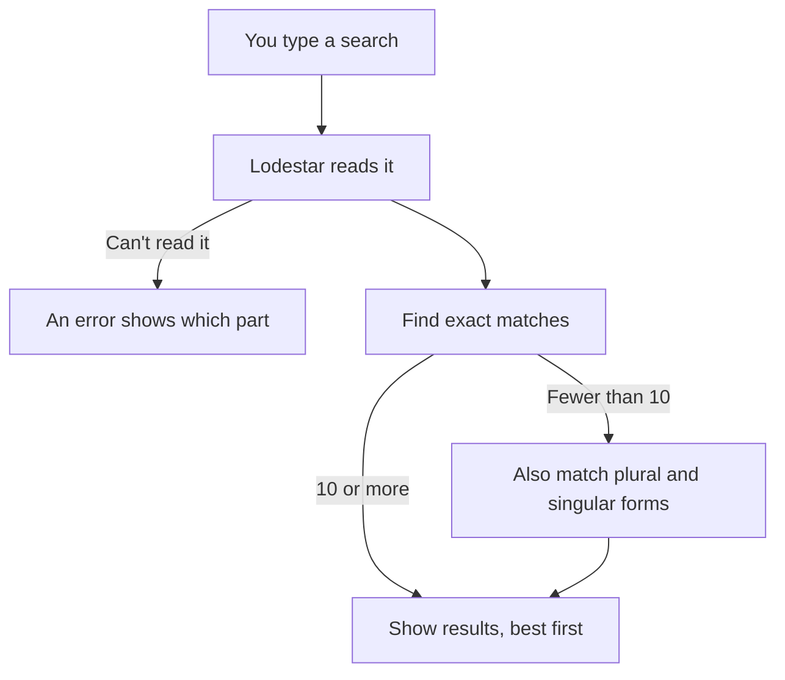

# Searching in Lodestar

Lodestar keeps an **index** (a searchable list) of the **torrents** it has found. A torrent is a description of a set of files that people share over BitTorrent; Lodestar stores that description, not the files themselves. This page shows how to search that list.

You can ignore everything after "Start here" until you need it. Most searches are plain words.

## Start here

Type words in the search box. A torrent must contain **all** of them to match.

| Goal | Type | Why |
|---|---|---|
| Find a title | `big buck bunny` | All three words must appear in the name or in a file name. |
| Find an exact phrase | `"big buck bunny"` | Quotes keep the words together, in order. |
| Leave something out | `big buck bunny -cam` | A minus sign removes matches that contain `cam`. |
| Either word | `bunny \| squirrel` | The `\|` means "or". |
| Only big files | `big buck bunny size:>4GB` | `size:` filters by the torrent's total size. |
| Only a video format | `big buck bunny res:1080p` | `res:` is the picture size. `4k` also works. |
| Only recent finds | `big buck bunny discovered:<7d` | `d` is days: found in the last 7 days. |
| Look up one torrent | Paste its **info hash** or a **magnet link** | The info hash is the 40-character code that identifies a torrent. A magnet link is a link that contains it. |

Things to know:

- Capitals, accents and punctuation don't matter. `Big.Buck.Bunny` and `big buck bunny` match the same torrents.
- A filter is a word, a colon and a value, with no spaces: `size:>4GB`. These are called **fields**.
- Several values after one field mean "any of": `type:movie,tv`.
- If a search finds fewer than 10 results, Lodestar also tries singular and plural forms of your words. You don't need to do anything.
- If you mistype a field name that is three or more letters, one typo from a real field, Lodestar suggests the right one. Otherwise it searches your text as plain words, so `rs:1080p` finds nothing useful. Field names are lowercase: `Size:>4GB` is also read as plain words.
- A typo in a plain word finds fewer results. Put `~` in front (`~bnuny`) to also match close spellings.

Not everything in the original plan works yet. This page marks it clearly; see [Not available yet](#not-available-yet).

### What happens when you search



In words: Lodestar reads your search first. If it can't, it shows an error that points at the problem. If it can, it finds the exact matches. With fewer than 10, it also tries singular and plural forms. Those matches usually rank below the exact ones.

### Recommended habits

- **Start with plain words (recommended).** Add one filter at a time and watch the result count change.
- **Use `size:` and `res:` before long lists of words.** They narrow results faster and don't depend on how a release was named.
- **Leave hidden results hidden (recommended).** Filter rules hide torrents on purpose. See [Hidden torrents and Adult](#hidden-torrents-and-adult).

## Full reference

The rest of this page is the precise reference: every field, operator and error. It describes what Lodestar does today, and it marks plans that aren't built yet. Every example in a code block on this page is checked by a test (`crates/search/tests/doc_examples.rs`) that runs it through the real parser. Blocks tagged `query` must parse. Blocks tagged `query-fail` must fail with the message shown after `=>`.

- [The basics](#the-basics)
- [Operators](#operators)
- [Fields](#fields)
- [Sizes, counts and shares](#sizes-counts-and-shares)
- [Dates](#dates)
- [Swarm health](#swarm-health)
- [Files inside torrents](#files-inside-torrents)
- [Pasting a hash or magnet link](#pasting-a-hash-or-magnet-link)
- [How results are ranked](#how-results-are-ranked)
- [Plurals fallback](#plurals-fallback)
- [Counts, pages and "reload"](#counts-pages-and-reload)
- [Errors](#errors)
- [Hidden torrents and Adult](#hidden-torrents-and-adult)
- [Not available yet](#not-available-yet)
- [Limits](#limits)

## The basics

- Words are joined with AND: `big buck bunny` needs both.
- Case, accents and punctuation don't matter. `Big.Buck.Bunny`, `big_buck_bunny` and `BIG BUCK BUNNY` all match the same torrents.
- A field narrows the search to one kind of fact: `res:2160p`, `size:>4GB`. A field name is lowercase and ends in `:`, with no space before the value.
- An empty search lists everything (browse), in the sort order you pick.

```query
big buck bunny res:2160p hdr:dv size:>20GB
"big buck bunny" -cam year:2008 type:movie
```

## Operators

| You type | Means |
|---|---|
| `big buck bunny` | both words (AND is implied) |
| `big AND bunny` | the same, written out |
| `bunny \| squirrel`, `bunny OR squirrel` | either |
| `-cam`, `!cam` | leave out torrents that match `cam` |
| `(bunny \| squirrel) AND 2019` | grouping |
| `"big buck bunny"` | the exact phrase, words side by side |
| `big NEAR/5 bunny` | the words within 5 words of each other, in either order |
| `comput*` | any word starting with `comput` (at least 2 letters before the `*`) |
| `~bnuny` | a word close to this one: 1 typo for words under 6 letters, up to 2 from 6 on (at least 3 letters) |

Details that trip people up:

- **OR binds loosest.** `a b | c` means `(a b) | c`. Use brackets when in doubt: `a (b | c)`.
- **`-` and `!` negate only when a term follows.** `WEB-DL` is one word, and a `-` on its own or before `)` or `|` is a plain character.
- **There is no `NOT` keyword.** Only `-` and `!` negate; `big NOT cam` searches for the three words `big`, `NOT` and `cam`. (`AND`, `OR` and `NEAR` must be capitals to count as operators.)
- **NEAR** joins words and phrases, all in the same field, with one distance per chain: `a NEAR/3 b NEAR/3 c`. Bare `NEAR` means 5 (`a NEAR b` is `a NEAR/5 b`). The distance is 1–50, and a chain holds up to 16 words.
- **Phrases** are checked against the name. Names keep word positions; folder and file paths inside torrents don't, so `path:"a b"` means "both words in the path", not "side by side". To match a phrase inside a file name, use `file:"…"`.
- Negation is exact. `-cam` only removes torrents that really contain `cam`, even when the plurals fallback widened the rest of the search.

Examples that parse:

```query
big AND bunny
bunny | squirrel
bunny OR squirrel
(bunny | squirrel) AND 2019
a b | c
a (b | c)
bunny -cam
bunny !cam
big NOT cam
-(cam | ts)
WEB-DL
big NEAR/5 bunny
big NEAR buck NEAR bunny
a NEAR/3 b NEAR/3 c
comput*
~bnuny
```

## Fields

Add a field name and a colon. Several values in one field, separated by commas, mean "any of": `type:movie,tv`.

### Words

| Field | Searches | Example |
|---|---|---|
| (none) | the name and the paths of the files inside | `big buck bunny` |
| `name:` | the torrent's name only | `name:"big buck bunny"` |
| `title:` | the resolved title, which is what Lodestar worked out the release is, including alternative titles | `title:squirrel` |
| `path:` | folder and file names inside the torrent | `path:extras` |

`name:`, `title:` and `path:` take a word, a `word*` prefix, a `~fuzzy` word, or a quoted phrase.

```query
name:"big buck bunny"
title:squirrel
title:"big buck bunny"
path:extras
path:"big buck"
path:subs*
```

### Facts about the release

These are read from the name and the files, then stored in a normal form. Aliases work: `codec:x265` finds the same as `codec:h265`, and `res:4k` is `res:2160p`.

| Field | Values | Examples |
|---|---|---|
| `type:` | `movie`, `tv`, `music`, `audiobook`, `ebook`, `comic`, `software`, `game`, `images`, `video`, `other`, `adult` | `type:movie,tv` |
| `res:` | a resolution: `2160p`, `1080p`, `4k`, or `1080` | `res:2160p` |
| `hdr:` | `dv`, `hdr10`, … as the release parser reads them | `hdr:dv` |
| `codec:` | video codec: `x265`, `h265`, `x264`, `av1`, … | `codec:x265` |
| `audio:` | audio codec: `atmos`, `flac`, `dts`, … | `audio:atmos` |
| `lang:` | a language, by name or two-letter code | `lang:fr` |
| `group:` | the release group, as written | `group:ntb` |
| `has:` | `bluray`, `dvd`, `cue`, `sfv`, `par2`, `multipart`, `steam`, `repack`, `sample`, `subs`, `proof`, `nfo`, `comics`, `photos` | `has:subs,cue` |
| `resolved:` | how the title was found: `files`, `folder`, `structure` | `resolved:files` |
| `adult:` | `scene`, `movie`, `photos`, `comics`, `game`, `vr`, `audio` | `adult:vr` (see [Adult](#hidden-torrents-and-adult)) |
| `year:` | a year or range; a pack that spans years matches any of them | `year:2019..2021` |
| `s:` | a season number; an `S01-S03` pack matches `s:2` | `s:2` |
| `e:` | an episode number, including ranges and absolute numbers | `e:5` |
| `junk:` | the junk score, 0–100: how likely the torrent is a lure (fake files, executables hidden in media, mismatched names) | `junk:<20` |
| `ext:` | file extensions inside the torrent, with or without the dot | `ext:mkv,mp4` |

A value Lodestar doesn't know for `type:`, `has:`, `resolved:` or `adult:` is an error that lists the valid ones.

```query
type:movie,tv
res:2160p
res:4k
res:1080
hdr:dv
codec:x265
codec:h265
audio:atmos
lang:fr
group:ntb
has:subs,cue
has:nfo
resolved:files
resolved:files,folder
year:2019..2021
s:2
e:5
s:1 e:2
junk:<20
ext:mkv,mp4
ext:.FLAC
adult:vr
```

### Yes/no fields

Write `yes`, `no`, `true`, `false`, `1` or `0`.

```query
private:no
v2:yes
hybrid:true
imported:no
backfill:yes
partial:no
ambiguous:yes
flagged:yes
demoted:yes
```

| Field | Meaning |
|---|---|
| `private:` | the torrent is private: it only works through its own tracker, not the **DHT** (the shared address book BitTorrent computers use to find each other) |
| `v2:` | BitTorrent v2 metadata |
| `hybrid:` | v1 and v2 together |
| `imported:` | came from an import, not from the DHT |
| `backfill:` | first seen during **backfill**, the crawler's first 30 days, when everything it meets is new to it. The discovered date is then only "when Lodestar first saw it" |
| `partial:` | only some of its files were indexed |
| `ambiguous:` | Lodestar couldn't tell which of several titles it is |
| `hidden:` | hidden by a filter rule (see [Hidden torrents](#hidden-torrents-and-adult)) |
| `demoted:` | pushed down by a filter rule |
| `flagged:` | flagged by a filter rule |

### Excluding with `!` and `-`

`!ext:exe` and `-ext:exe` mean the same: leave out torrents with an `.exe` file. This works for any field.

```query
!ext:exe
-ext:exe
-type:adult
```

### Aliases

`age:` is another name for `discovered:` (`age:<6h`).

```query
age:<6h
```

`s:` and `e:` are the season and episode fields. `magnet:` and `hash:` are covered [below](#pasting-a-hash-or-magnet-link).

## Sizes, counts and shares

Ranges work the same way everywhere:

| You write | Means |
|---|---|
| `size:4GB` | exactly 4 GB |
| `size:>4GB`, `size:>=4GB` | more than / at least |
| `size:<700MB`, `size:<=700MB` | less than / at most |
| `size:700MB..1.5GB` | from – to, both ends included |
| `size:1GiB..<4GiB` | from 1 GiB up to, but not including, 4 GiB |
| `size:..2GiB`, `size:1GB..` | open-ended |

- **Units:** `B`, `KB`, `MB`, `GB`, `TB`, and the `KiB`, `MiB`… spellings, also single letters (`1.5G`). All of them are 1024-based, the same as the sizes the UI shows. No unit means bytes.
- **How Lodestar writes sizes back:** in the largest unit that fits exactly (`size:4GiB`), or in bytes when no unit does. A bound one byte short of (or past) a unit is written in its exclusive form: dragging across the Size chart gives `size:1GiB..<4GiB`, and one-sided bounds read `size:<16GiB` or `size:>4GiB`.
- **Fields using bytes:** `size:` (total), `largest:` (the biggest file), `piece:` (the **piece length**: torrents are shared in equal-sized pieces, and this is the size of one, e.g. `piece:16MB`).
- **Fields using plain numbers:** `files:` (file count, `files:>=10`), `year:`, `s:`, `e:`, `junk:`.

```query
size:4GB
size:>4GB
size:>=4GB
size:<700MB
size:<=700MB
size:700MB..1.5GB
size:1GiB..<4GiB
size:..2GiB
size:1GB..
size:1.5G
largest:>2GB
piece:16MB
files:>=10
files:1
year:>=2015
```

### Shares of a torrent

`cat:` measures what share of a torrent's **files** are of a kind, and `bytes:` what share of its **bytes**. The kinds are `video`, `audio`, `image`, `document`, `ebook`, `archive`, `disc`, `software`, `subtitle` and `other`.

| You write | Means |
|---|---|
| `cat:video` | has at least some video |
| `cat:video>=80%` | at least 80% of the files are video |
| `cat:software=0` | no software at all |
| `cat:audio=10..50` | between 10% and 50% |
| `bytes:video>90%` | more than 90% of the bytes are video |
| `bytes:software<=5%` | no more than 5% of the bytes |

Shares run 0–100. A kind that isn't in the list gives an error that lists the valid kinds.

```query
cat:video
cat:video>=80%
cat:software=0
cat:audio=10..50
bytes:video>90%
bytes:software<=5%
```

## Dates

`discovered:` is when Lodestar first saw the torrent. `age:` is the same field.

| You write | Means |
|---|---|
| `discovered:<7d` | in the last 7 days |
| `discovered:>2w` | more than 2 weeks ago |
| `discovered:2026-01-01` | on that day (UTC) |
| `discovered:2026-01-01..2026-03-31` | between those days, both included |
| `discovered:>2026-01-01` | after that day |
| `discovered:<2026-01-01` | **not supported**: `<` takes an age such as `<7d`. Write `discovered:..2025-12-31` instead |
| `discovered:..2026-03-31`, `discovered:2026-01-01..` | open-ended |

Ages use `m` or `min` (minutes), `h`, `d`, `w`, `mo` (30 days) and `y` (365 days): `30m`, `6h`, `7d`, `2w`, `3mo`, `1y`.

Ages stay relative. A saved search with `discovered:<7d` always means "the last 7 days from now", not the week you saved it. Dates are in UTC.

```query
discovered:<7d
discovered:<30m
discovered:<6h
discovered:>2w
discovered:<3mo
discovered:>1y
discovered:2026-01-01
discovered:2026-01-01..2026-03-31
discovered:>2026-01-01
discovered:..2026-03-31
discovered:2026-01-01..
```

```query-fail
discovered:<2026-01-01 => can't read
discovered:soon => can't read
discovered:2026-13-01 => can't read
```

## Swarm health

Lodestar asks public trackers and the DHT how many people share each torrent (a **scrape**). These fields filter on what they last said:

| You write | Means |
|---|---|
| `seeders:>=5` | at least 5 seeders (people with the whole torrent) |
| `leechers:>0` | someone is downloading it |
| `trackers:>=3` | at least 3 trackers report people sharing it |
| `dht:>100` | the DHT estimates more than 100 people (seeds and peers together) |
| `seen:<24h` | Lodestar saw it active in the last 24 hours |
| `time:22:00..02:00` | discovered between 22:00 and 02:00 |

- **Never scraped matches no range.** A torrent Lodestar hasn't scraped yet has no counts, which isn't the same as 0: `seeders:0` and `seeders:<5` leave it out too.
- `seeders:`, `leechers:`, `trackers:` and `dht:` take plain numbers, with the same ranges as [sizes and counts](#sizes-counts-and-shares).
- `seen:` takes ages and dates, the same as `discovered:`. "Seen" means the last time the torrent showed up in the DHT or answered a scrape.
- `time:` is a time of day (`HH:MM`). A range can wrap past midnight, as in `22:00..02:00`. It reads the time in the zone the search names (`tz`, minutes east of UTC, in the API). Without one, the time is UTC. The app doesn't send your zone yet.
- A swarm a tracker exaggerates (fake seeding) doesn't count that tracker's numbers. If only the DHT is left, its estimate stands in.

```query
seeders:>=5
seeders:5..50
leechers:>0
trackers:>=3
dht:>100
seen:<24h
seen:>2w
seen:2026-01-01..2026-03-31
time:22:00..02:00
time:09:00..17:30
seeders:>=5 | trackers:>=3
```

You can also **sort** by `seeders`, `leechers`, `trackers` or `seen` (most first, or `+` for fewest first). Torrents never scraped always come last.

## Files inside torrents

`file:` asks about a single file. `file:(ext:flac size:>50MB)` finds torrents that contain **one file** that is both FLAC and over 50 MB. That's different from `ext:flac size:>50MB`, which can match a torrent with a small FLAC and a large video.

```query
ext:flac size:>50MB
file:(ext:flac size:>50MB)
file:(name:"big buck bunny" ext:mkv)
file:soundtrack
file:"big buck bunny"
file:(ext:mkv | ext:mp4)
```

```query-fail
file:(title:squirrel) => file:(…) takes
file:(files:>3) => file:(…) takes
```

- Inside the brackets you can use words, phrases, prefixes, fuzzy words, `name:`, `path:`, `ext:`, `size:` and the operators `AND`, `|`, `-`, brackets.
- Other fields (`title:`, `res:`, `files:`) are errors there, since they describe a torrent, not a file.
- Without brackets, `file:word` takes one word or one quoted phrase.
- Results of a `file:` search list their **matched files**.
- By default the file index is "smart": it covers every file of torrents with up to 1,000 files, and the larger files (5 MB or more) and non-"other" kinds of bigger packs. Small junk files in very large packs aren't searched here, though `path:` still covers them.

## Pasting a hash or magnet link

Paste a 40-character info hash or a magnet link in the box and you get that exact torrent.

```query
0123456789abcdef0123456789abcdef01234567
magnet:?xt=urn:btih:0123456789abcdef0123456789abcdef01234567&dn=Example
hash:0123456789abcdef0123456789abcdef01234567
```

- Upper or lower case both work (`0123456789ABCDEF0123456789ABCDEF01234567` is read the same).
- Only the `btih` hash is used. A magnet link without a 40-digit hex `btih` is an error.
- `hash:` and `magnet:` can be written explicitly too. A 32-character base32 hash isn't read yet.
- If the torrent is Adult and Adult is hidden, you get "not found" (see [Adult](#hidden-torrents-and-adult)).

## How results are ranked

Order **by relevance** is the default. Other sorts are `discovered`, `size`, `files`, `seeders`, `leechers`, `trackers` and `seen`, each ascending or descending.

Relevance works in two steps, so a search stays fast even when millions of torrents match:

1. Lodestar scores every match by how well your words match the name and the file paths (the usual text-search formula, called BM25), and keeps the best 200.
2. Those 200 are scored again with two bonuses: one for words found in the name, and a larger one for words found in the resolved title. Then each score is multiplied by a few small factors, and they are shown in that order:
   - **Seeders:** more seeders, a little higher (`1 + 0.2 × ln(1 + seeders)`). A torrent never scraped counts as 1 seeder.
   - **Freshness:** a torrent not seen active recently slips, halving its edge every 30 days, but never below 75%.
   - **Trackers:** up to 10% more for torrents several trackers report.
   - **Junk:** a junk score of 100 halves the score.
   - **Fake seeding:** a swarm flagged as fake seeding keeps 20% of its score.

What this means for you:

- Matches in the name or title tend to come before matches that only appear in a file path.
- Within a group of 200, the order is exact. Between groups, it is approximate: a torrent that would score higher on the second step stays in its own group. Scrolling down never repeats or skips a row.
- Text comes first: the factors only reorder results that match about equally well.
- An administrator can change the factors in `config.toml` (`[ranking]`).
- To see how a result's score was made, add `explain=1` to an API search (first page only). The response then has an `explain` block: for each result, its text score and every factor it was multiplied by.

## Plurals fallback

If your search finds **fewer than 10** torrents, Lodestar tries again, allowing each word to match by its plural/singular form in the **title**. `bunnies` finds *Big Buck Bunny*, and `bunny` finds a title that only says *Bunnies*. The stemming is deliberately light: it undoes `-s`, `-es` and `-ies`, plus the possessive, and it leaves `-ing`, `-ed` and short words (`bus`, `gas`) alone, so unrelated titles don't merge.

- Matches found only by the fallback score far lower than exact ones, so they usually rank below them when you sort by relevance. Under other sorts (discovered, size, files) they mix in with the exact matches.
- It applies to plain words and `title:` words. It does not apply to quoted phrases, `name:`, `path:`, prefixes or fuzzy words.
- It never widens a `-` exclusion.
- If a search already finds 10 or more, the fallback never runs.

## Counts, pages and "reload"

### Counts

- Up to 100,000 matches the count is exact: "1,284 results".
- Above that, Lodestar samples the index and shows an estimate, marked with "≈" (for example "≈ 2.4M"). The estimate is typically within a percent or two for large result sets, and an index that is small enough is counted exactly.
- You can ask for the exact number. The server counts every match with a 5-second limit; if it runs out of time, the estimate stays.

### Pages

Each page ends with a **cursor**, a code you send back to get the next page. It pins the exact version of the index your first page used, so when new torrents arrive while you scroll, rows don't repeat or vanish.

### Why results can say "reload"

That pinned version is kept for **10 minutes after you last used it**, and at most **1 hour**. If it is gone when you ask for the next page, you see *"These results changed or expired; reload the search."* Reasons:

- you left the page open for more than 10 minutes;
- you've been scrolling for over an hour;
- Lodestar restarted;
- the server has many other searches and evicted yours (it keeps at most 1,024 in total and 64 per session).

Reload runs the search again from the top on the current index. The same search sent with a cursor from another query, sort or hidden setting is a different error ("That cursor belongs to another search").

Paging by offset works to 10,000 results; paging with the cursor has no such limit.

## Errors

A search that can't be read isn't ignored or guessed at: you get an error with the part of the query it is about highlighted.

- **Unknown field names:** `resolvd:files` says *unknown field resolvd: (did you mean resolved:?)* when the name is one typo from a real field. A word with a colon that isn't close to any field is searched as plain text (`re:zero` finds *Re:Zero*).
- **A value that can't be read:** `size:big` → *can't read "big" as a number or range*. `type:cartoon` lists the types that exist.
- **Ranges the wrong way round:** `size:5..1` → *range runs backwards*.
- **Brackets and quotes:** `missing ')'`, `unexpected ')'`, `unclosed quote`, `empty parentheses`.
- **Operators:** `NEAR joins words or phrases`, `use one NEAR distance per chain`, `NEAR distance must be 1–50`.
- **Prefixes:** `prefixes need at least 2 letters`, `'*' only works at the end of a word`.
- **Fuzzy:** `fuzzy terms need at least 3 letters`.
- **Not built yet:** see the next-to-last section.

Examples that fail:

```query-fail
resolvd:files => unknown field
size:big => can't read
size:5..1 => range runs backwards
type:cartoon => expects one of
resolved:plugin => expects one of
big*bunny => only works at the end
c* => at least 2 letters
~ab => at least 3 letters
(big buck bunny => missing ')'
big buck bunny) => unexpected ')'
() => empty parentheses
"big buck bunny => unclosed quote
big NEAR/51 bunny => NEAR distance must be
big NEAR (bunny | squirrel) => NEAR joins words
big NEAR/3 bunny NEAR/4 buck => one NEAR distance
```

Searched as plain words instead (no error):

```query
re:zero
rs:1080p
Size:>4GB
```

## Hidden torrents and Adult

### Hidden by filters

Filter rules can hide torrents. The screen for writing rules, **Settings → Filters & Safety**, is **(planned)**. Hidden torrents are left out of search; this is the same as adding `hidden:no` to every search. Today, put `hidden:yes` in the query to see them. A **Hidden by filters** toggle in the results screen is also **(planned)**. A query that mentions `hidden:` anywhere is left alone, so `hidden:yes big` shows only hidden matches. `demoted:` and `flagged:` select torrents a rule pushed down or flagged.

```query
hidden:yes big
hidden:yes
```

### Adult

**Adult** is a kind of content (`type:adult`) with a sub-kind (`adult:scene`, `adult:vr`, `adult:photos`, …). Lodestar hides it by default (recommended). Hiding changes only what you see: Adult torrents are still stored and indexed.

While Adult is hidden:

- Plain searches, counts and filters leave Adult torrents out.
- `type:adult` and `adult:<kind>` return no results, and the answer carries a notice that Adult is hidden. `-type:adult` is not asking for Adult and gets no notice.
- Pasting the hash of an Adult torrent answers "not found" (the error code is `adult_hidden`, so the app can explain why).

```query
type:adult
adult:scene
-type:adult
```

To show Adult, turn on **Show adult content** in the **Content** settings section. It needs a confirmation that you are 18 or older. The **Settings → Content** screen is **(planned)**. Until it exists, send the change to the settings API, with the confirmation in the same request:

```text
PATCH /settings/content
{"show_adult": true, "confirm_adult": true}
```

Without `"confirm_adult": true`, the server answers `422 adult_confirmation_required` and saves nothing. Turning it off needs no confirmation. The change applies at once, with no restart. An administrator can also set it in `config.toml` (`[content] show_adult`) or with the `LODESTAR_SHOW_ADULT` environment variable. That setting then can't be changed in the app.

> [!NOTE]
> A page cursor from before you changed the setting stops working (`400 bad_cursor`). Run the search again.

> [!NOTE]
> A torrent Lodestar hasn't classified yet (new imports, or a backfill still running) isn't hidden until it is. This is a known gap.

## Not available yet

These are in the plan but don't work today. Each gives an error that says so, and none is silently ignored:

| Plan | Today |
|---|---|
| `/S0[1-9]E\d+/` regular expressions | *regex search arrives with the trigram index* |
| `sig:` (identical payload) | *arrives with grouping keys (M7)* |
| `resolved:plugin` | not a value; use `files`, `folder` or `structure` |

Each of these fails with the message shown after `=>`:

```query-fail
/S0[1-9]E\d+/ => regex search arrives
sig:7a9f3c12 => arrives with grouping keys
```

## Limits

- A query is at most 2,048 bytes, with at most 64 clauses and brackets nested 16 deep.
- Extensions are up to 10 letters or digits. Field values (keywords) are up to 64 bytes.
- `file:` clauses are limited to the kinds listed above.
- Quoted phrases can't be empty.
