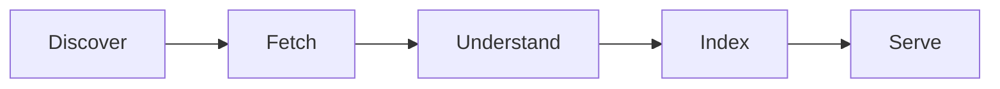

# Chapter 1: Before you start

Lodestar finds torrents on the BitTorrent network and makes their details searchable on your own server. This chapter says what it does, what it needs and what it never does.

> [!NOTE]
> **What you will learn**
> - Describe what Lodestar collects and what it never touches.
> - Check that your server and network meet the needs.
> - Choose between Unraid, Docker Compose and the other install routes.

## 1.1 Learn what Lodestar does
<!-- index: Lodestar; metadata; DHT; crawler -->

Lodestar is a crawler and search engine for torrent **metadata**. It listens to the [DHT](glossary.md#dht) and finds torrents other people share. It asks peers for each torrent's description and stores it in a local index. You search that index in a web page on your own server.

The description it stores is names, file lists, sizes, dates and swarm counts. Your index never leaves your server.

*Figure 1.1: How Lodestar turns the DHT into a search page.*

The diagram in words: Lodestar discovers torrents on the DHT and fetches their descriptions from peers. It works out what each one contains and adds it to the index. Then it serves the index to your browser.

## 1.2 Know what Lodestar never does
<!-- index: metadata only; offline by default; telemetry -->

Lodestar never downloads the content of a torrent. It fetches only the small description a torrent publishes about itself, so no movies, music or software land on your disk.

Three more facts hold today:

- Lodestar sends no telemetry.
- Updates are off until you choose them, because checking for updates contacts GitHub.
- The child-safety core of the content filters is always on.

What the crawler still shares with the network

To find torrents, the crawler talks to other DHT nodes and to peers, as every BitTorrent program does. Those nodes can see your public IP address. That is why [Chapter 3](03-keep-lodestar-safe.md#33-decide-about-the-dht-port-and-a-vpn) covers the DHT port and the [VPN](glossary.md#vpn) option.

## 1.3 Check what you need
<!-- index: requirements; SSD; cache pool -->

You need:

- A server that runs Unraid or Docker. The image supports `amd64` and `arm64`.
- Fast local storage for the data folder. On Unraid, use the [cache pool](glossary.md#cache-pool) or another SSD or NVMe pool. The index does random reads and writes, so spinning disks and network shares are slow.
- A way to read the [container](glossary.md#container) log. You need it once, to copy the [setup token](glossary.md#setup-token).
- A home router that copes with many connections. At the default intensity the crawler opens about 400 at once.

You don't need an account, a licence key or an open port on your router.

## 1.4 Choose how to install
<!-- index: install methods -->

| Option | When to use it |
|---|---|
| **Unraid template (recommended)** | You run Unraid. It sets the ports and folders for you. [Chapter 2](02-install-lodestar-on-unraid-and-docker.md#21-install-with-the-unraid-template) |
| Docker Compose | You run Docker on Linux or a NAS other than Unraid. [Chapter 2](02-install-lodestar-on-unraid-and-docker.md#24-install-with-docker-compose) |
| Windows installer | **(planned)** Not published yet. [Chapter 4](04-install-on-windows-and-linux.md) |
| Linux service (systemd) | Build from source today. Release files are **(planned)**. [Chapter 4](04-install-on-windows-and-linux.md) |

## 1.5 Check your understanding

1. Does Lodestar download the files inside the torrents it finds?
2. Why does the data folder belong on an SSD or NVMe pool?
3. Do you need to open a port on your router to install Lodestar?

> [!TIP]
> **Key takeaways**
> - Lodestar stores torrent descriptions only and never downloads content.
> - It sends no telemetry. The DHT crawl is its only regular traffic.
> - Put the data folder on fast local storage.

<!-- nav:start -->
---

[← Lodestar setup guide](README.md) · [Contents](README.md#contents) · [Chapter 2: Install Lodestar on Unraid and Docker →](02-install-lodestar-on-unraid-and-docker.md)
<!-- nav:end -->
