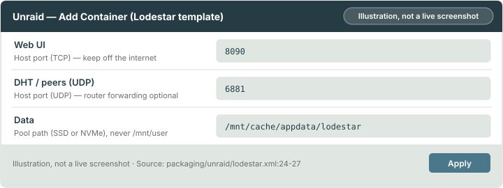
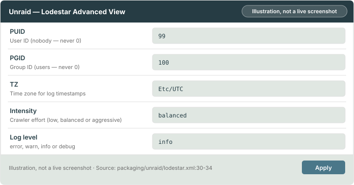
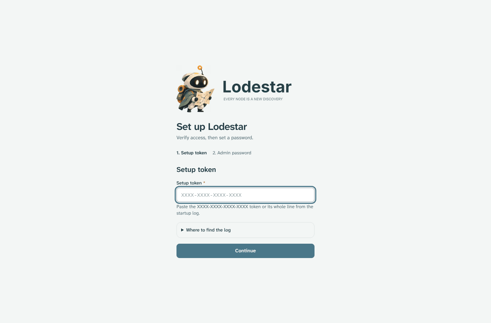

# Chapter 2: Install on Unraid and Docker

This chapter installs Lodestar from the Unraid template or with Docker Compose, then takes you through first run.

> [!WARNING]
> Don't run the `nightly` image on real data. It is built daily from `main` and untested, and it can apply database migrations that the release can't read. Once that happens, you can't go back to the release without a backup. Use `nightly` only for a throwaway try-out, and take a backup first ([section 3.7](03-keep-lodestar-safe.md#37-back-up-and-restore)) if you ever ran it on data you want to keep.

> [!NOTE]
> **What you will learn**
> - Install Lodestar from the Unraid template with the data folder on a pool.
> - Set the template fields to their recommended values.
> - Keep the [PUID and PGID](glossary.md#puid-and-pgid) that let Lodestar own its data folder.
> - Install with Docker Compose.
> - Create the admin password with the [setup token](glossary.md#setup-token).

## 2.1 Install with the Unraid template
<!-- index: Unraid; template; Community Applications -->

Lodestar's template is `packaging/unraid/lodestar.xml`. Community Applications doesn't list Lodestar yet **(planned)**, so you add the template by hand once.

To install from the template:

1. Open the Unraid terminal (the **>_** icon at the top right of the web UI).
2. Paste this command to download the template:

    ```bash
    wget -O /boot/config/plugins/dockerMan/templates-user/lodestar.xml https://github.com/dvortsis/lodestar-v2/raw/main/packaging/unraid/lodestar.xml
    ```

   **Result:** The command ends without an error.
3. Open the **Docker** tab and select **Add Container**.
4. In **Template**, choose **Lodestar** under **User templates**.
   **Result:** The form shows **Web UI**, **DHT / peers (UDP)** and **Data**.
5. Check the fields against [section 2.2](#22-settings-in-the-unraid-template). Leave everything else on its default.
6. Select **Apply**.
   **Result:** Unraid pulls the image and starts the [container](glossary.md#container). A **Lodestar** icon appears on the Docker tab.


*Figure 2.1: The three main fields in the Unraid template, with Data outlined on `/mnt/cache`. Illustration, not a live screenshot.*

Then check the user in [section 2.3](#23-check-the-user-the-container-runs-as) and finish with [section 2.5](#25-create-the-admin-password).

> [!WARNING]
> Don't choose the **Lodestar-gluetun** template unless a gluetun [VPN](glossary.md#vpn) container already runs. It has no network of its own. [Chapter 3](03-keep-lodestar-safe.md#33-decide-about-the-dht-port-and-a-vpn) explains it.

## 2.2 Settings in the Unraid template
<!-- index: template fields; appdata; Intensity -->

Fields marked *advanced* appear after you select **Show more settings**.

### Web UI

The port your browser uses to open Lodestar. The template maps host port `8090` to container port `8090`.

**Recommended:** `8090`. Change the host side only if another app uses it. Keep the container side at `8090`.

**Unsafe:** Forwarding this port on your router. Keep it on your home network and use a VPN instead. [Chapter 3](03-keep-lodestar-safe.md#31-keep-the-web-ui-off-the-internet) says why.

**Safe to change later:** Yes. Edit the container, change the host port and apply.

### DHT / peers (UDP)

The port Lodestar uses to talk to the [DHT](glossary.md#dht). It is [UDP](glossary.md#udp), not TCP.

**Recommended:** `6881` on the Unraid side. The template says to forward this port on your router for the best reach. This guide recommends against forwarding by default, because it shows your IP address to DHT peers. Forwarding is optional ([section 3.3](03-keep-lodestar-safe.md#33-decide-about-the-dht-port-and-a-vpn)).

**Safe to change later:** Yes.

### Peers (TCP) (advanced)

Reserved for incoming peer connections **(planned)**. Lodestar only makes outbound fetches today, so nothing listens here.

**Recommended:** leave it on `6881`. Don't forward it.

### Data

The folder where Lodestar keeps its index, database and settings. It is the one folder that survives an update, because a container is rebuilt on every update.

**Recommended:** `/mnt/cache/appdata/lodestar`. Use a pool path (`/mnt/cache/...` or `/mnt/<pool>/...`), not `/mnt/user/...`. The `/mnt/user` path goes through Unraid's [FUSE](glossary.md#fuse) layer, which is slow for this workload and risky for [SQLite](glossary.md#sqlite).

**Unsafe:** A path on the array or under `/mnt/user`. Use your [cache pool](glossary.md#cache-pool) instead.

**Safe to change later:** Only by moving the folder. Stop the container, copy the folder, change the field and start it.

### Hot path (optional) (advanced) and Cold path (optional) (advanced)

Planned, not used yet. They will split the index and the file-tree blobs across pools.

**Recommended:** leave both empty. Everything stays under **Data**.

### PUID and PGID (advanced)

The user ID and group ID Lodestar runs as. The [PUID and PGID](glossary.md#puid-and-pgid) decide who owns the files in **Data**. On start, Lodestar makes **Data** belong to this user and then gives up root for good.

**Recommended:** leave `99` and `100`, Unraid's `nobody` and `users`.

**Unsafe:** `0`. That is root, and Lodestar refuses to start with it. Use `99` and `100` instead.

### TZ (advanced)

The time zone for log timestamps. Log timestamps are UTC today whatever you set.

**Recommended:** leave `Etc/UTC`.

### Intensity (advanced)

How hard the crawler works: `low`, `balanced` or `aggressive`. Balanced opens about 400 [metadata](glossary.md#metadata) connections at once. Aggressive opens about 1000.

**Recommended:** `balanced`. Start at `low` if your network slows down.

**Unsafe:** `aggressive` can fill a home router's connection table, which slows the whole household. Use `balanced` or `low` instead.

**Safe to change later:** Yes. Apply the change and the container restarts.

### Log level (advanced)

The templates have no Log level field. The optional custom container variable
`LODESTAR_LOG` sets how much Lodestar logs on every output: `error`, `warn`, `info` or `debug`.
While it is set, you can't change Logging verbosity in Settings.
If you add this variable to the container configuration, use `LODESTAR_LOG` as its key.

**Recommended:** leave it unset; the default is `info`. Logs hold no torrent details by default.

## 2.3 Check the user the container runs as
<!-- index: PUID; PGID; file owner; permissions -->

Lodestar starts as root for a moment only to switch to the user in **PUID** and **PGID**. It makes the **Data** folder that user's own, then drops root. You don't change owners yourself.

To check the user:

1. On the Docker tab, select the **Lodestar** icon, then **Edit**.
2. Turn on **Advanced View** at the top right.
3. Check that **PUID** is `99` and **PGID** is `100`.
   **Result:** Both fields show the Unraid defaults. Leave them.


*Figure 2.2: PUID and PGID in Advanced View set to Unraid's nobody and users defaults. Illustration, not a live screenshot.*

> [!CAUTION]
> Never set **PUID** or **PGID** to `0`. That is root, so a bug in Lodestar could change anything on your server.

Two log messages point at this step:

- **"started as root without the SETUID/SETGID capabilities"**: the container was started with those permissions removed. Unraid's template doesn't do this. In Compose, remove `cap_drop: ALL`, or add `cap_add: [SETUID, SETGID, CHOWN]` after it.
- **The data folder "doesn't look like Lodestar's"**: **Data** already holds other files and belongs to someone else, so Lodestar won't take it over. Point **Data** at an empty folder.

## 2.4 Install with Docker Compose
<!-- index: Docker Compose; named volume; bind mount; docker-compose.yml -->

Docker Compose runs Lodestar from one file, `docker-compose.yml`. The file maps the web UI, the DHT port and a data volume for `/data`.

| Option | When to use it |
|---|---|
| **[Named volume](glossary.md#named-volume-and-bind-mount) (recommended)** | The default in the file. Docker manages the volume and keeps it across updates. |
| Bind mount | You want the data in a folder you pick, such as `./data`. |

To install with the named volume:

1. In a terminal on your Docker host, make a folder and move into it:

    ```bash
    mkdir lodestar && cd lodestar
    ```

2. Download the compose file:

    ```bash
    curl -fsSLO https://raw.githubusercontent.com/dvortsis/lodestar-v2/main/docker-compose.yml
    ```

3. Start Lodestar:

    ```bash
    docker compose up -d
    ```

   **Result:** Docker pulls the image and starts the container `lodestar`.
4. Check that it is healthy:

    ```bash
    docker inspect --format '{{.State.Health.Status}}' lodestar
    ```

   **Result:** The command prints `healthy` after about 30 seconds. `healthy` means only that the Lodestar process is alive. It doesn't mean Lodestar is finding torrents. The status pill on the **Search** screen and **Insights** show that ([section 5.3](05-use-lodestar.md#53-browse-discover-and-insights)).

> [!WARNING]
> Keep the data on local SSD or NVMe storage. Don't put the volume on a network share or a [FUSE](glossary.md#fuse) filesystem. The database is [SQLite](glossary.md#sqlite) and misbehaves there.

To keep the data in a folder you own instead:

1. Find your user and group IDs:

    ```bash
    id
    ```

   **Result:** The output shows `uid=` and `gid=` numbers, for example `1000`.
2. If `id` printed `uid=0`, you are in a root shell. Skip this step and keep `PUID` and `PGID` commented out, or use the numbers of a non-root account. Never use `0`.
3. In `docker-compose.yml`, change the two commented lines under `environment:` to the lines below, with your numbers. Delete the `#` and the space after it, so `PUID` lines up with `TZ`:

    ```yaml
          PUID: "1000"
          PGID: "1000"
    ```

4. Replace `- lodestar-data:/data` with `- ./data:/data`.
5. Make the folder and start Lodestar:

    ```bash
    mkdir data && docker compose up -d
    ```

   **Result:** Lodestar makes `data` belong to your user on start.

Do not use `network_mode: host` unless you need it. It skips Docker's network translation for better DHT reach, but it exposes port `8090` on every host interface.

Pin an exact version such as `x.y.z` instead of `latest`, if you want updates only when you decide.

## 2.5 Create the admin password
<!-- index: setup token; admin password; first run -->

On a fresh data folder, Lodestar prints a one-time **setup token** to its log. Anyone who can read the log can claim a fresh instance, so do this before anyone else can reach the web UI.

To create the admin password:

1. Read the log. On Unraid, select the **Lodestar** icon on the Docker tab, then **Logs**. With Compose, run this on the Docker host:

    ```bash
    docker compose logs lodestar
    ```

2. Find the line that contains `enter setup token` and copy the word right after it. The line also has a time and a level at its start.
3. Open `http://<server-ip>:8090` in your browser. Replace `<server-ip>` with your server's address, or use `localhost` on the same machine.
4. Enter the token and choose a password from your password manager.
   **Result:** Lodestar signs you in. It prints no token again.


*Figure 2.3: The first-run setup screen at /setup, with the Setup token field outlined and log instructions expanded.*

The crawler starts at once. The library fills slowly at first while the DHT routing table warms up.

> [!NOTE]
> **What to expect in the first hours**
> - Search works at once, but the index is small. It grows over days, not minutes.
> - After every start, including restarts and updates, sampling waits 6 hours before it resumes. New discoveries ramp up over the first hours after each start.

> [!NOTE]
> **Worked example**
> You lost the token. While no admin exists, every start prints a fresh token. Restart the container, read the log again and use the newest token.

## 2.6 Check your understanding

1. Which Unraid path do you use for **Data**, and why not `/mnt/user/appdata/lodestar`?
2. Which values do you leave in **PUID** and **PGID** on Unraid, and which value never?
3. When does the setup token stop being needed?

> [!TIP]
> **Key takeaways**
> - Map **Data** to a pool path such as `/mnt/cache/appdata/lodestar`.
> - Leave **PUID** `99` and **PGID** `100`, and never use `0`.
> - Create the admin password straight after the first start.

<!-- nav:start -->
---

[← Chapter 1: Before you start](01-before-you-start.md) · [Contents](README.md#contents) · [Chapter 3: Keep Lodestar safe →](03-keep-lodestar-safe.md)
<!-- nav:end -->
