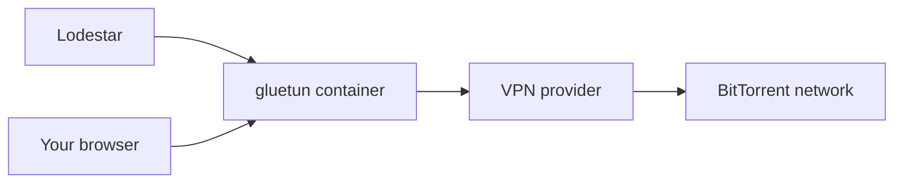

# Chapter 3: Keep Lodestar safe

This chapter sets up Lodestar so the web page, your password and your logs stay private, and so you can restore it.

> [!NOTE]
> **What you will learn**
> - Keep the web UI off the internet and reach it remotely through a [VPN](glossary.md#vpn).
> - Protect the [setup token](glossary.md#setup-token) and the admin password.
> - Choose whether to forward the [DHT](glossary.md#dht) port or run through a VPN [container](glossary.md#container).
> - Keep torrent details out of logs you share.
> - Back up the data folder and restore it.

## 3.1 Keep the web UI off the internet
<!-- index: port forwarding; web UI; remote access; VPN -->

The web UI on port `8090` holds your login page and your whole index. Do not forward it on your router, and do not put it in the router's DMZ. Either one puts the login page on the internet.

To reach Lodestar from outside your home:

1. Set up a VPN to your home network, such as WireGuard or Tailscale.
2. Connect to the VPN from your phone or laptop.
3. Open `http://<server-ip>:8090` as if you were at home.
   **Result:** The page loads through the VPN and nothing is exposed.

A [port forward](glossary.md#port-forwarding) is a router rule that sends traffic from the internet to one device. A VPN instead makes your remote device act as if it were at home.

> [!WARNING]
> Behind a TLS reverse proxy, set `http.secure_cookies = true` in `config.toml`. The proxy must still be reachable only over your VPN or your LAN.

## 3.2 Protect the setup token and the password
<!-- index: setup token; password manager; admin password -->

The setup token is a one-time key to a fresh instance. It appears in the log until you create the admin password, then stops working.

- Don't share a screenshot or a copy of the log before you finish setup.
- Create the admin password from a password manager, with a long random value.
- Use a password you don't use anywhere else.

If someone could have read the token before you used it, create the password now. Once an admin exists, the token stops working and can't be used to claim the instance.

## 3.3 Decide about the DHT port and a VPN
<!-- index: DHT port; gluetun; VPN; connection tracking -->

Lodestar works without any router change. It reaches fewer nodes, but it still finds and fetches torrents. You have three ways to run it.

| Option | What it means |
|---|---|
| **No forwarding (recommended)** | Do nothing on the router. Nothing from the internet reaches Lodestar, and it still crawls. |
| Forward [UDP](glossary.md#udp) `6881` | Better reach, because other nodes can contact you. DHT peers see your public IP. |
| VPN container (gluetun) | DHT and peer traffic leave through the VPN, so peers see the VPN's address, not yours. |

> [!WARNING]
> Forward only `6881` over UDP, never `8090`. Forwarding the DHT port tells every DHT peer your home IP address. If that matters, use the VPN option instead.

### Run Lodestar through gluetun

The **Lodestar-gluetun** template sets `--network=container:gluetun`, so Lodestar has no network of its own. It uses the network of your existing gluetun container.



*Figure 3.1: Lodestar's traffic leaves through gluetun.*

In words: Lodestar sends everything through the gluetun container to your VPN provider and on to the network. Your browser also reaches the web UI through gluetun.

To use it:

1. Install gluetun first and name the container `gluetun`.
2. In the gluetun container, publish port `8090`, the web UI port. Lodestar can't publish ports itself.
3. Install the **Lodestar-gluetun** template. If your VPN container has another name, change `--network=container:gluetun` in **Extra Parameters**.
   **Result:** Lodestar starts on gluetun's network.
4. Open the web UI at your server address and the port you published on gluetun.
5. Restart Lodestar whenever gluetun restarts. A container that shares a network stays attached to the old one.

A VPN hides your home IP from peers. It doesn't hide your activity from the VPN provider, and it doesn't make the web UI private. Inbound DHT reach needs a port your provider forwards: allow it in gluetun with `FIREWALL_VPN_INPUT_PORTS` and set **DHT port** in the template to the same number. Without it, Lodestar still crawls with fewer nodes.

<details>
<summary>Why a busy crawler can slow your home router</summary>

The crawler opens hundreds of short outbound connections at once: about 400 at `balanced`, about 1000 at `aggressive`. Consumer routers track every connection in a small table. When it fills, the whole household slows or drops. Start at `low`, raise the intensity step by step and watch the router's connection count. The VPN variant avoids this because the tunnel carries the load.

</details>

## 3.4 Keep logs private
<!-- index: logs; diagnostics; torrent details -->

By default Lodestar's logs contain no torrent details. They record what Lodestar did, not what it found.

- Leave torrent details off. Turning them on is a time-limited choice in the app **(planned)**.
- Share logs only through **Download diagnostics**, which removes torrent details **(planned)**.
- Until then, read a log before you post it. Remove IP addresses, tokens and names.

The setup token is the one secret that appears in the log. It stops working once the admin password exists.

## 3.5 Choose how updates work
<!-- index: updates; fixes only; rollback -->

Updates are off until you choose them, because checking contacts GitHub. In-app update settings are **(planned)**. Today you update by pulling a new image.

| Option | What it means |
|---|---|
| **Off or notify (recommended)** | You decide when to update. Copy the data folder first (see [section 3.7](#37-back-up-and-restore)). |
| Install automatically | **(planned)** Will install fixes only by default, then check health and roll back by itself if the new version fails. |

To update by hand:

1. Stop the container.
2. Copy the data folder ([section 3.7](#37-back-up-and-restore)). That copy is your rollback.
3. Pull the new image and start the container.
   **Result:** The container starts, and the old data is intact.

## 3.6 Handle API keys and content filters
<!-- index: API keys; content filters; child-safety core -->

API keys let other apps, such as Torznab clients, talk to Lodestar. Create one key per app. If a key leaks, regenerate it. Never reuse the admin password as a key.

The child-safety core of the content filters is always on. A change that would weaken protection asks for your password and shows a plain-language warning first.

## 3.7 Back up and restore
<!-- index: backup; restore; seal.key; data folder -->

All Lodestar state lives in the data folder. On Unraid that is `/mnt/cache/appdata/lodestar`. In Compose it is the `lodestar-data` volume or your bind mount. A `lodestar backup` command is **(planned)**, so copy the folder while Lodestar is stopped.

| File | What it holds |
|---|---|
| `lodestar.db` | The database. It is the source of truth. |
| `auth.json` | The admin password hash. |
| `seal.key` | The key that unlocks stored secrets. |
| `config.toml` | Your settings file, if you made one. |
| `index/` | The search index. Lodestar can rebuild it, so skipping it is fine. |

> [!WARNING]
> Back up `seal.key` together with the database. Without it, stored secrets in a restored database can't be read.

To back up on Unraid:

1. On the Docker tab, select the **Lodestar** icon, then **Stop**.
2. Open the Unraid terminal and paste:

    ```bash
    cp -a /mnt/cache/appdata/lodestar /mnt/user/backups/lodestar-backup
    ```

   Change `/mnt/user/backups` to a share on your array that already exists.
   **Result:** The copy finishes without an error.
3. Select the **Lodestar** icon, then **Start**.

To restore, stop Lodestar, copy the files back into the data folder and start it. Compare file ownership with [section 2.3](02-install-lodestar-on-unraid-and-docker.md#23-set-the-user-the-container-runs-as) if Lodestar then reports a permission error.

## 3.8 Check your understanding

1. A friend wants to open Lodestar from work. What do you set up, and what do you not do?
2. What does forwarding UDP `6881` tell DHT peers?
3. Which file must you back up with the database, and why?

> [!TIP]
> **Key takeaways**
> - Never forward port `8090`. Use a VPN for remote access.
> - Forwarding `6881` over UDP is optional and shows your IP to DHT peers.
> - Back up the whole data folder, `seal.key` included, with Lodestar stopped.

<!-- nav:start -->
---

[← Chapter 2: Install Lodestar on Unraid and Docker](02-install-lodestar-on-unraid-and-docker.md) · [Contents](README.md#contents) · [Chapter 4: Install on Windows and Linux →](04-install-on-windows-and-linux.md)
<!-- nav:end -->
