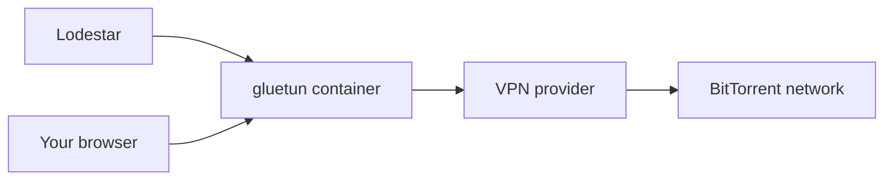

# Chapter 3: Keep Lodestar safe

This chapter sets up Lodestar so the web page, your password and your logs stay private, and so you can restore it.

> [!NOTE]
> **What you will learn**
> - Keep the web UI off the internet and reach it remotely through a [VPN](glossary.md#vpn).
> - Protect the [setup token](glossary.md#setup-token) and the admin password.
> - Choose whether to forward the [DHT](glossary.md#dht) port or run through a VPN [container](glossary.md#container).
> - Keep torrent details out of logs you share.
> - Back up the data folder and restore it.
> - Choose whether a clean restart skips the six-hour wait.

## 3.1 Keep the web UI off the internet
<!-- index: port forwarding; web UI; remote access; VPN -->

The web UI on port `8090` holds your login page and your whole index. Do not forward it on your router, and do not put it in the router's [DMZ](glossary.md#dmz). Either one puts the login page on the internet.

To reach Lodestar from outside your home:

1. Set up a VPN to your home network, such as WireGuard or Tailscale.
2. Connect to the VPN from your phone or laptop.
3. Open `http://<server-ip>:8090` as if you were at home.
   **Result:** The page loads through the VPN and nothing is exposed.

A [port forward](glossary.md#port-forwarding) is a router rule that sends traffic from the internet to one device. A VPN instead makes your remote device act as if it were at home.

> [!WARNING]
> Behind a [TLS reverse proxy](glossary.md#tls-reverse-proxy), set the environment variable `LODESTAR_SECURE_COOKIES=true`. The proxy must still be reachable only over your VPN or your LAN.

## 3.2 Protect the setup token and the password
<!-- index: setup token; password manager; admin password -->

The setup token is a one-time key to a fresh instance. It appears in the log until you create the admin password, then stops working.

- Don't share a screenshot or a copy of the log before you finish setup.
- Create the admin password from a password manager, with a long random value.
- Use a password you don't use anywhere else.

If someone could have read the token before you used it, create the password now. Once an admin exists, the token stops working and can't be used to claim the instance.

## 3.3 Decide about the DHT port and a VPN
<!-- index: DHT port; gluetun; VPN; connection tracking -->

Lodestar works without any router change. It reaches fewer nodes, but it still finds and fetches torrents. You have three ways to run it.

| Option | What it means |
|---|---|
| **No forwarding (recommended)** | Do nothing on the router. Nothing from the internet reaches Lodestar, and it still crawls. |
| Forward [UDP](glossary.md#udp) `6881` | Better reach, because other nodes can contact you. DHT peers see your public IP. |
| VPN container (gluetun) | DHT and peer traffic leave through the VPN, so peers see the VPN's address, not yours. |

> [!WARNING]
> Forward only `6881` over UDP, never `8090`. Forwarding the DHT port tells every DHT peer your home IP address. If that matters, use the VPN option instead.

### Run Lodestar through gluetun

The **Lodestar-gluetun** template sets `--network=container:gluetun`, so Lodestar has no network of its own. It uses the network of your existing gluetun container.



*Figure 3.1: Lodestar's traffic leaves through gluetun.*

In words: Lodestar sends everything through the gluetun container to your VPN provider and on to the network. Your browser also reaches the web UI through gluetun.

To use it:

1. Install gluetun first. The template expects the container to be named `gluetun`.
2. In the gluetun container, publish port `8090`, the web UI port. Lodestar can't publish ports itself.
3. Install the **Lodestar-gluetun** template. If your VPN container has another name, replace `gluetun` in `--network=container:gluetun` in **Extra Parameters**.
   **Result:** Lodestar starts on gluetun's network.
4. Open the web UI at your server address and the port you published on gluetun.
5. Restart Lodestar whenever gluetun restarts. A container that shares a network stays attached to the old one.

A VPN hides your home IP from peers. It doesn't hide your activity from the VPN provider, and it doesn't make the web UI private. Inbound DHT reach needs a port your provider forwards: allow it in gluetun with `FIREWALL_VPN_INPUT_PORTS` and set **DHT port** in the template to the same number. Without it, Lodestar still crawls with fewer nodes.

<details>
<summary>Why a busy crawler can slow your home router</summary>

The crawler opens hundreds of short outbound connections at once: about 400 at `balanced`, about 1000 at `aggressive`. Consumer routers track every connection in a small table. When it fills, the whole household slows or drops. Start at `low`, raise the intensity step by step and watch the router's connection count. The VPN variant avoids this because the tunnel carries the load.

</details>

## 3.4 Keep logs private
<!-- index: logs; diagnostics; torrent details -->

By default Lodestar's logs contain no torrent details. They record what Lodestar did, not what it found.

- Leave torrent details off. Turning them on is a time-limited choice in the app **(planned)**.
- Share logs only through **Download diagnostics**, which removes torrent details **(planned)**.
- Until then, read a log before you post it. Remove IP addresses, tokens and names.

The setup token is the one secret that appears in the log. It stops working once the admin password exists.

## 3.5 Choose how updates work
<!-- index: updates; fixes only; rollback -->

Updates are off until you choose them, because checking contacts GitHub. In-app update settings are **(planned)**. Today you update by pulling a new image.

| Option | What it means |
|---|---|
| **Off or notify (recommended)** | You decide when to update. Back up first (see [section 3.7](#37-back-up-and-restore)). |
| Install automatically | **(planned)** Will install fixes only by default, then check health and roll back by itself if the new version fails. |

To update by hand:

1. Take a backup while Lodestar runs ([section 3.7](#37-back-up-and-restore)). It is your rollback.
2. Stop the container.
3. Pull the new image and start the container.
   **Result:** The container starts, and the old data is intact.

## 3.6 Know what protects the content filters and API keys
<!-- index: API keys; content filters; child-safety core -->

The child-safety core of the content filters is always on. A change that would weaken protection asks for your password and shows a plain-language warning first.

API keys, which let other apps such as Torznab clients talk to Lodestar, are **(planned)**. When they arrive, create one key per app and regenerate any key that leaks. Never use the admin password as a key.

## 3.7 Back up and restore
<!-- index: backup; restore; seal.key; data folder -->

`lodestar backup` makes a consistent copy of everything that can't be rebuilt, and it is safe while Lodestar runs. It writes a new folder `lodestar-backup-<time>` under `backups/` in the data folder, with a `README.txt` that repeats the restore steps.

| File in the backup | What it holds |
|---|---|
| `lodestar.db` | The database. It is the source of truth. |
| `auth.json` | The admin password hash and the key that signs sessions. |
| `seal.key` | The key that unlocks stored secrets. |
| `config.toml` | Your settings file, if you made one. |

The search index isn't in the backup. Lodestar rebuilds it from the database.

> [!WARNING]
> The backup holds `seal.key` and `auth.json`. Keep it on a private share. Never place it on a share that is public over SMB.

To back up on Unraid:

1. Open the Unraid terminal and paste:

    ```bash
    docker exec Lodestar /lodestar backup
    ```

   With Compose, run `docker exec lodestar /lodestar backup` on the Docker host. Lodestar must be running.
   **Result:** The command prints `Backup written to` and the folder name.

2. Copy that folder off the [cache pool](glossary.md#cache-pool). Replace `<backup-folder>` with the name printed and `<share>` with a private share you already have:

    ```bash
    cp -a /mnt/cache/appdata/lodestar/backups/<backup-folder> /mnt/user/<share>/
    ```

   **Result:** The copy finishes without an error.

To restore on Unraid:

1. On the Docker tab, select the **Lodestar** icon, then **Stop**.
2. Open the Unraid terminal. Delete the old write-ahead files and the old search index, which doesn't match the restored database and would show the wrong torrents. Check the path before you run it:

    ```bash
    rm -f /mnt/cache/appdata/lodestar/lodestar.db-wal /mnt/cache/appdata/lodestar/lodestar.db-shm
    rm -rf /mnt/cache/appdata/lodestar/index
    ```

3. Copy the files from the backup. Replace `<share>` and `<backup-folder>` as before. Add `config.toml` to the list only if the backup has one:

    ```bash
    cd /mnt/user/<share>/<backup-folder>
    cp -a lodestar.db seal.key auth.json /mnt/cache/appdata/lodestar/
    ```

   The `-a` keeps the files' owner and permissions. If the backup came from another server, also run `chown 99:100 /mnt/cache/appdata/lodestar/lodestar.db /mnt/cache/appdata/lodestar/seal.key /mnt/cache/appdata/lodestar/auth.json`.
4. On the Docker tab, select the **Lodestar** icon, then **Start**.
   **Result:** Lodestar rebuilds the search index on start.
5. Change the admin password when the app offers it **(planned)**. A restored `auth.json` brings back the sessions that were valid when the backup was taken. They last up to 30 days. Changing the password ends them.

You can also copy the whole data folder while Lodestar is stopped. That copy includes the index, so step 2 doesn't apply when you restore it.

## 3.8 Restart without the six-hour wait
<!-- index: safe restart; restart record; witness; six hours; Starting -->

After every start, the crawler waits up to six hours before it samples the [DHT](glossary.md#dht) again. While it waits, the status pill says **Starting**. The wait is on purpose. Lodestar promises other DHT nodes to wait a while before asking them again, and it can't tell whether a restart kept those promises.

The **safe restart** switch removes the wait after a clean restart. When Lodestar stops cleanly, it writes a restart record: the promises still open and a check that the data folder is the same one. On the next start it checks the record and carries on at once. If anything doesn't add up, it waits the six hours as before. It is **off by default**.

Lodestar still waits the six hours after:
- its first start, and a crash or power cut;
- a restore from a backup, or a copied or moved data folder;
- a Docker image update, or a change you **Apply** to the container, because both make a new container;
- a restart record it can't write. The pill then says sampling waits until Lodestar can save its restart record. Open **Logs** to see why.

The record is in two places: in the data folder, and in a small restart record folder outside it. The second folder is how Lodestar notices a restored backup.

| Install | Restart record folder |
|---|---|
| Unraid and Docker | `/var/lib/lodestar-witness`, inside the container. You don't map it. |
| Linux (systemd) | `/var/lib/lodestar-witness`, beside `/var/lib/lodestar` |
| Windows service | `C:\ProgramData\Lodestar-witness`, beside `C:\ProgramData\Lodestar`. Lodestar makes it private. |

> [!WARNING]
> Keep the restart record folder out of your backups. Back up the data folder with `lodestar backup` ([section 3.7](#37-back-up-and-restore)), which copies no part of the restart record. Never back up the restart record folder with the data folder, and never restore the two together. A restore that brings back both looks like a clean restart, and Lodestar would then ask DHT nodes again too soon. On Linux with the systemd unit, both folders are under `/var/lib/private`, so back up `/var/lib/private/lodestar` rather than `/var/lib/private` as a whole.

To turn safe restart on with Unraid:

1. On the Docker tab, select the **Lodestar** icon, then **Edit**.
2. Select **Add another Path, Port, Variable or Device**. Set **Config Type** to **Variable**, **Key** to `LODESTAR_DHT_SAFE_RESTART` and **Value** to `true`, then select **Add**.
3. Select **Apply**.
   **Result:** The container restarts. This first start still waits the six hours. From the next clean restart on, sampling carries on at once.

On other installs, set the same variable, or add this to `config.toml` and restart:

```toml
[dht]
safe_restart = true
```

Leave `LODESTAR_DHT_WITNESS_DIR`, the variable that names the restart record folder, as the image or the service sets it.

When you uninstall Lodestar on Windows, `C:\ProgramData\Lodestar-witness` stays, like the data folder. It is harmless. You can delete it.

## 3.9 Check your understanding

1. A friend wants to open Lodestar from work. What do you set up, and what do you not do?
2. What does forwarding UDP `6881` tell DHT peers?
3. Why must a backup stay on a private share, and what does a restore bring back that you should know about?
4. You turned on safe restart. Why must the restart record folder never be in the same backup as the data folder?

> [!TIP]
> **Key takeaways**
> - Never forward port `8090`. Use a VPN for remote access.
> - Forwarding `6881` over UDP is optional and shows your IP to DHT peers.
> - Run `lodestar backup`, keep the result private and copy it off the cache pool.
> - Safe restart is off by default. With it on, a clean restart carries on at once. Keep the restart record folder out of your backups.

<!-- nav:start -->
---

[← Chapter 2: Install on Unraid and Docker](02-install-lodestar-on-unraid-and-docker.md) · [Contents](README.md#contents) · [Chapter 4: Install on Windows and Linux →](04-install-on-windows-and-linux.md)
<!-- nav:end -->
