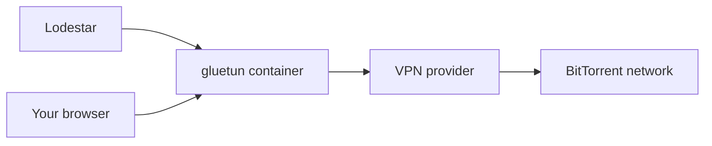

# Chapter 3: Keep Lodestar safe

This chapter sets up Lodestar so the web page, your password and your logs stay private, and so you can restore it.

> [!NOTE]
> **What you will learn**
> - Keep the web UI off the internet and reach it remotely through a [VPN](glossary.md#vpn).
> - Protect the [setup token](glossary.md#setup-token) and the admin password.
> - Choose whether to forward the [DHT](glossary.md#dht) port or run through a VPN [container](glossary.md#container).
> - Keep torrent details out of logs you share.
> - Back up the data folder and restore it.

## 3.1 Keep the web UI off the internet
<!-- index: port forwarding; web UI; remote access; VPN -->

The web UI on port `8090` holds your login page and your whole index. Do not forward it on your router, and do not put it in the router's [DMZ](glossary.md#dmz). Either one puts the login page on the internet.

To reach Lodestar from outside your home:

1. Set up a VPN to your home network, such as WireGuard or Tailscale.
2. Connect to the VPN from your phone or laptop.
3. Open `http://<server-ip>:8090` as if you were at home.
   **Result:** The page loads through the VPN and nothing is exposed.

A [port forward](glossary.md#port-forwarding) is a router rule that sends traffic from the internet to one device. A VPN instead makes your remote device act as if it were at home.

> [!WARNING]
> Behind a [TLS reverse proxy](glossary.md#tls-reverse-proxy), set the environment variable `LODESTAR_SECURE_COOKIES=true`. The proxy must still be reachable only over your VPN or your LAN.

## 3.2 Protect the setup token and the password
<!-- index: setup token; password manager; admin password -->

The setup token is a one-time key to a fresh instance. It appears in the log until you create the admin password, then stops working.

- Don't share a screenshot or a copy of the log before you finish setup.
- Create the admin password from a password manager, with a long random value.
- Use a password you don't use anywhere else.

If someone could have read the token before you used it, create the password now. Once an admin exists, the token stops working and can't be used to claim the instance.

## 3.3 Decide about the DHT port and a VPN
<!-- index: DHT port; gluetun; VPN; connection tracking -->

Lodestar works without any router change. It reaches fewer nodes, but it still finds and fetches torrents. You have three ways to run it.

| Option | What it means |
|---|---|
| **No forwarding (recommended)** | Do nothing on the router. Nothing from the internet reaches Lodestar, and it still crawls. |
| Forward [UDP](glossary.md#udp) `6881` | Better reach, because other nodes can contact you. DHT peers see your public IP. |
| VPN container (gluetun) | DHT and peer traffic leave through the VPN, so peers see the VPN's address, not yours. |

> [!WARNING]
> Forward only `6881` over UDP, never `8090`. Forwarding the DHT port tells every DHT peer your home IP address. If that matters, use the VPN option instead.

### Run Lodestar through gluetun

The **Lodestar-gluetun** template sets `--network=container:gluetun`, so Lodestar has no network of its own. It uses the network of your existing gluetun container.



*Figure 3.1: Lodestar's traffic leaves through gluetun.*

In words: Lodestar sends everything through the gluetun container to your VPN provider and on to the network. Your browser also reaches the web UI through gluetun.

To use it:

1. Install gluetun first. The template expects the container to be named `gluetun`.
2. Add Lodestar's post-rules to gluetun, as in [Close gluetun's gap when the VPN drops](#close-gluetuns-gap-when-the-vpn-drops) below.
3. In the gluetun container, publish port `8090`, the web UI port. Lodestar can't publish ports itself.
4. Install the **Lodestar-gluetun** template. If your VPN container has another name, replace `gluetun` in `--network=container:gluetun` in **Extra Parameters**.
   **Result:** Lodestar starts on gluetun's network.
5. Open the web UI at your server address and the port you published on gluetun.
6. Restart Lodestar whenever gluetun restarts. A container that shares a network stays attached to the old one.

### Close gluetun's gap when the VPN drops

gluetun's firewall is its kill switch. When the VPN drops, it blocks every new connection. On its own, though, it lets packets of connections that were already open leave through your normal network, with your home IP. Lodestar's post-rules file closes that gap.

> [!IMPORTANT]
> Add the post-rules file to gluetun before you start Lodestar. Without it, a few packets can leave outside the VPN each time the tunnel drops.

These steps are for WireGuard, the VPN type Lodestar's templates use, and the rules were checked with it.

1. Open the Unraid terminal (**>_** in the top bar). Save the file, then check it:

    ```sh
    mkdir -p /mnt/cache/appdata/gluetun
    wget -O /mnt/cache/appdata/gluetun/post-rules.txt https://raw.githubusercontent.com/dvortsis/lodestar-v2/1118f82d27de39d8d616eb822544beb7e6af093c/packaging/companions/gluetun-post-rules.txt
    sha256sum /mnt/cache/appdata/gluetun/post-rules.txt
    ```

   **Result:** The `sha256sum` line starts with `26a485e39989b300dab8135ae80635d4d25a4a5ba0eaabe0eab7ea74f08830ea`. If it doesn't, delete the file and download it again. gluetun runs these lines as root, so use only this exact file.
2. Edit the gluetun container and add a **Path**: container path `/iptables/post-rules.txt`, host path `/mnt/cache/appdata/gluetun/post-rules.txt`, access mode **Read Only**.
3. Add a **Variable**: key `VPN_INTERFACE`, value `wg0`. The rules name the tunnel `wg0`, and gluetun's own default is `tun0`. Without this variable the rules do nothing.
4. Select **Apply**. Then, in the terminal, check that gluetun loaded the rules:

    ```sh
    docker exec gluetun iptables -S OUTPUT | head -4
    docker exec gluetun ip link show wg0
    ```

   **Result:** After the first line (`-P OUTPUT DROP`), the next three lines name `wg0`: one ends in `CONNMARK --set-xmark 0x800000/0x800000` and two end in `-j DROP`. The second command shows the `wg0` link. If either is different, gluetun is running without the rules: check steps 1 to 3. Its log line `[firewall] enabled successfully` alone doesn't prove it, because gluetun skips a missing file without a word.
5. If Lodestar already runs, restart it now.

With OpenVPN, gluetun names the tunnel `tun0`, and `wg0` isn't a valid OpenVPN device name. Leave `VPN_INTERFACE` unset, and run `sed -i 's/wg0/tun0/g' /mnt/cache/appdata/gluetun/post-rules.txt` after step 1. In step 4, look for `tun0` instead. This variant wasn't tested, so step 4's check is what tells you it works.

If gluetun stops instead:

| Log line | What to do |
|---|---|
| `post-rules.txt: is a directory` | The file wasn't at the host path, so Docker made a folder there. Delete the folder, repeat step 1, and start gluetun again. |
| `ip6tables is required` | Your server's kernel has no IPv6 firewall. Delete the three lines that start with `ip6tables` from the file, then start gluetun again. |

To undo it, remove the Path and the Variable from gluetun, select **Apply**, and restart Lodestar.

With the file, a connection that used the VPN never leaves any other way. Nothing Lodestar or gluetun sends to the internet goes around the VPN either. The rules never let anything new through. One side effect: gluetun no longer answers pings from your network. The [companion](glossary.md#companion) templates Lodestar generates don't include the file or the variable yet **(planned)**, so add both by hand.

A VPN hides your home IP from peers. It doesn't hide your activity from the VPN provider, and it doesn't make the web UI private. Inbound DHT reach needs a port your provider forwards: allow it in gluetun with `FIREWALL_VPN_INPUT_PORTS` and set **DHT port** in the template to the same number. Without it, Lodestar still crawls with fewer nodes.

<details>
<summary>Why a busy crawler can slow your home router</summary>

The crawler opens hundreds of short outbound connections at once: about 400 at `balanced`, about 1000 at `aggressive`. Consumer routers track every connection in a small table. When it fills, the whole household slows or drops. Start at `low`, raise the intensity step by step and watch the router's connection count. The VPN variant avoids this because the tunnel carries the load.

</details>

## 3.4 Keep logs private
<!-- index: logs; diagnostics; torrent details -->

By default Lodestar's logs contain no torrent details. They record what Lodestar did, not what it found.

- Leave torrent details off. Turning them on is a time-limited choice in the app **(planned)**.
- Share logs only through **Download diagnostics**, which removes torrent details **(planned)**.
- Until then, read a log before you post it. Remove IP addresses, tokens and names.

The setup token is the one secret that appears in the log. It stops working once the admin password exists.

## 3.5 Choose how updates work
<!-- index: updates -->

Updates are off until you choose them, because checking contacts GitHub. Automatic updates are not available in this release.

**Recommended:** update manually after making a backup. In-app update controls are unavailable in v0.5.1.

To update by hand:

1. Take a backup while Lodestar runs ([section 3.7](#37-back-up-and-restore)). It is your rollback.
2. Stop the container.
3. Select the release you want. On Unraid, edit **Repository** to its exact image tag, then apply. For Compose, edit `image:` first.
   **Result:** Unraid starts the selected release with the existing data folder.
4. For Compose, run these commands in the folder containing `docker-compose.yml` on your Docker host:

    ```bash
    docker compose pull
    docker compose up -d
    ```

   **Result:** Compose starts the selected image with the existing data volume. A pinned `0.5.1` tag stays on v0.5.1 until you change it.

> [!NOTE]
> After every start, sampling waits 6 hours before it resumes, so new discoveries slow down after an update or restart. Full speed starts after those 6 hours. Search still works. The index grows over days.

> [!WARNING]
> v0.5.1 uses schema V12 and can upgrade older compatible data. Back up first. A newer nightly can create a store v0.5.1 cannot read. Restore a compatible backup or choose a fresh data folder when returning from newer development builds.

The safe-restart switch documented for development builds is not available in v0.5.1. Native installations also need manual updates: stop the service, install the verified release package, then restart.

## 3.6 Know what protects the content filters and API keys
<!-- index: API keys; content filters; child-safety core -->

The child-safety core of the content filters is always on. A change that would weaken protection asks for your password and shows a plain-language warning first.

The five optional packs cover malware, lures, fakes, spam and scams. They are off by default in v0.5.1. Default-on packs, unauthorised-copy rules and pack-version controls belong to later releases.

API keys, which let other apps such as [Torznab](glossary.md#torznab) clients talk to Lodestar, are **(newer than v0.5.1)**: see [section 7.2](07-connect-other-apps.md#72-create-a-torznab-key). Create one key per app and regenerate any key that leaks. Never use the admin password as a key.

## 3.7 Back up and restore
<!-- index: backup; restore; seal.key; data folder -->

`lodestar backup` makes a consistent copy of everything that can't be rebuilt, and it is safe while Lodestar runs. It writes a new folder `lodestar-backup-<time>` under `backups/` in the data folder, with a `README.txt` that repeats the restore steps.

| File in the backup | What it holds |
|---|---|
| `lodestar.db` | The database. It is the source of truth. |
| `auth.json` | The admin password hash and the key that signs sessions. |
| `seal.key` | The key that unseals the names Lodestar holds back for review. |
| `config.toml` | Your settings file, if you made one. |

The search index isn't in the backup. Lodestar rebuilds it from the database. `secrets.key` isn't in it either. That file protects the secrets you entered for integrations, proxies and notification channels. After a restore to a new server, enter them again.

> [!WARNING]
> The backup holds `seal.key` and `auth.json`. Keep it on a private share. Never place it on a share that is public over SMB.

To back up on Unraid:

1. Open the Unraid terminal and paste:

    ```bash
    docker exec Lodestar /lodestar backup
    ```

   With Compose, run `docker exec lodestar /lodestar backup` on the Docker host. Lodestar must be running.
   **Result:** The command prints `Backup written to` and the folder name.

2. Copy that folder off the [cache pool](glossary.md#cache-pool). Replace `<backup-folder>` with the name printed and `<share>` with a private share you already have:

    ```bash
    cp -a /mnt/cache/appdata/lodestar/backups/<backup-folder> /mnt/user/<share>/
    ```

   **Result:** The copy finishes without an error.

To restore on Unraid:

1. On the Docker tab, select the **Lodestar** icon, then **Stop**.
2. Open the Unraid terminal. Delete the old write-ahead files and the old search index, which doesn't match the restored database and would show the wrong torrents. Check the path before you run it:

    ```bash
    rm -f /mnt/cache/appdata/lodestar/lodestar.db-wal /mnt/cache/appdata/lodestar/lodestar.db-shm
    rm -rf /mnt/cache/appdata/lodestar/index
    ```

3. Copy the files from the backup. Replace `<share>` and `<backup-folder>` as before. Add `config.toml` to the list only if the backup has one:

    ```bash
    cd /mnt/user/<share>/<backup-folder>
    cp -a lodestar.db seal.key auth.json /mnt/cache/appdata/lodestar/
    ```

   The `-a` keeps the files' owner and permissions. If the backup came from another server, also run `chown 99:100 /mnt/cache/appdata/lodestar/lodestar.db /mnt/cache/appdata/lodestar/seal.key /mnt/cache/appdata/lodestar/auth.json`.
4. On the Docker tab, select the **Lodestar** icon, then **Start**.
   **Result:** Lodestar rebuilds the search index on start.
5. Change the admin password when the app offers it **(planned)**. A restored `auth.json` brings back the sessions that were valid when the backup was taken. They last up to 30 days. Changing the password ends them.

You can also copy the whole data folder while Lodestar is stopped. That copy includes the index, so step 2 doesn't apply when you restore it.

## 3.8 Check your understanding

1. A friend wants to open Lodestar from work. What do you set up, and what do you not do?
2. What does forwarding UDP `6881` tell DHT peers?
3. Why must a backup stay on a private share, and what does a restore bring back that you should know about?

> [!TIP]
> **Key takeaways**
> - Never forward port `8090`. Use a VPN for remote access.
> - Forwarding `6881` over UDP is optional and shows your IP to DHT peers.
> - Run `lodestar backup`, keep the result private and copy it off the cache pool.

<!-- nav:start -->
---

[← Chapter 2: Install on Unraid and Docker](02-install-lodestar-on-unraid-and-docker.md) · [Contents](README.md#contents) · [Chapter 4: Install on Windows and Linux →](04-install-on-windows-and-linux.md)
<!-- nav:end -->
