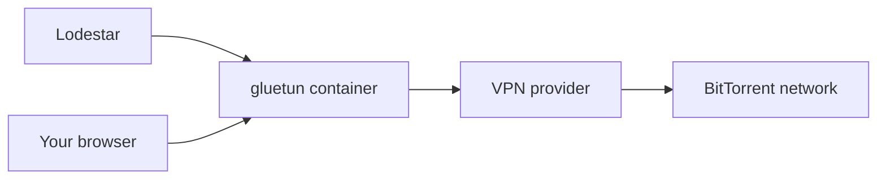

# Chapter 3: Keep Lodestar safe

This chapter sets up Lodestar so the web page, your password and your logs stay private, and so you can restore it.

> [!NOTE]
> **What you will learn**
> - Keep the web UI off the internet and reach it remotely through a [VPN](glossary.md#vpn).
> - Protect the [setup token](glossary.md#setup-token) and the admin password.
> - Choose whether to forward the [DHT](glossary.md#dht) port or run through a VPN [container](glossary.md#container).
> - Keep torrent details out of logs you share.
> - Back up the data folder and restore it.

## 3.1 Keep the web UI off the internet
<!-- index: port forwarding; web UI; remote access; VPN -->

The web UI on port `8090` holds your login page and your whole index. Do not forward it on your router, and do not put it in the router's [DMZ](glossary.md#dmz). Either one puts the login page on the internet.

To reach Lodestar from outside your home:

1. Set up a VPN to your home network, such as WireGuard or Tailscale.
2. Connect to the VPN from your phone or laptop.
3. Open `http://<server-ip>:8090` as if you were at home.
   **Result:** The page loads through the VPN and nothing is exposed.

A [port forward](glossary.md#port-forwarding) is a router rule that sends traffic from the internet to one device. A VPN instead makes your remote device act as if it were at home.

> [!WARNING]
> Behind a [TLS reverse proxy](glossary.md#tls-reverse-proxy), set the environment variable `LODESTAR_SECURE_COOKIES=true`. The proxy must still be reachable only over your VPN or your LAN.

## 3.2 Protect the setup token and the password
<!-- index: setup token; password manager; admin password -->

The setup token is a one-time key to a fresh instance. It appears in the log until you create the admin password, then stops working.

- Don't share a screenshot or a copy of the log before you finish setup.
- Create the admin password from a password manager, with a long random value.
- Use a password you don't use anywhere else.

If someone could have read the token before you used it, create the password now. Once an admin exists, the token stops working and can't be used to claim the instance.

## 3.3 Decide about the DHT port and a VPN
<!-- index: DHT port; gluetun; VPN; connection tracking -->

Lodestar works without any router change. It reaches fewer nodes, but it still finds and fetches torrents. You have three ways to run it.

| Option | What it means |
|---|---|
| **No forwarding (recommended)** | Do nothing on the router. Nothing from the internet reaches Lodestar, and it still crawls. |
| Forward [UDP](glossary.md#udp) `6881` | Better reach, because other nodes can contact you. DHT peers see your public IP. |
| VPN container (gluetun) | DHT and peer traffic leave through the VPN, so peers see the VPN's address, not yours. |

> [!WARNING]
> Forward only `6881` over UDP, never `8090`. Forwarding the DHT port tells every DHT peer your home IP address. If that matters, use the VPN option instead.

### Run Lodestar through gluetun

The **Lodestar-gluetun** template sets `--network=container:gluetun`, so Lodestar has no network of its own. It uses the network of your existing gluetun container.



*Figure 3.1: Lodestar's traffic leaves through gluetun.*

In words: Lodestar sends everything through the gluetun container to your VPN provider and on to the network. Your browser also reaches the web UI through gluetun.

To use it:

1. Install gluetun first. The template expects the container to be named `gluetun`.
2. Add Lodestar's post-rules to gluetun, as in [Close gluetun's gap when the VPN drops](#close-gluetuns-gap-when-the-vpn-drops) below.
3. In the gluetun container, publish port `8090`, the web UI port. Lodestar can't publish ports itself.
4. Install the **Lodestar-gluetun** template. If your VPN container has another name, replace `gluetun` in `--network=container:gluetun` in **Extra Parameters**.
   **Result:** Lodestar starts on gluetun's network.
5. Open the web UI at your server address and the port you published on gluetun.
6. Restart Lodestar whenever gluetun restarts. A container that shares a network stays attached to the old one.

### Run Lodestar through gluetun with Docker Compose
<!-- index: gluetun Compose; network_mode service; WireGuard -->

This one Compose file runs gluetun and Lodestar together. Lodestar uses gluetun's network (`network_mode: "service:gluetun"`) and starts only once gluetun reports healthy, so it never crawls on your normal network. Use it in place of the steps in [section 2.4](02-install-lodestar-on-unraid-and-docker.md#24-install-with-docker-compose). The example uses WireGuard, as Lodestar's post-rules do.

To run it:

1. In a terminal on your Docker host, make a folder and move into it:

    ```bash
    mkdir lodestar && cd lodestar
    ```

2. Download Lodestar's post-rules file and check it:

    ```bash
    curl -fsSL -o post-rules.txt https://raw.githubusercontent.com/dvortsis/lodestar-v2/1118f82d27de39d8d616eb822544beb7e6af093c/packaging/companions/gluetun-post-rules.txt
    sha256sum post-rules.txt
    ```

   **Result:** The line starts with `26a485e39989b300dab8135ae80635d4d25a4a5ba0eaabe0eab7ea74f08830ea`. If it doesn't, delete the file and download it again. gluetun runs these lines as root, so use only this exact file.
3. Make a file named `docker-compose.yml` in the same folder with this content:

    ```yaml
    services:
      gluetun:
        image: qmcgaw/gluetun:v3.41.3
        container_name: gluetun
        restart: unless-stopped
        cap_add:
          - NET_ADMIN
        devices:
          - /dev/net/tun:/dev/net/tun
        environment:
          TZ: Etc/UTC
          # Fill these in from your VPN provider. Lodestar never sees them.
          VPN_SERVICE_PROVIDER: "FILL_IN_YOURSELF"
          VPN_TYPE: wireguard
          VPN_INTERFACE: wg0
          # Many VPN providers don't answer pings: check the VPN with DNS.
          HEALTH_SMALL_CHECK_TYPE: dns
          WIREGUARD_PRIVATE_KEY: "FILL_IN_YOURSELF"
          WIREGUARD_ADDRESSES: "FILL_IN_YOURSELF"
        volumes:
          # Lodestar's post-rules: they close the gap when the VPN drops.
          - ./post-rules.txt:/iptables/post-rules.txt:ro
        ports:
          # Lodestar's web UI. Lodestar shares gluetun's network,
          # so its ports are published here.
          - "8090:8090/tcp"

      lodestar:
        image: ghcr.io/dvortsis/lodestar-v2:0.5.1
        container_name: lodestar
        restart: unless-stopped
        stop_grace_period: 60s
        # All of Lodestar's traffic goes through gluetun.
        network_mode: "service:gluetun"
        depends_on:
          gluetun:
            condition: service_healthy
            # Compose restarts Lodestar whenever it restarts gluetun.
            restart: true
        environment:
          TZ: Etc/UTC
          # Lodestar restarts itself when gluetun restarts outside Compose.
          LODESTAR_EXIT_ON_NETWORK_LOSS: "true"
        volumes:
          - lodestar-data:/data

    volumes:
      lodestar-data:
    ```

4. Replace each `FILL_IN_YOURSELF` with the values from your VPN provider's WireGuard setup page. Keep `VPN_INTERFACE: wg0`: the post-rules name the tunnel `wg0`.

   gluetun's own documentation lists the provider names it accepts. A provider it doesn't list (`VPN_SERVICE_PROVIDER: custom`) also needs its endpoint and public key: see gluetun's [custom provider page](https://github.com/qdm12/gluetun-wiki/blob/main/setup/providers/custom.md).
5. Check that your Docker Compose is version 2.17 or later, then check the file and start gluetun alone:

    ```bash
    docker compose version
    docker compose config -q && docker compose up -d gluetun
    ```

   **Result:** The first line shows the version, such as `Docker Compose version v2.29.7`. An older version refuses the file with "Additional property restart is not allowed": update Docker first. `docker compose config -q` prints nothing when the file is valid, and Docker starts only gluetun. If gluetun keeps restarting, run `docker compose logs gluetun` to see why.
6. Before Lodestar starts, check that gluetun loaded the post-rules:

    ```bash
    docker compose exec gluetun iptables -S OUTPUT | head -4
    docker compose exec gluetun ip link show wg0
    ```

   **Result:** After the first line (`-P OUTPUT DROP`), the next three lines name `wg0`: one ends in `CONNMARK --set-xmark 0x800000/0x800000` and two end in `-j DROP`. The second command shows the `wg0` link. If either is different, gluetun is running without the rules: check steps 2 to 4 before you start Lodestar. gluetun skips a missing rules file without a word, so this check is the only proof.
7. Start Lodestar:

    ```bash
    docker compose up -d
    ```

   **Result:** Docker starts Lodestar once gluetun reports healthy. If gluetun can't connect, Lodestar doesn't start.
8. Create the admin password as in [section 2.5](02-install-lodestar-on-unraid-and-docker.md#25-create-the-admin-password). Open the web UI at `http://<server-ip>:8090`, the port published on gluetun.

**(Newer than v0.5.1)** When gluetun restarts, Lodestar notices it has lost its network within about half a minute and restarts itself. The web UI comes back once its start wait is over.

In v0.5.1, Lodestar ignores `LODESTAR_EXIT_ON_NETWORK_LOSS`. Compose still restarts Lodestar when Compose restarts gluetun. After any other gluetun restart, run `docker compose restart lodestar`. That restart costs the six-hour sampling wait. Search keeps working meanwhile.

An automatic updater or any other tool that updates gluetun outside Compose makes a new gluetun container. Lodestar can't rejoin that one by itself, in any version.

You see it this way: the web UI doesn't load, and `docker compose ps` shows Lodestar stopped or restarting again and again. **(Newer than v0.5.1)** Its log, from `docker compose logs lodestar`, ends with a line that starts `Network lost:`. To fix it, run `docker compose up -d --force-recreate lodestar`. Updating with `docker compose pull && docker compose up -d` avoids this.

To back up, restore or rebuild the index, use the Compose commands in [section 3.7](#37-back-up-and-restore). They work the same with this file.

### Close gluetun's gap when the VPN drops

gluetun's firewall is its kill switch. When the VPN drops, it blocks every new connection. On its own, though, it lets packets of connections that were already open leave through your normal network, with your home IP. Lodestar's post-rules file closes that gap.

> [!IMPORTANT]
> Add the post-rules file to gluetun before you start Lodestar. Without it, a few packets can leave outside the VPN each time the tunnel drops.

The Compose file above already has the post-rules, and its step 6 is the check. **(Newer than v0.5.1)** Lodestar can generate gluetun from its [companion](glossary.md#companion) templates ([chapter 8](08-add-companions.md)). In v0.5.1 there are no companion templates, so use the Compose file above or the steps below. If Lodestar generated your gluetun, most of this is done:

| Template | What it already has | What you do |
|---|---|---|
| Compose file | The rules, built in, and `VPN_INTERFACE=wg0`. The companion starts only once gluetun is healthy. | Use Docker Compose 2.23.1 or later: run `docker compose version` to see yours. Older versions refuse the file. Then check the rules: run step 4's commands with `docker compose exec` in place of `docker exec`. Don't skip it: a Compose tool that ignores the built-in rules starts gluetun without them, and without an error. |
| Unraid template | A read-only **Post-rules** path (`/mnt/cache/appdata/gluetun/post-rules.txt`) and `VPN_INTERFACE=wg0`. | Step 1 below, then the check in step 4. If you changed the **Post-rules** path in the form, use your path in step 1's commands. Then set the start order (below). |

Lodestar's own Unraid template has a **Companion files** path, `/mnt/user/appdata/lodestar-companions` by default. Keep it outside Lodestar's **Data** folder: gluetun reads from it, and the **Data** folder holds Lodestar's secrets. With that path set, Lodestar saves the post-rules file at each start, as `gluetun/post-rules.txt` in that folder, so you can skip step 1:

1. Restart Lodestar, then open the Unraid terminal and check the file and who owns its folders:

    ```sh
    sha256sum /mnt/user/appdata/lodestar-companions/gluetun/post-rules.txt
    stat -c '%U %a %n' /mnt/user/appdata/lodestar-companions /mnt/user/appdata/lodestar-companions/gluetun
    ```

   **Result:** The `sha256sum` line starts with the same `26a485e3…` value as step 1's, and both `stat` lines start with `root 755`. If the file is missing, Lodestar's log says why, in the line **gluetun post-rules not saved**:

   | Why | What to do |
   |---|---|
   | The folder isn't set, holds other files, or belongs to another user | Use step 1 instead. |
   | It sits inside Lodestar's **Data** folder or another container's folder | Edit Lodestar, set **Companion files** back to `/mnt/user/appdata/lodestar-companions`, and restart it. |
2. Edit gluetun and set its **Post-rules** path to `/mnt/user/appdata/lodestar-companions/gluetun/post-rules.txt`. Then do the check in step 4.

The file and its folders belong to root. Lodestar can read them but not change them, so nothing it runs can change the rules gluetun runs as root. Settings → Companions will fill in gluetun's **Post-rules** path for you **(planned)**.

> [!IMPORTANT]
> Let Docker create the **Companion files** folder when you apply Lodestar's template. Keep it outside Lodestar's **Data** folder and outside any other container's folder: Lodestar won't use one inside them. Map only the folders Lodestar needs. If you map a whole share or disk into Lodestar, it can't tell the folders apart and refuses on purpose. Don't make it over a network share, and don't run Unraid's **New Permissions** tool on it: Lodestar doesn't use a folder another user can write.

If gluetun started before the file existed, Docker made a folder named `post-rules.txt` in its place. Delete it with `rmdir /mnt/user/appdata/lodestar-companions/gluetun/post-rules.txt`, then restart Lodestar and gluetun. `rmdir` removes only an empty folder, so it can't delete anything else by mistake.

To set the start order on Unraid:

1. Open the **Docker** tab and switch it to **Advanced View** (top right).
2. Select the lock icon above the container list to unlock it, then drag gluetun above the companion. Select the lock again.
3. Turn on **Autostart** for both, and in gluetun's row set **wait** to `30`.

   **Result:** After each restart, Unraid starts gluetun, waits 30 seconds for its firewall, then starts the companion.

The steps below are for a gluetun you set up yourself. With Lodestar's Unraid template, do only steps 1 and 4: the template already has steps 2 and 3. The steps are for WireGuard, the VPN type Lodestar's templates use, and the rules were checked with it.

1. Open the Unraid terminal (**>_** in the top bar). Save the file, then check it:

    ```sh
    mkdir -p /mnt/cache/appdata/gluetun
    wget -O /mnt/cache/appdata/gluetun/post-rules.txt https://raw.githubusercontent.com/dvortsis/lodestar-v2/1118f82d27de39d8d616eb822544beb7e6af093c/packaging/companions/gluetun-post-rules.txt
    sha256sum /mnt/cache/appdata/gluetun/post-rules.txt
    ```

   **Result:** The `sha256sum` line starts with `26a485e39989b300dab8135ae80635d4d25a4a5ba0eaabe0eab7ea74f08830ea`. If it doesn't, delete the file and download it again. gluetun runs these lines as root, so use only this exact file.
2. Edit the gluetun container and add a **Path**: container path `/iptables/post-rules.txt`, host path `/mnt/cache/appdata/gluetun/post-rules.txt`, access mode **Read Only**.
3. Add a **Variable**: key `VPN_INTERFACE`, value `wg0`. The rules name the tunnel `wg0`, and gluetun's own default is `tun0`. Without this variable the rules do nothing.
4. Select **Apply**. Then, in the terminal, check that gluetun loaded the rules:

    ```sh
    docker exec gluetun iptables -S OUTPUT | head -4
    docker exec gluetun ip link show wg0
    ```

   **Result:** After the first line (`-P OUTPUT DROP`), the next three lines name `wg0`: one ends in `CONNMARK --set-xmark 0x800000/0x800000` and two end in `-j DROP`. The second command shows the `wg0` link. If either is different, gluetun is running without the rules: check steps 1 to 3. Its log line `[firewall] enabled successfully` alone doesn't prove it, because gluetun skips a missing file without a word.
5. If Lodestar already runs, restart it now.

With OpenVPN, gluetun names the tunnel `tun0`, and `wg0` isn't a valid OpenVPN device name. Leave `VPN_INTERFACE` unset, and run `sed -i 's/wg0/tun0/g' /mnt/cache/appdata/gluetun/post-rules.txt` after step 1. In step 4, look for `tun0` instead. This variant wasn't tested, so step 4's check is what tells you it works.

If gluetun stops or keeps restarting instead:

| Log line | What to do |
|---|---|
| `post-rules.txt: is a directory` | The file wasn't at the host path, so Docker made a folder there. Delete the folder, repeat step 1, and start gluetun again. |
| `ip6tables is required` | Your server's kernel has no IPv6 firewall. Delete the three lines that start with `ip6tables` from the file, then start gluetun again. |
| `restarting VPN`, again and again | gluetun's health check pings through the VPN by default, and many VPN providers, PIA among them, don't answer pings. A ping to an address on your network, set with `HEALTH_ICMP_TARGET_IP`, fails too, because the rules drop it. Add the variable `HEALTH_SMALL_CHECK_TYPE` with value `dns`, remove `HEALTH_ICMP_TARGET_IP` if you set it, and restart gluetun. gluetun then checks the VPN with a DNS lookup through it. Lodestar's templates already set it. A few restarts in the first half minute after gluetun starts are normal. |

To undo it, remove the Path and the Variable from gluetun, select **Apply**, and restart Lodestar.

With the file, a connection that used the VPN never leaves any other way. Nothing Lodestar or gluetun sends to the internet goes around the VPN either. The rules never let anything new through. One side effect: gluetun no longer answers pings from your network.

**When gluetun stops or restarts,** the VPN server can keep sending packets for the old connection for a short while. They now reach your server itself, not gluetun. Your server may answer them with an ICMP message, "port unreachable". ICMP is the kind of network message `ping` uses. These answers leave your home connection directly, outside the VPN.
- **What they reveal:** that your server is on and that the old connection has gone. They go to the VPN server, which already knows your home address because the tunnel came from it. Your internet provider sees only traffic to the VPN server, which it already sees. Nothing readable is in them: only the start of the VPN server's own encrypted packet, sent back to it.
- **The safe choice is to leave this alone.** You don't need extra firewall rules on your server for it. Many NAS and desktop firewalls already drop such packets. Unraid has no host firewall by default, and the advice is the same there. A wrong rule on the server's own firewall can cut you off from it.

A VPN hides your home IP from peers. It doesn't hide your activity from the VPN provider, and it doesn't make the web UI private. Inbound DHT reach needs a port your provider forwards: allow it in gluetun with `FIREWALL_VPN_INPUT_PORTS` and set **DHT port** in the template to the same number. Without it, Lodestar still crawls with fewer nodes.

<details>
<summary>Why a busy crawler can slow your home router</summary>

The crawler opens hundreds of short outbound connections at once: about 400 at `balanced`, about 1000 at `aggressive`. Consumer routers track every connection in a small table. When it fills, the whole household slows or drops. Start at `low`, raise the intensity step by step and watch the router's connection count. The VPN variant avoids this because the tunnel carries the load.

</details>

## 3.4 Keep logs private
<!-- index: logs; diagnostics; torrent details -->

By default Lodestar's logs contain no torrent details. They record what Lodestar did, not what it found.

- Leave torrent details off. Turning them on is a time-limited choice in the app **(planned)**.
- Share logs only through **Download diagnostics**, which removes torrent details **(planned)**.
- Until then, read a log before you post it. Remove IP addresses, tokens and names.

The setup token is the one secret that appears in the log. It stops working once the admin password exists.

## 3.5 Choose how updates work
<!-- index: updates -->

Updates are off until you choose them, because checking contacts GitHub. Automatic updates are not available in this release.

**Recommended:** update manually after making a backup. In-app update controls are unavailable in v0.5.1.

To update by hand:

1. Take a backup while Lodestar runs ([section 3.7](#37-back-up-and-restore)). It is your rollback.
2. Stop the container.
3. Select the release you want. On Unraid, edit **Repository** to its exact image tag, then apply. For Compose, edit `image:` first.
   **Result:** Unraid starts the selected release with the existing data folder.
4. For Compose, run these commands in the folder containing `docker-compose.yml` on your Docker host:

    ```bash
    docker compose pull
    docker compose up -d
    ```

   **Result:** Compose starts the selected image with the existing data volume. A pinned `0.5.1` tag stays on v0.5.1 until you change it.

> [!NOTE]
> After every start, sampling waits 6 hours before it resumes, so new discoveries slow down after an update or restart. Full speed starts after those 6 hours. Search still works. The index grows over days.

> [!WARNING]
> v0.5.1 uses schema V12 and can upgrade older compatible data. Back up first. A newer nightly can create a store v0.5.1 cannot read. Restore a compatible backup or choose a fresh data folder when returning from newer development builds.

The safe-restart switch documented for development builds is not available in v0.5.1. Native installations also need manual updates: stop the service, install the verified release package, then restart.

## 3.6 Know what protects the content filters and API keys
<!-- index: API keys; content filters; child-safety core -->

The child-safety core of the content filters is always on. A change that would weaken protection asks for your password and shows a plain-language warning first.

The five optional packs cover malware, lures, fakes, spam and scams. They are off by default in v0.5.1. Default-on packs, unauthorised-copy rules and pack-version controls belong to later releases.

API keys, which let other apps such as [Torznab](glossary.md#torznab) clients talk to Lodestar, are **(newer than v0.5.1)**: see [section 7.2](07-connect-other-apps.md#72-create-a-torznab-key). Create one key per app and regenerate any key that leaks. Never use the admin password as a key.

## 3.7 Back up and restore
<!-- index: backup; restore; seal.key; data folder -->

`lodestar backup` makes a consistent copy of everything that can't be rebuilt, and it is safe while Lodestar runs. It writes a new folder `lodestar-backup-<time>` under `backups/` in the data folder, with a `README.txt` that repeats the restore steps.

| File in the backup | What it holds |
|---|---|
| `lodestar.db` | The database. It is the source of truth. |
| `auth.json` | The admin password hash and the key that signs sessions. |
| `seal.key` | The key that unseals the names Lodestar holds back for review. |
| `config.toml` | Your settings file, if you made one. |

The search index isn't in the backup. Lodestar rebuilds it from the database. `secrets.key` isn't in it either. That file protects the secrets you entered for integrations, proxies and notification channels. After a restore to a new server, enter them again.

> [!WARNING]
> The backup holds `seal.key` and `auth.json`. Keep it on a private share. Never place it on a share that is public over SMB.

To back up on Unraid:

1. Open the Unraid terminal and paste:

    ```bash
    docker exec Lodestar /lodestar backup
    ```

   Lodestar must be running.
   **Result:** After a few log lines, the command prints the folder and what it holds, for example:

    ```text
    Backup written to /data/backups/lodestar-backup-20261115-121546
      lodestar.db    1.19 MiB
      seal.key       32 B
      auth.json      107 B
    The store holds 0 torrents (schema v12).
    The search index isn't included. After a restore, rebuild it with `lodestar reindex`.
    The folder holds secrets (seal.key, auth.json): keep it private. Its README.txt has the restore steps.
    ```

   `/data` inside the container is your **Data** folder, `/mnt/cache/appdata/lodestar`.

2. Copy that folder off the [cache pool](glossary.md#cache-pool). Replace `<backup-folder>` with the name printed and `<share>` with a private share you already have:

    ```bash
    cp -a /mnt/cache/appdata/lodestar/backups/<backup-folder> /mnt/user/<share>/
    ```

   **Result:** The copy finishes without an error.

To restore on Unraid:

1. On the Docker tab, select the **Lodestar** icon, then **Stop**.
2. Open the Unraid terminal. Delete the old write-ahead files, which belong to the old database. Check the path before you run it:

    ```bash
    rm -f /mnt/cache/appdata/lodestar/lodestar.db-wal /mnt/cache/appdata/lodestar/lodestar.db-shm
    ```

3. Copy the files from the backup. Replace `<share>` and `<backup-folder>` as before. Add `config.toml` to the list only if the backup has one:

    ```bash
    cd /mnt/user/<share>/<backup-folder>
    cp -a lodestar.db seal.key auth.json /mnt/cache/appdata/lodestar/
    ```

   The `-a` keeps the files' owner and permissions. If the backup came from another server, also run `chown 99:100 /mnt/cache/appdata/lodestar/lodestar.db /mnt/cache/appdata/lodestar/seal.key /mnt/cache/appdata/lodestar/auth.json`.
4. Mark the search index for rebuild. The old index doesn't match the restored database and would show the wrong torrents. In the same terminal, run:

    ```bash
    docker run --rm -v /mnt/cache/appdata/lodestar:/data -e PUID=99 -e PGID=100 ghcr.io/dvortsis/lodestar-v2:0.5.1 reindex
    ```

   Use the same image as your container's **Repository** field. If you changed **PUID** and **PGID**, use your numbers. **Result:** After a few log lines, it prints `The search index is marked for rebuild.` If it says `refused` and asks you to stop Lodestar, stop it on the Docker tab. Then run the command again.
5. On the Docker tab, select the **Lodestar** icon, then **Start**.
   **Result:** Lodestar rebuilds the search index from the database. Results fill in while it runs.
6. Change the admin password when the app offers it **(planned)**. A restored `auth.json` brings back the sessions that were valid when the backup was taken. They last up to 30 days. Changing the password ends them.

You can also copy the whole data folder while Lodestar is stopped. That copy includes a matching index, so step 4 doesn't apply when you restore it.

### Back up and restore with Docker Compose
<!-- index: backup Docker; named volume backup; docker cp; restore Docker -->

With Compose and the recommended [named volume](glossary.md#named-volume-and-bind-mount), Docker keeps the data in a volume, not in a folder you browse. The commands below copy files in and out of it. Run them on the Docker host, in the folder that holds `docker-compose.yml`.

- **The volume's name:** the commands assume that folder is named `lodestar`, so the volume is `lodestar_lodestar-data`. Run `docker volume ls` to see yours, and use its name if it differs.
- **A bind mount** (`./data:/data`): the data is already in `./data`. Follow the Unraid steps above with that folder, your `PUID` and `PGID` in place of `99:100`, and the Compose `reindex` command below.

To back up:

1. Make the backup. Lodestar must be running:

    ```bash
    docker exec lodestar /lodestar backup
    ```

   **Result:** It prints `Backup written to /data/backups/lodestar-backup-<time>`, the files and the restore hint, as on Unraid.
2. Copy the folder out of the volume, into the current folder. Replace `<backup-folder>` with the name printed, such as `lodestar-backup-20261115-121546`:

    ```bash
    docker cp lodestar:/data/backups/<backup-folder> .
    ```

   **Result:** The command ends without an error, and `ls <backup-folder>` shows `README.txt`, `auth.json`, `lodestar.db` and `seal.key`. Move that folder somewhere private: it holds the secrets in `seal.key` and `auth.json`.

To restore, with the backup folder in the current folder:

1. Stop Lodestar:

    ```bash
    docker compose stop lodestar
    ```

2. Delete the old write-ahead files, which belong to the old database:

    ```bash
    docker run --rm -v lodestar_lodestar-data:/data busybox:1.36 rm -f /data/lodestar.db-wal /data/lodestar.db-shm
    ```

   The image has no shell, so these steps use the small `busybox` image to reach the volume. **Result:** The command prints nothing.
3. Copy the files from the backup into the volume, then give them to Lodestar's user. `65532` is the image's default user. If you set `PUID` and `PGID`, use your numbers:

    ```bash
    docker run --rm -v lodestar_lodestar-data:/data -v "$PWD/<backup-folder>":/backup:ro busybox:1.36 cp /backup/lodestar.db /backup/seal.key /backup/auth.json /data/
    docker run --rm -v lodestar_lodestar-data:/data busybox:1.36 chown 65532:65532 /data/lodestar.db /data/seal.key /data/auth.json
    ```

   **Result:** Both commands print nothing. Add `/backup/config.toml` to the first command only if the backup has one.
4. Mark the search index for rebuild:

    ```bash
    docker compose run --rm lodestar reindex
    ```

   **Result:** It prints `The search index is marked for rebuild.` If it says `refused` and that the store is open in another process, Lodestar is still running: repeat step 1.
5. Start Lodestar:

    ```bash
    docker compose start lodestar
    ```

   **Result:** Lodestar rebuilds the search index from the database. Then change the admin password, as in step 6 of the Unraid restore.

### Back up and restore on Windows
<!-- index: backup on Windows; restore on Windows; ProgramData -->

On Windows, `lodestar backup` finds the data folder by itself, so you don't need to set `LODESTAR_DATA_DIR`:

- **Installed (the MSI):** the service's folder, `C:\ProgramData\Lodestar`. If that folder isn't private, the command refuses, as the service does, and says how to fix it.
- **Portable:** the `data` folder beside `lodestar.exe`, when you run it from that folder.

If the command says `no store at`, it names the folder it looked in. Point it at the folder that holds `lodestar.db`, for example `D:\Lodestar`, then run it again in the same window:

```powershell
$env:LODESTAR_DATA_DIR = 'D:\Lodestar'
```

To back up an installed Lodestar (the MSI):

1. From Start, open **PowerShell** with **Run as administrator**. Only administrators and the service can open the data folder.
2. Paste:

    ```powershell
    & 'C:\Program Files\Lodestar\lodestar.exe' backup
    ```

   Lodestar can keep running.
   **Result:** The command prints `Backup written to` and a folder under `C:\ProgramData\Lodestar\backups`, with the files it holds, as on Unraid.
3. Copy that folder to a private place off this PC, for example a USB drive. Replace `<backup-folder>` with the name printed and `E:\` with your drive:

    ```powershell
    Copy-Item -Recurse 'C:\ProgramData\Lodestar\backups\<backup-folder>' 'E:\'
    ```

   **Result:** The copy finishes without an error.
4. Delete the copy left in `C:\ProgramData\Lodestar\backups` once it's safe elsewhere. It holds `auth.json` and `seal.key`, the keys listed above. Replace `<backup-folder>` as before:

    ```powershell
    Remove-Item -Recurse 'C:\ProgramData\Lodestar\backups\<backup-folder>'
    ```

To restore an installed Lodestar:

1. Open **PowerShell** with **Run as administrator**, then stop the service:

    ```powershell
    Stop-Service Lodestar
    ```

2. Delete the old write-ahead files, which belong to the old database. Check the paths before you run it:

    ```powershell
    Remove-Item -Force -ErrorAction SilentlyContinue 'C:\ProgramData\Lodestar\lodestar.db-wal', 'C:\ProgramData\Lodestar\lodestar.db-shm'
    ```

3. Copy the files from the backup. Replace `E:\<backup-folder>` with where your backup is. Add `config.toml` to the list only if the backup has one:

    ```powershell
    Copy-Item 'E:\<backup-folder>\lodestar.db', 'E:\<backup-folder>\seal.key', 'E:\<backup-folder>\auth.json' 'C:\ProgramData\Lodestar\'
    ```

4. Mark the search index for rebuild:

    ```powershell
    & 'C:\Program Files\Lodestar\lodestar.exe' reindex
    ```

   **Result:** It prints `The search index is marked for rebuild.` If it says `refused` and that the store is open in another process, the service is still running: repeat step 1.
5. Start the service:

    ```powershell
    Start-Service Lodestar
    ```

   **Result:** Lodestar rebuilds the search index from the database. Then change the admin password, as in step 6 of the Unraid restore.

A portable copy works the same way from its own folder. Open PowerShell in the folder that holds `lodestar.exe` and run `.\lodestar.exe backup`; the backup goes under `data\backups`. To restore, stop Lodestar (**Ctrl+C** in its window) and delete `data\lodestar.db-wal` and `data\lodestar.db-shm`. Copy the files from the backup into `data`, run `.\lodestar.exe reindex`, then run **Start Lodestar.cmd** again.

### Rebuild the search index
<!-- index: reindex; rebuild index; lodestar reindex -->

The search index is built from the database, so it can always be rebuilt. Do it after a restore, or when search shows torrents the database doesn't have. Lodestar must be stopped: a running Lodestar refuses, with a message that says so, and changes nothing.

| Where | Commands |
|---|---|
| Docker Compose | `docker compose stop lodestar`, then `docker compose run --rm lodestar reindex`, then `docker compose start lodestar` |
| Unraid | Stop **Lodestar** on the Docker tab. In the terminal, run `docker run --rm -v /mnt/cache/appdata/lodestar:/data -e PUID=99 -e PGID=100 ghcr.io/dvortsis/lodestar-v2:0.5.1 reindex`, with your **PUID** and **PGID** if you changed them, then start **Lodestar** again. |
| Windows (the MSI) | In PowerShell opened with **Run as administrator**: `Stop-Service Lodestar`, then `& 'C:\Program Files\Lodestar\lodestar.exe' reindex`, then `Start-Service Lodestar` |

**Result:** The command prints `The search index is marked for rebuild.` At the next start, Lodestar builds a new index from the database. Results fill in while it runs.

### Keep the data folder owner-only
<!-- index: data folder permissions; chmod; folder mode -->

The data folder holds the store, the search index and your settings. Only Lodestar's own user should be able to open it, so Lodestar keeps it owner-only. That's mode 700: only the owner can read, write or open it. That's the safe choice because the folder holds your library, settings and keys, and no other account needs it.

- **A folder Lodestar creates** is owner-only from the start.
- **A folder Lodestar's user owns** is made owner-only at the next start, if it's plainly Lodestar's: empty, or holding Lodestar's files. In Docker and on Unraid with `PUID`/`PGID`, Lodestar hands the folder to that user first.
- **Any other folder** is never changed. That's a folder another account owns, a link, or a folder holding other files, such as a whole share. If other users could read it, Lodestar logs one warning at start. The warning gives the folder's path and says "the data folder can be read by other users".

If you see that warning, give the folder to Lodestar's user. Don't run `chmod 700` as the folder's owner instead. Lodestar reaches a folder it doesn't own through the group or other permissions, so that would lock it out.

1. Find the folder in the warning, for example the folder you set in `LODESTAR_DATA_DIR`. Check it holds only Lodestar's files, not a whole share or a home folder. If it doesn't, point Lodestar at a folder of its own. If the path is a link (`ls -ld` shows `->`), set `LODESTAR_DATA_DIR` to the folder it points to.
2. Give the folder to Lodestar's user:
   - **Docker or Unraid:** set `PUID` and `PGID` to the user and group Lodestar should run as, and don't use `--user`. Lodestar hands the folder over itself. If you must use `--user`, give the folder to that user ID instead.
   - **Linux without Docker:** run this in a terminal, with Lodestar's user and group and your folder's path:
     ```bash
     sudo chown lodestar:lodestar /path/to/lodestar-data
     ```
3. Restart Lodestar.

   **Result:** Lodestar makes the folder owner-only, and the next start logs no warning.

Unraid's appdata backup runs as root, so it can still copy the folder. On Windows, the installed service's folder `C:\ProgramData\Lodestar` is already limited to SYSTEM, Administrators and the service ([chapter 4](04-install-on-windows-and-linux.md)). A portable copy's `data` folder, or a folder you chose yourself, keeps the permissions of the folder it's in.

## 3.8 Check your understanding

1. A friend wants to open Lodestar from work. What do you set up, and what do you not do?
2. What does forwarding UDP `6881` tell DHT peers?
3. Why must a backup stay on a private share, and what does a restore bring back that you should know about?

> [!TIP]
> **Key takeaways**
> - Never forward port `8090`. Use a VPN for remote access.
> - Forwarding `6881` over UDP is optional and shows your IP to DHT peers.
> - Run `lodestar backup`, keep the result private and copy it off the cache pool.

<!-- nav:start -->
---

[← Chapter 2: Install on Unraid and Docker](02-install-lodestar-on-unraid-and-docker.md) · [Contents](README.md#contents) · [Chapter 4: Install on Windows and Linux →](04-install-on-windows-and-linux.md)
<!-- nav:end -->
