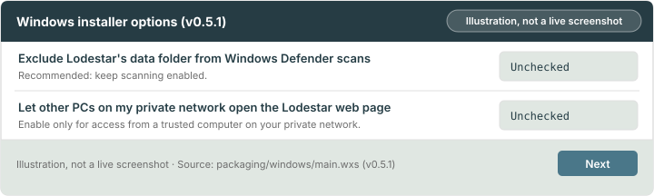
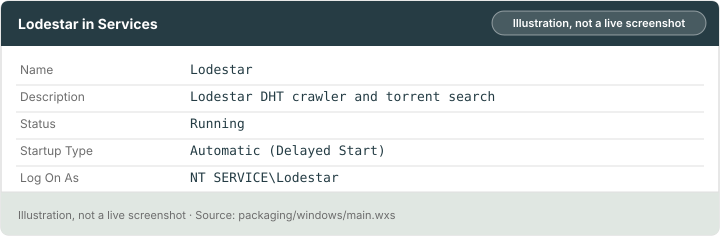
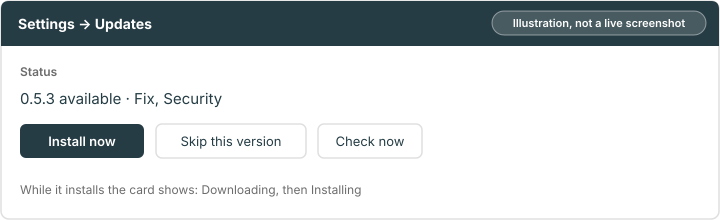

# Chapter 4: Install on Windows and Linux

Install v0.5.1 from the published Windows or Linux downloads. Check the download first, then choose a service or a portable run. The last two sections explain two warnings Lodestar can show about your PC.

> [!NOTE]
> **What you will learn**
> - Explain why Windows shows "Windows protected your PC" for Lodestar.
> - Check a download against its [checksum](glossary.md#checksum) with PowerShell.
> - Decide when to run the file and when to stop.
> - Install the Windows service, portable ZIP or Linux service, and say what each leaves on your PC.
> - Move a data folder off a slow or unsafe filesystem, and fix the Windows port warning with the `netsh` command Insights gives you.
> - Choose an update setting, install an update and read an [update rollback](glossary.md#update-rollback) on Windows **(newer than v0.5.1)**.

## 4.1 Understand the SmartScreen warning
<!-- index: SmartScreen; unsigned; code signing -->

Windows builds of Lodestar ship **unsigned** for now, because the project has no code-signing certificate. [SmartScreen](glossary.md#smartscreen) shows "Windows protected your PC" for apps it doesn't recognise, and for apps without a publisher signature. The warning doesn't mean the file is harmful. It means Windows can't tell who made it.

That is why you verify the file yourself before you run it.

## 4.2 Check the download before you run it
<!-- index: checksum; Get-FileHash; SHA-256 -->

A [checksum](glossary.md#checksum) is a short fingerprint of a file. If the file changes by one byte, the fingerprint changes. Download Lodestar only from the project's official release page: [v0.5.1 downloads](https://github.com/dvortsis/lodestar-v2/releases/tag/v0.5.1).

> [!WARNING]
> Don't run an installer from a mirror, forum post or re-upload. Get it from the official release page instead.

Each release has one file called `SHA256SUMS` beside the installer and archives. Its lines look like `<hash>  <file name>`. Use releases only. Nightly builds are workflow artifacts with a `.sha256` file each and no signature.

To check the download on Windows:

1. On the release page, download the installer and `SHA256SUMS`. Put both in your **Downloads** folder.
2. Open **PowerShell** from the Start menu.
3. Paste this command. Replace `<file>` with the installer's file name:

    ```powershell
    (Get-FileHash "$HOME\Downloads\<file>" -Algorithm SHA256).Hash.ToLower()
    ```

   **Result:** PowerShell prints 64 letters and digits.
4. Open `SHA256SUMS` in Notepad and find the line for your installer.
5. Compare the two values character by character.
   **Result:** They are identical.

To check a download on Linux:

1. Open a terminal in the folder that holds the file and `SHA256SUMS`.
2. Run:

    ```bash
    sha256sum --check --ignore-missing SHA256SUMS
    ```

   **Result:** The line for your file ends in `OK`.

The checksum checks file integrity. The signature checks that the checksum list was signed with the project's release key. v0.5.1 includes `SHA256SUMS.minisig`. The public key has ID `02910813433E81E0`. With [minisign](https://jedisct1.github.io/minisign/) installed, check the signature before relying on the checksums:

1. Open a terminal in a folder that holds `SHA256SUMS` and `SHA256SUMS.minisig`.
2. Download the public key. In Windows PowerShell, use `curl.exe` in place of `curl`:

    ```bash
    curl --fail --silent --show-error --location --remote-name https://raw.githubusercontent.com/dvortsis/lodestar-v2/v0.5.1/packaging/keys/lodestar-release.pub
    ```

3. Run:

    ```bash
    minisign -V -p lodestar-release.pub -m SHA256SUMS
    ```

   Add `-x <path>/SHA256SUMS.minisig` if the signature is in another folder.
   **Result:** minisign prints `Signature and comment signature verified`.

## 4.3 Run it or stop
<!-- index: Run anyway; More info -->

If the hashes match, run the file. When SmartScreen appears, select **More info**, check the file name, then select **Run anyway**.

If the hashes differ, stop. Delete the file and download it again from the official release page. If it still differs, don't run it, and report it at <https://github.com/dvortsis/lodestar-v2/issues>.

> [!TIP]
> Select **Run anyway** only after the hashes match. Never turn off SmartScreen or Defender to get past the warning.

## 4.4 Install on Windows
<!-- index: Windows; MSI; portable ZIP; Windows service; Defender; uninstall; REMOVE_DATA -->

Choose a download from the [v0.5.1 release](https://github.com/dvortsis/lodestar-v2/releases/tag/v0.5.1). Both Windows packages require `x86_64`.

| Option | When to use it |
|---|---|
| **MSI installer (recommended)** | Run Lodestar as a service that starts with Windows, with firewall rules and a Start-menu shortcut. Download `lodestar-0.5.1-x86_64.msi`. |
| Portable ZIP | Try Lodestar without installing anything. Download `lodestar-0.5.1-x86_64-windows-portable.zip`. |

### Install the MSI

The installer shows a welcome page, the licence, one **Options** page, then **Ready**. It has no folder page: the program always goes in `C:\Program Files\Lodestar`, so the scripts Windows runs as SYSTEM stay out of reach of other users.

1. Verify the MSI as described in [section 4.2](#42-check-the-download-before-you-run-it), then open it.
2. Accept the licence. On **Options**, leave both boxes unchecked unless you have a reason:

    - **Exclude Lodestar's data folder from Windows Defender scans.** Defender then skips `C:\ProgramData\Lodestar`. Lodestar writes its database and index all day, so scanning every write can slow it several times over. **Recommended:** leave it off. Lodestar works without it, only slower. If you turn it on, only that folder is excluded, never a drive.
    - **Let other PCs on my private network open the Lodestar web page.** This opens `8090/tcp` in the firewall, for private networks only. The page on this PC works either way. **Recommended:** leave it off unless another trusted computer on your home network needs the page.

3. Finish the installer and accept the Windows administrator prompt for this verified installer.
   **Result:** The **Lodestar** service starts. Its files are in `C:\Program Files\Lodestar`, and its data is in `C:\ProgramData\Lodestar`.
4. From Start, open **PowerShell** with **Run as administrator**, then read the [setup token](glossary.md#setup-token):

    ```powershell
    Get-Content -LiteralPath 'C:\ProgramData\Lodestar\logs\lodestar.log' | Select-String 'setup token'
    ```

5. Open `http://localhost:8090/` and complete [first-run setup](02-install-lodestar-on-unraid-and-docker.md#25-create-the-admin-password).
   **Result:** You sign in with your new password. Keep the token and log private.


*Figure 4.1: Recommended Windows installer options. Illustration, not a live screenshot.*

You can also set the options from the command line, for an unattended install. The two properties are `DEFENDER_EXCLUSION=1` and `WEB_FIREWALL=1`, for example `msiexec /i lodestar-0.5.1-x86_64.msi DEFENDER_EXCLUSION=1`. You can add or remove the Defender exclusion later in **Windows Security → Virus & threat protection → Manage settings → Exclusions**.

### What the installer sets up

| Part | What it is |
|---|---|
| Service | **Lodestar**, running as its own unprivileged account, `NT SERVICE\Lodestar`. It starts a little after Windows boots (**Automatic (Delayed Start)**) and runs `lodestar.exe serve`. |
| After a crash | Windows restarts it up to twice, 60 seconds apart. After that it stays stopped, and the count starts again after a day, so check a service that stays stopped ([section 6.1](06-troubleshooting.md#61-common-problems)). |
| Program | `C:\Program Files\Lodestar` |
| Data | `C:\ProgramData\Lodestar`. Only SYSTEM, Administrators and the service can read it. Logs are in its `logs` folder. |
| Firewall | `6881/udp` ([UDP](glossary.md#udp), for the [DHT](glossary.md#dht)) for the Lodestar program on private networks only. `8090/tcp` only if you ticked the web-page option. |
| Start menu | A **Lodestar** folder with a **Lodestar** shortcut that opens `http://localhost:8090/` in your browser. |


*Figure 4.2: The Lodestar service as Windows Services shows it. Illustration, not a live screenshot.*

> [!WARNING]
> Do not open `C:\ProgramData\Lodestar` in File Explorer, and never select **Continue** on its permission prompt. Doing so adds your account to the folder's permissions, and the service then refuses to start until you fix it. Use [elevated PowerShell](glossary.md#elevated-powershell) instead. If this already happened, follow [the error 3 fix](06-troubleshooting.md#62-fix-windows-service-error-3).

PowerShell shows the service state at any time:

```powershell
Get-Service Lodestar
```

**Result:** `Status` shows `Running`.

### Uninstall the MSI

Open **Settings → Apps → Installed apps** (**Apps & features** on Windows 10), find **Lodestar**, and select **Uninstall**.

**Result:** The service, program, firewall rules, Start-menu shortcut and any Defender exclusion on the data folder are removed. **Your data stays** in `C:\ProgramData\Lodestar`: your library, password and keys. Reinstalling picks it up again. Small installer log folders named `C:\Windows\Temp\lodestar-secure-*` also stay. Only administrators can read them, and you can delete them.

To delete the data as well, uninstall from an elevated PowerShell with `REMOVE_DATA=1`. Use the same MSI file you installed: Windows ties an uninstall to that exact build, so after an update use the newer file. First go to the folder that holds it:

```powershell
cd "$HOME\Downloads"
msiexec /x lodestar-0.5.1-x86_64.msi REMOVE_DATA=1
```

If you already uninstalled and want the data gone now, install the same MSI again, then run this command.

> [!WARNING]
> `REMOVE_DATA=1` deletes your library, password and keys, and you can't undo it. Take a [backup](03-keep-lodestar-safe.md#37-back-up-and-restore) first if you might want any of it. If the folder holds a link or junction, the installer leaves the folder and the uninstall still finishes. Your data is then still there. The reason is logged under `C:\Windows\Temp\lodestar-secure-*`, which only administrators can read.

### Use the portable ZIP

The portable ZIP installs nothing: no service, no firewall rules, no changes to Windows. Delete the folder to remove it.

1. Verify the ZIP, then extract it into a private folder inside your own user folder, such as **Documents**. Use a local SSD. Don't use the top of a drive, a shared drive, or a synced folder such as OneDrive.
2. Open **Start Lodestar.cmd**. A console window opens and then your browser opens `http://localhost:8090/`. If Windows asks about the firewall, allow private networks only.
3. Copy the setup token from the console and complete setup in the browser.
   **Result:** Lodestar keeps its database and settings in the `data` folder beside `lodestar.exe`.
4. To stop, press **Ctrl+C** in the console and wait for shutdown to finish. Windows may ask "Terminate batch job (Y/N)?"; answer **N**. The window then prints "Lodestar stopped." and waits for a key; press any key to close it.
   **Result:** Lodestar saves its database and index before exiting.

How it differs from the service:

| | MSI service | Portable ZIP |
|---|---|---|
| Starts with Windows | Yes | No: run **Start Lodestar.cmd** each time |
| Runs as | Its own account, `NT SERVICE\Lodestar` | You |
| Data | `C:\ProgramData\Lodestar`, readable by Administrators only | `data` folder beside `lodestar.exe`, readable by anyone who can read that folder |
| Firewall rules | Added for you | Windows asks the first time |
| Remove | Uninstall, as above | Delete the folder |

**Recommended:** use the MSI for a PC that stays on. Use the ZIP to try Lodestar.

## 4.5 Install on Linux
<!-- index: Linux; systemd; service; tarball; journalctl -->

Download `lodestar-0.5.1-x86_64-linux-musl.tar.gz` for Intel or AMD Linux, or `lodestar-0.5.1-aarch64-linux-musl.tar.gz` for ARM64 Linux. Each holds one program, `lodestar`, with the web page built in, plus `lodestar.service`, `README.txt` and `LICENSE`. It needs no other packages.

**Recommended:** use the included systemd service for an installation that starts at boot. The unit is hardened: it runs as an unprivileged dynamic user (`DynamicUser=yes`), with no extra privileges and a read-only system.

To install the Linux service:

1. Download the archive, `SHA256SUMS` and `SHA256SUMS.minisig` into a private folder. Verify them using [section 4.2](#42-check-the-download-before-you-run-it).
2. Open a terminal in that folder and extract the archive:

    ```bash
    tar -xzf lodestar-0.5.1-<arch>-linux-musl.tar.gz
    cd lodestar-0.5.1-<arch>-linux-musl
    ```

   Replace `<arch>` in both commands with `x86_64` or `aarch64`, matching your download.
3. In the same terminal, install the program and service:

    ```bash
    sudo install -m 0755 lodestar /usr/local/bin/lodestar
    sudo install -m 0644 lodestar.service /etc/systemd/system/lodestar.service
    sudo systemctl daemon-reload
    sudo systemctl enable --now lodestar
    ```

   **Result:** The service starts at once and at every boot. It keeps its data in `/var/lib/lodestar`, which systemd creates for it, and no other user can read it.
4. Read the token in the same terminal:

    ```bash
    sudo journalctl -u lodestar --no-pager | grep 'setup token'
    ```

5. Open `http://localhost:8090/` on that machine, or `http://<server-ip>:8090/` on your trusted home network, and complete setup.
   **Result:** You sign in and can search the local index.

Replace `<server-ip>` with your server's address. If a firewall on the server blocks the web page, allow `8090/tcp` only from your trusted home network. Never forward it on your router. `6881/udp` is the DHT port; forwarding it is optional and shows your IP address to DHT peers.

Day to day:

| To | Run |
|---|---|
| See whether it runs | `systemctl status lodestar` |
| Read the log | `sudo journalctl -u lodestar` |
| Follow the log as it grows | `sudo journalctl -u lodestar -f` |
| Restart or stop it | `sudo systemctl restart lodestar` or `sudo systemctl stop lodestar` |

**(Newer than v0.5.1)** The service has a second private folder, `/var/lib/lodestar-witness`, for the restart record. It stays empty unless safe restart is on. Don't back it up together with the data folder.

To try Linux without a service, open a terminal in the extracted folder and run `./lodestar serve` as your normal user. It stores data in `./data`. Stop with **Ctrl+C** and wait for shutdown.

In a terminal on the Linux server, remove the service with these commands:

```bash
sudo systemctl disable --now lodestar
sudo rm /etc/systemd/system/lodestar.service /usr/local/bin/lodestar
sudo systemctl daemon-reload
```

The service is gone. Your data stays in systemd's state folder, `/var/lib/lodestar`, so a reinstall picks it up. To delete it too, run `sudo rm -r /var/lib/private/lodestar` and `sudo rm /var/lib/lodestar` after a [backup](03-keep-lodestar-safe.md#37-back-up-and-restore). This can't be undone. Newer than v0.5.1 also leaves `/var/lib/private/lodestar-witness` and a link `/var/lib/lodestar-witness`: remove those the same way.

| Mistake | What to do instead |
|---|---|
| Install an archive for the wrong processor | Match `x86_64` or `aarch64` to your Linux machine. |
| Run a portable copy from a shared or synced folder | Use a private folder on local SSD storage. |
| Close a running console without stopping Lodestar | Press **Ctrl+C** and wait for shutdown. |

## 4.6 Fix a data folder warning
<!-- index: filesystem warning; FUSE; user share; network filesystem; data folder -->

Lodestar's database and search index do many small reads and writes, and the database relies on file locking. Some filesystems are slow at this or can't lock files reliably. At start, Lodestar checks which filesystem holds its data folder. It warns you in three places:

- the **Storage & retention** step of the setup wizard **(newer than v0.5.1)**;
- **Settings**, on the Overview and About screens **(newer than v0.5.1)**;
- the Insights page, under **Needs attention** **(newer than v0.5.1)**.

On v0.5.1, the same advice appears only in the start-up log and in `lodestar stats`. A warning never stops you. It tells you what to move and where.

| What the warning says | Why it matters | What to do |
|---|---|---|
| **Unraid's user share** (`/mnt/user`) | The share goes through Unraid's [FUSE](glossary.md#fuse) layer, which is slow for the index and risky for the database. | Move the data folder to a pool path. In the [container's](glossary.md#container) template, set the data folder's host path to one such as `/mnt/cache/appdata/lodestar` ([section 2.2](02-install-lodestar-on-unraid-and-docker.md#22-settings-in-the-unraid-template)). Keep only backups on the array. |
| **A FUSE filesystem** | FUSE filesystems such as mergerfs or ntfs-3g are slow for the index and may not give the database the locking it needs. | Keep the data folder on a local disk, ideally an SSD. |
| **A [network or shared-folder filesystem](glossary.md#network-or-shared-folder-filesystem)** | NFS, SMB, a Windows network drive, and the shared folders WSL2 and Docker Desktop mount from a Windows drive can't lock files reliably enough, and the database can be damaged. | Keep the data folder on a local disk, ideally an SSD. Send only backups to the share. |

To move a data folder you already use:

1. Stop Lodestar and wait until it has stopped:
   - Unraid or Docker: stop the container.
   - Windows service: run `Stop-Service Lodestar` in an elevated PowerShell.
   - Portable ZIP: press **Ctrl+C** in its console.
   - Linux service: run `sudo systemctl stop lodestar`.
2. Copy the whole data folder, or for the portable ZIP the whole extracted folder, to a local disk. Compare the size of the copy with the original.
   On Unraid, Docker and Linux, use `cp -a` so the owner stays the same ([section 2.3](02-install-lodestar-on-unraid-and-docker.md#23-check-the-user-the-container-runs-as)).
3. Point Lodestar at the new place. On Unraid, change the template's **Data** host path. On Docker, change the volume or bind mount. For the portable ZIP, start it from the new folder.
4. Start Lodestar and check that the warning is gone and your library is there. Keep the old folder until you're sure.
   **Result:** The warning no longer appears and your library is unchanged.

The Linux service keeps its data under `/var/lib`, so it warns only if you mounted a share or FUSE filesystem there. Mount a local disk there instead. The Windows service keeps its data in `C:\ProgramData\Lodestar` on the system drive.

> [!TIP]
> The warning's detail line can name the filesystem type, such as `fuse.shfs` or `nfs4`. You don't need it to fix the problem. Include it if you ask for help.

## 4.7 Fix the Windows port warning
<!-- index: ephemeral ports; netsh; dynamic port range; port warning -->

Every connection Lodestar opens to a peer uses a temporary local port, taken from the [dynamic port range](glossary.md#dynamic-port-range) Windows sets aside. Hyper-V, WSL and Docker Desktop can reserve blocks inside that range.

When too few ports are left, fetches fail and other programs on the PC can lose their network access. The Insights page lists this under **Needs attention** **(newer than v0.5.1)**. Lodestar also logs it at start.

On v0.5.1 the log is the only place, and it gives a template, not a finished command.

In an elevated PowerShell, find the line (the portable ZIP prints it in its console):

```powershell
Get-Content -LiteralPath 'C:\ProgramData\Lodestar\logs\lodestar.log' | Select-String 'windows.ports_low'
```

It shows `family`, `fix_start` and `fix_count`. Put them into `netsh int <family> set dynamicport tcp start=<fix_start> num=<fix_count>`. If `fix_count` is 0, no range is large enough: lower the intensity instead, as at the end of this section.

**(Newer than v0.5.1)** Lodestar checks again about once an hour. On v0.5.1 the warning goes away only after a restart.

The sentence tells you how many ports are left and how many Lodestar and the rest of this PC need. It then gives one of two fixes.

**A command to run.** The exception shows a command with the numbers filled in for your PC. `ipv4` becomes `ipv6` when that range has the problem. Its form, for an administrator Command Prompt or PowerShell, is:

```powershell
netsh int ipv4 set dynamicport tcp start=<start> num=<count>
```

It moves where Windows' temporary range starts and how big it is, so enough ports are left for everything. Copy the command from the exception, not from this page: the numbers depend on your PC.

1. Note your current range, so you can restore it: run `netsh int ipv4 show dynamicport tcp` and write down `Start Port` and `Number of Ports`. Use `ipv6` in place of `ipv4` for the other range.
2. Open **Start**, type **Command Prompt**, right-click it and select **Run as administrator**. PowerShell as administrator works too.
3. Paste the command from the exception and press Enter.
   **Result:** `netsh` prints `Ok.`
4. Check the range:

    ```powershell
    netsh int ipv4 show dynamicport tcp
    ```

   **Result:** `Start Port` and `Number of Ports` match the command you ran. If the command you ran says `ipv6`, check with `ipv6` too.

The exception clears within an hour. If it stays, run `netsh int ipv4 show excludedportrange protocol=tcp` to see which blocks other programs reserve.

> [!WARNING]
> The command changes Windows' network settings for the whole PC. Run it only from an exception on your own PC, as an administrator. To undo it, run the same command with the `Start Port` and `Number of Ports` you wrote down. Windows' default range is `start=49152 num=16384`, for `ipv4` and `ipv6`.

**No command.** When no range is large enough, the exception says to lower the crawler's intensity in Settings, then restart Lodestar.

Open **Settings → Crawler**, set **Crawl intensity** one step lower (**Balanced** to **Low**), and save. If it is already **Low**, or **Peer socket limit** is set, lower that limit instead. Intensity only sets the socket count while the limit is empty.

Then restart Lodestar, because the change applies at the next start:

- Windows service: run `Restart-Service Lodestar` in an elevated PowerShell.
- Portable ZIP: press **Ctrl+C**, wait for shutdown, then open **Start Lodestar.cmd** again.
- Linux: run `sudo systemctl restart lodestar`.

## 4.8 Keep Lodestar up to date on Windows
<!-- index: updates; Windows update; Install now; install window; rollback; probation; Restart now; Event Viewer; update helper; previous.exe; signed list -->

> [!NOTE]
> **(Newer than v0.5.1)** v0.5.1 has no in-app update engine. To update it, install the newer MSI over the old one by hand. For the portable ZIP, replace everything in its folder except `data`. Take a [backup](03-keep-lodestar-safe.md#37-back-up-and-restore) first. Everything in this section needs a newer version.

A newer Lodestar can check for updates and install one when you press **Install now**. It goes back by itself if the new version doesn't start properly. This works for the MSI service and the portable ZIP. A Windows install never updates unattended, so you always press **Install now**. For the Docker and Linux ways of updating, and the command line, see [Upgrades and Backups](../operations.md#7-upgrades-and-backups).

### Choose the update setting

Open **Settings → Updates** in the **System** group. Under **How to update**, choose one:

| Choice | What it does | Windows |
|---|---|---|
| **Off** | Lodestar never contacts GitHub. **Check now** still works when you press it. | The default until you choose. |
| **Check and notify** (recommended) | Lodestar checks every 6 hours and tells you about new releases. Nothing installs unless you press **Install now**. | Safe choice. |
| **Install automatically** | Installs by itself at the level you pick, inside the [install window](glossary.md#install-window). | You can select it, but on Windows it installs nothing by itself. It behaves like **Check and notify**. |
| **Container image updates** | For Docker and Unraid. | Not shown on Windows. |

**Recommended:** **Check and notify**. You see each release, read its notes, and choose when the service is down. Checking contacts GitHub and sends nothing about you beyond what any download shows, your IP address. Turn it on only if you accept that. Leave **Off** if you would rather update by hand.

A setting locked by a `LODESTAR_UPDATES*` variable shows "Set by …" and can't be changed in the app.

### Know when an install can run

Two things don't stop **Install now**.

- **The install window** is a daily time range in the PC's local time, `03:00-05:00` by default. It holds back automatic installs. A Windows install is never automatic. So **Install now** ignores the window and the **Days to wait** setting.
- **Updates Off or paused.** **Check now** and **Install now** both work while updates are **Off** or paused: they are your own request. Switching to **Off**, or starting a pause, withdraws an **Install now** that still waits for the update helper. An example is one waiting for Windows to restart. That install then doesn't happen. To pause updates, use **Pause automatic updates** on the same screen.

If an **Install now** is waiting and you would rather it didn't run, switch updates to **Off** or start a pause. If they are already **Off**, switch to **Check and notify** and back to **Off**.

### What Lodestar checks before it installs

Lodestar installs a release only if the project's key signed its list of releases. The download must also match the size and SHA-256 [checksum](glossary.md#checksum) that list gives. A file that doesn't match is thrown away, so nobody can swap an update on the way to you. The Windows files carry no publisher signature yet, so the signed list is the check ([section 4.1](#41-understand-the-smartscreen-warning)).

### Update the MSI service

1. Open **Settings → Updates**. If the status card says a version is available, read its notes.
2. Take a [backup](03-keep-lodestar-safe.md#37-back-up-and-restore). **Recommended** before every update, and above all before the first one. The automatic rollback can only reinstall a version that an earlier in-app update installed. After you installed the MSI by hand, a failed first update can't go back.
3. Select **Install now**. A release with manual steps first shows its notes and asks you to read its notes first and confirm with **Install**.
   **Result:** The card shows Downloading, then Installing. The **Lodestar update helper**, a scheduled task the installer set up, does the install as SYSTEM. The web page goes quiet while the **Lodestar** service stops, the new version installs and the service starts again.
4. Wait for the page to come back. It can take a few minutes. The service must stay running for 60 seconds before the new version counts as good.
   **Result:** The card says Lodestar is up to date on the new version.

The previous installer is kept in `C:\Program Files\Lodestar\updates`, a folder only administrators can change, so a failed update can put it back. **Install now** works only with the default data folder, `C:\ProgramData\Lodestar`. With any other data folder, download the new installer and run it.

Sometimes Windows needs a restart to put the new files in place. Nothing asks you: the page stays on the old version. Restart Windows when it suits you, and the helper finishes the update at the next start.


*Figure 4.3: The Updates status card. Illustration, not a live screenshot.*

### Update the portable ZIP

1. Open **Settings → Updates** and select **Install now**. A portable copy installs only when it sits in a normal folder with a `data` folder beside `lodestar.exe`, as the ZIP lays it out.
2. Wait. Lodestar downloads the new ZIP, checks it, swaps its own program for the new one and restarts.
   **Result:** The console window stays open and keeps running Lodestar. The page comes back on the new version. There is no service to stop, so the only break is the restart.
3. Leave it running for 5 minutes. The old program is kept as `data\bin\previous.exe` until the new one passes its health check, then it is removed.

### Roll back

An [update rollback](glossary.md#update-rollback) puts the previous version back.

Lodestar checks every new version after it installs, and this check is called [probation](glossary.md#probation). If the new version fails it, Lodestar rolls the update back **on its own**. You don't press anything.

- **Service:** the new service must reach Running within 5 minutes, then stay running for 60 seconds. If not, the helper restores your library from the snapshot taken before the update, if the update took one. It then reinstalls the previous version and starts the service.
- **Portable:** the new copy must start, open your library, answer a search, listen on its web port and report healthy within 5 minutes. If not, or if it keeps crashing at start, Lodestar puts `previous.exe` back and starts the old version. It restores the snapshot too, if the update took one.

A snapshot restore removes torrents Lodestar found after the update. A version that failed is skipped, so Lodestar doesn't offer it again. Wait for the next release.

What you see:

- Service: **Settings → Updates** shows the notice "The last update didn't install" and keeps running the old version. The Windows update history stays empty for now.
- Portable: the screen shows nothing. The old version runs again. The console window and `data\logs\lodestar.jsonl` record it.
- In **Event Viewer**, under **Windows Logs → Application**, the service writes a **Warning** from the source **Lodestar**, event ID 4, while the rollback runs. It says the service is waiting because an update is being undone in its data folder. The service carries on by itself afterwards. Until then it stays idle, so nothing opens a half-restored library. Older versions don't write this Warning.

Manual rollback isn't available on Windows. To go back to an older version on purpose, install that version's MSI by hand. If the newer version changed your library's format, the older one can't open it. Restore the backup you took before the update ([section 3.7](03-keep-lodestar-safe.md#37-back-up-and-restore)).

**If a service rollback fails,** the **Lodestar update helper** writes an **Error**, event ID 900, to the Application log. Its source is **Lodestar update helper**. The text says which step stopped and what an administrator does next.

- If the failure came after the rollback began, the service stays stopped and disabled. Neither version then opens a half-restored library.
- Follow the numbered steps in the event, in order. Installing the MSI is one of them, not the whole fix.
- The helper's journal is in `C:\Program Files\Lodestar\updates`. The service's own notes are in `%SystemRoot%\Temp\lodestar-service.log`, which is `C:\Windows\Temp`.
- See also [section 6.3](06-troubleshooting.md#63-get-help). Don't delete the data folder.

If the portable rollback fails, read the console window, which says what stopped, and `data\logs\lodestar.jsonl`. If an update was interrupted between its program swaps, **Start Lodestar.cmd** puts the previous version back. It prints "Lodestar put the previous version back after an interrupted update."

### Restart Lodestar yourself

A restart is separate from an update. Settings tells you when saved changes wait for one ("3 changes apply after a restart"). **Restart now** in the web page is **(planned)**: the button isn't there yet, though the server side is built. Until it is, restart as [section 4.7](#47-fix-the-windows-port-warning) shows. Use `Restart-Service Lodestar`, or **Ctrl+C** and **Start Lodestar.cmd** for the portable ZIP.

What to expect once a restart is offered:

- **Service:** Lodestar shuts down cleanly and Windows starts it again after 60 seconds. The page's estimate is how long the last start took, plus a minute.
- **Paused for about a day:** Windows restarts the service on its own only twice a day. Lodestar keeps one for a crash. So Restart now is **paused for about a day** after a Restart now or an unexpected stop. It is also paused at the first start after upgrading from a version that didn't keep this record. Restart the service from **Services** (`services.msc`) instead. Each Restart now of the service writes events 7024 and 7031 to the **System** log, which is normal.
- **Portable:** a new copy starts first and takes over when the old one has finished. The console keeps running. It prints "Lodestar restarted and keeps running in this window." It doesn't print "Lodestar stopped." To stop it, press **Ctrl+C** and wait.

**Recommended:** after a restart, keep the browser tab open until the page comes back. Then close it if you like.

### Fix update problems

| Problem | What to do |
|---|---|
| **Install now** is missing or does nothing | The button shows only while a newer release is offered, it hasn't been skipped, and this install can update itself. If the last check is out of date, it refuses. Select **Check now**. For a service, the data folder must be `C:\ProgramData\Lodestar`. The portable folder must hold `lodestar.exe` with `data` beside it. The reason shows beside **Install automatically** under **How to update**. |
| The page says the update is waiting | Windows wouldn't start the service at the end of the install, so nothing changed. Lodestar tries again at the next Windows start unless you switch updates **Off** or pause them first. |
| The update rolled back | The failed version is skipped, so **Install now** refuses it. Keep running the old version and wait for the next release. Report the failure ([section 6.3](06-troubleshooting.md#63-get-help)), and don't install the failed build by hand. |
| The portable window says "Lodestar stopped." but it still runs | An older **Start Lodestar.cmd**, from a ZIP made before the fix, prints this after a restart while the new copy keeps running in the window. Open `http://localhost:8090/`: if the page answers, Lodestar is running, and **Ctrl+C** in that window stops it. Closing the window kills it without a clean shutdown. Use the newer ZIP's launcher. |
| The service stays stopped after a rollback | Follow "If a service rollback fails" above. If there's no Error 900, the rollback is waiting to try again. Restart Windows and the helper finishes it. |

## 4.9 Check your understanding

1. Why does the MSI installer have no folder page, and where does the program go?
2. What stays on your PC after you uninstall the MSI, and how do you remove it as well?
3. Your data folder is on Unraid's `/mnt/user`. Where should it go, and why?
4. Insights shows the ports exception with no command. What do you do?

Answers are in [Appendix A](appendix-a-answers.md#chapter-4-install-on-windows-and-linux).

> [!TIP]
> **Key takeaways**
> - Windows builds are unsigned, so SmartScreen warns. Compare the `Get-FileHash` value with the checksum, and if they differ, don't run the file.
> - The MSI is the recommended Windows install; uninstalling keeps your data unless you ask otherwise.
> - A data folder on a share or FUSE filesystem belongs on a local disk.
> - On Windows, **Check and notify** is the safe update setting **(newer than v0.5.1)**. You press **Install now**, a failed update rolls back on its own, and a failed rollback means reading the log before you reinstall.

<!-- nav:start -->
---

[← Chapter 3: Keep Lodestar safe](03-keep-lodestar-safe.md) · [Contents](README.md#contents) · [Chapter 5: Use Lodestar →](05-use-lodestar.md)
<!-- nav:end -->
