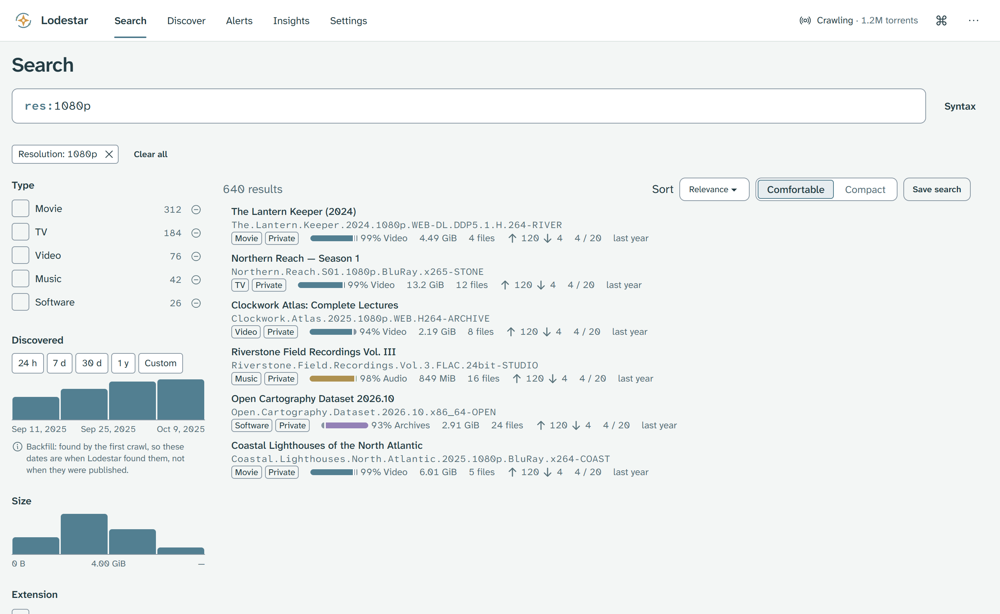
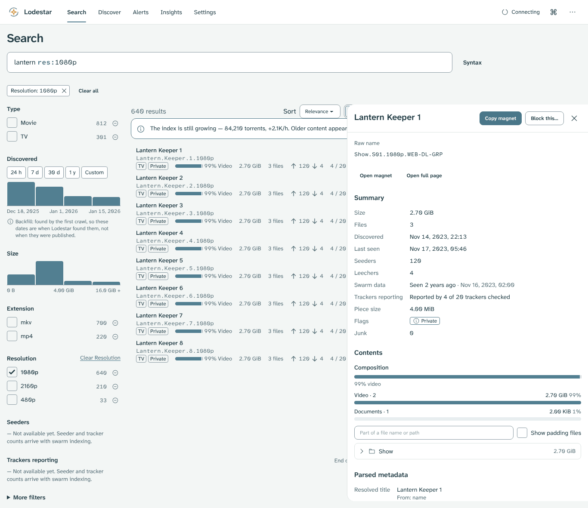
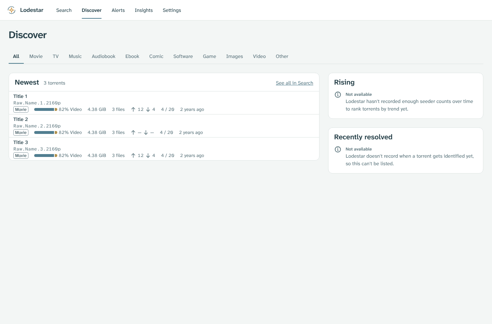
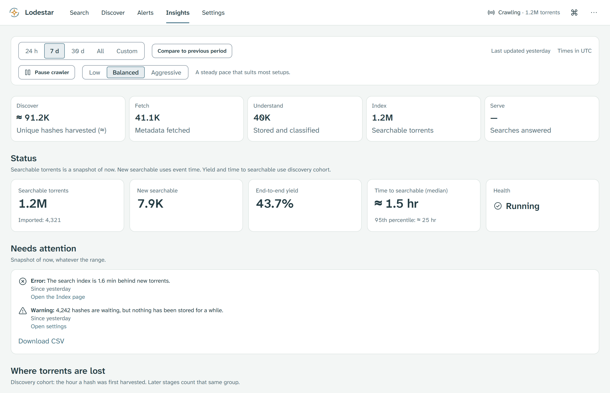
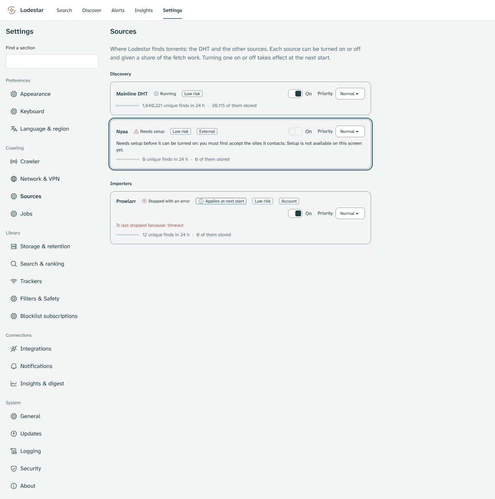
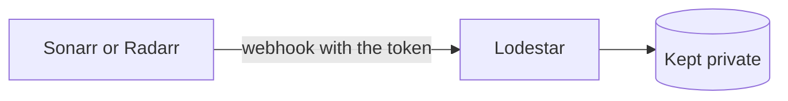

# Chapter 5: Use Lodestar

Once you create the admin password, Lodestar opens to **Search** while the [DHT](glossary.md#dht) crawler collects [metadata](glossary.md#metadata) in the background.

> [!NOTE]
> **What you will learn**
> - Filter results with the facet rail or query tokens on **Search**.
> - Inspect a torrent's file tree and copy its magnet link in the detail drawer.
> - Browse newest discoveries on **Discover** and check pipeline health on **Insights**.
> - Choose which sources Lodestar uses to find torrents in **Settings → Sources**.
> - Connect Sonarr and Radarr so each release they grab reaches Lodestar.

## 5.1 Search and filter
<!-- index: Search; facets; query syntax; composition bar -->

The **Search** screen pairs a query bar with a left-hand facet rail for type, discovery window, size, file extension and language. Each row shows a parsed title, content-type badge, file-composition bar and total size.

<picture>
  <source media="(prefers-color-scheme: dark)" srcset="images/search-dark.png">
  </picture>
*Figure 5.1: The Search screen filtered by resolution, with facet histograms on the left and file composition bars on each row.*

Select any value in the facet rail to include it, or select the minus button beside a count to exclude it. Select **Syntax** beside the search box to view operators such as `res:1080p`, `type:movie` or `ext:mkv`.

## 5.2 Inspect a torrent
<!-- index: detail drawer; magnet link; file tree -->

Select a result row to open its detail drawer on the right without leaving your search results. The drawer shows swarm numbers, piece size, flags and the folder tree inside the torrent.

<picture>
  <source media="(prefers-color-scheme: dark)" srcset="images/detail-dark.png">
  </picture>
*Figure 5.2: The torrent detail drawer showing summary fields, magnet actions and the contents tree.*

Select **Copy magnet** to copy the magnet URI to your clipboard, or **Open full page** to open the torrent at its own URL.

## 5.3 Browse Discover and Insights
<!-- index: Discover; Insights; crawler health -->

**Discover** lists the newest torrents indexed across all categories or within a single tab such as **Movie**, **TV** or **Music**.

<picture>
  <source media="(prefers-color-scheme: dark)" srcset="images/discover-dark.png">
  </picture>
*Figure 5.3: The Discover screen showing recently indexed torrents grouped by category.*

**Insights** shows the live health of the five-stage pipeline: **Discover**, **Fetch**, **Understand**, **Index** and **Serve**, followed by searchable totals and attention notices.

<picture>
  <source media="(prefers-color-scheme: dark)" srcset="images/insights-dark.png">
  </picture>
*Figure 5.4: The Insights overview showing stage status cards, searchable torrent counts and attention items.*

## 5.4 Choose where Lodestar finds torrents (Settings → Sources)
<!-- index: sources; Settings → Sources; source status; source priority; yield bar -->

A [**source**](glossary.md#lodestar-source) is a place Lodestar learns about torrents from. The [DHT](glossary.md#dht) is the one it uses out of the box. This version also lists **Sonarr and Radarr webhooks** (see [section 5.5](#55-connect-sonarr-and-radarr)) and **Torrent cache**, which can't be set up yet. More sources, such as a torrent site, come in later versions. Lodestar still collects [metadata](glossary.md#metadata) only and never downloads torrent content.

To see them, select **Settings**, then **Sources** under **Crawling**.

<picture>
  <source media="(prefers-color-scheme: dark)" srcset="images/sources-dark.png">
  </picture>
*Figure 5.5: The Sources screen, as an illustration. It includes sources that are not in this version. The outlined row is a source that needs setup.*

**Groups.** Sources sit under the kind of work they do: **Discovery**, **Importers**, **Peer finders**, **Enrichment**, **Networks** and **Outputs**. A source with two kinds appears once, under the first.

**Labels.** Each row shows a risk label: **Low risk**, **Medium risk** or **High risk**. Some rows also show a class label:
- **External**: it contacts other sites.
- **Account**: it needs your account details.
- **Restricted** and **Overlay**: it needs your admin password each time you turn it on.

**Status.** Each row has a status with an icon and words:

| Status | What it means |
|---|---|
| **Running** | On, and working now. |
| **On, not running now** | On, and waiting for its next turn. This is normal. |
| **Stopped with an error** | On, but it stopped. The row says why. Lodestar keeps running. |
| **Needs setup** | Off, and it can't be turned on yet. See below. |
| **Paused** | Off, and held as paused. This screen can't pause a source, so you won't normally see it. |
| **Off** | Off. |
| **Purged** | Its data was removed (purge comes in a later version). |
| **Purge unfinished** | A removal of its data didn't finish (purge comes in a later version). |

**Turn a source on or off.** Use the **On** switch on its row.

1. Select the switch. Lodestar saves the change at once, with no **Undo**.
2. The row shows **Applies at next start**.
3. The source starts or stops the next time Lodestar restarts. A restart can include the six-hour DHT wait; see [section 3.8](03-keep-lodestar-safe.md#38-restart-without-the-six-hour-wait).

Until that restart, the status shows your saved choice, not what is running.

**Needs setup.** Some sources must be set up before they can be turned on. Setup means reading and accepting what a source does, accepting the sites it contacts, adding account details, or typing your admin password. Their switch stays off and the row says what is missing. Setting these up is not on this screen yet. It is coming in a later version, so leave those sources off for now.

**Priority.** The **Priority** menu (**Low**, **Normal**, **High** or **Maximum**) sets how much of Lodestar's fetch work a source gets compared with the others. Leave it on **Normal** unless one source is crowding out the rest.

**The yield bar.** The [yield bar](glossary.md#yield-bar) under each row shows how much of what the source found Lodestar stored, over the last 24 hours. The words beside it give the counts: **unique finds**, which are torrents this source reported first, and **of them stored**.

A short bar with a high find count is normal. Many torrents a source hears of never give their metadata, or are removed by the content filters.

> [!IMPORTANT]
> **Recommended:** leave sources that contact other sites (**External**) or need your account (**Account**) turned off unless you need them. Each one sends requests from your connection to a place outside the DHT.

> [!NOTE]
> Changes on this screen are saved at once, and unlike other settings there is no **Undo**. To reverse one, set the switch or menu back. **Priority** applies at once. **On** applies at the next restart.

## 5.5 Connect Sonarr and Radarr
<!-- index: Sonarr; Radarr; webhook; webhook token; Sonarr and Radarr webhooks -->

If you run Sonarr or Radarr, each can tell Lodestar about every release it grabs or imports. It does this with a [**webhook**](glossary.md#webhook): a short message Sonarr or Radarr sends to Lodestar's address. Lodestar keeps the release's hash, title, size and the show's or movie's catalogue numbers. It never keeps the indexer's name, your download client, file paths or addresses.

Everything that comes this way is **private**. Your indexers may be private trackers, so Lodestar never looks these torrents up in the DHT or on public trackers. It never serves them through feeds or shareable exports either.

Each app proves who it is with a **webhook token**: a long secret that only that app knows. Sonarr and Radarr each get their own.

**Step 1: turn the source on.**

1. In Lodestar, select **Settings**, then **Sources** under **Crawling**.
2. Turn on **Sonarr and Radarr webhooks**. It is a plain switch: it contacts no other site.
3. Restart Lodestar. The source starts at the next start. A restart can include the six-hour DHT wait; see [section 3.8](03-keep-lodestar-safe.md#38-restart-without-the-six-hour-wait).

Result: after the restart, its row says **Running**.

**Step 2: make a token.** The Sources screen has no token panel yet; one is coming in a later version **(planned)**. Until then, make the token from a terminal on your home network. In the commands, replace `<server-ip>` with your server's address, and `sonarr` with `radarr` for Radarr.

**On Unraid, Linux or macOS,** use a bash terminal. On Unraid, the **Terminal** button at the top of the web UI opens one.

1. Paste these lines. The `read` line waits for your admin password; type it and press Enter. It doesn't show, and it doesn't go into the shell's history or the list of running programs.

    ```bash
    LODESTAR=http://<server-ip>:8090; APP=sonarr
    read -rs LODESTAR_PW
    umask 077; JAR=$(mktemp)
    body() { printf '{"password":"%s"}' "$(printf '%s' "$LODESTAR_PW" | sed 's/\\/\\\\/g; s/"/\\"/g')"; }
    body | curl -fsS -c "$JAR" -H 'Content-Type: application/json' --data-binary @- "$LODESTAR/api/v1/login" >/dev/null &&
      body | curl -fsS -b "$JAR" -H 'Content-Type: application/json' --data-binary @- "$LODESTAR/api/v1/webhooks/$APP/token"
    rm -f "$JAR"; unset LODESTAR_PW
    ```

**On Windows,** use PowerShell:

1. Paste these lines. A window asks for your admin password; the user name doesn't matter.

    ```powershell
    $Lodestar = 'http://<server-ip>:8090'; $App = 'sonarr'
    $c = Get-Credential -UserName lodestar -Message 'Lodestar admin password'
    $b = @{ password = $c.GetNetworkCredential().Password } | ConvertTo-Json
    Invoke-RestMethod -Method Post -Uri "$Lodestar/api/v1/login" -ContentType application/json -Body $b -SessionVariable s | Out-Null
    Invoke-RestMethod -Method Post -Uri "$Lodestar/api/v1/webhooks/$App/token" -ContentType application/json -Body $b -WebSession $s
    Remove-Variable c, b, s
    ```

Result: Lodestar answers with the integration and a token starting `lsw_`. Copy the token. Lodestar shows it only this once and keeps only a fingerprint of it. Making a new token replaces the old one at once.

If it fails with error 401, the password was wrong. Error 429 means too many wrong tries; wait a minute and try again.

**Step 3: add the connection in Sonarr or Radarr.**

1. In Sonarr or Radarr, go to **Settings → Connect**, select **+**, then **Webhook**.
2. Give it a name, such as `Lodestar`.
3. Turn on **On Grab** and **On Import** (the names vary a little between versions). Leave the others off; Lodestar ignores them.
4. Set **URL** to `http://<server-ip>:8090/api/v1/webhooks/sonarr` (or `…/radarr` for Radarr) and **Method** to **POST**.
5. Set **Username** to anything, such as `lodestar`, and paste the token into **Password**.
6. Select **Test**, then **Save**.

Result: the test succeeds. If it says the source is turned off, go back to step 1. If it fails to log in, check that the token is pasted whole and goes with the right app.

This diagram shows the path a grab takes.



In words: Sonarr or Radarr sends each grab to Lodestar with its token, and Lodestar keeps what it learns as private.

> [!IMPORTANT]
> **Recommended:** keep Sonarr, Radarr and Lodestar on the same home network, and never forward port 8090 on your router. Give each app its own token. If a token leaks, make a new one at once; the old one stops working.

> [!NOTE]
> If Sonarr or Radarr sends more than Lodestar takes at once, or the source is off, Lodestar still answers with success and drops the message. That way the app doesn't pause the connection. Only the **Test** button is told when the source is off.

> [!TIP]
> **Key takeaways**
> - Combine text queries with facet checkboxes or `field:value` tokens on **Search**.
> - Select any row to inspect its file list and copy a magnet link.
> - Open **Insights** to check whether the DHT crawler and index are healthy.
> - Leave **External** and **Account** sources off unless you need them. Source changes are saved at once with no **Undo**, and **On** applies at the next restart.
> - Connect Sonarr and Radarr with one webhook token each, kept on your home network.

<!-- nav:start -->
---

[← Chapter 4: Install on Windows and Linux](04-install-on-windows-and-linux.md) · [Contents](README.md#contents) · [Chapter 6: Troubleshooting →](06-troubleshooting.md)
<!-- nav:end -->
