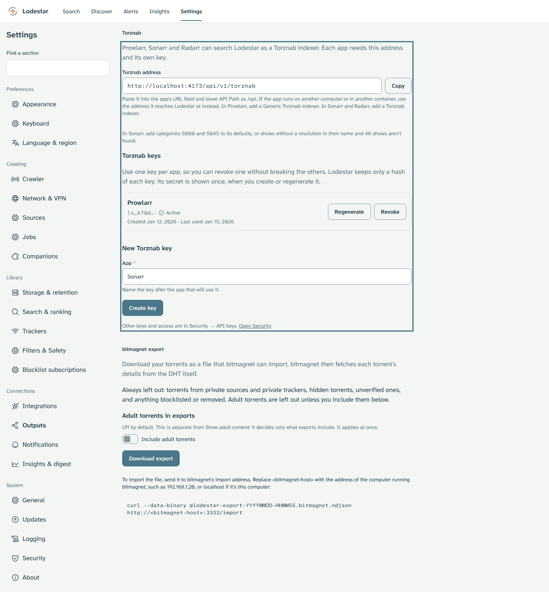
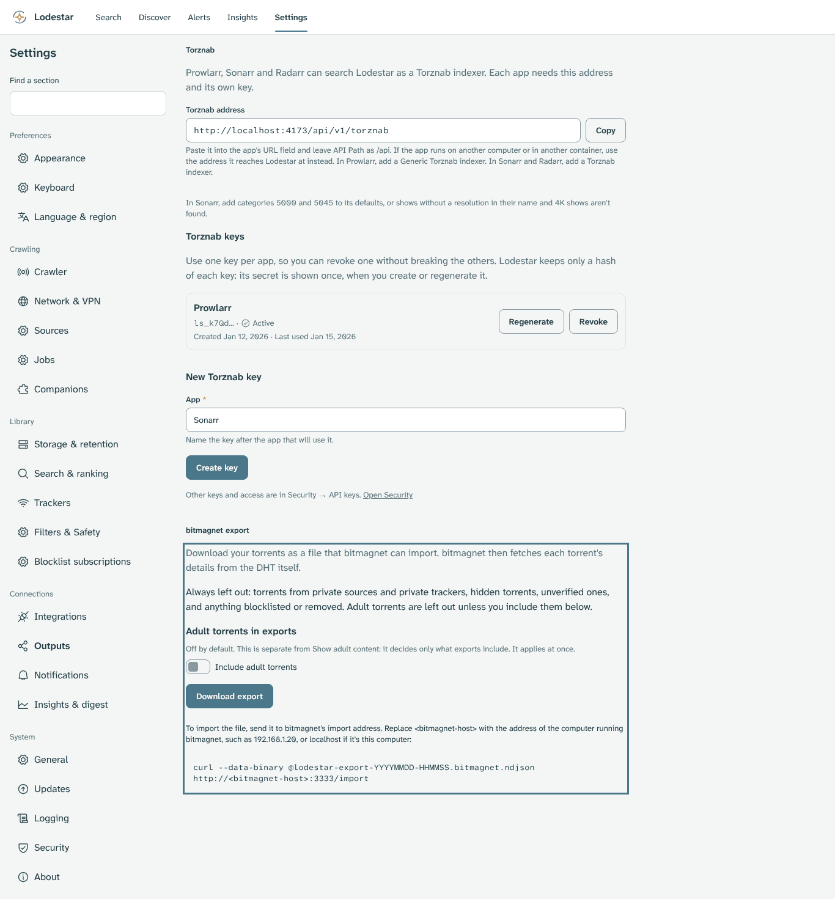

# Chapter 7: Connect other apps

This chapter lets Prowlarr, Sonarr and Radarr search Lodestar, and copies your torrents into [bitmagnet](glossary.md#bitmagnet). Everything in it is **(newer than v0.5.1)**.

> [!NOTE]
> **What you will learn**
> - Create a [Torznab key](glossary.md#torznab-key) for one app and keep it secret.
> - Connect Prowlarr to Lodestar, and Sonarr or Radarr through it.
> - Add the categories Sonarr misses when you connect it directly.
> - Read the errors the apps show, and fix each one.
> - Export your torrents to bitmagnet and check the file is complete.

## 7.1 Know what other apps can take from Lodestar
<!-- index: Outputs; Torznab; bitmagnet export; private source -->

> [!IMPORTANT]
> **(Newer than v0.5.1)** v0.5.1 has no Outputs screen, no [Torznab](glossary.md#torznab) and no API keys. Everything in this chapter needs a newer version.

**Settings → Outputs** holds two ways for other apps to use your index:

- **Torznab**: an address and a key that Prowlarr, Sonarr and Radarr use to search Lodestar, as they search any [indexer](glossary.md#indexer).
- **bitmagnet export**: a file of your torrents that bitmagnet can import.

Both leave out the same things, whatever you ask for:

- torrents from private sources and private trackers;
- hidden torrents (your filter rules apply);
- unverified torrents;
- anything blocklisted or removed.

Adult torrents are left out too. The bitmagnet export can include them when you turn that on (section 7.7). The settings screens have no switch for adult results in Torznab yet **(planned)**.

Torznab results are magnet links only. Your download client needs its [DHT](glossary.md#dht) turned on to fetch them.

## 7.2 Create a Torznab key
<!-- index: Torznab key; API key; password dialog; key rotation -->

A Torznab key lets one app search Lodestar, and nothing else. It isn't your password, and it can't sign in to the web UI or change settings.

Lodestar keeps only a hash of each key, so it shows a key once, when you create it. Make one key per app, named after the app. Then you can revoke one without breaking the others.

<picture>
  <source media="(prefers-color-scheme: dark)" srcset="images/outputs-dark.png">
  </picture>
*Figure 7.1: Settings → Outputs, with the Torznab section outlined. The address in this picture is a test server's; yours shows the address you opened Lodestar at.*

To create a key for Prowlarr:

1. Open Lodestar and go to **Settings → Outputs**.
2. Under **New Torznab key**, check the **App** field. It suggests the first app without a key, such as `Prowlarr`.
3. Select **Create key**.
   **Result:** A dialog asks for your password.
4. Enter your password in **Your password** and select **Create key**.
   **Result:** The dialog **Copy the secret for Prowlarr** shows the key once.
5. Select **Copy**, and paste the key straight into the app (section 7.3 or 7.4), or into a password manager.
6. Select **Done**.
   **Result:** The key is gone from the screen. The list shows **Prowlarr** with the key's first few characters, its status and its dates.

> [!WARNING]
> Treat the key like a password. Keep it only in the app and your password manager, instead of in a screenshot, a log or a support request. If someone could have seen it, regenerate it (section 7.6).

If you lose a key, you can't show it again. Regenerate it instead, and paste the new one into the app.

## 7.3 Connect Prowlarr
<!-- index: Prowlarr; Generic Torznab; API Path; Torznab address -->

Prowlarr is an app that manages indexers for Sonarr and Radarr. Connect Lodestar to Prowlarr once, and Prowlarr passes it on to each app.

| Option | What it means |
|---|---|
| **Through Prowlarr (recommended)** | One Lodestar key, kept in Prowlarr. Sonarr and Radarr reach Lodestar through Prowlarr and get the right categories by themselves. |
| Directly in Sonarr or Radarr | One key per app, and you set the categories yourself (section 7.4). |

The address to use is on **Settings → Outputs**, under **Torznab address**. It looks like `http://<server-ip>:8090/api/v1/torznab`. Here `<server-ip>` is the address of the computer running Lodestar, and `8090` is the web UI port you set when you installed it.

> [!WARNING]
> Prowlarr reaches Lodestar on the web UI port, `8090`. Keep that port off the internet: run Prowlarr on the same network, or reach it over a [VPN](glossary.md#vpn) ([section 3.1](03-keep-lodestar-safe.md#31-keep-the-web-ui-off-the-internet)). Never forward `8090` on your router.

To add Lodestar to Prowlarr:

1. In Prowlarr, open **Indexers** and select **Add Indexer**.
2. Search for **Generic Torznab** and select it.
3. Set **URL** to the **Torznab address** from Lodestar, such as `http://<server-ip>:8090/api/v1/torznab`.
4. Select **Show Advanced**, and check that **API Path** says `/api`. Leave it as it is.
5. Paste your Torznab key into **API Key**.
6. Select **Test**.
   **Result:** Prowlarr reports no error. If it shows one, see section 7.5.
7. Select **Save**.
   **Result:** Lodestar is in Prowlarr's list of indexers. Prowlarr adds it to each Sonarr and Radarr you've connected under **Settings → Apps** in Prowlarr.

Prowlarr passes Lodestar on only to the apps it knows. If you haven't connected Sonarr or Radarr to Prowlarr yet:

1. In Sonarr or Radarr, open **Settings → General** and copy its **API Key**. This key belongs to that app, not to Lodestar.
2. In Prowlarr, open **Settings → Apps**, add Sonarr or Radarr, and paste that key.
3. Select **Test**, then **Save**.
   **Result:** Prowlarr adds Lodestar to that app's indexers by itself.

If you had already added Lodestar to the app directly, delete that indexer there, so the app doesn't search Lodestar twice.

Prowlarr joins the URL and the API Path into one address. With **API Path** at `/api`, it asks Lodestar at `/api/v1/torznab/api`, which is right.

<details>
<summary>Which address do I use when Prowlarr runs in Docker?</summary>

When Prowlarr runs in its own [container](glossary.md#container), a packaged, running copy of an app:

- Use the server's own address, such as `http://192.168.1.20:8090/api/v1/torznab`. `localhost` inside the Prowlarr container means Prowlarr itself, not Lodestar.
- If both containers are on the same custom Docker network, you can use the container's name instead, such as `http://lodestar:8090/api/v1/torznab`.
- If Lodestar runs through gluetun, use the server address and the port you published on gluetun.

</details>

> [!NOTE]
> **Worked example**
> Lodestar and Prowlarr run on an Unraid server at `192.168.1.20`. You create a key named `Prowlarr`, add **Generic Torznab** with **URL** `http://192.168.1.20:8090/api/v1/torznab`, leave **API Path** at `/api`, paste the key and select **Test**. It passes, so you save. Sonarr and Radarr then list Lodestar under their own indexers, added by Prowlarr.

## 7.4 Connect Sonarr or Radarr directly
<!-- index: Sonarr; Radarr; Newznab category; categories 5000 and 5045 -->

Use this only if you don't run Prowlarr. Each app needs its own key (section 7.2), named after it.

To add Lodestar to Sonarr or Radarr:

1. In the app, open **Settings → Indexers**, select **+**, and choose **Torznab**.
2. Set **URL** to the **Torznab address** from Lodestar.
3. Select **Show Advanced**, and leave **API Path** at `/api`.
4. Paste that app's key into **API Key**.
5. In Sonarr only, open **Categories** and add **5000** and **5045** (the next part says why). The list fills in once **URL** and **API Key** are set.
6. Select **Test**, then **Save**.
   **Result:** The app lists Lodestar under its indexers.

Lodestar files each torrent under a [Newznab category](glossary.md#newznab-category), a number such as `5000` for TV. Sonarr's own defaults are only `5030` and `5040`, TV in standard and high definition. So when you connect Sonarr directly, it misses two kinds of show:

| Category | What Lodestar lists there | Sonarr's default |
|---|---|---|
| `5000` TV | Shows whose resolution isn't in the name | Missing: add it |
| `5045` TV UHD | 4K shows | Missing: add it |
| `5030` TV SD, `5040` TV HD | Shows in standard or high definition | Included |

These are category numbers, not ports. Lodestar serves Torznab on its web UI port, `8090` by default.

Radarr's defaults already include `2000` and its subcategories, so it misses nothing. Through Prowlarr, Sonarr also gets `5000` and `5045` by itself.

## 7.5 Read the apps' error messages
<!-- index: invalid credentials; HTTP 401; HTTP 429; HTTP 503; server is unavailable; timed out; no results -->

Prowlarr, Sonarr and Radarr show Lodestar's errors in their own long messages, with the HTTP status in them. Look for the words in the first column.

| The message contains | What it means | What to do |
|---|---|---|
| **invalid credentials**, **Invalid API key**, `401` or `403` | The key is wrong, expired, revoked or regenerated, or it lacks Torznab access | Create a new key on **Settings → Outputs** and paste it into the app |
| `429` or **TooManyRequests** | The app asked too often, or this address tried too many wrong keys | Wait a few minutes. The app pauses Lodestar for a while, then tries again by itself |
| `503` or **ServiceUnavailable** | Search is turned off in Lodestar | Turn on **Enable search** in **Settings → Search & ranking**, then restart Lodestar |
| **timed out**, **Connection refused**, **connection failure** or **DNS** | The app can't reach Lodestar at that address | Check the address and port from the app's computer or container. Inside a container, don't use `localhost` (section 7.3) |
| `404` or **NotFound** | The URL or the API Path is wrong | Set **URL** to the **Torznab address** and **API Path** to `/api` |
| **no results** | Lodestar has nothing in those categories yet | Wait until Lodestar has indexed some shows or movies, then test again |

Keys made on **Settings → Outputs** always have Torznab access. A key from **Settings → Security** without the Torznab scope gets the credentials error.

## 7.6 Regenerate or revoke a key
<!-- index: regenerate key; revoke key; leaked key -->

Regenerate a key when it may have leaked: in a screenshot, a log, a backup you shared, or a message. The old key stops working at once.

To regenerate a key:

1. Go to **Settings → Outputs**, and find the key under **Torznab keys**.
2. Select **Regenerate**.
   **Result:** A dialog says the app finds nothing until you paste the new key, and asks for your password.
3. Enter your password and select **Regenerate key**.
   **Result:** The new key shows once.
4. Select **Copy**, paste the new key into the app's **API Key**, and save there.
5. Select **Done** in Lodestar.
   **Result:** The app's next **Test** passes with the new key.

To stop an app for good, select **Revoke** instead, then **Revoke key**. This can't be undone: to connect the app again, create a new key.

For keys with other access, or any other app's key, open **Settings → Security**.

## 7.7 Export your torrents to bitmagnet
<!-- index: bitmagnet export; Include adult torrents; Jobs; incomplete export -->

bitmagnet is another torrent indexer. The export gives it Lodestar's torrents as a file in bitmagnet's import format. bitmagnet then looks up each torrent on the DHT itself.

### Include adult torrents in exports

The **Include adult torrents** switch on **Settings → Outputs** decides only what exports hold. It's separate from **Show adult content** in Appearance.

**Recommended:** Off, the default. Turn it on only if you're 18 or older and want them in bitmagnet. It asks you to confirm first, because bitmagnet will look each one up on the DHT.

To undo, turn it off again; it asks nothing. Files you already downloaded keep their adult torrents, so delete them if you don't want those in bitmagnet.

### Download the export

<picture>
  <source media="(prefers-color-scheme: dark)" srcset="images/outputs-export-dark.png">
  </picture>
*Figure 7.2: The bitmagnet export section of Settings → Outputs, outlined.*

To export your torrents:

1. Go to **Settings → Outputs**, under **bitmagnet export**.
2. Select **Download export**.
   **Result:** Your browser saves a file named like `lodestar-export-20261112-093015.bitmagnet.ndjson`, and the screen shows the progress.
3. Wait until the screen says **Done** with the number of torrents in the file.
   **Result:** The file is complete.

What the screen says when it ends:

| The screen says | What to do |
|---|---|
| **Done: … torrents in the file.** | Import the file (next part). |
| **The file stopped at the limit of 1,000,000 torrents, so it isn't complete.** | Import what you have. The rest can't come in this file. |
| **The export was cancelled** or **The export failed** | Delete the file, then select **Download export** again. |
| **Lodestar couldn't find this export's progress.** | Open **Jobs** in Settings. If no file downloaded, try again. |
| **Paused at … torrents. Resume it in Jobs.** | Resume it in **Settings → Jobs**, and keep the browser open while it finishes. |
| **Lodestar couldn't update this export's progress. It may still be running.** | Check **Settings → Jobs**. Import the file only once the job shows it's done. |

> [!WARNING]
> Never import a file from a cancelled or failed export. It ends partway through, and nothing inside the file says so: only the screen does.

Exports also appear in **Settings → Jobs**, where you can pause, resume or cancel one.

### Import the file into bitmagnet

bitmagnet takes the file at its import address. On the computer that has the file, open a terminal in the folder with the file, and paste:

```bash
curl --data-binary @<file> http://<bitmagnet-host>:3333/import
```

Replace `<file>` with the file's name, such as `lodestar-export-20261112-093015.bitmagnet.ndjson`. Replace `<bitmagnet-host>` with the address of the computer running bitmagnet, such as `192.168.1.20`, or `localhost` if it's this computer. Replace `3333` if you changed bitmagnet's port.

On Windows, in PowerShell, type `curl.exe` instead of `curl`, and put the file part in quotes, because PowerShell reads `@` itself:

```powershell
curl.exe --data-binary "@<file>" http://<bitmagnet-host>:3333/import
```

Plain `curl` in PowerShell runs a different command that doesn't understand `--data-binary`.

**Result:** bitmagnet prints how many items it imported, then `import complete`.

## 7.8 Check your understanding

1. Why make a separate key for each app instead of sharing one?
2. You connect Sonarr directly and it never finds 4K shows. What do you change?
3. Prowlarr's **Test** reports invalid credentials right after you regenerated the key. What happened, and what do you do?
4. An export ends with **The export failed**. What do you do with the file?

> [!TIP]
> **Key takeaways**
> - Connect Prowlarr, and let it pass Lodestar to Sonarr and Radarr.
> - Leave **API Path** at `/api`, and use the **Torznab address** as the URL.
> - Make one key per app. Regenerate any key that leaks.
> - Connected directly, Sonarr needs categories `5000` and `5045` added.
> - Import a bitmagnet export only after the screen says **Done**.

<!-- nav:start -->
---

[← Chapter 6: Troubleshooting](06-troubleshooting.md) · [Contents](README.md#contents) · [Appendix A: Answers to check your understanding →](appendix-a-answers.md)
<!-- nav:end -->
