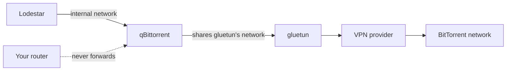
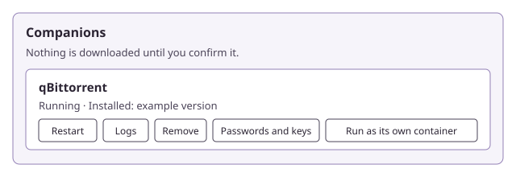

# Chapter 8: Add companions

This chapter sets up the helper programs Lodestar can run beside itself, such as a download client, on Docker, Unraid, Windows and Linux. Everything in it is **(newer than v0.5.1)**.

> [!NOTE]
> **What you will learn**
> - Say what a [companion](glossary.md#companion) is and which one to start with.
> - Name the four safety rules that apply on every platform.
> - Add a companion with Docker Compose, on Unraid, or on Windows and Linux.
> - See what Lodestar finds and sets up for you, and what you still do yourself.
> - Add a companion you already run, and fix the usual problems.

## 8.1 Know what a companion is
<!-- index: companion; qBittorrent; Prowlarr; gluetun; download client; catalogue; Settings, Companions -->

> [!IMPORTANT]
> **(Newer than v0.5.1)** v0.5.1 has no **Settings → Companions** screen and no `lodestar companion` command. Everything in this chapter needs a newer version.

A companion is a separate program that Lodestar works with. Lodestar finds it, configures it and checks that it still answers. It never bundles one inside its own download.

| Companion | What it does | Where it can run |
|---|---|---|
| **qBittorrent** | Downloads the torrents you pick. It's a download client. | Docker, Unraid, Windows, Linux |
| **Prowlarr** | Manages [indexers](glossary.md#indexer) for Lodestar's Prowlarr source. | Docker, Unraid, Windows, Linux |
| **gluetun** | Sends other containers' traffic through your [VPN](glossary.md#vpn). | Docker and Unraid only |

> [!TIP]
> **Recommended:** use **qBittorrent** as your download client. It's the one Lodestar sets up most fully, and the wizard offers it first.

Lodestar stays a [metadata](glossary.md#metadata) index. A companion downloads only when you ask it to.

Lodestar's built-in catalogue lists the companions. It ships inside the program and changes only with a release. A download is offered only when the catalogue holds a checked **SHA-256** for it (a [checksum](glossary.md#checksum)).

In the build this chapter was written against, no entry has its checked download yet. Installs from the app say **This companion isn't available to install yet.** The Compose and Unraid files are refused for the same reason. Until a release pins them, run the companion as its own [container](glossary.md#container), or install it yourself. Today only qBittorrent can then be added to Lodestar (section 8.7).

<details>
<summary>What about FlareSolverr, i2pd and the others?</summary>

Only qBittorrent, Prowlarr and gluetun are in the catalogue today. FlareSolverr (an optional helper for Prowlarr), a Usenet client, i2pd, aMule and Kubo come in later releases **(planned)**. This chapter doesn't cover them.

</details>

## 8.2 Know the safety rules
<!-- index: Docker socket; socket proxy; gluetun route; LAN only; port forwarding; least privilege -->

These four rules hold on every platform. Lodestar's generated files follow them, and you keep to them when you change anything.

1. **No Docker socket.** Lodestar never asks for access to `/var/run/docker.sock`. A container that holds the socket can control every container on the host, which is the same as being root. So on Docker and Unraid, Lodestar *shows* you the companion's service or template and you apply it. A "managed containers" mode that creates containers through a restricted socket proxy is an advanced option, off by default, and **(planned)**. Leave it off even when it arrives, unless you understand the risk.
2. **Companion ports stay on the internal network.** A companion's web page and API port are meant to be reached only by Lodestar. That means the Docker network between them, or `127.0.0.1` on Windows and Linux. Other local programs can reach `127.0.0.1` too, so the companion requires a sign-in there. The files Lodestar generates publish no port.
3. **VPN traffic goes through gluetun.** Where you use a VPN, a companion shares gluetun's network. In Compose that is `network_mode: service:gluetun` (a gluetun service Lodestar prints) or `network_mode: "container:<name>"` (one you already run). On Unraid it is `--network=container:<name>`. The companion then has no route to the internet except the VPN.
4. **A companion's web page never leaves your LAN.** Never forward its port on your router, and never put it behind a public address. For remote access use a VPN ([section 3.1](03-keep-lodestar-safe.md#31-keep-the-web-ui-off-the-internet)).



*Figure 8.1: A companion on the internal network, leaving through gluetun. The router forwards nothing to it.*

In words: Lodestar talks to qBittorrent on the internal network. qBittorrent has no network of its own: it uses gluetun's, so everything it sends goes to your VPN provider. Your router never sends traffic from the internet to it.

Companions run with the least rights that work. A native companion runs as Lodestar's own account, and Lodestar refuses to start one if it runs as root or an administrator. A container companion runs as the `PUID` and `PGID` you give it.

## 8.3 Add a companion with Docker Compose
<!-- index: compose service; lodestar companion compose; network_mode; --gluetun; --gluetun-container -->

Lodestar prints a Compose service for the companion. You read it, paste it into your own Compose file and apply it.

The generated service joins an **existing** Docker network that Lodestar must be on too. Its default name is `lodestar`. Lodestar's own Compose file and Unraid template don't put it on a network of that name, so set that up first:

1. Create the network once: `docker network create lodestar`. On Unraid, open the terminal (the `>_` icon) and run it there. Then open **Settings → Docker** in Advanced View, stop Docker, set **Preserve user defined networks** to **Yes**, and start Docker again. Without that, the network disappears when Docker restarts.
2. Put Lodestar on it. In Compose, add `networks: [lodestar]` to Lodestar's service, and a top-level `networks:` block with `lodestar:` set to `external: true`. On Unraid, set Lodestar's **Network Type** to `lodestar`.

To use another network, name it with `--network <name>` instead.

To print qBittorrent's service:

1. Run the command in the Lodestar container. Replace the two folders with folders on your server, one for qBittorrent's settings and one for its downloads. Both are required for qBittorrent. Prowlarr takes `--config-dir` only, and gluetun takes neither:

   ```bash
   docker exec lodestar /lodestar companion compose qbittorrent --config-dir /srv/qbittorrent --downloads /srv/downloads
   ```

   **Result:** The command prints a Compose service named `qbittorrent`. It runs the pinned image, on the network you named, with those two folders, `Etc/UTC` as its time zone and no published ports.
2. Copy the printed service into your Compose file under `services:`, and copy its `networks:` block to the top level of the file. Compose rejects the service without that block.
3. Start it with `docker compose up -d`.
   **Result:** The container starts and keeps running. Add it to Lodestar with section 8.7. Only qBittorrent can be added there today.

A container that already has the same name stops the new one from starting, so remove or rename the old one first.

The command never starts anything. Keep Lodestar's own data folder out of every folder you give it: run this way, the command can't see where that folder is. It refuses some input:

- a folder that sits inside another companion's appdata folder;
- a folder with a part starting with a dot, such as `.ssh`;
- any value with a `$` in it.

It also refuses when the companion's image isn't pinned yet in your version. The message says **awaiting_pin**. Nothing is written without a pinned image digest.

Useful options:

| Flag | What it does |
|---|---|
| `--puid` and `--pgid` | The user and group the companion runs as. Both default to `1000`. Lodestar refuses `0`, which is root. |
| `--gluetun` | Prints a gluetun service too, and puts the companion on its network. |
| `--gluetun-container <name>` | Routes through a gluetun container you already run, by its container name. |

For a VPN, add `--gluetun` or `--gluetun-container`. The printed gluetun service has placeholders for your VPN settings, each written `FILL_IN_YOURSELF`. gluetun refuses to start until you replace them, and the companion can't start without gluetun, so nothing leaves before you finish. Lodestar never asks for, stores or writes your VPN key.

> [!WARNING]
> **Without** `--gluetun` or `--gluetun-container`, the companion's traffic leaves outside any VPN. Choose one of them if you want it inside one.

The app offers the same choices. Open **Settings → Companions** and select **Run as its own container** on the row. Set **How its traffic leaves** to **Directly (no VPN)**, **Through a new gluetun container** or **Through a gluetun container I already run**. Then select **Compose service**, and **Copy**. The screen warns that **Directly** leaves outside any VPN. Nothing you enter there is stored.

To open a companion's own web page, for example to set qBittorrent's password, add a `ports:` entry for its web port. Use your server's LAN address, such as `"192.168.1.20:8080:8080"`, and never `0.0.0.0`. Never forward it on your router (rule 4), and remove the entry afterwards if you don't need it.

For a companion behind gluetun, publish the port on the gluetun service instead. If you publish qBittorrent's peer port, don't use `6881` on the same host as Lodestar's own [DHT](glossary.md#dht) port, which is [UDP](glossary.md#udp) `6881`.

<details>
<summary>Why not let Lodestar start the container itself?</summary>

To start a container, Lodestar would need the Docker socket (rule 1 in section 8.2). Anything that can reach the socket can start a container with the whole host disk in it. That isn't a risk worth taking for a download client, so Lodestar shows you the file and you apply it.

</details>

> [!NOTE]
> **Worked example**
> You run Lodestar and gluetun with Compose. You run `docker exec lodestar /lodestar companion compose qbittorrent --gluetun-container gluetun --config-dir /srv/qbittorrent --downloads /srv/downloads`. The printed service has `network_mode: "container:gluetun"`, so qBittorrent has no network of its own. You paste it, run `docker compose up -d` and add it in Lodestar by its **Address**. Because qBittorrent now lives inside gluetun, the address is gluetun's, such as `http://gluetun:8080`, and gluetun must be on Lodestar's network.

## 8.4 Add a companion on Unraid
<!-- index: Unraid template; templates-user; Add Container; Community Applications -->

On Unraid, Lodestar gives you the companion's template with every field filled in. You save it and Unraid reads it.

Unraid can't open a template from a link that fills in the form. It reads a template only from a file saved on the Unraid flash drive. So you save the file first, in Unraid's own **templates-user** folder.

The template joins a Docker network named `lodestar` (or the one you choose) that must exist and that Lodestar must be on. Set that up as in section 8.3.

To add qBittorrent:

1. In Lodestar, open **Settings → Companions**.
2. On the qBittorrent row, select **Run as its own container**.
3. Under **How its traffic leaves**, choose how it reaches the internet:
   - **Directly (no VPN)**;
   - **Through a new gluetun container**;
   - **Through a gluetun container I already run**, then type **gluetun container name**.
4. Set **Settings folder on the host** and **Downloads folder on the host**. For qBittorrent, both are required, although the screen says they are optional. Put them on the [cache pool](glossary.md#cache-pool), such as `/mnt/cache/appdata/qbittorrent`, as [section 2.2](02-install-lodestar-on-unraid-and-docker.md#22-settings-in-the-unraid-template) does.
   Never use Lodestar's own appdata folder, such as `/mnt/cache/appdata/lodestar`, or a folder inside it. It holds its secrets, and Lodestar can't check this from inside its container.
5. Select **Unraid template**.
   **Result:** Lodestar shows the template file, such as `my-qbittorrent.xml`, with **Copy**, and a line **In Unraid, open:** with a path.
6. Save the file in `/boot/config/plugins/dockerMan/templates-user/` on the Unraid server. The easiest way is the `flash` share from another computer: `\\<server>\flash\config\plugins\dockerMan\templates-user`. Use the exact file name Lodestar showed.
7. In your browser, put your Unraid server's address in front of the path from step 5, such as `http://tower` followed by the path. Or open **Docker → Add Container** and pick the template under **Template**.
   **Result:** Add Container opens with the form filled in.
8. Review the form, then select **Apply**.
   **Result:** Unraid creates the container. Add it to Lodestar with section 8.7. Only qBittorrent can be added there today.

To open the companion's own web page, add a **Port** for its web port in the template form, on your LAN only. Never forward it on your router. Remove it afterwards if you don't need it.

If you chose a new gluetun, Lodestar shows two files, gluetun's first. Apply gluetun's first and fill in its VPN settings. The companion's template shares gluetun's network, so that container must exist already. Before you apply gluetun's, save Lodestar's post-rules file, as [Close gluetun's gap when the VPN drops](03-keep-lodestar-safe.md#close-gluetuns-gap-when-the-vpn-drops) shows. Without the file, gluetun won't start. Once both templates are applied, set the start order, as the same section shows.

Saving a template replaces one of the same name. Applying it replaces the container of that name, with its settings. To keep a gluetun you already run, choose **Through a gluetun container I already run**.

If you'd rather fill the form by hand, Lodestar also shows each field and its value to copy.

> [!NOTE]
> **Worked example**
> Your Unraid server already runs gluetun. In **Settings → Companions**, you choose **Through a gluetun container I already run**, enter `gluetun` and select **Unraid template**. You save `my-qbittorrent.xml` into `templates-user`, open the path Lodestar showed, check the form and apply it. The container starts with `--network=container:gluetun`.

## 8.5 Add a companion on Windows or Linux
<!-- index: managed companion; supervised; lodestar companion install; lodestar companion remove; Install dialog; Job Objects; Landlock -->

When Lodestar runs directly on Windows or Linux, it can install a companion itself. It then starts and stops it as a **child process**: a program that Lodestar launches and watches. Lodestar also caps what it can use. That is a Job Object on Windows, and resource limits on Linux, with a Landlock sandbox where the kernel supports it. On Windows a companion can still read Lodestar's data folder.



*Figure 8.2: Settings → Companions, one companion's row. An illustration, not a capture: the labels come from the app and the version is an example.*

Each install asks you first. Lodestar shows what it will download and does nothing until you confirm. Today no download is pinned (section 8.1), so these steps are refused until a release pins one.

> [!IMPORTANT]
> Lodestar installs only what the catalogue lists, only from the hosts the catalogue lists, and only when the file's SHA-256 matches the pinned one. A file that doesn't match is refused.

Where Lodestar runs in a container, it can't install a companion itself. Use section 8.3 or 8.4 instead.

### Install from the app

1. Open **Settings → Companions**.
2. On the companion's row, select **Set up**, or **Update** if it's installed and a newer version is offered.
   **Result:** The dialog **Install qBittorrent?** shows **Program**, **Version**, **Licence**, **Download size**, **SHA-256 checksum** and **Where it runs**. Nothing is downloaded yet.
3. Read the details, then select **Install**.
   **Result:** Lodestar downloads the file, checks it, installs it into its own folder, generates a random password, configures the companion and starts it. The row's status turns **Running**.

The first-run wizard has the same step, under **Download client**: select **Install qBittorrent for me**, check the details and select **Confirm and install**. Select **Not now** to skip it. The wizard offers this only where Lodestar can install it itself, which means native Linux, not Windows, Docker or Unraid.

The terminal commands are below. Today `install` answers `awaiting_pin` and shows nothing to confirm, because no build is pinned. Once a release pins one, the terminal still can't start companions (`not_wired`), so install from the app.

```bash
lodestar companion list
lodestar companion install qbittorrent
lodestar companion install qbittorrent --sha256 <the SHA-256 it showed>
lodestar companion remove qbittorrent
lodestar companion remove qbittorrent --yes
```

- Without `--sha256`, `install` only shows what it would install, with its SHA-256, size and licence. Run it again with `--sha256` and that exact value to confirm. There's no `--yes`: you type the hash.
- Without `--yes`, `remove` only shows what it would delete. Run it again with `--yes` to delete it.
- `list`, `install` and `remove` need Lodestar stopped. `compose` doesn't. See [`docs/operations.md`](../operations.md#10-the-command-line) for the command line.

### What Lodestar keeps an eye on

Lodestar checks each companion's health every 30 seconds. After three failed checks it restarts it, waiting 1 second, then 2, doubling up to 5 minutes. After five crashes within 10 minutes it stops restarting it. The row then shows **Not responding**. Select **Restart** to try again. **Logs** shows its recent output, with passwords removed.

### Install qBittorrent on Windows

The only official qBittorrent for Windows is an installer. It needs an administrator and runs as a desktop program, and Lodestar's service is neither. So **Lodestar never downloads or runs this installer.** You install qBittorrent yourself, and Lodestar takes over after that:

1. Download qBittorrent from `https://www.qbittorrent.org/download`.
2. Install it and start it.
3. In qBittorrent, open **Tools → Options → Web UI** and turn on **Web User Interface (Remote control)**. Then:
   - set **IP address** to `127.0.0.1`, so only this computer can reach it (the default `*` opens it to your whole network), and keep **Port** `8080`;
   - keep the user name `admin`, which Lodestar always signs in as;
   - set a long, unique password from a password manager;
   - leave **Bypass authentication for clients on localhost** off.
4. If Windows Firewall asks about qBittorrent, allow **Private networks** only, or select **Cancel**. Lodestar reaches it on `127.0.0.1`.
5. In Lodestar, follow section 8.7. Lodestar finds qBittorrent at `http://localhost:8080`.

Lodestar is tested with qBittorrent 4.6.0 to 5.2.x. When its set-up step arrives **(planned)**, it will refuse a version outside that range.

On the qBittorrent row, the message says **This one is set up through the guided setup, not downloaded by Lodestar.** That is expected.

### Remove a companion

1. Open **Settings → Companions** and select **Remove** on the row.
   **Result:** The dialog **Remove qBittorrent?** lists the **Folder** and the **Saved setting** rows it will delete.
2. Select **Remove** in the dialog.
   **Result:** The companion stops, and its folder and those rows are deleted. The download client Lodestar set up for it in **Settings → Integrations** goes too. Nothing else changes.

The terminal `remove` command doesn't remove that download client. Use the app, or remove it by hand in **Settings → Integrations**.

A companion folder lives under `companions/<name>` in Lodestar's data folder.

## 8.6 See what Lodestar finds and sets up
<!-- index: detection; auto-configuration; categories; save path; Prowlarr; hand-over; managed download client -->

However you installed a companion, Lodestar can find it, set it up and keep checking it.

**Where Lodestar looks.** Only these places, and nowhere else:

- `127.0.0.1`, then `::1`, on the companion's usual port: `8080` for qBittorrent, `9696` for Prowlarr and `8000` for gluetun;
- the container names `qbittorrent`, `prowlarr` and `gluetun` on Docker's network, on the same ports (only when Lodestar itself runs in Docker);
- one address you type yourself.

It never scans a range or a subnet. A probe never sends a password.

**What Lodestar sets up on a companion it installed:**

| Companion | Lodestar sets |
|---|---|
| **qBittorrent** | A random password, replacing the one it came with. The default save path and categories. Local sign-in is required, so a program on the same computer must sign in too. The web page's listening address. The network interface or address, when you route it through a VPN on Windows or Linux. |
| **Prowlarr** | Its proxy: on to follow a SOCKS5 VPN route, off for a direct route. Nothing else. |
| **gluetun** | Nothing. Lodestar only checks that it answers. |

Lodestar also makes the qBittorrent it installed your managed download client, in **Settings → Integrations**.

For a companion you run yourself, the app today records its address and checks its health. Configuring it for you (replacing its password, setting its categories and making it your download client) is not in the app yet **(planned)**. Set those in the companion, and add it as a download client by hand in **Settings → Integrations**.

**What you still do yourself:**

- fill in your VPN settings in gluetun;
- choose the folders companions use;
- add indexers in Prowlarr;
- forward a peer-to-peer port on your router, if you choose to. Lodestar's generated files publish no port, so on Docker you publish it yourself in the Compose file or template. Never do that on a companion that shares gluetun's network. Never forward a companion's web page port.

A companion's route (direct or through a VPN) is copied from the source that needs it when it first starts. A later change to that source's route doesn't reach it: it keeps the route it started with. Where a companion's route uses a SOCKS5 proxy, three things bypass it:

- email notifications connect directly, so leave them off;
- a FlareSolverr pairing leaves directly, so don't pair them;
- per-indexer proxies you add in Prowlarr bypass the route.

The screen says the same under **If this companion's route uses a SOCKS5 proxy**.

**Passwords and keys.** A companion Lodestar installed has a generated password or key. To see it, select **Passwords and keys** on the row, then **Show**, enter **Your Lodestar password** and select **Show it**. Lodestar asks every time and never remembers it. The value stays until you select **Hide**.

**Make a new one** replaces it at once, so anything using the old one needs the new one. Treat it like a password. A password you pasted yourself is never shown back.

## 8.7 Add a companion you already run
<!-- index: Companions you already run; Look for companions; hand-over; guided; temporary password -->

Use this for a qBittorrent you started yourself (section 8.3, 8.4 or the Windows installer), or one you run on another computer. The app records where it is and checks its health.

> [!IMPORTANT]
> Today only qBittorrent can be added here. Prowlarr and gluetun answer **This can't be done yet.** **(planned)**. To use Prowlarr, add it as a source in **Settings → Sources** instead ([Chapter 7](07-connect-other-apps.md) covers the other direction).

1. Open **Settings → Companions** and scroll to **Companions you already run**.
2. Select **Look for companions**.
   **Result:** Lodestar lists each companion it found, such as **Found qBittorrent**, or **None found.**
3. Select **Add qBittorrent** next to the one you want.
   If nothing was found, or the companion is on another computer, choose it under **Companion** instead, type its **Address**, such as `http://192.168.1.20:8080`, and select **Add**. Lodestar checks that the right program answers there.
   **Result:** The companion appears in the list with its health.

On Windows, the qBittorrent row also has **Passwords and keys**. Open it, paste the password you set in qBittorrent under **Temporary password for qBittorrent**, and select **Save**. The message **Saved. It isn't shown again.** appears, and Lodestar keeps the password sealed. The password field appears only for qBittorrent on Windows. Replacing it with a random one is not in the app yet **(planned)**.

> [!WARNING]
> Only add an address you trust. Lodestar refuses addresses it can't use safely, with **That address can't be used.**

If Lodestar installed qBittorrent for you, you don't need this section. Lodestar says **Lodestar installed this one itself, so this isn't needed.**


## 8.8 Fix a problem
<!-- index: companion not detected; credentials refused; port in use; Needs setup; Set up chip -->

A source that needs a companion that isn't there shows **Needs qBittorrent** with **Set up** under **Settings → Sources**, instead of failing. Select **Set up** to open the install dialog in place. If the companion is installed but silent, the source shows **qBittorrent isn't responding**; open **Settings → Companions** and select **Restart**.

| Problem | What to do |
|---|---|
| **None found.** after **Look for companions** | The companion may not be on its usual port or may be on another computer. Behind gluetun, the companion's own name doesn't answer, so type gluetun's address. Choose it under **Companion**, type its **Address**, and select **Add**. In Docker, check that Lodestar and the companion share a network: Lodestar finds a container by its name on Docker's network. |
| **That program didn't answer there.** | The address or port is wrong, or the program isn't running. Check that the program is running and that its web interface is on. In a container, the address works only inside the Docker network, so you can't test it from your browser unless you publish its port on your LAN (section 8.3). |
| **The companion didn't answer.** | The program is stopped or still starting. Wait a minute, then try again. |
| **The companion refused the saved password.** | The password changed outside Lodestar. Reset the password in the companion, then add it again with section 8.7. |
| **That password isn't right.** | You typed the wrong **Your Lodestar password** for **Show**. That is your Lodestar admin password, not the companion's. |
| **Too many tries. Wait a few minutes and try again.** | Lodestar limits how often you can try a password. Wait, then try again. |
| **This can't be done yet.** | Only qBittorrent can be added under **Companions you already run** today. |
| **Lodestar is using a download client you set up yourself.** | You already added a download client by hand. Remove it in **Settings → Integrations**, then install qBittorrent from Lodestar again. |
| A port is already in use | A companion Lodestar installed always uses its usual port on this computer, `8080` or `9696`, and can't be moved. Find the other program, stop it or move it, then select **Restart**. On Windows run `netstat -ano \| findstr :8080`. On Linux run `ss -ltnp`. |
| **This companion isn't available to install yet.** | This version of Lodestar has no checked download for it. Run it as its own container (section 8.3 or 8.4), or install it yourself and use section 8.7. |
| **Lodestar is running in a container, so it can't install this program itself.** | Run the companion as its own container (section 8.3 or 8.4). |
| **This program isn't available for this computer.** | There's no build for your system. Install it yourself and use section 8.7. |
| **Something else is changing this companion. Try again in a minute.** | An install or restart is running. Wait for it to finish. |
| **What you confirmed no longer matches what's on offer.** | Nothing was changed. Open the install dialog again to see the new details. |
| **The download client refused that.** | Check qBittorrent's settings and try again. |

> [!TIP]
> If a companion keeps stopping, select **Logs** on its row. If you share the output, check it first: the log shows only what the companion printed, with passwords removed.

## 8.9 Check your understanding

1. Why does Lodestar show you a Compose service instead of starting the container itself?
2. You want to reach qBittorrent's web page while you're away from home. Should you forward its port on your router?
3. Which companion do you recommend as a download client, and why do you confirm each install?
4. **Look for companions** says **None found.** while qBittorrent is running on another computer. What do you do?

> [!TIP]
> **Key takeaways**
> - A companion is a separate program. Start with qBittorrent as your download client.
> - Four rules hold everywhere: no Docker socket, internal-network ports, VPN through gluetun, and a web page that never leaves your LAN.
> - On Docker and Unraid, Lodestar shows the file and you apply it. On Windows and Linux it installs, starts and watches the companion once you confirm.
> - Lodestar looks only at the usual ports, container names and one address you type. You fill in VPN settings, folders and indexers.
> - Passwords are random and shown only after you re-enter your Lodestar password.

<!-- nav:start -->
---

[← Chapter 7: Connect other apps](07-connect-other-apps.md) · [Contents](README.md#contents) · [Appendix A: Answers to check your understanding →](appendix-a-answers.md)
<!-- nav:end -->
